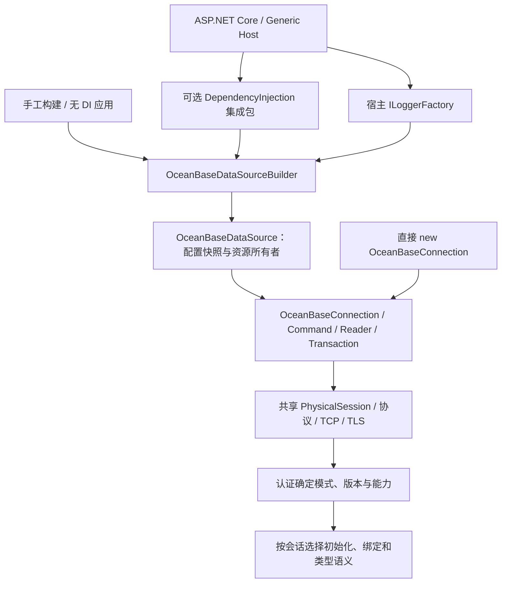
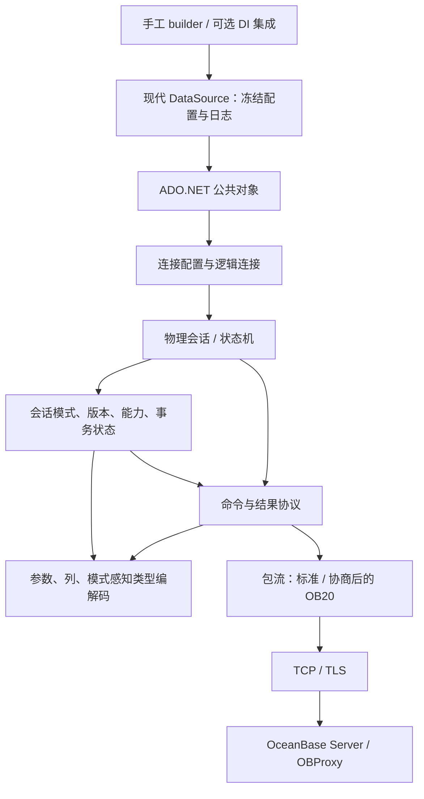

# OceanBase Connector for .NET 架构设计

状态：设计基线，A 阶段及 B01–B09、C02 已有本地实现/审核证据，C03数值、纳秒、TZ/LTZ和MySQL零日期、C04顺序字段流及服务端游标、C05数据库切换及首批四个目录集合已有本地实现；A05 的可信 MySQL 判定仍是实现缺口，§9 产品决定和真实兼容性未关闭。日期：2026-10-19。实施任务见 [开发方案](obconnector-dotnet-development-plan.md)，证据见 [进度台账](obconnector-dotnet-progress.md)。.NET 接入已合并到 §2.1–§2.7；参数化、reader 字段元数据、本地事务及取消/超时已有本地实现，B09 补齐标量 ProviderType 和命令日志类别。目录元数据真实验收仍开放，池化仍因完整重置证据不足而阻塞。

## 1. 目标与依据

构建直接连接 OceanBase Server 或 OBProxy 的托管 .NET 数据库驱动，向应用提供标准 ADO.NET provider，同时支持 OceanBase 的 MySQL 和 Oracle 兼容模式。首个正式版本应能安全地完成连接、参数化执行、结果读取、事务和常见类型往返；后续按依赖顺序补齐 Java 驱动中确有实现的扩展能力。这里的“支持”必须由指定服务端版本和真实数据库测试证明，不能由 Java 源码中存在某个类推定。

依据是 [Java 架构提纲](obconnector-j-architecture-outline.md) 所记录的 `obconnector-j` 提交 `6adc311ba5db8b2f19f98f3e6e4734667fdfdda1`（2.4.14）；本次另核对了该提交的握手模式识别、能力协商、服务端预处理条件、类型映射及事务中重连路径。提纲中有关 Go `database/sql`、Go 设计文档的文字不属于本设计的 .NET 结论。Java 工程采用 LGPL-2.1；可以用它分析行为和协议，但移植源码前必须单独审查许可证和归属，本设计不授权复制实现。

### 设计目标

- 一个 provider 和一条共享连接/命令协议主链，在会话上携带兼容模式；没有“Oracle 驱动”和“MySQL 驱动”两套传输实现。
- `netstandard2.0`、`netstandard2.1`、`net8.0`、`net9.0`、`net10.0` 可消费同一个 NuGet 包；标准 ADO.NET 行为在五个目标上一致，现代 API 仅在对应目标出现。
- 真正异步的网络 I/O、可取消操作、明确的资源所有权；在网络中断、事务中断和取消时不猜测 SQL 是否执行成功。
- 默认保护凭据和连接，协议、服务端版本及功能可用性都有显式验证边界。

### 非目标

- 不连接原生 Oracle 或 MySQL 产品，不提供 SQL 方言翻译器，也不复制 JDBC 历史类名和 Java SPI；EF Core provider 是独立生态层，不属于本驱动首版。
- 不在首个可用里程碑实现 Java 的所有选项、HA 拓扑、XA、复杂类型或诊断插件。
- 不声称所有 OceanBase 版本、所有部署模式都兼容；发布时维护经过实测的组合矩阵。

## 2. 运行目标和公开契约

单个核心 provider 工程和包，`TargetFrameworks=netstandard2.0;netstandard2.1;net8.0;net9.0;net10.0`；另设可选 `OceanBaseConnector.DependencyInjection` 集成包，目标为 `net8.0;net9.0;net10.0`，不按兼容模式拆包。核心引入标准日志抽象，两个Standard资产另通过DiagnosticSource提供诊断API；不依赖容器实现或日志后端。仓库统一使用 NuGet 中央包管理(CPM):根目录 `Directory.Packages.props` 以 `ManagePackageVersionsCentrally` 固定全部包版本并开启传递依赖钉扎,任何工程不得在自身 `PackageReference` 上内联 `Version`;产品及未来所有程序集的包版本统一由根 `Directory.Build.props` 的 `Version` 属性给出,csproj 内不得声明各自版本；核心和集成包同版本统一发布并验证包间依赖。`netstandard2.0` 是最低 API 基线,不等于保证每一个实现该标准的旧运行时都已通过集成测试。项目以 .NET 10 SDK 和 `OceanBaseConnector.slnx` 构建五目标；全部测试及消费宿主统一使用 `net10.0`，`global.json` 约束 SDK 主版本；旧运行时的专门消费验证保留为 B09/R01 发布验收;正式支持的运行时遵循微软生命周期,.NET 9 已结束官方支持时仍可提供目标资产,但不承诺修复其运行时本身的问题。若现代目标没有需要独立实现的 API,优先共享源码和行为,不分叉协议栈。

| 范围 | 建议类型 / 行为 |
| --- | --- |
| 标准入口 | `OceanBaseConnection : DbConnection`、`OceanBaseCommand : DbCommand`、`OceanBaseParameter : DbParameter`、`OceanBaseDataReader : DbDataReader`、`OceanBaseTransaction : DbTransaction`、`OceanBaseProviderFactory : DbProviderFactory` |
| 连接配置 | `OceanBaseConnectionStringBuilder : DbConnectionStringBuilder`；在提供 `DbProviderFactories.RegisterFactory` 的运行时由应用显式注册，旧运行时按其 provider 注册机制处理，不在程序集加载时修改全局状态 |
| 现代目标 | B01 提供 `OceanBaseDataSourceBuilder`、`OceanBaseDataSource : DbDataSource` 及 factory 的 `CreateDataSource`，先支持无池建连；C06 已本地实现 `OceanBaseBatch : DbBatch`、`OceanBaseBatchCommand` 和集合，connection/factory 的 `CanCreateBatch=true`。`netstandard2.0`/`netstandard2.1` 不暴露这些平台 API，也不补造同名平台类型；其继承能力保持不支持 |
| 宿主接入 | B01 的可选 DI 包提供普通/带 key 的统一数据源注册，容器工厂创建 Singleton 数据源并接入宿主 `ILoggerFactory`；应用按操作创建/释放连接，默认不注入连接、命令或 reader。无 DI 的 builder 和直接连接入口继续可用；生命周期和注册冲突规则见 §2.4–§2.5 |
| 异步 | `netstandard2.0`/`netstandard2.1` 覆写带 `CancellationToken` 的 `OpenAsync`、`ExecuteNonQueryAsync`、`ExecuteScalarAsync`、受保护的 `ExecuteDbDataReaderAsync`、`ReadAsync`、`NextResultAsync`；`netstandard2.1` 与现代目标还覆盖其参考 API 已有的 `PrepareAsync`、受保护的 `BeginDbTransactionAsync`（公开的 `BeginTransactionAsync` 委托给它）、`CommitAsync`、`RollbackAsync`，以及连接、命令、reader 和事务的 `DisposeAsync`、连接及 reader 的 `CloseAsync`；`netstandard2.0` 参考 API 没有这些入口。关闭或释放需要读包、回滚或池重置时，2.1 与现代目标共用真正异步的清理实现。C 阶段的 `ChangeDatabaseAsync` 同样覆盖 2.1 与现代目标；`GetSchemaAsync` 和 `DbBatch.Execute*Async` 仅在提供对应 API 的现代目标覆盖。网络层用异步读写；同步入口使用同步 I/O，共享编码、状态机和错误映射，不以同步等待异步任务充数，也不依赖基类调用同步方法的默认异步实现 |
| 扩展 | 仅对 ADO.NET 无法表达且已实现的 OceanBase 类型/能力增加 `OceanBaseDbType`、provider-specific 值或显式方法；扩展不替代标准 `DbType`、`ParameterDirection`、`GetSchemaTable` |

名称和 NuGet ID 暂按 `OceanBaseConnector` 工作名；发布前检查商标、包名可用性和授权。连接串不要求 JDBC URL 兼容。最小键为 `Server`、`Port`、`User ID`、`Password`、`Database`、`Connection Timeout`、`Command Timeout`、`TLS Mode`；同义词须少且有测试。未知或冲突选项报错。连接串 builder 为创建连接必须能序列化密码，因此调用方应保护其输出；已打开连接的公开 `ConnectionString` 及现代 `DbDataSource.ConnectionString` 默认隐藏凭据，只有显式 `Persist Security Info=true` 才允许保留。异常和日志始终隐藏凭据。Oracle 模式的 `Database`/schema 语义需要按服务端实际行为定义，不通过连接串强行指定会话模式；可提供 `ExpectedMode` 校验配置，若服务端模式不符则在打开连接时失败。

`TLS Mode` 拟以 `VerifyFull` 为默认值，校验证书链和主机名；`Required` 表示加密但不验证身份，`Disabled` 表示明文，两者必须显式选择。五个目标均使用操作系统信任根；私有 CA 需先安装到运行环境的受信根中。`netstandard2.0` 没有 `X509ChainPolicy.CustomTrustStore`，因此首版不暴露行为不一致的独立 PEM 根证书参数；需要它时先设计并验证跨目标一致的证书链校验。默认以当前连接端点的 DNS 名称校验证书并用于 SNI；以 IP 连接 OBProxy、证书却签给 DNS 名称时，可显式设置 `TLS Server Name`，仍须用此名称完成证书验证，多地址场景要求所有目标都为该名称提供有效证书，否则逐地址使用可验证的 DNS 名称。TLS 握手失败不得回退明文，证书错误也不得自动降级为 `Required`。认证方式按服务端握手协商，首个里程碑只承诺经两种模式真实环境验证的插件；未知插件明确失败，cleartext 类认证只允许在已验证的 TLS 通道上发送。该默认值与证书配置是 .NET 新驱动的设计决定，可能与 Java 默认值不同。

### 2.1 参考依据与取舍

| 依据 | 已核对事实 | 本设计采用的边界 |
| --- | --- | --- |
| `obconnector-j`，提交 `6adc311ba5db8b2f19f98f3e6e4734667fdfdda1` | `OceanBaseDataSource.getConnection()`、`OceanBaseConnection.newConnection()` 共用连接路径；`AbstractConnectProtocol` 在认证 OK 后记录 `isOracleMode`，并据此处理会话初始化和协议差异 | 统一 provider、连接、命令、结果与事务类型；模式、版本、能力保留在物理会话。Java 是协议与模式行为的主要参考，JDBC、XA、日志工厂不直接翻译成 .NET 公共 API |
| Npgsql 10.0.0 | builder 提供 `UseLoggerFactory`；DI 扩展在容器工厂中构建数据源，取得宿主 `ILoggerFactory`；默认数据源 Singleton、连接 Transient，并支持带 key 的注册 | 参考 .NET 的构建入口、宿主日志和资源所有权。首版默认只注册数据源，由操作显式创建/释放连接，不照搬全部连接注入与生命周期选项 |
| 本地 `oceanbase-dotnet`，提交 `b9dd14f7c0ea26a29a244c113c5dbe059a07eb9c` | 有独立 DI 工程和 builder 的 `UseLoggerFactory`；但 MySql/Oracle 数据源与注册入口分开，且扩展使用 `AddSingleton(builder.Build())` 实例注册 | 仅参考独立集成包、builder 日志入口。实例注册不会把实例释放责任交给内置容器，不能沿用其所有权方式；不采用双模式分离结构或可变全局日志配置 |

源码定位：Java [`OceanBaseDataSource`](https://github.com/oceanbase/obconnector-j/blob/6adc311ba5db8b2f19f98f3e6e4734667fdfdda1/src/main/java/com/oceanbase/jdbc/OceanBaseDataSource.java#L271)、[`OceanBaseConnection`](https://github.com/oceanbase/obconnector-j/blob/6adc311ba5db8b2f19f98f3e6e4734667fdfdda1/src/main/java/com/oceanbase/jdbc/OceanBaseConnection.java#L393)、[`AbstractConnectProtocol`](https://github.com/oceanbase/obconnector-j/blob/6adc311ba5db8b2f19f98f3e6e4734667fdfdda1/src/main/java/com/oceanbase/jdbc/internal/protocol/AbstractConnectProtocol.java#L823)；Npgsql [`DI 工厂及默认生命周期`](https://github.com/npgsql/npgsql/blob/v10.0.0/src/Npgsql.DependencyInjection/NpgsqlServiceCollectionExtensions.cs#L354)、[`builder 日志入口`](https://github.com/npgsql/npgsql/blob/v10.0.0/src/Npgsql/NpgsqlDataSourceBuilder.cs#L99)；本地参考 `D:/dotnet-code/oceanbase-dotnet/src/OceanBase.DependencyInjection/OceanBaseServiceCollectionExtensions.cs` 及 `src/OceanBase/Logging/MySqlConnectorLoggingConfiguration.cs`。以上只证明参考源码行为，不证明本项目已支持这些功能。

### 2.2 同一 provider，两层接入



DI 只装配应用级对象。`PhysicalSession`、包流、认证处理、命令和 reader 不注册为容器服务，底层不接收 `IServiceProvider`，也不根据注册名称选择兼容模式。不新增 `MySqlConnection`/`OracleConnection`、两套数据源、两套注册扩展或自定义 `IOceanBaseConnection` 抽象。差异落在现有会话状态和对应协议处理位置，确有多处重复时再提取内部共享逻辑。

一个应用访问两种模式的租户时，使用两个独立配置的数据源，但公共类型和协议实现相同。DI key 标识应用中的数据源用途，不代表服务端模式；每个物理连接仍独立认证、校验 `ExpectedMode`。统一 API 不承诺自动翻译两种 SQL 方言，也不表示同一物理连接能切换租户模式。

### 2.3 包、目标框架和发布

| 包 / 工程 | 目标 | 依赖与职责 |
| --- | --- | --- |
| `OceanBaseConnector` | 保持 `netstandard2.0;netstandard2.1;net8.0;net9.0;net10.0` | 唯一 provider 与协议实现；引用 `Microsoft.Extensions.Logging.Abstractions`，两个Standard资产另引用 `System.Diagnostics.DiagnosticSource`，现代资产使用运行时诊断API。不依赖容器实现、配置系统或日志后端 |
| `OceanBaseConnector.DependencyInjection` | `net8.0;net9.0;net10.0` | 引用核心及 `Microsoft.Extensions.DependencyInjection.Abstractions`；装配数据源并取得核心日志抽象中的 `ILoggerFactory`，不引用完整容器实现 |
| DI 与消费测试 | `net10.0` | 测试工程可引用完整内置 DI 容器，验证作用域、释放、key、日志与包消费；发布时另取 .NET 8/9 运行时证据 |

将原先的“单个产品包/程序集”修订为“单个核心 provider 包 + 可选宿主集成包”。它们不是两个模式的驱动。两个包都从 `Directory.Build.props` 取同一 `Version`，在同一次发布中构建、验证和发布；所有依赖版本仍只写在 `Directory.Packages.props`，解决方案继续使用 slnx。集成包的核心依赖使用当前根版本的精确 NuGet 区间（如 `[0.1.0-alpha]`，由根 Version 派生，不在项目复制版本字面量），打包时核对 nuspec，不各自发布不同版本。

R01 本地打包固定以上两个现有包 ID；`src/Directory.Build.props` 显式导入根公共属性后统一产品包的源码仓库、说明文档和归属清单，包内包含根 `README.md` 及 `THIRD-PARTY-NOTICES.md`。一次 `dotnet pack OceanBaseConnector.slnx -c Release --no-build --no-restore -o TestResults/packages` 生成两个包，`eng/Verify-Packages.ps1 -PackageDirectory TestResults/packages` 检查实际 nuspec/资产/依赖后，在全新缓存、限制产品 ID 仅来自本地包源的空项目中进行实际 PackageReference 还原；SHA512 与本次 nupkg 对照，禁止由旧同版本缓存或产品 ProjectReference 替代包消费。项目开源许可证、商标/包名可用性和源码来源审核仍为发布前独立关口，不自动沿用 Java 的 LGPL 或为缺失的授权虚构 SPDX 表达式。

专门的发布消费样例保存在 `tests/PackageConsumer/Program.cs`，不新增日常旧目标测试宿主；验证器临时生成五目标样例工程及其 CPM 配置，分别编译两个 Standard 库与三个现代可执行样例。Standard 在 .NET 10 的隔离加载上下文中验证；现代样例分别运行于实际 .NET / ASP.NET Core 8、9、10，借用样例宿主的容器实现验证普通/keyed DI、factory、类型身份、现代 API 边界、取消/凭据隐藏及日志/诊断程序集主版本，不给产品增加 ASP.NET Core 依赖。这只证明本地包消费，不代替完整旧运行时、真实双模式或跨平台兼容验收。普通测试工程仍统一 net10。

依赖版本统一管理不等于所有目标引用同一主版本。`Directory.Packages.props` 按 `TargetFramework` 条件选择 Microsoft 通用库，核心和 DI 集成包采用相同矩阵，传递依赖也不得将较低目标抬升至较高主版本。当前版本如下；后续补丁只在对应主版本内集中升级。

| 产品目标 | Logging.Abstractions | DependencyInjection.Abstractions | 完整 DependencyInjection（仅测试需要） | DiagnosticSource |
| --- | --- | --- | --- | --- |
| `netstandard2.0` / `netstandard2.1` | 8.0.3 | 8.0.2 | 8.0.1 | 8.0.1（显式包） |
| `net8.0` | 8.0.3 | 8.0.2 | 8.0.1 | 运行时8 |
| `net9.0` | 9.0.10 | 9.0.10 | 9.0.10 | 运行时9 |
| `net10.0` | 10.0.0 | 10.0.0 | 10.0.0 | 运行时10 |

全部测试宿主为 `net10.0`，因此完整容器当前仅用于 10.0.0 测试；表中的较低目标版本不代表新增对应测试宿主。SDK 和测试宿主为 .NET 10，不能作为产品旧资产引用 10.x 通用库的理由。验证须检查各目标 restore 图、程序集引用及 NuGet 依赖组，不能仅靠 .NET 10 测试宿主运行时的程序集统一加载结果推断旧运行时兼容性。

`OceanBaseDataSourceBuilder` 和 `OceanBaseDataSource : DbDataSource` 仅在现代核心资产出现；`netstandard2.0`/`netstandard2.1` 保持连接/工厂入口，不补造 `System.Data.Common.DbDataSource`，也不把自定义同名类型伪装成平台类型。五个资产均提供直接连接的 `(string connectionString, ILoggerFactory? loggerFactory)` 构造重载，使旧资产也能按实例配置日志，不需要全局工厂或 DI。不因 Npgsql 10 的依赖选择而提高本项目旧资产的 Microsoft 通用库基线。

新增 `netstandard2.1` 资产继续共享 provider 和协议实现，不提高 Microsoft 通用库基线，不引入数据源、batch 等现代 ADO.NET 类型。条件编译按实际平台 API 判断：两个 Standard 目标的 TCP 连接取消均通过关闭 socket 中断；2.1 的 TLS 握手可使用带取消令牌的重载，2.0 仍由关闭传输中断。2.1 已有的连接/事务异步开始、提交、回滚和连接/reader/事务异步关闭释放均覆写，不误限于 net8+；数据源/batch 的目标边界保持不变。两个 Standard 资产均以独立加载上下文验证类型边界、日志依赖和公开连接入口；这些 .NET 10 宿主证据不代表所有旧运行时已验收。

### 2.4 数据源与连接所有权

- builder 是可变构建器，不保证线程安全；`Build()` 只冻结配置并建立日志上下文，不连接数据库、不判断模式。修改 builder 不影响已构建数据源，重复构建得到独立数据源。
- 数据源是可并发使用的长期对象，保存冻结的连接配置、日志上下文，C01 后拥有自己的可选池。B01 使用 `Pooling=false` 即可完整工作，不等待池实现。不同数据源即使连接串相同，也不共享隐含全局池，避免日志、凭据和信任材料交叉。
- `CreateConnection()` 只创建关闭的逻辑连接；`OpenConnection()`/`OpenConnectionAsync(ct)` 创建并打开，打开失败必须释放连接。同步与异步仍分别使用真实同步/异步 I/O。
- 从数据源创建的连接继承其配置和日志；`ConnectionString` 不能替换成其他配置，尝试修改须在发包前失败。直接 `new OceanBaseConnection(connectionString)` 仍可用，关闭状态按 ADO.NET 契约设置配置，默认无日志；两条入口最终使用同一个 `PhysicalSession` 和协议实现。
- 连接、命令、reader 和事务属于一次业务操作，应用按 `using`/`await using` 释放；每个连接仍只允许一个活动命令或 reader。多个并行操作从同一数据源取得各自连接，不共享一个请求级连接。
- 手工 `Build()` 的数据源由调用方释放；容器工厂创建的数据源由容器释放，应用服务不释放注入的数据源。外部传入的 `ILoggerFactory` 始终由原所有者管理，驱动不得释放它。数据源释放幂等，须允许 DI 别名指向同一实例后发生重复释放调用。
- 数据源释放后拒绝新建连接及由其创建但尚未打开的连接的后续打开；已经打开的连接由调用方继续完成和关闭，不强行中断其事务。C01 清理空闲连接，已借用连接归还即销毁；释放不无限等待活动借用者。已开始的打开与释放竞争必须有明确提交点，不能让新会话进入已释放的池。

`OceanBaseProviderFactory.CreateDataSource` 在现代资产上走相同 builder，默认无日志；静态 factory 不从全局容器取服务。C06 的数据源 batch 复用平台 `DbDataSource` 包装与同一个连接 batch 实现，冻结配置、日志、来源释放检查和无池策略均沿用 B01，不另起协议路径。

### 2.5 DI 注册契约

计划提供两种注册，配置回调统一为可选的 `Action<IServiceProvider, OceanBaseDataSourceBuilder>`：

```csharp
services.AddOceanBaseDataSource(connectionString, (sp, builder) => { /* 可选配置 */ });
services.AddKeyedOceanBaseDataSource("reporting", reportingConnectionString);
```

普通注册提供 Singleton `OceanBaseDataSource`；未被其他 provider 占用时再提供指向它的 `DbDataSource` 别名，不覆盖其他数据库的注册。带 key 的注册提供同 key 的具体类型和 `DbDataSource` 别名，均指向同一实例；key 不能为空。多个 OceanBase 数据源要求使用不同 key，重复普通注册或重复 key 在注册时明确失败。若同 key 的 `DbDataSource` 已被其他 provider 占用，也须失败而不覆盖；所有冲突检查在新增本次服务描述符之前完成，不能留下半套注册。泛型数据库消费代码须明确其绑定，业务默认优先注入具体类型。

注册阶段只登记工厂并验证必要参数；首次解析时，容器工厂创建 builder，取得可选的 `ILoggerFactory`，调用 `UseLoggerFactory`，再执行应用配置回调并 `Build()`。应用回调可显式覆盖日志设置；宿主没注册日志时使用 `NullLoggerFactory`，不隐式添加日志提供程序。不得调用 `BuildServiceProvider()` 创建第二个容器，不在注册时打开网络连接。

默认不注册 `OceanBaseConnection`/`DbConnection`，避免把可变连接变成共享服务；也不注册 command、reader 或事务。首版不增加连接生命周期参数、自动配置热重载、宿主后台服务、健康检查或自定义 options 管线。连接字符串由应用读取 `IConfiguration` 后传入，不使驱动强依赖配置和 Options 包。Singleton 的配置回调不能捕获 Scoped 服务，测试应开启 scope validation。

使用示意（计划 API，尚不能在当前代码运行）：

```csharp
// 不使用 DI：调用方拥有数据源，loggerFactory 仍由外部管理。
var builder = new OceanBaseDataSourceBuilder(connectionString);
builder.UseLoggerFactory(loggerFactory);
await using var dataSource = builder.Build();
await using var connection = await dataSource.OpenConnectionAsync(cancellationToken);

// 使用 DI：启动时只注册，业务注入 OceanBaseDataSource 后按操作取得连接。
services.AddOceanBaseDataSource(connectionString);
// 两租户可分别用 "orders"、"reporting" 注册同一种数据源类型；
// ExpectedMode 只是打开后的校验条件，不能覆盖认证模式。
```

### 2.6 日志、追踪和指标

三者单独定义：`ILogger` 是结构化运行日志，`ActivitySource` 是本地操作链路，`Meter` 是聚合指标。B01 引入日志；B02/B07 随命令/事务实现增加相应日志；C07 提供本地追踪和指标，C01 增加池日志。不一次堆叠 `DiagnosticListener`、`EventSource` 和自定义日志接口；只有实际消费者需要额外桥接时再增加。

`UseLoggerFactory(ILoggerFactory?)` 属于数据源 builder，直接连接也可通过 §2.3 的构造重载传入同一标准抽象，空值均表示无日志。日志上下文随数据源→连接→会话或直接连接→会话传递，无可变进程级 LoggerFactory，也不从连接串选择日志后端。类别使用 `OceanBaseConnector.Connection`、`.Command`、`.Transaction`、`.Pool`，区分事件而不按 MySQL/Oracle 建两套类别；已认证模式可作为结构化字段。未知模式不能提前写成 MySQL。

稳定 `EventId` 与字段先覆盖连接开始/完成/失败、执行完成/失败/取消/结果未知，池事件在 C01 定义。默认记录耗时、命令类别、端点、已确认模式、错误码/SQLSTATE；默认日志、span、metric 均不包含 SQL 文本、参数值、密码、完整连接串或认证字节。服务端错误文本可能回显敏感内容，不能直接把原始异常对象/Message 交给日志后端。各日志级别都遵守凭据保护；首版不提供敏感参数日志开关。

禁用日志时先检查级别，不进行 SQL 渲染或逐包字符串分配。TCP/包流不因接入 DI 而依赖容器或反复解析服务；日志集中在会话、命令、事务与池的状态边界。日志提供程序异常不能跳过 socket 清理、覆盖原始数据库错误，或把已经成功的写入变成可重试失败，B01/B09 验证该隔离边界。

C07 使用 `System.Diagnostics.DiagnosticSource` 支持旧资产的 Activity API，`Meter` 所需 API/包版本按五目标验证；指标只用有限维度，如模式、操作类别、结果，不能用 SQL、连接 ID 或任意 DI key 作高基数标签。本地追踪不依赖 OB20；D01 才处理经协商的服务端完整链路追踪。抓包仍是独立显式功能，默认关闭。

C07 本地实施约定：五资产共用名称为 `OceanBaseConnector` 的 ActivitySource 和 Meter，以程序集版本标识版本，不新增公共诊断包装类型或配置开关。监听器按标准 API 订阅；两个 Standard 资产显式依赖 DiagnosticSource 8.0.1，现代三个资产使用对应运行时内置 API，不由 net10 测试宿主提高旧资产依赖。span 为 Client，名称为 `oceanbase.` 加固定操作名：`open`、`execute`、`prepare`、`change_database`、`transaction.begin`、`transaction.commit`、`transaction.rollback`。目录查询按其底层 execute 计，batch 按逐条 execute/prepare 计；内部时区探测和自动准备合并到当前操作，不重复计数。取得操作前的验证失败、预取消、连接关闭和无网络的静态目录集合不单独计数；开始后的初始化或校验失败仍计入该操作。

span 继承开始时 Activity.Current 的父上下文，但立即恢复调用方 Current，reader 跨调用生命周期不占据应用的 ambient span；不发送服务端追踪信息。命令覆盖取得执行租约后的准备/执行及完整结果消费，读尽终态时结束，提前关闭或故障也结束且只结束一次；连接覆盖完整 Open 候选建连/TLS/认证，事务覆盖本地状态发布及恢复自动提交。COMMIT/ROLLBACK 已确认而恢复失败仍保留已确认结果，清理失败沿既有日志报告。诊断开始在操作独占状态发布后、内部锁外，结束在资源/事务状态清理后；监听器异常不能改变操作结果、跳过清理或泄漏 Activity.Current，包括 Activity.CurrentChanged 在恢复上下文时抛异常。若首次注册源或发布instrument的监听器抛异常，对应诊断通道可在该程序集实例内失效，不使驱动类型初始化失败或阻断后续连接；修复应用监听器后应重新启动以恢复该通道。

两个指标为 `oceanbase.client.operations`（Counter<long>，单位 `{operation}`）和 `oceanbase.client.operation.duration`（Histogram<double>，单位 `s`），都在操作结束时记录一次。共同固定标签 `db.operation.name`、`oceanbase.compatibility_mode`（`mysql`/`oracle`/`unknown`）、`oceanbase.outcome`（`success`/`error`/`canceled`/`timeout`）及 `oceanbase.execution_outcome_unknown`（bool）；取消/超时原因和执行结果未知可同时表达，模式在认证确认前只能为 unknown。span 使用相同标签，另加固定 `db.system.name=oceanbase`，成功为 Ok，其余为 Error，不附错误文本/异常事件。metric 不包含端点、库名、SQL、参数、凭据、连接ID或任意键。无监听器时不创建每次诊断对象、Activity、标签集合或Stopwatch；以Windows本地公开协议/预处理/多结果/大值基线记录耗时、分配与禁用开销，不以夹具数值代替真实数据库性能。C01 尚阻塞，高并发池借还基线暂缓，不用非池连接基线冒充。

应用自行创建和释放诊断监听器，驱动不接管宿主的 `MeterListener`。本次实际 .NET 8.0.31 回归及对应 runtime 源码确认：未设置 `MeasurementsCompleted` 时，`Dispose` 可能保留已启用的 instrument 订阅。宿主应提供完成回调（可为空操作），或在释放前显式 `DisableMeasurementEvents`；测试夹具亦遵守此清理要求，不放宽监听异常隔离或无监听分配断言。此处仅描述已验证补丁版本，不推断所有 .NET 8 补丁行为。

2026-10-19 Windows 本地回归另在实际 .NET8.0.31/9.0.20 各运行完整 Unit1206/DI8，全部通过；仅以临时MSBuild属性构建旧运行时测试宿主，工程声明仍为net10.0，核心五目标/DI三目标及按TFM的8/9/10依赖主版本保持不变。恢复默认后.NET10.0.12完整Unit1206/Consumer152/DI8及实际五资产包消费通过。该证据补齐本地套件的8/9执行，不关闭真实数据库、非Windows、Framework4.8或完整兼容矩阵验收。

### 2.7 当前代码影响与验收

现有 `ConnectResult.Mode`、`PhysicalSession` 独占状态机、`OceanBaseConnectionOptions` 冻结配置、TCP/TLS 与包序号处理可以保留。现有代码没有双模式两套公开对象，不需要按参考项目重写。B01 在已有 options 之外增加不可变日志上下文并交给连接/会话，不把 `ILoggerFactory` 序列化进连接串；底层 byte cursor/帧编解码不增加宿主依赖。

| 范围 | 实施与验证边界 |
| --- | --- |
| B01 | 核心 builder/data source、factory 现代入口、日志上下文；新增可选 DI 工程、slnx 项目项、CPM 依赖；保留无 DI 建连路径 |
| B01/B09 | 无网络 Build/解析；配置快照；数据源并发但连接独占；连接打开失败清理；关闭/释放竞争；容器创建和释放、外部 logger 不释放、无日志宿主、配置覆盖、key 隔离、重复注册和 scope validation |
| B02/B07/B09 | 同步/异步日志一致、失败/取消/结果未知不混淆；恶意服务端回显不泄密；日志后端异常不改变数据库执行与清理结果 |
| 消费 / 包 | 五个核心资产编译；旧资产无现代类型；隔离消费测试解析新增日志依赖；DI 工程三个现代资产编译；全部测试宿主 .NET 10；两个包版本与依赖一致，核心不反向依赖 DI |
| C01 | 数据源拥有池；重置、租户/模式/TLS/凭据隔离；数据源关闭后归还即销毁；禁止跨数据源共享物理会话 |
| C06/C07 | C06 只补 batch 和数据源 batch 入口；C07 追踪、指标、禁用开销和性能验收，不重新实现数据源/基础日志 |

B01 已实现统一公开连接/工厂、现代无池数据源、可选 DI 和基础连接日志；B02 已增加无参文本命令、逐行 reader、多结果、更新计数与命令日志；B03/B04 已增加 Oracle 名称绑定和服务端预处理、基础二进制参数/结果；B05 已增加低精度精确数值、provider-specific 访问及模式感知日期时间；B06 已增加 reader 的两套字段 schema 和结果切换快照；B07 已增加显式本地事务及同步/异步关闭回滚。B08 已补本地取消/超时故障矩阵及预算 token/日志归因，真实故障时序验收仍待完成。A 阶段的 G0/G1、MySQL 模式可信版本矩阵与真实租户测试仍是阻塞项。DI 注册成功不能作为双模式连接或 SQL 兼容的证据。依用户要求，暂不执行实库及非 Windows 运行测试，保留验收项。

## 3. 分层与状态所有权



现代数据源拥有冻结的配置、日志上下文及 C01 后的独立可选池；可以并发创建连接，但不是一条可共享执行的连接。DI 仅装配数据源，不注册内部协议对象，也不把 `IServiceProvider` 传入会话。外部 `ILoggerFactory` 不由驱动释放；手工创建的数据源由应用释放，容器工厂创建的由容器释放。具体释放竞争、活动连接与配置修改契约见 §2.4。

物理会话拥有 socket、包序号、连接 ID、服务端版本、服务端确认的模式、协商后的能力、当前事务和服务端 statement ID。逻辑 `DbConnection` 拥有借用/关闭语义；`DbCommand` 拥有 SQL、参数与超时；`DbDataReader` 拥有尚未消费的响应和游标。每个物理会话同一时刻只允许一条命令或一个活动 reader；未消费的响应必须先读尽或使会话失效，绝不把带有未读包的连接交给下一条命令或连接池。

握手先解析服务端能力和认证挑战，构造客户端能力并在握手响应中声明 `CLIENT_SUPPORT_ORACLE`、`CLIENT_SESSION_TRACK`、多结果和服务端预处理多结果等实际需要的能力位；仅按服务端支持的能力解析对应响应。启用 TLS 时，先确认服务端 `CLIENT_SSL`，发送带 `CLIENT_SSL` 的 SSLRequest，再通过 `SslStream` 完成 TLS 握手和所选模式要求的证书验证，之后才发送含认证数据的握手响应；服务端不支持 TLS 或升级失败均直接关闭连接，不发送明文凭据或降级。`TLS Mode=Disabled` 不发送 SSLRequest。认证 OK 中的 `OB_SERVER_USE_ORACLE_MODE` 决定模式；仅对经过验证会返回该状态位的 OceanBase/OBProxy 版本，才把位未设置解释为 MySQL，无法可靠识别模式的版本应在解码结果前拒绝。`ob_capability_flag` 等会话状态决定 OB20、追踪和结果集元数据能力；缺失可选能力反馈时禁用对应扩展，不影响已确认模式下的基础协议。选项只是请求，`EffectiveCapabilities = 请求 ∩ 服务端协商 ∩ 版本/模式条件`，任何扩展命令只依赖生效能力。模式不是根据端口、SQL、用户名或连接串中的 `oracle:` 字样推断。Java 源码证据：[客户端能力位](https://github.com/oceanbase/obconnector-j/blob/6adc311ba5db8b2f19f98f3e6e4734667fdfdda1/src/main/java/com/oceanbase/jdbc/internal/protocol/AbstractConnectProtocol.java#L290)、[SSLRequest 与 TLS 升级](https://github.com/oceanbase/obconnector-j/blob/6adc311ba5db8b2f19f98f3e6e4734667fdfdda1/src/main/java/com/oceanbase/jdbc/internal/protocol/AbstractConnectProtocol.java#L673)、[认证 OK 与能力解析](https://github.com/oceanbase/obconnector-j/blob/6adc311ba5db8b2f19f98f3e6e4734667fdfdda1/src/main/java/com/oceanbase/jdbc/internal/protocol/AbstractConnectProtocol.java#L823)、[扩展命令条件](https://github.com/oceanbase/obconnector-j/blob/6adc311ba5db8b2f19f98f3e6e4734667fdfdda1/src/main/java/com/oceanbase/jdbc/internal/protocol/AbstractConnectProtocol.java#L1778)。

包读写层只负责帧、长度、序号、上限与校验；命令层处理握手、`COM_QUERY`、`COM_STMT_*`、OK/ERR、列/行、多结果和状态变更；模式感知编解码处理同一类型码在两种模式下的不同解释。OB20 是经协商后替换/包裹包流的能力，不是另一个公开驱动。所有长度、计数、压缩后大小和响应包数在分配内存前校验；对 LOCAL INFILE 等会触及客户端文件系统的服务端请求默认拒绝，未来若开放需显式授权和路径策略。

## 4. 执行、事务与取消

1. 普通无参命令走文本协议。参数化命令以服务端 prepare/execute 为首选，维护物理会话内的 statement ID；`Prepare()` 强制准备。首版不隐式回退为客户端参数插值；服务端不支持的语句明确报错。Java 的 `useServerPrepStmts` 默认是 `false`，但游标或 Oracle 扩展执行等选项可在后处理时改为 `true`；因此 .NET 首版对 Java 默认可执行、服务端却不能 prepare 的参数化 SQL 有明确功能差距。B 阶段的 Oracle 占位符词法器识别单/双引号、注释、成对及非成对分隔符的 `q'...'` 字面量及 `:=`，仅将实际 `:name` 绑定映射为服务端预处理的位置占位符，重复名称映射到各位置，无法可靠识别的字面量或绑定语法、缺失绑定均在发包前失败。Oracle `ParameterName` 接受 `name` 或 `:name`，按去掉前缀后的名称不区分大小写匹配；参数集合中规范化后重名的多个项一律在发包前拒绝，SQL 中重复 `:name` 仍使用同一个参数。B03 的命名子集为 ASCII `[A-Za-z_][A-Za-z0-9_$#]*`；数字位置绑定、带引号/Unicode 名称和 Oracle 字面量外的 `?` 暂不支持，明确拒绝而不猜测其含义。普通引号用双写结束符转义，反斜杠不作转义；`q`/`nq` 前缀不区分大小写，分隔符为单个非空白/非控制/非代理项 BMP 字符，成对括号以匹配的右括号结束。行注释到 CR/LF 或 EOF，块注释不嵌套、以首个 `*/` 结束。执行入口在获取命令租约前用已认证模式校验绑定，即使参数集合为空也检测缺失绑定；尚未打开的连接不能靠 `ExpectedMode` 推测模式。B03 完成映射与校验，B04 已接入合法基础参数执行及强制服务端 `Prepare`；非 Input 参数方向当前明确拒绝。MySQL SQL 原样交给服务端 prepare，由其返回的参数个数确定 `?` 位置绑定数量；不在客户端按可能变化的 `SQL_MODE` 猜测问号是否处于字符串内。值始终通过协议参数传送。D 阶段若加入客户端预处理回退，须另行实现并测试安全的文本值编码，仅对明确的“不支持 prepare”错误启用可配置回退，连接错误不能降级。
2. Oracle `COM_STMT_PREPARE_EXECUTE` 只在模式、选项和版本条件全部满足时启用；Java 当前门槛是 `>=2.2.76`，但 .NET 实现仍须用实际服务端矩阵验证。`DbBatch` 在 C 阶段先逐条执行，保留每条更新计数及失败位置，并明确“已执行前缀”的结果；D 阶段再增加 bulk/array binding 优化。批量不自动获得原子性。
3. `DbDataReader` 从 B 阶段起逐行解码，不缓存整个结果集；支持 `NextResult`。默认发送 `CLIENT_FOUND_ROWS`，使 `UPDATE` 的行数按匹配行而非实际改变行计算，与 Java 驱动默认值一致；`RecordsAffected` 和 `ExecuteNonQuery` 从服务端 OK 包更新计数得出，不按客户端对 SQL 的猜测改写。只有结果集而没有更新计数时 `RecordsAffected=-1`；多结果中的更新计数累加，并分别验证文本、预处理和两种兼容模式。Java 可用 `useAffectedRows` 切换语义；.NET 首版不提供该选项，若以后增加，须在握手前确定并纳入池键。C 阶段的流式扩展专指大值 `SequentialAccess` 和服务端游标。reader/游标占用物理会话直至关闭或读尽；`CommandBehavior.CloseConnection` 关闭逻辑连接，`ExecuteScalar`/`ExecuteNonQuery` 也必须消费或安全终止未用的响应。`SequentialAccess` 不允许隐式把整个大值缓存到内存。服务端 statement 缓存以物理会话为作用域，断线即失效。
4. `BeginTransaction` 固定物理会话，`Commit`/`Rollback` 只作用于该会话；同一逻辑连接一次只允许一个有效本地事务。存在有效事务时，执行前要求 `DbCommand.Transaction` 引用该事务；没有有效事务时要求其为 `null`。已结束、已释放或属于其他连接的事务一律在发包前拒绝，C 阶段的 `DbBatch.Transaction` 使用同一规则；不能仅凭共用物理会话让未绑定命令隐式加入事务。未完成事务的 `Dispose` 必须尝试回滚，无法确认回滚完成时销毁物理会话。隔离级别逐模式映射，不支持的值抛明确异常。事务期间断线导致结果未知时，将连接标记失效并报告结果不确定，绝不自动重放；无事务时也不自动重试已经发出的 SQL。只可在发送前的连接建立阶段遍历候选地址。Java 也存在事务中重连抛错路径：[重连处理](https://github.com/oceanbase/obconnector-j/blob/6adc311ba5db8b2f19f98f3e6e4734667fdfdda1/src/main/java/com/oceanbase/jdbc/internal/failover/impl/MastersFailoverListener.java#L354)。
5. 每次执行把调用方 `CancellationToken`、命令超时和连接关闭合并处理。请求尚未发送时取消返回 `OperationCanceledException`，可确认未执行；完整成功/错误响应已收到时遵循该响应，但服务器 ERR 不代表批量中较早的语句已回滚。发包已开始而没有可信终态响应时，包括自动提交的写入、`Commit` 和 `Rollback`，必须丢弃物理会话并抛 `OceanBaseException : DbException`，其 `IsExecutionOutcomeUnknown=true`，错误中保留取消/超时/网络中断原因；此时不能仅返回普通取消或超时，以免调用方误认为写入未发生。只有能够确认服务端取消成功且协议响应已读尽，才能保留会话。辅助连接取消只是可选优化，连接 ID 必须匹配原物理会话。对 `netstandard2.0` 无法直接取消的 socket/TLS 等待，关闭传输以中断等待。`DbCommand.Cancel()` 遵循同一状态机。
6. 首版只支持显式本地 `DbTransaction`。`Open`/`OpenAsync` 在建连前检查 `System.Transactions.Transaction.Current`；已打开连接的所有调用方发起的协议操作，在公共发送入口再次检查，包括命令执行与预处理、`BeginTransaction`、`Commit`、`Rollback`、`ChangeDatabase`、`GetSchema` 及其异步入口。存在环境事务时，在发包前抛 `NotSupportedException`；`EnlistTransaction` 也始终显式拒绝。内部关闭、回滚清理和销毁会话不得因这个检查被阻止，清理失败则销毁物理会话。这样即使连接在进入 `TransactionScope` 前打开，也不会悄然执行自动提交或改变会话状态。未来只有完成加入、提交/回滚、跨连接升级和恢复测试后才改变此契约；显式 XA API 与 `TransactionScope` 是不同能力。

C04 报文底层已提供内部 OpenPayload/OpenPayloadAsync，只读取当前逻辑包的帧头及调用方请求的正文，不缓存整包；每个续帧仍校验双向序号和累计 64 MiB 上限，恰好满帧必须读完空终结帧。完整消费前禁止其他读包/发包、BeginCommand 和 TLS 传输替换，提前释放、截断、损坏及正文读取取消关闭传输；读取开始前已取消则不消费空闲传输。整包 ReadPacket 也共用此链路，保留显式完整数组语义。该通道仍按物理会话单所有者使用，不支持并发调用。默认 QueryResult 仍通过整包 API 缓存当前行；C04 已将 SequentialAccess 接入逐字段读取，并提供共享命令所有权的服务端游标分页。Java 2.4.14 的 StandardPacketInputStream.getPacketArray 同样拼接整包；其行为只作为协议参考，不作为 .NET 大值流式内存的证明。字段读取与字符解码已接入同一命令租约与取消预算，服务端游标复用此所有权。

`CommandBehavior.SequentialAccess` 的文本及预处理二进制结果仅预读行前缀/NULL 位图，`HasRows` 不要求读取正文。字段 ordinal 和字段内偏移只能前进；`IsDBNull` 只消费字段头。`GetBytes`/`GetStream` 直接读原始二进制列，`GetChars`/`GetTextReader` 用严格 UTF-8 增量解码字符串列（保留 BOM 和 UTF-16 代理项边界）；NULL 流访问拒绝。跳列、`Read` 和 `NextResult` 用复用的有界缓冲区排空未读正文，不缓存整行。`GetBytes` 的空 buffer 可查询字节长度；`GetChars` 的空 buffer 在顺序模式明确拒绝，避免为统计字符数而消费或缓存整列，调用方可使用 `GetTextReader`。默认模式原有长度查询语义保留。

显式 `GetValue`、typed/provider-specific getter 和 `GetFieldValueAsync<T>` 可完整物化当前字段并重复转换，保留 C03 精度/零日期契约；这是调用方主动请求整值的分配，不把它当作固定内存流接口。整值、字节流和字符流不可在同一字段混用。字段流在换列、换行、换结果或关闭 reader 后失效；提前关闭且响应未读尽时销毁会话，`CloseConnection` 同时关闭逻辑连接。缓存字符和已耗尽流也检查命令取消、超时及连接关闭；字段异步读取 token 纳入相同取消预算。已完整收到的终结 EOF/ERR 在解析前遇到取消仍保留已知服务端结果，未完成响应则标记执行结果未知并禁止重放。异步路径直接使用异步传输，禁止同一 reader/字段流并发操作。COM_STMT_FETCH 分页与顺序字段流可组合使用；locator LOB 仍留 D04。

C04 服务端游标使用同一个 `OceanBaseCommand.FetchSize`：默认 0 为普通结果流，正数在本次执行快照分页行数并强制服务端 prepare，负数拒绝；预处理元数据无结果列时在 execute 前拒绝。只读 COM_STMT_EXECUTE flag=1，随后发送 9 字节 COM_STMT_FETCH（statement ID 与行数 LE32）；分页不重发 SQL、不更换物理会话、不重置命令总超时。reader 持有独占租约直到 `LastRowSent`。MySQL fetch 直接返回二进制行；Oracle fetch 先重发列元数据，逐列校验名称、来源、类型、字符集、flags、长度、精度和 scale，禁止悄然改变值解释。

MySQL execute 的游标确认必须为旧 EOF 或以 `0xFE` 开头的 FE-OK，二进制行的 `0x00` 不能冒充确认。Oracle 旧 EOF 也以元数据终结状态确认游标；协商 ClientDeprecateEof 时，Oracle execute/fetch 均省略元数据 EOF，依据已认证 Oracle 模式及显式只读游标请求进入首次 fetch，以重复元数据和批次状态验证。空结果也必须 fetch 到 `LastRowSent` 才完成。此模式差别参考固定 Java 2.4.14 的 [readResultSetColumnDef](https://github.com/oceanbase/obconnector-j/blob/6adc311ba5db8b2f19f98f3e6e4734667fdfdda1/src/main/java/com/oceanbase/jdbc/internal/protocol/AbstractQueryProtocol.java#L2185) 和 [readResultSet](https://github.com/oceanbase/obconnector-j/blob/6adc311ba5db8b2f19f98f3e6e4734667fdfdda1/src/main/java/com/oceanbase/jdbc/internal/protocol/AbstractQueryProtocol.java#L2487)，本地协议夹具不是目标版本互通证据。

继续页必须带 `CursorExists` 且至少返回一行，页内行数不得超过 FetchSize；`LastRowSent` 可结束空最终页。多结果/OUT 标记、不确认游标、元数据变化或无进展均失败并销毁会话，绝不回退重执行。默认与 SequentialAccess 共享分页，HasRows 预取首行（顺序模式只读前缀），NextResult 排空所有页。提前关闭、取消、超时或网络故障销毁原会话；完整 ERR 保留已知服务器错误，但在释放租约和日志回调前先销毁游标会话，避免新命令进入未清理游标。每页终结包更新或失效会话状态，不复用旧报告。完整读尽后原 statement 可在同 SQL/会话复用，FetchSize 改回 0 仍使用该 statement 的普通结果流。offset/滚动游标、REF CURSOR、LOB locator 及真实版本/模式/OBProxy 验收仍不属于已验证能力，A05 的公开 MySQL 握手限制不变。

C05 数据库切换本地契约：`ChangeDatabase` 只在已认证 MySQL 模式发送 COM_INIT_DB（命令2），名称按严格 UTF-8 原样编码，不拼接 USE SQL、不转义/折叠大小写/裁剪名称。null、空串、NUL、非法 UTF-16 及超出逻辑包上限在取得租约前失败；具体数据库名合法性与权限由服务端判断。Oracle 模式发包前明确报不支持，不把 schema 切换假装为 database 切换。参考 Java [setCatalog](https://github.com/oceanbase/obconnector-j/blob/6adc311ba5db8b2f19f98f3e6e4734667fdfdda1/src/main/java/com/oceanbase/jdbc/internal/protocol/AbstractQueryProtocol.java#L1882) 的协议命令和模式边界；.NET 额外严格验证 OK 形态，不照搬 Java 的服务端错误文本回显。

物理会话保存当前 Database，初值来自冻结配置；合法单一 OK（零计数、无多结果/OUT/游标标记）后，只有仍拥有该会话的租约可更新当前值，再释放租约及运行完成日志回调。已知 ERR 保留原 Database/服务器错误且可继续使用，响应不可信则销毁会话并标记执行结果未知，不重发。关闭后 Database 恢复配置值，重开/新数据源连接仍使用原始配置；旧响应不能污染重开的会话，ConnectionString 和数据源配置不因切换而变更。准备语句记录准备时 Database，持有执行租约后再次比较当前值；不同则重新 prepare，旧 ID 沿既有延迟清理路径关闭，防止同 SQL 留在旧库。SQL 自身的 `USE` 等直接会话变更不在此 API 的本地追踪保证内，发布前须确认会话报告及对象解析语义。

切换允许空闲的当前显式本地事务，保持事务对象/绑定及提交状态；活动 reader/命令、关闭/故障连接和环境事务在发送前拒绝。使用连接的 Command Timeout 与同一个 CommandExchange 总预算；取消、部分发送、网络中断遵守同一未知结果不重放策略。同步入口使用同步 I/O；Standard2.1和现代目标覆写 `ChangeDatabaseAsync`，真实异步等待网络，不通过同步入口包装。Standard2.0不添加其参考 API 不存在的异步成员。真实数据库权限、事务/对象解析行为及版本矩阵仍待验收，A05可信公共MySQL握手不因此开放；C05目录集合契约见§5。

B04 本地实现：自动准备与执行共用一个物理会话租约和超时预算；只在实际发送 COM_QUERY/COM_STMT_EXECUTE 后报告 SQL 结果未知。准备响应中断销毁会话，但不声称 SQL 已执行；可信终态 ERR 不触发回退。statement ID 由命令和物理会话共同拥有，只在改写后的 SQL 与会话均不变时复用；改 SQL、重连或释放命令使旧 ID 失效。空闲时发送无响应 COM_STMT_CLOSE，其他 reader 占用时排队到下一命令前；清理取消只影响所属租约。Prepare 成功但绑定数不匹配时关闭新 ID、保留会话并报参数错误。基础输入参数支持 bool、有/无符号整数、浮点、普通 UTF-8 字符串、byte[] 和 NULL，B05 再扩展 §5 的数值与日期时间；未显式设置 DbType 时按 Value 推断，ResetDbType 恢复推断，显式类型要求 CLR 值匹配，每次执行重发类型。national charset 和 LOB 扩展仍待后续模块，执行入口在发送其准备/执行包前拒绝未支持的显式参数类型和值不匹配；显式 Prepare/PrepareAsync 只校验 SQL 与绑定结构，不检查 Value 编码。

B07 本地事务沿 Java 的会话协议设置隔离和自动提交（[自动提交](https://github.com/oceanbase/obconnector-j/blob/6adc311ba5db8b2f19f98f3e6e4734667fdfdda1/src/main/java/com/oceanbase/jdbc/internal/protocol/AbstractQueryProtocol.java#L1949)、[隔离级别](https://github.com/oceanbase/obconnector-j/blob/6adc311ba5db8b2f19f98f3e6e4734667fdfdda1/src/main/java/com/oceanbase/jdbc/internal/protocol/AbstractQueryProtocol.java#L2080)），使用 `SET SESSION TRANSACTION ISOLATION LEVEL ...` 后 `set autocommit = 0`；实际事务由首条业务语句隐式开始。Unspecified 固定为 MySQL RepeatableRead / Oracle ReadCommitted；MySQL 映射 ReadUncommitted/ReadCommitted/RepeatableRead/Serializable，Oracle 仅开放 ReadCommitted/Serializable，其他值发送前拒绝。Java 对 Oracle RepeatableRead 的允许不能代替实测，因此暂不开放。每次 Begin 都显式设置隔离级别，不声称恢复应用通过原始 SQL 修改的会话状态；完整池化重置仍属 C01。

提交/回滚与恢复 `set autocommit = 1` 共用独占租约。控制响应仅接受单个合法 OK，拒绝多结果、未结束事务或自动提交状态不符；完整 ERR 仍保留活动事务供调用方回滚。终态 COMMIT/ROLLBACK 已确认后，恢复失败只销毁物理会话并记录恢复失败，保留该已确认结果；响应未确认时才报告该事务操作结果未知。Dispose/Close 内部回滚不受环境事务阻止；忙 reader/事务操作不能被插入回滚包，直接销毁原会话。`netstandard2.1` 与现代 reader CloseAsync/DisposeAsync 的 CloseConnection 路径也必须等待异步回滚。关闭时先发布逻辑 Closed，再清理捕获的旧会话，重开后的会话不受旧清理影响。事务日志使用独立类别及 1200/1201 完成/失败事件，只有已脱敏的结构化字段。

五资产公共事务消费已在 .NET 10 宿主通过，`netstandard2.1` 和现代资产有延迟响应验证异步 Begin/End，2.1 与 net10 另验证连接关闭/释放、事务释放和 reader 关闭/释放等待异步回滚及恢复自动提交。预取消 Begin/Commit/Rollback 保留原 token 且不发控制 SQL；Windows 环回另覆盖结果未知、清理及状态事件。`netstandard2.0` 仅实现其参考 API 中的同步事务入口；.NET 10 宿主消费不能证明旧运行时兼容。真实双模式隔离与提交语义、OBProxy、非 Windows 及旧运行时证据仍待补；缺 Oracle 模式位的公共握手安全门槛不变。

B08 本地取消契约：发送前取消不写包、归还租约并保留调用方 token；发送执行请求后若未收到可信终态，则销毁所属物理会话、报告结果未知且不重放。准备阶段中断也销毁会话，但不宣称 SQL 已执行。内部链接预算 token 仅用于中止 I/O，不能直接把它当作外部取消原因；调用方取消保留原 token，Cancel 映射取消，纯预算到期映射 TimeoutException。命令/事务 Canceled 日志反映归因后的异常，不把超时内部中止算成调用方取消。

完整 OK/ERR 已读取时保留确认结果，即使取消发生在解析之前且已保守销毁传输；多结果的中间 OK 尚不能确认整个命令完成。Close 后重开仅由新物理会话处理新请求，旧命令的 Cancel/Dispose 不影响它。同步/异步故障注入覆盖部分头/负载 I/O 失败，异步写入固定前缀后使用真实预算 token 等待 Cancel/token/超时，另覆盖无终态响应、事务中断及五资产公共取消/超时消费。Windows 环回不证明真实服务端已执行；真实双模式/OBProxy 故障时序、非 Windows 与旧运行时仍待验收。

C06 批量本地契约：现代三个资产公开 `OceanBaseBatch : DbBatch`、`OceanBaseBatchCommand` 和集合；connection 创建时继承 Command Timeout，factory 可创建未绑定 batch 和命令。开始执行或准备时，快照全部条目的 SQL、CommandType、参数元数据和值（复制 byte[]），复用每个条目的服务端准备缓存。条目只能属于一个集合；移除/替换/清空释放其准备资源，batch 释放同样关闭自有 ID，但不释放调用方的连接或事务。活动期间禁止改变 batch 配置、条目 SQL/CommandType 和集合；参数对象的后续变更不影响本次快照。同一 batch/reader 不支持并发执行、读取或释放。

执行始终逐条发送，不合并 SQL、不自动开启事务、不发送额外的提交或回滚，服务端当前自动提交设置仍然生效。reader 初始执行第一条，`NextResult` 先消费该条剩余结果，再启动下一条；更新计数也是 FieldCount=0 的结果，空批次不发包，FieldCount=0、无行/后续结果。同步/异步共用现有命令协议，保留多结果、严格 typed/provider-specific getter、两套 schema 和 SequentialAccess 字段流；不为 batch 缓存整批结果。ExecuteNonQuery 排空所有条目，ExecuteScalar 跳过前置更新计数，取第一个有列结果的首行首列（该结果无行则 null），再排空全部后缀。每条 RecordsAffected 开始时重置为 -1，已读到的 OK 累加，只有结果集/尚未完成计数保持 -1；总计忽略 -1，全无计数为 -1，空批次为0。reader 保存该次执行的独立计数快照，不能被 batch 重用覆盖，也不能反写新执行的条目计数。

批次从开始到 reader 关闭预约原物理会话，包括已读尽后的 reader 生命周期；普通命令、目录、切库、另一批次及事务控制不能在条目间插入。失败停止后缀并释放预约，字段流/物化故障同样通知批次结束；提前关闭只清理当前条，不启动后缀，当前响应未读尽仍销毁会话。关闭重开后，原批次不能进入新会话，普通/batch reader 的 CloseConnection 也只关闭仍是原物理会话的逻辑连接。显式 batch.Transaction 必须精确匹配当前事务，环境事务拒绝；已知 ERR 不表示已完成前缀回滚。

Timeout 是每条命令包含准备、执行和读取的总秒数，0 表示无限，条目间重建预算；不是整批墙钟上限。Cancel 中止当前请求并阻止后缀。异步初始执行 token、NextResult/字段读取自己的 token 和内部 Cancel 分开归因，原调用方已取消时优先保留原 token；完整终态结果不被后到取消覆盖，部分发送或无可信终态的 SQL 仍报告未知结果并销毁，不重放。服务端及协议/未知结果 OceanBaseException 通过继承的 DbException.BatchCommand 指向原集合条目，保留原错误码/SQLSTATE/原因；本地参数/配置校验仍保留原异常类型。

数据源 batch 使用 .NET 的 DbDataSource 包装：ExecuteNonQuery/Scalar 自动打开并在 finally 关闭，reader 注入 CloseConnection，释放 batch 同时释放其内部连接；来源的冻结配置、日志、脱敏和释放关口不变。平台包装明确拒绝 Connection/Transaction 和 Prepare，使用 factory.CreateBatchCommand 添加条目（不依赖平台包装的 CreateBatchCommand）。池化仍受 C01 阻塞，bulk/array binding、隐式原子性和额外的 JDBC 批量优化均未实现。Windows 的隔离消费和三个实际运行时样例不替代真实 MySQL/Oracle 租户、OBProxy 或跨平台验收。

## 5. 值与元数据契约

公共值优先用 `bool`、有符号/无符号整数、`decimal`、`double`、`string`、`byte[]`、`DateTime`、`DateTimeOffset`、`TimeSpan`、`DBNull.Value`。参数编码依据 `DbType`/`OceanBaseDbType` 和实际值；读取依据列定义、兼容模式、字符集、精度及符号位，不仅依据协议类型码。Java 类型码 3 在 MySQL 模式是 `INTEGER`、Oracle 模式是 `NUMBER`：[ColumnType](https://github.com/oceanbase/obconnector-j/blob/6adc311ba5db8b2f19f98f3e6e4734667fdfdda1/src/main/java/com/oceanbase/jdbc/internal/ColumnType.java#L72)。所有 provider-specific 值类型定义在公共的 `netstandard2.0` API 中，五个目标框架共用同一类型身份和往返语义。

| 服务端列 | `GetValue` / `GetFieldType` | 精确访问与写回 |
| --- | --- | --- |
| MySQL `DECIMAL(p,s)` 或 Oracle `NUMBER(p,s)`，且列元数据确认 `1<=p<=28`、`0<=s<=p` | `decimal` / `typeof(decimal)` | B 阶段起 `GetProviderSpecificFieldType` 为 `typeof(OceanBaseDecimal)`，`GetProviderSpecificValue` 返回 `OceanBaseDecimal`（系数 `BigInteger` + scale）；`GetDecimal` 必须精确，范围内的 `OceanBaseDecimal` 参数保留 scale 写回 |
| 其他精确数值，包括 MySQL `DECIMAL(p,s)` 的 `p>28`、无可靠精度元数据的列，以及 Oracle 无声明精度、负 scale 或 `p>28` 的 `NUMBER` | `OceanBaseDecimal` / `typeof(OceanBaseDecimal)`，一列内类型稳定 | `GetDecimal` 在该行的值恰能精确表示时转换，否则抛转换/溢出异常；参数接受 `OceanBaseDecimal` 并保持 scale；MySQL `DECIMAL(65,20)` 不经 `decimal` 或 `double` 中转 |
| Oracle `DATE`（协议可表现为 `DATETIME`） | `DateTime` / `typeof(DateTime)`，包括时分秒 | `DateTime.Kind=Unspecified`；`GetDateTime` 与 `GetProviderSpecificValue` 保留时分秒。Oracle 模式下用 `OceanBaseDbType.OracleDate` 显式写回，`DbType.Date` 绑定 `DateTime` 时也不得静默截断非零时间部分 |
| Oracle 不带时区的 `TIMESTAMP(p)` | `p<=7` 用 `DateTime`，`p=8/9` 用 `OceanBaseTimestamp`；`GetFieldType` 随声明精度固定 | 所有p的provider-specific类型为OceanBaseTimestamp；`DateTime.Kind=Unspecified`，`GetDateTime`/`GetFieldValue<DateTime>` 仅在纳秒可精确表示为 100ns 时成功，写回 provider 类型保留 0–9 位小数秒 |
| Oracle `TIMESTAMP WITH TIME ZONE(p)` | 所有精度用 `OceanBaseTimestampWithTimeZone` / 同名字段类型，保存本地时间、纳秒、offset 及服务端提供时的时区名称 | 显式 `GetFieldValue<DateTimeOffset>` 仅在可精确表示时成功；它只保留 offset，不能保留时区名称；写回 provider 类型携带名称及缩写；服务端按名称/缩写解析时区规则，不能保证忽略该规则而保留矛盾的输入 offset |
| Oracle `TIMESTAMP WITH LOCAL TIME ZONE` | `OceanBaseTimestampLocalTimeZone` / 同名字段类型，保留服务端返回的本地字段、纳秒与会话时区标识 | 显式转 `DateTime` 时使用 `Kind=Unspecified`，只在精度可表示时成功；夏令时重复时刻不能由该 `DateTime` 唯一确定瞬时点，服务端已丢失的原始输入 offset 也不可恢复 |
| MySQL `DATE` / `DATETIME` / `TIMESTAMP` 列（可含零分量） | C 阶段起正常值的标准访问仍返回 `DateTime`；零值的标准 `GetValue`、`GetDateTime` 抛转换异常，`GetFieldType` 整列为 `typeof(DateTime)` | `GetProviderSpecificFieldType` 整列固定为 `typeof(OceanBaseDate)` / `typeof(OceanBaseDateTime)`；正常值和零值的 `GetProviderSpecificValue` 均返回对应 provider 类型，不得改写零值为 `DateTime.MinValue` |

`GetProviderSpecificFieldType` 与 `GetProviderSpecificValue` 使用同一 provider 类型，`GetFieldValue<T>`、`GetValues`、`IsDBNull` 和 `GetSchemaTable` 必须遵守上表及列元数据；不能逐行改变 `GetFieldType`。`DBNull.Value` 与空字符串遵循服务端模式语义，Oracle 的空字符串/NULL 规则单独验证。字符集、NCHAR、无符号溢出、`DateTime.Kind` 和会话时区都写成双向测试；`DateOnly`/`TimeOnly` 可在现代目标上作便利转换，但不能成为跨目标唯一表示，Oracle `DATE` 含非零时间时不得隐式转换为 `DateOnly`。Java 的 `TIMESTAMPTZ` 解码会读取额外的时区名称，因此 .NET 的默认值不能只保留 offset：[Java 时间解码](https://github.com/oceanbase/obconnector-j/blob/6adc311ba5db8b2f19f98f3e6e4734667fdfdda1/src/main/java/com/oceanbase/jdbc/extend/datatype/DataTypeUtilities.java#L1030)。

C 阶段完成前，B 阶段已支持低精度列的 `OceanBaseDecimal` provider-specific 读取和范围内参数写入；C03已扩展宽精度、纳秒、TZ/LTZ及MySQL零日期。B阶段MySQL日期列provider访问原为DateTime，C03起DATE整列固定OceanBaseDate，DATETIME/TIMESTAMP整列固定OceanBaseDateTime，并验证同列混合正常值、零分量和NULL。相同规则适用于各阶段尚未实现的类型及编码，包括 Oracle NCHAR/INTERVAL、MySQL JSON/BIT/YEAR：读取时按实际模式、列类型与字符集识别并报不支持，显式指定未支持类型的参数在发包前报不支持；不得截断、舍入，或猜测性地解码为 `string`/`byte[]`。未声明服务端目标类型的普通 `string` 参数仍按普通字符串绑定，不据此声称支持 NCHAR/JSON。Oracle NCHAR 需独立识别服务端 national character set，不能沿用普通字符集；新增支持时同时验证文本与预处理读写及元数据映射。MySQL 宽精度数值的参照场景见 Java 的 [`DECIMAL(65,20)` 测试](https://github.com/oceanbase/obconnector-j/blob/6adc311ba5db8b2f19f98f3e6e4734667fdfdda1/src/test/java/com/oceanbase/jdbc/DataTypeSignedTest.java#L77)。

B05 本地实现边界：低精度列必须有 `1<=p<=28`、`0<=s<=p` 的可靠元数据；Oracle 精度来自列定义尾部独立字节、scale 按有符号字节读取，MySQL DECIMAL 精度由显示长度减去符号位和小数点位置推导。Oracle 类型码 3 是优化 NUMBER 的四字节整数布局，缺省 p=0/s=0 可按该布局确定 p=10；不能把此规则套用到类型码 246 或其他无精度 NUMBER。类型码 0/246 在二进制行中仍读取长度编码的十进制文本，按系数与 scale 精确解析，不经浮点或允许舍入的转换；低精度标准读取为 decimal，provider-specific 及 `GetFieldValue<OceanBaseDecimal>` 保留列 scale，NULL 为 DBNull。宽精度/未知精度列即使当前值为 1 或 NULL 也不据值缩窄类型。

参数的 `OceanBaseDbType` 是可选显式覆盖；设置 `DbType` 或调用 `ResetDbType` 清除覆盖。B05 支持 Decimal、OracleDate、Timestamp；已命名但延期的类型即使绑定 NULL 也拒绝。B05 原有限制是 scale 0–28、值可被 CLR decimal 精确表示、显式 Precision 不超过 28，C03 数值子项将其扩展为以下模式范围。只设置 Precision 时推断值的 scale，显式 Scale=0 则要求精确整数，任何重标度都不得舍入。OceanBaseDecimal 的公共表示允许任意 BigInteger 系数和 int scale，协议入口另作范围校验；ToDecimal 仅作精确转换，溢出或需舍入时失败。

C03 数值契约：可靠 `1<=p<=28`、`0<=s<=p` 的列仍为 decimal，其余精确数值整列为 OceanBaseDecimal；GetDecimal/GetFieldValue<decimal> 只对可精确表示的当前值成功。MySQL 声明上限 p65/s30；Oracle 声明上限 p38、s[-84,127]，非零 NUMBER 绝对值范围为 [1e-130,1e126)，未知精度最多38个有效数字。Oracle 原始 p255/s-85 沿 Java ColumnDefinition 归一为未知 p0/s0，schema 不伪造精度，p0/s0 按载荷保留系数和 scale；已知 scale 需精确重标度；p0 且已知非零 scale 时用 Oracle38/MySQL65 的精度上限校验，schema 精度仍为未知。参数沿 Java BigDecimalParameter 发送长度编码的普通十进制文本，不经 CLR decimal 或 double，不用科学记数法；负 scale 展开为整数，读回 scale 由目标列决定。仅显式设置参数 Scale 时不凭空声明 Precision，重标度后仍校验模式范围；显式 Precision 则严格检查。DbParameter.Scale 保留 byte API，负 scale 通过 OceanBaseDecimal.Scale 表达。输入文本最长512字符、指数[-256,256]，内部 scale/重标度差值有界，防止不可信载荷造成无界展开。数值、纳秒、TZ/LTZ及零日期的本地证据见台账；C03本地实现齐备，真实互通仍待验证。

日期时间参数要求 `DateTimeKind.Unspecified`，MySQL DATE 不允许非零时间、DATETIME/TIMESTAMP 和 TIME 保留最多六位小数秒；TIME 是范围 ±838:59:59.999999 的 TimeSpan，二进制天数先验证范围再计算 ticks。Oracle DATE 用类型码 12 保留时分秒、不接受小数秒，TIMESTAMP 用 202；两种结果协议的 202 字段都是长度编码的 12 字节内容（世纪、世纪内年份、月日时分秒、LE32 纳秒、scale），B05 仅接受声明和载荷 scale 一致且不超过 7、可精确表示为 100ns 的值，其他变体留待实库确认/C03。Oracle RAW 203 读取为 byte[]，二进制参数按 Java Oracle 路径绑定 VARSTRING 253。以上布局核对 Java 基线的 ColumnDefinition、BinaryRowProtocol、RowProtocol、DataTypeUtilities 和 OBTIMESTAMPParameter；本地合成报文及 Windows 环回通过不能代替两模式真实互通。B06 已补 GetSchemaTable/GetColumnSchema。

C03 纳秒子项将不带时区的Oracle TIMESTAMP扩展至p0..9。OceanBaseTimestamp保存Kind=Unspecified的整秒WholeSeconds、Nanosecond及Scale；双参数构造要求整秒且纳秒符合scale，DateTime单参数构造拆出100ns刻度的纳秒（默认scale7）。年份范围保持1..9999，超范围/非法日期、纳秒、长度或scale明确失败，不归一化；ToDateTime只接受100ns的整数倍。文本和二进制结果共用type202解码；列p<=7标准读取仍为DateTime，p8/9即使当前值无小数或为NULL也不缩窄；所有p的provider-specific类型及两套schema均为OceanBaseTimestamp。参数自动推断DbType.DateTime2，也可显式OceanBaseDbType.Timestamp；只在Oracle TIMESTAMP路径接受该值，不猜测MySQL或DATE转换。默认写回provider.Scale，普通DateTime默认7，显式Scale0..9仅允许精确重标度；Java OBTIMESTAMPParameter固定写scale9，本驱动选择保留显式/值scale，是需真实服务器验证的有意差异。维持结果载荷scale和列scale一致的严格检查；该规则与非7/9参数scale的真实接受范围尚未验收。LTZ及MySQL零日期见下文；本地证据不代表C03真实验收完成。

C03 TZ 本地契约：OceanBaseTimestampWithTimeZone 保存 OceanBaseTimestamp、整分钟且范围 -14:00..+14:00 的 Offset、可选 TimeZoneName/TimeZoneAbbreviation。名称按严格 UTF-8 各限255字节，拒绝控制字符/非法代理项，空名称归 null；不查询客户端时区或按客户端规则重算 offset。所有p0..9的标准/provider-specific类型及两套schema固定为该类型，NULL不缩窄。GetFieldValue<DateTimeOffset> 和 ToDateTimeOffset 仅在纳秒为100的倍数且 UTC 瞬时点不越界时成功；GetDateTime 不隐式丢弃时区。DateTimeOffset 输入拆出本地字段/offset、默认scale7，provider输入默认保留scale；显式Scale只允许精确重标度。DbType.DateTimeOffset 或末尾追加的 OceanBaseDbType.TimestampWithTimeZone（27，旧值不变）绑定Oracle200；MySQL（包括typed NULL）及显式类型和值不匹配在发包前拒绝。

TZ type200 的文本/二进制结果使用长度编码的14..530字节载荷，时间前12字节沿202布局，随后hour/minute及可选名称/缩写的长度编码（各限255字节）；hour非零时分钟为非负幅值，hour为零时分钟才带符号，(-3,+30)为-03:30，(0,-30)为-00:30。非法长度、日期、UTF-8、偏移和scale明确失败。参数时间/偏移布局相同，但名称/缩写长度及外层总长度均为单字节，超过255字节（含两个名称长度字段）在发包前拒绝，不能复用结果的长度编码。Java OBTIMESTAMPTZParameter 同样写单字节长度但未检查溢出且固定写scale9；本驱动检查上限并保留值/显式scale。固定服务端源码补证：[参数读取单字节并保留scale](https://github.com/oceanbase/oceanbase/blob/5e8a63d29dae9fde5e962b8fcc7b167d438fc343/src/observer/mysql/obmp_stmt_execute.cpp#L3232)、[参数时区解释和结果偏移编码](https://github.com/oceanbase/oceanbase/blob/5e8a63d29dae9fde5e962b8fcc7b167d438fc343/deps/oblib/src/lib/timezone/ob_time_convert.cpp#L7593)。有名称时服务端按其时区表和缩写解释本地时间，不能承诺任意名称/offset组合在真实写回后原样保留offset；不带名称的 DateTimeOffset 使用明确offset。结果内部名称编码另核对服务端 [write_segment_str/store_length](https://github.com/oceanbase/oceanbase/blob/5e8a63d29dae9fde5e962b8fcc7b167d438fc343/deps/oblib/src/rpc/obmysql/ob_mysql_util.cpp#L543)，251..255字节名称占3字节长度字段，因此两名称各255字节时结果最大530字节；不能按参数单字节规则读取结果名称。上述是源码与Windows环回证据，目标版本/OBProxy、时区表及真实 DST 行为仍待验收。LTZ的时区来源与结果快照规则见下文；不采用Java客户端默认时区，不猜测UTC或本机时区。

LTZ会话报告通路：PhysicalSession单独保存可失效的time_zone报告，ConnectResult.SessionVariables只代表认证事实、不随命令改变。任意业务/事务SQL在开始发送时，以同一物理会话锁捕获当前值后清空；预取消未开始发送、prepare和statement-close不触发SQL失效。每个QueryResult在读取头包前冻结本结果快照，并清空后续结果来源；终态合法OK或FEOK、事务控制OK在校验通过后才能报告新值，供后续命令/结果使用。经典EOF和ERR无报告即未知；不能把执行前或认证时快照回填未知值。故“第一结果报告A、第二结果无报告、第三结果”中第三结果保持未知；空结果预读终态也不改变已冻结的本结果快照。

状态应用校验有效Busy及同一租约身份，已完成交换不能污染新命令；Close/Break清空，晚到完整OK不复活已关闭/损坏的会话。time_zone报告是服务端给出的原始事实，不等同于可解析的地区标识、已验证的持续追踪保证或LTZ正确解释所需的可靠查询结果；未知、SYSTEM和非法标识按下述执行前查询补全。报告通路不改变已认证模式和协商能力；LTZ沿用单provider，不新增公开配置。C03真实互通验收仍未完成。

C03 LTZ本地契约：五目标共享只读OceanBaseTimestampLocalTimeZone，组合OceanBaseTimestamp与SessionTimeZone。标识严格UTF-8最多255字节，无空白/控制字符；SYSTEM为未解析状态，不能构造有效值，数字offset须为±HH:MM且范围±14:00。地区名称为服务端不透明标识，不通过TimeZoneInfo或客户端规则推算瞬时点；DST重复本地时刻保留字段和标识，不提供猜测DateTimeOffset转换。ToDateTime/GetDateTime/GetFieldValue<DateTime>仅精确转100ns且Kind=Unspecified，不能截断纳秒；default值无时区，写入时在网络操作前拒绝。

Oracle201的两种结果协议共用12字节时间布局，结果列绑定每结果时区快照，p0..9标准/provider-specific类型和schema固定为OceanBaseTimestampLocalTimeZone。未知时区时仍校验模式/scale并提供稳定metadata与DBNull；非NULL值必须有有效快照才能解码，不在活动reader中查询或缓存整个结果。参数自动推断DbType.DateTime2，显式OceanBaseDbType.TimestampLocalTimeZone追加为28；普通Timestamp仍是202，不允许LTZ值覆盖显式Timestamp身份。参数按单字节12长度及原始时间字段写入，保留值scale、显式scale只精确重标度；LTZ参数的SessionTimeZone须与当前已解析会话标识逐字一致，不推测地区与offset等价。MySQL（含typed NULL）拒绝201。

Oracle业务命令执行前复用有效time_zone报告；缺失、SYSTEM或非法时，在同一CommandExchange租约、超时和取消预算内执行SELECT SESSIONTIMEZONE FROM DUAL，再发送业务SQL。prepare-only及内部事务控制不触发补全。内部查询只接受一个支持UTF-8的字符串列、一行非NULL且有效的标识；拒绝额外行/结果、错误计数、非法UTF-8及超长载荷，成功排空后才发布值，保留租约用于业务请求。若标量与终态报告冲突，清空报告并失败；下次执行必须重新查询，不能保留任一冲突来源。响应未确认则销毁会话，内部只读查询的故障/超时不标记为用户SQL执行结果未知；已发送业务SQL的原有未知结果规则不变。普通绑定错误先于补全查询拒绝，LTZ标识不匹配先于prepare/execute拒绝，已缓存语句也遵守该顺序。没有持续报告时每次后续执行可能增加一轮查询；多结果无报告的后续201值明确失败，不把旧快照复用。

源码依据：[Java LTZ本地字段/会话时区读取](https://github.com/oceanbase/obconnector-j/blob/6adc311ba5db8b2f19f98f3e6e4734667fdfdda1/src/main/java/com/oceanbase/jdbc/extend/datatype/DataTypeUtilities.java#L762)、[服务端decode_otimestamp本地字段与会话上下文转UTC](https://github.com/oceanbase/oceanbase/blob/5e8a63d29dae9fde5e962b8fcc7b167d438fc343/deps/oblib/src/lib/timezone/ob_time_convert.cpp#L7518)、[结果按会话时区编码](https://github.com/oceanbase/oceanbase/blob/5e8a63d29dae9fde5e962b8fcc7b167d438fc343/deps/oblib/src/lib/timezone/ob_time_convert.cpp#L7623)。[session_track_system_variables仅MySQL模式](https://github.com/oceanbase/oceanbase/blob/5e8a63d29dae9fde5e962b8fcc7b167d438fc343/src/share/system_variable/ob_system_variable_init.cpp#L1302)，因此不能把Oracle报告视作持续追踪保证。源码及本地夹具不替代目标版本/OBProxy、SESSIONTIMEZONE权限、真实DST和时区表验证；单个存储调用内部改变时区后返回201的语义仍需真实矩阵确认，当前不宣称存储过程支持。


`DbDataReader` 通过 `IDbColumnSchemaGenerator` 支持 `GetColumnSchema()`，并提供 `GetSchemaTable()`；字段类型、列名、长度、精度和可空性基于实际列定义。数据库对象元数据通过 `DbConnection.GetSchema()` 实现，MySQL 模式使用相应 `SHOW`/`INFORMATION_SCHEMA`，Oracle 模式使用其兼容数据字典。字段元数据和数据库目录元数据分别验证，不用一套 SQL 混用。LOB locator、REF CURSOR 和复杂类型值若依赖连接/事务，公开对象必须说明失效点和 `Dispose` 义务；首个里程碑可先支持安全的内联字节/文本值，不能把 locator 当普通 `byte[]` 误解码。

C05首批目录集合（2026-10-19本地实现，真实字典版本/权限仍待验收）：五目标提供三个同步GetSchema重载；现代三目标覆写三个GetSchemaAsync重载，后者使用异步执行、逐行/结果读取及释放，不调用基类同步回退。每次返回独立的InvariantCulture DataTable，空结果保留列形状；未支持集合抛NotSupportedException，不静默返回空集。

| 集合 | 固定列形状（按顺序） | 限制参数顺序 |
| --- | --- | --- |
| MetaDataCollections | CollectionName:string、NumberOfRestrictions:int、NumberOfIdentifierParts:int；四行对应本表，限制数0/0/4/4，标识部分数0/0/3/4 | 无 |
| DataSourceInformation | ADO.NET标准17列，见下文 | 无 |
| Tables | TABLE_CATALOG/TABLE_SCHEMA/TABLE_NAME/TABLE_TYPE:string；仅TABLE/VIEW | catalog、schema、table、type |
| Columns | TABLE_CATALOG/TABLE_SCHEMA/TABLE_NAME/COLUMN_NAME:string、ORDINAL_POSITION:int、COLUMN_DEFAULT/IS_NULLABLE/DATA_TYPE:string、CHARACTER_MAXIMUM_LENGTH:long、NUMERIC_PRECISION/NUMERIC_SCALE/DATETIME_PRECISION:int | catalog、schema、table、column |

DataSourceInformation列为CompositeIdentifierSeparatorPattern、DataSourceProductName、DataSourceProductVersion、DataSourceProductVersionNormalized:string；GroupByBehavior:GroupByBehavior；IdentifierPattern:string、IdentifierCase:IdentifierCase、OrderByColumnsInSelect:bool、ParameterMarkerFormat/ParameterMarkerPattern:string、ParameterNameMaxLength:int、ParameterNamePattern/QuotedIdentifierPattern:string、QuotedIdentifierCase:IdentifierCase、StatementSeparatorPattern/StringLiteralPattern:string、SupportedJoinOperators:SupportedJoinOperators。产品名OceanBase、版本保留认证原文，不把MySQL兼容版本前缀猜成OceanBase规范版本；参数标记按模式为`?`或`:{0}`，Oracle名称正则限定驱动实际支持的ASCII字母/下划线开头。Oracle未引用标识大小写不敏感、引用标识敏感；MySQL大小写配置未知，IdentifierCase/QuotedIdentifierCase为Unknown。GroupByBehavior为Unknown；其余无可靠证据的版本规范化、名称长度、引号/文字正则、分组/连接运算符等字段保留DBNull，不发布虚假能力。

四集合都要求连接已打开且无进行中的命令/reader，拒绝环境事务；静态两集合不发包。目录命令快照限制数组，显式绑定当前本地事务并固定原物理会话，关闭重开不能令旧模式查询在新会话执行。使用连接Command Timeout及原命令独占/取消/错误/未知结果不重放契约；权限错误保留服务端错误码，不吞成空结果或切换方言重试。限制数超过集合上限抛ArgumentException；null限制不筛选，空串、百分号、下划线、引号均作为绑定值参与`=`比较，不去引号或改写大小写，比较遵守服务端标识列的排序/比较规则。MySQL catalog映射TABLE_SCHEMA、schema为DBNull；Oracle catalog为DBNull、schema映射OWNER。对不存在标识部分的非null限制返回空表。未给限制时列举当前用户可见对象，不隐式限定当前Database/用户。

MySQL从INFORMATION_SCHEMA.TABLES/COLUMNS读取，BASE TABLE归一为TABLE；Oracle从ALL_OBJECTS（TABLE/VIEW，排除__recyclebin）/ALL_TAB_COLUMNS读取，DATA_DEFAULT原样保留、NULLABLE归一YES/NO，列序号保留字典COLUMN_ID，字符长度仅对字符类型取CHAR_LENGTH，TIMESTAMP小数精度取DATA_SCALE。按catalog/schema/table及列序号排序，缺失元数据保留DBNull，数值使用精确整数转换并拒绝溢出/小数；文本经精确十进制解析，浮点等不支持的数值表示明确拒绝，不能先舍入再判整数，也不依赖当前文化。固定列名/数量验证防止把不兼容结果误装载；返回DataTable前读到终态并拒绝额外结果集。

源码依据为Java基线JDBC4DatabaseMetaData.getTables/getColumns及OceanBaseOracleDatabaseMetadata和util/DefaultSQLs：沿用两模式字典来源，不复制其字符串插值、模式匹配、JDBC类型码或列序号调整。与Java相比，首批不提供同义词、键/索引、过程/参数、类型/模式等完整集合；差距留D阶段。真实目标版本字典列、ALL_TAB_COLUMNS默认值LONG、列序号、权限可见性及大小写配置仍须实库确认，本地协议/五资产消费不能替代互通验收。

B06 本地契约：五目标 reader 的两套 schema 共用 ResultColumn/内部 DbColumn 映射，仅反映当前结果；不额外发 SQL、不缓存整个结果集。返回独立快照，GetColumnSchema 集合只读，调用方修改 schema table 不影响 reader。零行 SELECT 仍保留声明列，直到 NextResult 返回 false 才清空；无列的 OK 结果返回 null schema table/空 column schema。表别名与原始表列名分别保留，GetName 返回标签；原始名称缺失时不猜测来源。MySQL 数据库名映射 BaseCatalogName，Oracle 映射 BaseSchemaName；协议 catalog 标记 def 不是库名。

C03 MySQL零日期本地契约：OceanBaseDate保存Year/Month/Day（0..9999/0..12/0..31）；非零月/日需合法日历，year0按400年检查闰日，其他ALLOW_INVALID_DATES非法日历仍明确拒绝。IsValidDate仅在三个分量均非零时为true，ToDateTime对零分量抛InvalidCastException，default表示全零。DateTime输入须Kind=Unspecified且时间为零。OceanBaseDateTime组合Date、Hour/Minute/Second、Microsecond和Scale（0..6），仅允许合法时钟、0..999999微秒及符合scale的精确小数；DateTime输入须Unspecified且不能有亚微秒tick，默认scale6。IsValidDateTime遵循Date，ToDateTime保留100ns可表示的微秒，不进行时区转换。ToString严格输出yyyy-MM-dd及可选时分秒/声明精度小数，不做文化相关或零值归一化。

两种结果协议下DATE10、DATETIME12/TIMESTAMP7的标准FieldType仍是DateTime，正常值标准读取仍返回DateTime，任一零日期分量的GetValue/GetDateTime/GetFieldValue<DateTime>/GetValues抛InvalidCastException。ProviderSpecificFieldType及两套schema整列分别固定OceanBaseDate/OceanBaseDateTime，GetProviderSpecificValue(s)/GetFieldValue<provider>保留正常/零值；SQL NULL仍为DBNull且IsDBNull只看协议NULL。DATE声明scale须0，其他0..6。文本严格固定分隔符和位数，小数位可少于声明scale，但不能多于；补零后保存声明scale，所有值都验证精确可表示性。二进制DATE仅0/4，其他0/4/7/11字节，零长度也保留声明scale；分量、长度、日期和小数超界均拒绝。没有零日期转NULL、最小日期或客户端时区配置。

provider参数分别推断DbType.Date/DateTime，既有OceanBaseDbType.Date/DateTime可显式指定；仅MySQL对应DATE10/DATETIME12接受provider值。Oracle路径、错误显式类型及精度丢失在发包前拒绝，NULL仍按原参数元数据验证。全部日期/时钟/微秒为零时写单字节0长度；部分零或零日期加非零时间使用正常4/7/11字段，不丢分量；默认保留provider.Scale，显式Scale只能精确重标度。MySQL TIMESTAMP7读取保留服务端本地字段，不恢复UTC瞬时点；沿既有参数契约写回DATETIME12，由目标列和服务端会话决定存储语义。[Java二进制时间分量与零值处理](https://github.com/oceanbase/obconnector-j/blob/6adc311ba5db8b2f19f98f3e6e4734667fdfdda1/src/main/java/com/oceanbase/jdbc/internal/com/read/resultset/rowprotocol/BinaryRowProtocol.java#L1433)、[TimestampParameter DATETIME绑定](https://github.com/oceanbase/obconnector-j/blob/6adc311ba5db8b2f19f98f3e6e4734667fdfdda1/src/main/java/com/oceanbase/jdbc/internal/com/send/parameters/TimestampParameter.java#L117)为协议参考；不移植Java的零值转NULL/round配置。SQL_MODE对零分量和年份0的接受范围、写回后scale和TIMESTAMP时区语义仍需目标版本实测。

A05可信MySQL模式判定仍缺，本地MySQL reader/五资产消费使用明确的内部模式夹具（测试中替换认证后的会话事实），不代表公开MySQL连接可用，也不放宽握手验证；真实双模式/OBProxy及跨平台验收保持开放。

ColumnSize 对 MySQL 文本列按支持的 utf8/utf8mb4 最大字符宽度换算字符数，binary 按字节；Oracle 普通字符长度沿用 Java 基线的服务端单位，真实字符/字节语义仍待矩阵验证。非字符列保留线格式长度，超过 int 的长度先换算再饱和为 int.MaxValue；decimal 精度/scale 遵守 B05/C03 数值契约，整数精度按固定宽度及符号位确定，不使用显示宽度冒充数值精度。浮点列未提供可靠十进制 precision/scale 时保持未知。NOT_NULL 与 AUTO_INCREMENT 标志分别给出 AllowDBNull/IsAutoIncrement；IsKey/IsUnique/IsExpression/IsReadOnly/IsIdentity 及服务端名称等未可靠提供的字段为 null（schema table 为 DBNull），不凭单列标志宣称复合索引唯一性或可更新性。ProviderSpecificDataType 与实际读取类型一致；B09 已补齐当前支持标量的 OceanBaseDbType 身份，ProviderType 返回该枚举的整数值，不把原始协议码伪装成枚举。

reader 在响应尚未消费完时独占物理会话，终态完整读取后释放租约；提前关闭未读响应则销毁会话。CloseConnection 在读尽和提前关闭两条路径都关闭逻辑连接。ExecuteScalar/ExecuteNonQuery 沿用安全消费路径；scalar 值转换失败时 Dispose 销毁未读会话。零日期的标准转换按C03抛InvalidCastException，provider-specific访问保留零分量，不转换为DateTime.MinValue或NULL。以上有 Windows 合成协议/环回及五目标隔离消费证据，实库、非 Windows 和完整旧运行时验收仍未取得；B09 的 Windows 基础运行时消费证据见下。

### B09 公共类型与能力审核（2026-10-19）

`OceanBaseDbType` 保持既有 Decimal..Year 的0..9身份，末尾追加 SByte/Byte、Int16/UInt16、Int32/UInt32、Int64/UInt64、Single/Double、Boolean、String/Binary、Date/DateTime/Time 和 Null（10..26）。枚举是 provider 标量族，不是服务端 wire code；两套字段 schema 的 ProviderType 均返回其整数值。MySQL MEDIUMINT 按符号归入 Int32/UInt32，Oracle 优化 NUMBER 归入 Decimal；普通字符列归 String、二进制列及 RAW 归 Binary，具体 CHAR/VARCHAR/TEXT/RAW 名称仍由 DataTypeName 区分。TIMESTAMP 家族归 Timestamp；Oracle DATE 归 OracleDate，MySQL DATE/DATETIME/TIME 分别归 Date/DateTime/Time。

参数设置这些身份复用已实现的严格 DbType 编码；设置 DbType 或 ResetDbType 清除 provider override。Null 固定 DbType.Object，只允许 null/DBNull；模式限制在空值改写前校验，Oracle TIME 即使为空也拒绝，OracleDate 在 MySQL 模式拒绝。Timestamp 的模式敏感参数编码与 B05 相同；ProviderType 是可用于参数的标量身份，不承诺逐个恢复原始列的存储类型。Boolean 是输入便利类型，不根据 TINYINT 宽度/值猜测结果为 bool；结果保持服务器声明的有符号/无符号整数及对应身份。NChar/NVarchar2/INTERVAL/Json/Bit/Year 等延期成员依然发包前拒绝。

| 公共入口 | 当前实现和与 Java 的有意差距 | 当前证据/未验收边界 |
| --- | --- | --- |
| 连接/factory/现代数据源/可选 DI | 五资产同一 provider；两个 Standard 资产没有现代数据源，核心不引用 DI；配置与日志按实例传递 | 五目标消费、依赖图及现代 DI 生命周期测试；旧运行时 DI 尚未执行 |
| 命令/参数 | 文本无参和强制服务端 prepare；无客户端插值回退；只允许 Input 和 Text；Oracle 名称绑定限 B03 子集 | B02-B05/B08 公共环回；不支持 Java 客户端 prepare 默认路径、存储过程及 OUT |
| reader/元数据 | 逐行文本/二进制、多结果、两套字段 schema、固定 CLR/provider-specific 类型；typed getter 要求类型匹配，C03 的 decimal/DateTime/DateTimeOffset getter 允许精确转换 | B05/B06/B09；C04 已实现本地 SequentialAccess 字段流及服务端游标；C05首批四个目录集合及现代GetSchemaAsync本地实现；真实大值/游标/字典验收仍开放 |
| 本地事务/取消 | 会话绑定、两模式隔离映射、结果未知不重放；环境事务始终拒绝 | B07/B08；Oracle RepeatableRead、XA/TransactionScope 不照搬 Java 支持范围 |
| 诊断 | Connection 1000..1003、Command 1100/1101、Transaction 1200/1201 分类别；预先安全创建 logger，后端异常不改变结果 | B09 修复原命令事件误入 Connection 类别，4项类别过滤回归先失败后通过；C07补充五资产ActivitySource/Meter、固定标签及禁用开销基线，Windows单元/隔离消费与实际8/9/10样例通过；实库、池性能和跨平台仍待验收 |
| 现代 batch | C06 逐条执行、流式结果、各条计数/失败归属和显式事务，现代 factory/connection/source 入口共用；两个 Standard 资产不含 batch 类型 | Windows 协议/隔离消费及 .NET8/9/10 独立运行时消费；真实双模式批量互通尚未验收 |
| 扩展/发布 | 不宣称 adapter/command builder、池化、LOB 等未实现能力；无原生依赖 | 工厂能力测试、五/三资产打包检查；真实兼容、许可及 NuGet 发布仍需后续门槛 |

Windows 实际运行时冒烟源为 `tests/OceanBaseConnector.ConsumerTests/RuntimeConsumerSample.cs`，从 xUnit 编译项排除以保持全部日常测试宿主 net10.0。用 SDK10 的 csc 对相应运行时 reference pack 和单个产品资产编译独立可执行文件，使用该资产 project.assets.json 对应包的私有 DLL，runtimeconfig 的 Microsoft.NETCore.App 主版本固定、rollForward=LatestPatch；样例断言实际 Environment.Version/日志程序集主版本，并通过公开预取消、已认证 Oracle 环回查询、NUMBER(6,2) 读取、两套 ProviderType 和 CloseConnection。

本次实际通过：Standard2.0/2.1 与 net8 资产在 .NET8.0.31，net9 在9.0.20，net10 在10.0.12；日志程序集主版本分别8/9/10。它仅补 Windows 核心资产的单次环回消费证据，不覆盖所有 API、旧运行时 DI、.NET Framework4.8、真实租户或其他 OS。原 net10.0 宿主的五资产隔离测试继续保留，两者不互相替代。

## 6. 池、HA、诊断和扩展范围

ADO.NET 不替 provider 自动管理物理连接。`Pooling=false` 是默认值；生产版本提供可选池，只有某个服务端/OBProxy 版本与兼容模式组合经真实测试证实“完整重置”后，才允许为该组合启用 `Pooling=true`。其他组合在 `Open` 时明确拒绝池化请求。池按规范化连接选项、认证身份以及 TLS 信任材料/名称分组，限制连接数和等待超时；凭据或信任材料轮换须清空对应旧池。现代 `DbDataSource` 从 B01 即提供配置与生命周期入口，C01 才挂接其拥有的独立池；不跨数据源共享物理会话。直接连接入口复用相同协议/重置规则；未来池化实现不得形成另一套协议链。

归还会话时先关闭或读尽 reader，回滚未结束事务，再执行经过验证的服务端完整重置，并重做必要的字符集、时区、schema/NLS 等初始化；服务端 statement ID 与缓存、游标和 locator 全部失效。验证必须覆盖应用直接执行的 `SET`/`ALTER SESSION`、当前 database/schema、用户变量、临时对象、准备语句和失败中的事务，不能只恢复驱动 API 记录的设置。任何一步失败、遇到不能证明已清理的会话对象，或该版本没有完整重置能力，都销毁物理会话。Java 的 `OceanBaseConnection.reset()` 仅在特定条件下发 `COM_RESET_CONNECTION`，其他时候主要恢复已跟踪状态；它不能作为 OceanBase 完整重置的证明：[Java reset](https://github.com/oceanbase/obconnector-j/blob/6adc311ba5db8b2f19f98f3e6e4734667fdfdda1/src/main/java/com/oceanbase/jdbc/OceanBaseConnection.java#L2463)。

多地址先实现连接建立前顺序尝试；后续负载均衡和发现能力按真实 OceanBase/OBProxy 拓扑扩展。故障后创建的新物理会话必须重新握手、识别模式、初始化状态和准备 statement；不透明恢复 reader、事务或 locator。XA 需要显式 API、固定会话、恢复语义及两种模式不同命令；在真实服务端和事务协调器测试完成前不接入 `System.Transactions`。

C02 的 .NET 连接串约定为 `Server=ob1:2881,ob2:2883,[::1]:2881;Port=2881`：候选按声明顺序尝试，省略的端口继承 Port，不带端口的 IPv6 也可使用；带端口的 IPv6 必须加方括号。候选两侧空格忽略，拒绝空候选及非法主机/端口，不接受 JDBC URL 或候选角色语法。整个 Open（全部候选 TCP、TLS、认证、模式初始化）共享 Connection Timeout 预算，0 为无限。仅 TCP 建连的 socket 故障触发下一候选；一旦连通，TLS/认证/协议/模式失败立即返回，不通过切换隐藏身份或配置错误。这比 Java connectWithoutProxy 对 SQLException 的广泛尝试更保守，是本驱动的明确选择。每次显式 Open 创建新会话并重新从首候选开始；业务执行路径没有候选切换。TLS 名称和认证 _server_host 使用本次实际候选主机（显式 TLS Server Name 优先）；DataSource 返回配置列表，成功/关闭/执行诊断使用实际端点。

2026-10-19 C02已在共享PhysicalSession路径实现，connection和现代data source共用；Windows60项新增单元、五资产10项同步/异步消费及五次8/9/10独立运行时基础消费提供本地证据。TLS测试记录实际SNI和认证_server_host，VerifyFull拒绝不受信证书且不尝试下一地址；可信私有CA成功链仍未验收。总预算回归只证明整个Open耗时上界，跨候选不重置由单次CreateBudget及同一token传递的源码走查确认，不依赖操作系统拒绝连接的耗时。IPv6有解析证据，真实IPv6网络、两模式直连/OBProxy与非Windows互通仍未验证。C01尚无完整重置白名单，继续拒绝池化。

数据库/协议错误使用 `OceanBaseException : DbException`，保留服务端错误码、SQLSTATE 和 `IsExecutionOutcomeUnknown`，现代目标通过继承的 `BatchCommand` 关联批次条目；异常不提供模式或端点属性，安全端点和模式通过日志/诊断关联；发送前的调用方取消遵循 `OperationCanceledException`。B01 接入 `Microsoft.Extensions.Logging.Abstractions`，由数据源 builder 的 `UseLoggerFactory` 配置，默认无日志，不使用可变全局工厂；命令/事务日志随 B02/B07 实现。日志与追踪不写入默认 SQL、绑定值、凭据或原始服务端错误文本，日志后端异常不能改变执行与资源清理结果。C07 已用 `ActivitySource`、`Meter` 暴露本地操作和聚合指标，两个Standard资产显式DiagnosticSource8.0.1、现代资产运行时API的五目标边界已本地验证；不预先叠加多套事件设施。本地追踪不依赖 OB20，经服务端协商的完整链路追踪归 D01。日志与协议抓包分开，抓包必须显式开启并擦除认证和参数内容。事件、安全和生命周期细则见 §2.6。

## 7. 实施阶段与验收

| 阶段 | 最小完整产物 | 验收门槛 |
| --- | --- | --- |
| A. 协议基础 | 五目标构建；连接串、TCP/TLS、握手认证、模式/能力识别、标准包流、错误映射 | 固定字节夹具验证包边界/错误/模式位、客户端 Oracle/会话跟踪能力声明及协商、`CLIENT_SSL` 与 SSLRequest 顺序；要求 TLS 时，无 TLS 能力或升级失败不得发送认证数据；认证 OK 后无法识别模式则在解码查询结果前失败；两模式真实服务端用已确认的认证插件打开、关闭并识别模式；私有 CA、名称不匹配和禁止 TLS 降级均有测试 |
| B. ADO.NET 核心 | 标准 provider 对象、现代数据源/可选 DI、标准日志、同步/异步文本与服务端参数执行、逐行结果/多结果、显式事务、取消、基础类型和字段元数据 | 五目标编译；日常测试宿主统一 .NET 10，发布消费另取 .NET 8/9 与 `netstandard2.0`/`netstandard2.1` 资产证据；验证数据源/DI 生命周期、key 隔离和日志脱敏；两模式 CRUD、Oracle 名称绑定及重复名称、低精度 `OceanBaseDecimal` provider-specific 访问、Oracle `DATE` 含时间值的读取和写回、服务端不支持 prepare 时明确报错、参数往返、未实现类型的读取及绑定显式失败、`UPDATE` 匹配但值不变时的 `RecordsAffected`/`ExecuteNonQuery` 结果、活动事务下缺失/错误/过期 `DbCommand.Transaction` 拒绝、已打开连接进入 `TransactionScope` 后各协议入口拒绝且可清理、发送前取消和发包后结果未知均有集成测试；现代目标验证预处理及本地事务异步入口不退回同步 I/O |
| C. 生产连接 | 经验证后可启用的池、多地址建连、服务端语句缓存、大值/游标流式读取、基础 `GetSchema`、MySQL 模式 `ChangeDatabase`、逐条 `DbBatch`、高精度/纳秒值、诊断 | 对池验证原始会话 SQL、临时对象、事务、准备语句及重置失败的隔离；不支持重置的组合拒绝 `Pooling=true`；验证 `DbBatch.Transaction` 绑定、每条命令的更新计数和失败前缀、异步批量、`GetSchemaAsync`/`ChangeDatabaseAsync` 不阻塞调用线程，以及 MySQL `DECIMAL(65,20)` 等宽精度值在文本/预处理路径上的精确读写、字段类型、provider-specific 读取及写回、OBProxy 与故障路径 |
| D. OceanBase 扩展 | OB20/校验/追踪、Oracle OUT/RETURNING/游标、LOB/复杂类型、批量优化、显式 XA，以及有需求的客户端预处理回退/认证插件 | 每项都在目标服务端版本和兼容模式上有往返、错误及资源生命周期测试；扩展 API 未经验证时明确报不支持，不把 Java 选项名直接暴露给 .NET 用户 |

测试矩阵的维度为 TFM/运行时、OceanBase 与 OBProxy 版本、兼容模式、TLS/认证方式、标准/OB20 包流、文本/预处理、同步/异步、池化/直连、正常/故障路径。协议夹具测试验证恶意长度、截断包、错误序号、能力缺失；集成测试使用独立的 MySQL/Oracle 模式租户和可控网络故障。没有可用服务器时只可报告静态与夹具测试通过，不能称驱动已经兼容真实 OceanBase。每一阶段记录明确支持的服务端版本下限，不直接继承 Java README 的“所有版本”表述。

## 8. Java 功能与 .NET 落点

下表中的阶段是 .NET **计划**，不是已经实现或验证的能力。M01–M16 与 [Java 提纲](obconnector-j-architecture-outline.md) §4 对应；不能由 Java 类或测试的存在推断 .NET 已支持。基础能力要分别在 MySQL/Oracle 模式验收；Java 的兼容选项不自动成为 .NET 连接串键。

| Java 模块 | .NET 对应与计划阶段 | 差异或延后范围 |
| --- | --- | --- |
| M01 入口与统一 API | B：`DbConnection`、`DbCommand`、`DbDataReader`、`DbTransaction`、`DbProviderFactory`、现代 `DbDataSource` 和可选 DI；C：`DbBatch` | JDBC `DataSource`/XA 入口不照搬；`DbDataAdapter`/`DbCommandBuilder` 仅在实际需要且模式语义明确时实现，未实现时 factory 不宣称支持 |
| M02 URL、选项、地址 | A：.NET 连接串 builder 和单地址；C：多地址顺序尝试 | JDBC URL、TNS、OCP 地址发现和 Java 大量选项延后；不按 `oracle:` URL 判定模式 |
| M03 网络、TLS、认证 | A：TCP、`CLIENT_SSL`/SSLRequest、`SslStream`、经验证的握手认证及标准包；D：按需求增加认证方式 | 要求 TLS 时，认证数据只在升级和所选验证完成后发送；显式明文连接仍不得使用 cleartext 类认证；Java 的 SPI、Unix socket、Windows pipe、共享内存、压缩包流不是首版承诺；私有 CA 与证书名称见 §2 |
| M04 握手、模式、能力 | A：客户端 `CLIENT_SUPPORT_ORACLE`/`CLIENT_SESSION_TRACK` 等能力声明、认证 OK 状态位、服务端版本和协商能力 | OB20/追踪在 D；请求选项、模式、版本、服务端能力分别保存，不能把未知模式当 MySQL |
| M05 会话与本地事务 | B：生命周期、自动提交、事务与隔离级别，命令显式绑定当前事务；C：可验证重置及 `ChangeDatabase` | B 阶段曾拒绝 `ChangeDatabase`/`ChangeDatabaseAsync`；C05 已实现 MySQL 模式 COM_INIT_DB 及真实异步入口，当前数据库和预处理归属由物理会话管理，真实切换语义仍待实库验证。Oracle 模式明确报不支持，不能把 schema 变化误当 database 切换。保存点按模式验证；现代事务异步方法执行真实异步网络 I/O，`DbTransaction.Save` 等仅在验证后开放，旧 TFM 不补同名平台 API |
| M06 SQL 与预处理 | B：文本及服务端 prepare/execute；D：Oracle PrepareExecute 与可选客户端预处理 | Java 默认客户端预处理，部分选项强制服务端预处理；.NET 首版不隐式模拟，服务端不可预处理的参数化 SQL 会报错；`CommandType.StoredProcedure` 在 D 的过程支持前明确报不支持 |
| M07 参数和批量 | B：模式感知词法解析、位置/名称绑定和常见输入参数；C：逐条 `DbBatch`；D：bulk/array binding、长参数优化 | B 阶段的 Oracle `:name` 需映射为服务端位置参数，不能把名称绑定词法器推迟到客户端预处理阶段；`ParameterDirection.Output`/`InputOutput`、Oracle PIECE_DATA 和 MySQL LONG_DATA 要分别验证，未经支持的方向在执行前报错 |
| M08 结果与游标 | B：OK/ERR、多结果、文本/二进制逐行读取和默认 `CLIENT_FOUND_ROWS` 计数；C：大值/服务器游标流式读取；D：REF CURSOR/offset fetch | Reader、游标、原物理会话的生命周期绑定，不透明迁移；Java 的 `useAffectedRows` 可选语义不属于 .NET 首版 |
| M09 类型/字符集/时间 | B：基础标量、低精度 NUMBER/DECIMAL 的 provider-specific 访问、Oracle `DATE` 的日期加时间语义和模式感知映射；C：宽精度 NUMBER/DECIMAL、Oracle TIMESTAMP/TZ/LTZ 纳秒语义与 MySQL 零日期 | Oracle NCHAR、INTERVAL、MySQL JSON/BIT/YEAR 列为 D 阶段候选或经测试提前；未实现时按 §5 显式失败，不用单一类型码表或猜测性解码 |
| M10 LOB 与复杂类型 | D：locator、流式 LOB、ARRAY/STRUCT 及类型字典 | B/C 只读取已证明安全的内联值；不把 locator 或复杂值当普通字节数组 |
| M11 元数据 | B：列/结果元数据；C：`GetSchema` 基础集合；D：过程/参数及复杂类型元数据 | MySQL 用对应系统视图，Oracle 用兼容数据字典；集合清单和限制参数需逐项测试 |
| M12 HA/地址发现 | C：建连前顺序切换；D：经拓扑验证的负载均衡/发现 | 不迁移 Java 的 AURORA/REPLICATION 名称或透明重试已发送 SQL |
| M13 内置池 | C：provider 池与完整重置门槛 | .NET 没有替 provider 提供通用物理池；Java 的已跟踪状态重置不足以证明隔离 |
| M14 XA | D：固定会话的显式 XA API，分模式命令和恢复 | 不自动等价于 `TransactionScope`，首版显式拒绝环境事务 |
| M15 诊断/OB20 | B：标准日志；C：`ActivitySource`/`Meter`；D：OB20、校验与服务端完整链路追踪 | 本地追踪不依赖 OB20；服务端追踪依赖协商，抓包默认关闭并擦除敏感内容 |
| M16 构建与生态 | A–D：NuGet、多目标、夹具和双模式集成矩阵 | Java SPI/OSGi/JMX/JNA 不移植；.NET 工厂注册和可选生态集成按需求实现 |

## 9. 实现前需确认的产品决定

以下是本设计采用的默认选择，评审可调整，不应在首个 PR 中悄悄改变公开契约：

1. `netstandard2.0` 是跨平台 API 基线；是否还需要对 .NET Framework 4.8 作正式运行测试与支持承诺。
2. TLS 默认 `VerifyFull`；无 TLS 的现有部署是否允许显式使用 `Disabled`，以及首发要支持哪些认证方式。首版私有 CA 依赖平台信任根，`TLS Server Name` 按 §2 纳入设计。
3. 首发最低 OceanBase/OBProxy 版本与两种兼容模式的实际测试环境；它们决定可对外承诺的功能矩阵。
4. 首个正式版本是否必须包含经验证的池化与 Oracle 高精度/纳秒 provider-specific 值；本设计将它们列为 C 阶段交付门槛，而不是协议原型门槛。无法完整重置的服务端组合只承诺直连。

本文定义目标架构。2026-10-19 已具备 A 阶段工程、传输、握手原型与物理会话，B01 宿主接入、B02 无参文本执行/逐行 reader/多结果、B03/B04 名称绑定与服务端预处理/基础二进制参数/结果、B05 低精度数值/provider-specific 访问和常见日期时间，B06 reader 字段元数据，以及 B07 本地事务和关闭回滚、B08 本地取消/超时故障矩阵、B09 标量元数据/公共 API 审核及 C02 多地址 TCP 建连；C03数值、纳秒、TZ/LTZ和MySQL零日期、C04顺序字段流/服务端游标及C05数据库切换及首批目录集合、C06逐条DbBatch和C07本地追踪/聚合指标已有本地实现；R01已完成本地双包/五资产消费验证，许可/来源/包名审查仍开放，R02已补齐README故障、兼容限制及交付回退材料并完成本地验证和走查，最终真实矩阵仍开放，尚未发布。池化仍未实现，目录元数据真实验收仍开放，真实互通尚未验证，状态见进度台账。当前没有已验证的服务端版本矩阵，认证 OK 未设置 Oracle 模式位时一律拒绝，不以 ExpectedMode 覆盖；取得 G0/G1 版本证据后再开放对应 MySQL 模式组合。
