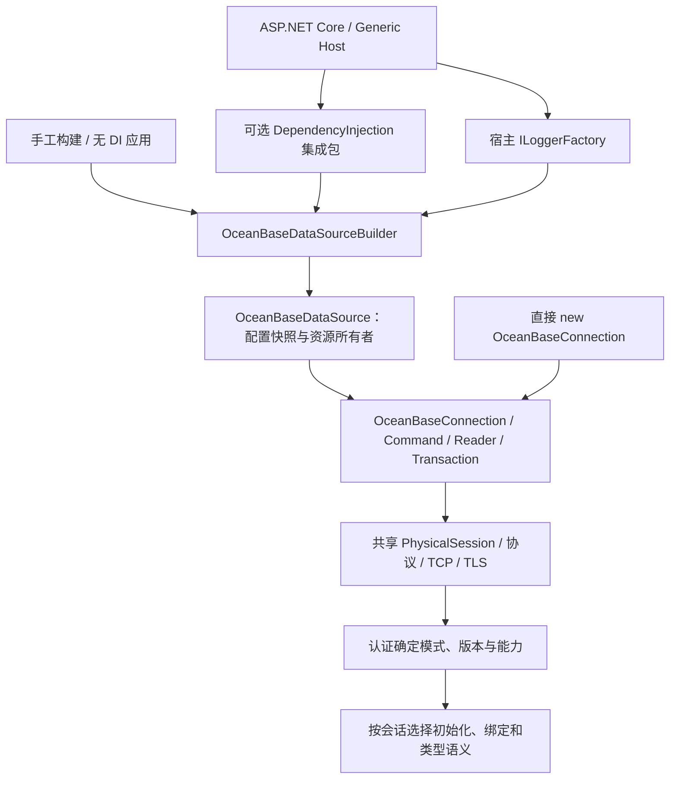
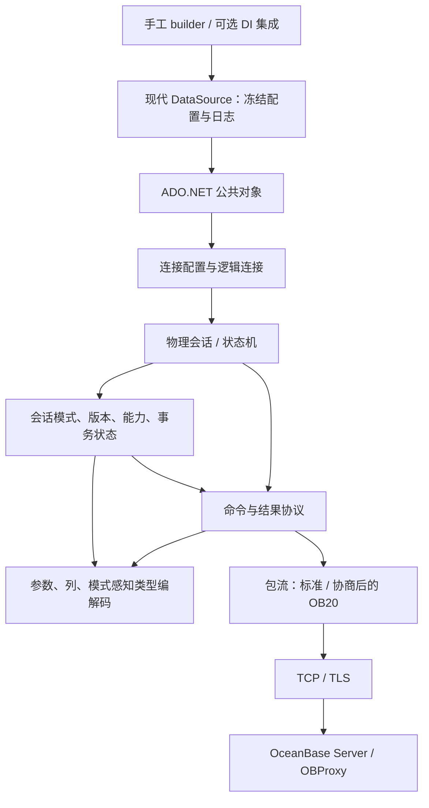

# OceanBase Connector for .NET 架构设计

状态：设计基线，A 阶段及 B01 已有本地实现；§9 的产品决定和真实服务端兼容性仍待确认。日期：2026-10-18。实施任务见 [开发方案](obconnector-dotnet-development-plan.md)，实际完成证据见 [进度台账](obconnector-dotnet-progress.md)。.NET 接入设计已合并到 §2.1–§2.7；后续 SQL、reader、事务能力仍待实现。

## 1. 目标与依据

构建直接连接 OceanBase Server 或 OBProxy 的托管 .NET 数据库驱动，向应用提供标准 ADO.NET provider，同时支持 OceanBase 的 MySQL 和 Oracle 兼容模式。首个正式版本应能安全地完成连接、参数化执行、结果读取、事务和常见类型往返；后续按依赖顺序补齐 Java 驱动中确有实现的扩展能力。这里的“支持”必须由指定服务端版本和真实数据库测试证明，不能由 Java 源码中存在某个类推定。

依据是 [Java 架构提纲](obconnector-j-architecture-outline.md) 所记录的 `obconnector-j` 提交 `6adc311ba5db8b2f19f98f3e6e4734667fdfdda1`（2.4.14）；本次另核对了该提交的握手模式识别、能力协商、服务端预处理条件、类型映射及事务中重连路径。提纲中有关 Go `database/sql`、Go 设计文档的文字不属于本设计的 .NET 结论。Java 工程采用 LGPL-2.1；可以用它分析行为和协议，但移植源码前必须单独审查许可证和归属，本设计不授权复制实现。

### 设计目标

- 一个 provider 和一条共享连接/命令协议主链，在会话上携带兼容模式；没有“Oracle 驱动”和“MySQL 驱动”两套传输实现。
- `netstandard2.0`、`net8.0`、`net9.0`、`net10.0` 可消费同一个 NuGet 包；标准 ADO.NET 行为在四个目标上一致，现代 API 仅在对应目标出现。
- 真正异步的网络 I/O、可取消操作、明确的资源所有权；在网络中断、事务中断和取消时不猜测 SQL 是否执行成功。
- 默认保护凭据和连接，协议、服务端版本及功能可用性都有显式验证边界。

### 非目标

- 不连接原生 Oracle 或 MySQL 产品，不提供 SQL 方言翻译器，也不复制 JDBC 历史类名和 Java SPI；EF Core provider 是独立生态层，不属于本驱动首版。
- 不在首个可用里程碑实现 Java 的所有选项、HA 拓扑、XA、复杂类型或诊断插件。
- 不声称所有 OceanBase 版本、所有部署模式都兼容；发布时维护经过实测的组合矩阵。

## 2. 运行目标和公开契约

单个核心 provider 工程和包，`TargetFrameworks=netstandard2.0;net8.0;net9.0;net10.0`；另设可选 `OceanBaseConnector.DependencyInjection` 集成包，目标为 `net8.0;net9.0;net10.0`，不按兼容模式拆包。核心仅引入标准日志抽象，不依赖容器实现或日志后端。仓库统一使用 NuGet 中央包管理(CPM):根目录 `Directory.Packages.props` 以 `ManagePackageVersionsCentrally` 固定全部包版本并开启传递依赖钉扎,任何工程不得在自身 `PackageReference` 上内联 `Version`;产品及未来所有程序集的包版本统一由根 `Directory.Build.props` 的 `Version` 属性给出,csproj 内不得声明各自版本；核心和集成包同版本统一发布并验证包间依赖。`netstandard2.0` 是最低 API 基线,不等于保证每一个实现该标准的旧运行时都已通过集成测试。项目以 .NET 10 SDK 和 `OceanBaseConnector.slnx` 构建四目标；全部测试及消费宿主统一使用 `net10.0`，`global.json` 约束 SDK 主版本；旧运行时的专门消费验证保留为 B09/R01 发布验收;正式支持的运行时遵循微软生命周期,.NET 9 已结束官方支持时仍可提供目标资产,但不承诺修复其运行时本身的问题。若现代目标没有需要独立实现的 API,优先共享源码和行为,不分叉协议栈。

| 范围 | 建议类型 / 行为 |
| --- | --- |
| 标准入口 | `OceanBaseConnection : DbConnection`、`OceanBaseCommand : DbCommand`、`OceanBaseParameter : DbParameter`、`OceanBaseDataReader : DbDataReader`、`OceanBaseTransaction : DbTransaction`、`OceanBaseProviderFactory : DbProviderFactory` |
| 连接配置 | `OceanBaseConnectionStringBuilder : DbConnectionStringBuilder`；在提供 `DbProviderFactories.RegisterFactory` 的运行时由应用显式注册，旧运行时按其 provider 注册机制处理，不在程序集加载时修改全局状态 |
| 现代目标 | B01 提供 `OceanBaseDataSourceBuilder`、`OceanBaseDataSource : DbDataSource` 及 factory 的 `CreateDataSource`，先支持无池建连；C06 再提供 `DbBatch`。`netstandard2.0` 不暴露这些平台 API，也不补造同名平台类型。`DbConnection.CanCreateBatch` 和 `DbProviderFactory.CanCreateBatch` 在 C 阶段真正实现前为 `false`，相应创建方法不返回执行语义未定义的空壳 |
| 宿主接入 | B01 的可选 DI 包提供普通/带 key 的统一数据源注册，容器工厂创建 Singleton 数据源并接入宿主 `ILoggerFactory`；应用按操作创建/释放连接，默认不注入连接、命令或 reader。无 DI 的 builder 和直接连接入口继续可用；生命周期和注册冲突规则见 §2.4–§2.5 |
| 异步 | `netstandard2.0` 覆写带 `CancellationToken` 的 `OpenAsync`、`ExecuteNonQueryAsync`、`ExecuteScalarAsync`、受保护的 `ExecuteDbDataReaderAsync`、`ReadAsync`、`NextResultAsync`；现代目标还须覆盖实际发包的 `PrepareAsync`、受保护的 `BeginDbTransactionAsync`（公开的 `BeginTransactionAsync` 委托给它）、`CommitAsync`、`RollbackAsync`，以及 C 阶段的 `ChangeDatabaseAsync`、各个 `GetSchemaAsync` 重载和 `DbBatch.Execute*Async`。关闭或释放需要读包、回滚或池重置时，现代 `CloseAsync`/`DisposeAsync` 也走异步清理。网络层用异步读写；同步入口使用同步 I/O，共享编码、状态机和错误映射，不以同步等待异步任务充数，也不依赖基类调用同步方法的默认异步实现 |
| 扩展 | 仅对 ADO.NET 无法表达且已实现的 OceanBase 类型/能力增加 `OceanBaseDbType`、provider-specific 值或显式方法；扩展不替代标准 `DbType`、`ParameterDirection`、`GetSchemaTable` |

名称和 NuGet ID 暂按 `OceanBaseConnector` 工作名；发布前检查商标、包名可用性和授权。连接串不要求 JDBC URL 兼容。最小键为 `Server`、`Port`、`User ID`、`Password`、`Database`、`Connection Timeout`、`Command Timeout`、`TLS Mode`；同义词须少且有测试。未知或冲突选项报错。连接串 builder 为创建连接必须能序列化密码，因此调用方应保护其输出；已打开连接的公开 `ConnectionString` 及现代 `DbDataSource.ConnectionString` 默认隐藏凭据，只有显式 `Persist Security Info=true` 才允许保留。异常和日志始终隐藏凭据。Oracle 模式的 `Database`/schema 语义需要按服务端实际行为定义，不通过连接串强行指定会话模式；可提供 `ExpectedMode` 校验配置，若服务端模式不符则在打开连接时失败。

`TLS Mode` 拟以 `VerifyFull` 为默认值，校验证书链和主机名；`Required` 表示加密但不验证身份，`Disabled` 表示明文，两者必须显式选择。四个目标均使用操作系统信任根；私有 CA 需先安装到运行环境的受信根中。`netstandard2.0` 没有 `X509ChainPolicy.CustomTrustStore`，因此首版不暴露行为不一致的独立 PEM 根证书参数；需要它时先设计并验证跨目标一致的证书链校验。默认以当前连接端点的 DNS 名称校验证书并用于 SNI；以 IP 连接 OBProxy、证书却签给 DNS 名称时，可显式设置 `TLS Server Name`，仍须用此名称完成证书验证，多地址场景要求所有目标都为该名称提供有效证书，否则逐地址使用可验证的 DNS 名称。TLS 握手失败不得回退明文，证书错误也不得自动降级为 `Required`。认证方式按服务端握手协商，首个里程碑只承诺经两种模式真实环境验证的插件；未知插件明确失败，cleartext 类认证只允许在已验证的 TLS 通道上发送。该默认值与证书配置是 .NET 新驱动的设计决定，可能与 Java 默认值不同。

### 2.1 参考依据与取舍

| 依据 | 已核对事实 | 本设计采用的边界 |
| --- | --- | --- |
| `obconnector-j`，提交 `6adc311ba5db8b2f19f98f3e6e4734667fdfdda1` | `OceanBaseDataSource.getConnection()`、`OceanBaseConnection.newConnection()` 共用连接路径；`AbstractConnectProtocol` 在认证 OK 后记录 `isOracleMode`，并据此处理会话初始化和协议差异 | 统一 provider、连接、命令、结果与事务类型；模式、版本、能力保留在物理会话。Java 是协议与模式行为的主要参考，JDBC、XA、日志工厂不直接翻译成 .NET 公共 API |
| Npgsql 10.0.0 | builder 提供 `UseLoggerFactory`；DI 扩展在容器工厂中构建数据源，取得宿主 `ILoggerFactory`；默认数据源 Singleton、连接 Transient，并支持带 key 的注册 | 参考 .NET 的构建入口、宿主日志和资源所有权。首版默认只注册数据源，由操作显式创建/释放连接，不照搬全部连接注入与生命周期选项 |
| 本地 `oceanbase-dotnet`，提交 `b9dd14f7c0ea26a29a244c113c5dbe059a07eb9c` | 有独立 DI 工程和 builder 的 `UseLoggerFactory`；但 MySql/Oracle 数据源与注册入口分开，且扩展使用 `AddSingleton(builder.Build())` 实例注册 | 仅参考独立集成包、builder 日志入口。实例注册不会把实例释放责任交给内置容器，不能沿用其所有权方式；不采用双模式分离结构或可变全局日志配置 |

源码定位：Java [`OceanBaseDataSource`](https://github.com/oceanbase/obconnector-j/blob/6adc311ba5db8b2f19f98f3e6e4734667fdfdda1/src/main/java/com/oceanbase/jdbc/OceanBaseDataSource.java#L271)、[`OceanBaseConnection`](https://github.com/oceanbase/obconnector-j/blob/6adc311ba5db8b2f19f98f3e6e4734667fdfdda1/src/main/java/com/oceanbase/jdbc/OceanBaseConnection.java#L393)、[`AbstractConnectProtocol`](https://github.com/oceanbase/obconnector-j/blob/6adc311ba5db8b2f19f98f3e6e4734667fdfdda1/src/main/java/com/oceanbase/jdbc/internal/protocol/AbstractConnectProtocol.java#L823)；Npgsql [`DI 工厂及默认生命周期`](https://github.com/npgsql/npgsql/blob/v10.0.0/src/Npgsql.DependencyInjection/NpgsqlServiceCollectionExtensions.cs#L354)、[`builder 日志入口`](https://github.com/npgsql/npgsql/blob/v10.0.0/src/Npgsql/NpgsqlDataSourceBuilder.cs#L99)；本地参考 `D:/dotnet-code/oceanbase-dotnet/src/OceanBase.DependencyInjection/OceanBaseServiceCollectionExtensions.cs` 及 `src/OceanBase/Logging/MySqlConnectorLoggingConfiguration.cs`。以上只证明参考源码行为，不证明本项目已支持这些功能。

### 2.2 同一 provider，两层接入



DI 只装配应用级对象。`PhysicalSession`、包流、认证处理、命令和 reader 不注册为容器服务，底层不接收 `IServiceProvider`，也不根据注册名称选择兼容模式。不新增 `MySqlConnection`/`OracleConnection`、两套数据源、两套注册扩展或自定义 `IOceanBaseConnection` 抽象。差异落在现有会话状态和对应协议处理位置，确有多处重复时再提取内部共享逻辑。

一个应用访问两种模式的租户时，使用两个独立配置的数据源，但公共类型和协议实现相同。DI key 标识应用中的数据源用途，不代表服务端模式；每个物理连接仍独立认证、校验 `ExpectedMode`。统一 API 不承诺自动翻译两种 SQL 方言，也不表示同一物理连接能切换租户模式。

### 2.3 包、目标框架和发布

| 包 / 工程 | 目标 | 依赖与职责 |
| --- | --- | --- |
| `OceanBaseConnector` | 保持 `netstandard2.0;net8.0;net9.0;net10.0` | 唯一 provider 与协议实现；增加 `Microsoft.Extensions.Logging.Abstractions`。不依赖容器实现、配置系统或日志后端 |
| `OceanBaseConnector.DependencyInjection` | `net8.0;net9.0;net10.0` | 引用核心及 `Microsoft.Extensions.DependencyInjection.Abstractions`；装配数据源并取得核心日志抽象中的 `ILoggerFactory`，不引用完整容器实现 |
| DI 与消费测试 | `net10.0` | 测试工程可引用完整内置 DI 容器，验证作用域、释放、key、日志与包消费；发布时另取 .NET 8/9 运行时证据 |

将原先的“单个产品包/程序集”修订为“单个核心 provider 包 + 可选宿主集成包”。它们不是两个模式的驱动。两个包都从 `Directory.Build.props` 取同一 `Version`，在同一次发布中构建、验证和发布；所有依赖版本仍只写在 `Directory.Packages.props`，解决方案继续使用 slnx。集成包的核心依赖使用当前根版本的精确 NuGet 区间（如 `[0.1.0-alpha]`，由根 Version 派生，不在项目复制版本字面量），打包时核对 nuspec，不各自发布不同版本。

依赖版本统一管理不等于所有目标引用同一主版本。`Directory.Packages.props` 按 `TargetFramework` 条件选择 Microsoft 通用库，核心和 DI 集成包采用相同矩阵，传递依赖也不得将较低目标抬升至较高主版本。当前版本如下；后续补丁只在对应主版本内集中升级。

| 产品目标 | Logging.Abstractions | DependencyInjection.Abstractions | 完整 DependencyInjection（仅测试需要） |
| --- | --- | --- | --- |
| `netstandard2.0` / `net8.0` | 8.0.3 | 8.0.2 | 8.0.1 |
| `net9.0` | 9.0.10 | 9.0.10 | 9.0.10 |
| `net10.0` | 10.0.0 | 10.0.0 | 10.0.0 |

全部测试宿主为 `net10.0`，因此完整容器当前仅用于 10.0.0 测试；表中的较低目标版本不代表新增对应测试宿主。SDK 和测试宿主为 .NET 10，不能作为产品旧资产引用 10.x 通用库的理由。验证须检查各目标 restore 图、程序集引用及 NuGet 依赖组，不能仅靠 .NET 10 测试宿主运行时的程序集统一加载结果推断旧运行时兼容性。

`OceanBaseDataSourceBuilder` 和 `OceanBaseDataSource : DbDataSource` 仅在现代核心资产出现；`netstandard2.0` 保持连接/工厂入口，不补造 `System.Data.Common.DbDataSource`，也不把自定义同名类型伪装成平台类型。四个资产均提供直接连接的 `(string connectionString, ILoggerFactory? loggerFactory)` 构造重载，使旧资产也能按实例配置日志，不需要全局工厂或 DI。不因 Npgsql 10 的依赖选择而提高本项目旧资产的 Microsoft 通用库基线。

### 2.4 数据源与连接所有权

- builder 是可变构建器，不保证线程安全；`Build()` 只冻结配置并建立日志上下文，不连接数据库、不判断模式。修改 builder 不影响已构建数据源，重复构建得到独立数据源。
- 数据源是可并发使用的长期对象，保存冻结的连接配置、日志上下文，C01 后拥有自己的可选池。B01 使用 `Pooling=false` 即可完整工作，不等待池实现。不同数据源即使连接串相同，也不共享隐含全局池，避免日志、凭据和信任材料交叉。
- `CreateConnection()` 只创建关闭的逻辑连接；`OpenConnection()`/`OpenConnectionAsync(ct)` 创建并打开，打开失败必须释放连接。同步与异步仍分别使用真实同步/异步 I/O。
- 从数据源创建的连接继承其配置和日志；`ConnectionString` 不能替换成其他配置，尝试修改须在发包前失败。直接 `new OceanBaseConnection(connectionString)` 仍可用，关闭状态按 ADO.NET 契约设置配置，默认无日志；两条入口最终使用同一个 `PhysicalSession` 和协议实现。
- 连接、命令、reader 和事务属于一次业务操作，应用按 `using`/`await using` 释放；每个连接仍只允许一个活动命令或 reader。多个并行操作从同一数据源取得各自连接，不共享一个请求级连接。
- 手工 `Build()` 的数据源由调用方释放；容器工厂创建的数据源由容器释放，应用服务不释放注入的数据源。外部传入的 `ILoggerFactory` 始终由原所有者管理，驱动不得释放它。数据源释放幂等，须允许 DI 别名指向同一实例后发生重复释放调用。
- 数据源释放后拒绝新建连接及由其创建但尚未打开的连接的后续打开；已经打开的连接由调用方继续完成和关闭，不强行中断其事务。C01 清理空闲连接，已借用连接归还即销毁；释放不无限等待活动借用者。已开始的打开与释放竞争必须有明确提交点，不能让新会话进入已释放的池。

`OceanBaseProviderFactory.CreateDataSource` 在现代资产上走相同 builder，默认无日志；静态 factory 不从全局容器取服务。B01 只交付其已实现的创建能力；`DbBatch` 仍在 C06，不能因已有数据源就宣称支持 batch。

### 2.5 DI 注册契约

计划提供两种注册，配置回调统一为可选的 `Action<IServiceProvider, OceanBaseDataSourceBuilder>`：

```csharp
services.AddOceanBaseDataSource(connectionString, (sp, builder) => { /* 可选配置 */ });
services.AddKeyedOceanBaseDataSource("reporting", reportingConnectionString);
```

普通注册提供 Singleton `OceanBaseDataSource`；未被其他 provider 占用时再提供指向它的 `DbDataSource` 别名，不覆盖其他数据库的注册。带 key 的注册提供同 key 的具体类型和 `DbDataSource` 别名，均指向同一实例；key 不能为空。多个 OceanBase 数据源要求使用不同 key，重复普通注册或重复 key 在注册时明确失败。若同 key 的 `DbDataSource` 已被其他 provider 占用，也须失败而不覆盖；所有冲突检查在新增本次服务描述符之前完成，不能留下半套注册。泛型数据库消费代码须明确其绑定，业务默认优先注入具体类型。

注册阶段只登记工厂并验证必要参数；首次解析时，容器工厂创建 builder，取得可选的 `ILoggerFactory`，调用 `UseLoggerFactory`，再执行应用配置回调并 `Build()`。应用回调可显式覆盖日志设置；宿主没注册日志时使用 `NullLoggerFactory`，不隐式添加日志提供程序。不得调用 `BuildServiceProvider()` 创建第二个容器，不在注册时打开网络连接。

默认不注册 `OceanBaseConnection`/`DbConnection`，避免把可变连接变成共享服务；也不注册 command、reader 或事务。首版不增加连接生命周期参数、自动配置热重载、宿主后台服务、健康检查或自定义 options 管线。连接字符串由应用读取 `IConfiguration` 后传入，不使驱动强依赖配置和 Options 包。Singleton 的配置回调不能捕获 Scoped 服务，测试应开启 scope validation。

使用示意（计划 API，尚不能在当前代码运行）：

```csharp
// 不使用 DI：调用方拥有数据源，loggerFactory 仍由外部管理。
var builder = new OceanBaseDataSourceBuilder(connectionString);
builder.UseLoggerFactory(loggerFactory);
await using var dataSource = builder.Build();
await using var connection = await dataSource.OpenConnectionAsync(cancellationToken);

// 使用 DI：启动时只注册，业务注入 OceanBaseDataSource 后按操作取得连接。
services.AddOceanBaseDataSource(connectionString);
// 两租户可分别用 "orders"、"reporting" 注册同一种数据源类型；
// ExpectedMode 只是打开后的校验条件，不能覆盖认证模式。
```

### 2.6 日志、追踪和指标

三者单独定义：`ILogger` 是结构化运行日志，`ActivitySource` 是本地操作链路，`Meter` 是聚合指标。B01 引入日志；B02/B07 随命令/事务实现增加相应日志；C07 再实现追踪和指标，C01 增加池日志。不一次堆叠 `DiagnosticListener`、`EventSource` 和自定义日志接口；只有实际消费者需要额外桥接时再增加。

`UseLoggerFactory(ILoggerFactory?)` 属于数据源 builder，直接连接也可通过 §2.3 的构造重载传入同一标准抽象，空值均表示无日志。日志上下文随数据源→连接→会话或直接连接→会话传递，无可变进程级 LoggerFactory，也不从连接串选择日志后端。类别使用 `OceanBaseConnector.Connection`、`.Command`、`.Transaction`、`.Pool`，区分事件而不按 MySQL/Oracle 建两套类别；已认证模式可作为结构化字段。未知模式不能提前写成 MySQL。

稳定 `EventId` 与字段先覆盖连接开始/完成/失败、执行完成/失败/取消/结果未知，池事件在 C01 定义。默认记录耗时、命令类别、端点、已确认模式、错误码/SQLSTATE；默认日志、span、metric 均不包含 SQL 文本、参数值、密码、完整连接串或认证字节。服务端错误文本可能回显敏感内容，不能直接把原始异常对象/Message 交给日志后端。各日志级别都遵守凭据保护；首版不提供敏感参数日志开关。

禁用日志时先检查级别，不进行 SQL 渲染或逐包字符串分配。TCP/包流不因接入 DI 而依赖容器或反复解析服务；日志集中在会话、命令、事务与池的状态边界。日志提供程序异常不能跳过 socket 清理、覆盖原始数据库错误，或把已经成功的写入变成可重试失败，B01/B09 验证该隔离边界。

C07 使用 `System.Diagnostics.DiagnosticSource` 支持旧资产的 Activity API，`Meter` 所需 API/包版本按四目标验证；指标只用有限维度，如模式、操作类别、结果，不能用 SQL、连接 ID 或任意 DI key 作高基数标签。本地追踪不依赖 OB20；D01 才处理经协商的服务端完整链路追踪。抓包仍是独立显式功能，默认关闭。

### 2.7 当前代码影响与验收

现有 `ConnectResult.Mode`、`PhysicalSession` 独占状态机、`OceanBaseConnectionOptions` 冻结配置、TCP/TLS 与包序号处理可以保留。现有代码没有双模式两套公开对象，不需要按参考项目重写。B01 在已有 options 之外增加不可变日志上下文并交给连接/会话，不把 `ILoggerFactory` 序列化进连接串；底层 byte cursor/帧编解码不增加宿主依赖。

| 范围 | 实施与验证边界 |
| --- | --- |
| B01 | 核心 builder/data source、factory 现代入口、日志上下文；新增可选 DI 工程、slnx 项目项、CPM 依赖；保留无 DI 建连路径 |
| B01/B09 | 无网络 Build/解析；配置快照；数据源并发但连接独占；连接打开失败清理；关闭/释放竞争；容器创建和释放、外部 logger 不释放、无日志宿主、配置覆盖、key 隔离、重复注册和 scope validation |
| B02/B07/B09 | 同步/异步日志一致、失败/取消/结果未知不混淆；恶意服务端回显不泄密；日志后端异常不改变数据库执行与清理结果 |
| 消费 / 包 | 四个核心资产编译；旧资产无现代类型；隔离消费测试解析新增日志依赖；DI 工程三个现代资产编译；全部测试宿主 .NET 10；两个包版本与依赖一致，核心不反向依赖 DI |
| C01 | 数据源拥有池；重置、租户/模式/TLS/凭据隔离；数据源关闭后归还即销毁；禁止跨数据源共享物理会话 |
| C06/C07 | C06 只补 batch 和数据源 batch 入口；C07 追踪、指标、禁用开销和性能验收，不重新实现数据源/基础日志 |

B01 已实现统一公开连接/工厂、现代无池数据源、可选 DI 和基础连接日志；其余公共对象仅提供标准类型与显式不支持的执行入口，不代表 SQL/reader/事务已可用。A 阶段的 G0/G1、MySQL 模式可信版本矩阵与真实租户测试仍是阻塞项。DI 注册成功不能作为双模式连接或 SQL 兼容的证据。依用户要求，暂不执行实库及非 Windows 运行测试，保留验收项。

## 3. 分层与状态所有权



现代数据源拥有冻结的配置、日志上下文及 C01 后的独立可选池；可以并发创建连接，但不是一条可共享执行的连接。DI 仅装配数据源，不注册内部协议对象，也不把 `IServiceProvider` 传入会话。外部 `ILoggerFactory` 不由驱动释放；手工创建的数据源由应用释放，容器工厂创建的由容器释放。具体释放竞争、活动连接与配置修改契约见 §2.4。

物理会话拥有 socket、包序号、连接 ID、服务端版本、服务端确认的模式、协商后的能力、当前事务和服务端 statement ID。逻辑 `DbConnection` 拥有借用/关闭语义；`DbCommand` 拥有 SQL、参数与超时；`DbDataReader` 拥有尚未消费的响应和游标。每个物理会话同一时刻只允许一条命令或一个活动 reader；未消费的响应必须先读尽或使会话失效，绝不把带有未读包的连接交给下一条命令或连接池。

握手先解析服务端能力和认证挑战，构造客户端能力并在握手响应中声明 `CLIENT_SUPPORT_ORACLE`、`CLIENT_SESSION_TRACK`、多结果和服务端预处理多结果等实际需要的能力位；仅按服务端支持的能力解析对应响应。启用 TLS 时，先确认服务端 `CLIENT_SSL`，发送带 `CLIENT_SSL` 的 SSLRequest，再通过 `SslStream` 完成 TLS 握手和所选模式要求的证书验证，之后才发送含认证数据的握手响应；服务端不支持 TLS 或升级失败均直接关闭连接，不发送明文凭据或降级。`TLS Mode=Disabled` 不发送 SSLRequest。认证 OK 中的 `OB_SERVER_USE_ORACLE_MODE` 决定模式；仅对经过验证会返回该状态位的 OceanBase/OBProxy 版本，才把位未设置解释为 MySQL，无法可靠识别模式的版本应在解码结果前拒绝。`ob_capability_flag` 等会话状态决定 OB20、追踪和结果集元数据能力；缺失可选能力反馈时禁用对应扩展，不影响已确认模式下的基础协议。选项只是请求，`EffectiveCapabilities = 请求 ∩ 服务端协商 ∩ 版本/模式条件`，任何扩展命令只依赖生效能力。模式不是根据端口、SQL、用户名或连接串中的 `oracle:` 字样推断。Java 源码证据：[客户端能力位](https://github.com/oceanbase/obconnector-j/blob/6adc311ba5db8b2f19f98f3e6e4734667fdfdda1/src/main/java/com/oceanbase/jdbc/internal/protocol/AbstractConnectProtocol.java#L290)、[SSLRequest 与 TLS 升级](https://github.com/oceanbase/obconnector-j/blob/6adc311ba5db8b2f19f98f3e6e4734667fdfdda1/src/main/java/com/oceanbase/jdbc/internal/protocol/AbstractConnectProtocol.java#L673)、[认证 OK 与能力解析](https://github.com/oceanbase/obconnector-j/blob/6adc311ba5db8b2f19f98f3e6e4734667fdfdda1/src/main/java/com/oceanbase/jdbc/internal/protocol/AbstractConnectProtocol.java#L823)、[扩展命令条件](https://github.com/oceanbase/obconnector-j/blob/6adc311ba5db8b2f19f98f3e6e4734667fdfdda1/src/main/java/com/oceanbase/jdbc/internal/protocol/AbstractConnectProtocol.java#L1778)。

包读写层只负责帧、长度、序号、上限与校验；命令层处理握手、`COM_QUERY`、`COM_STMT_*`、OK/ERR、列/行、多结果和状态变更；模式感知编解码处理同一类型码在两种模式下的不同解释。OB20 是经协商后替换/包裹包流的能力，不是另一个公开驱动。所有长度、计数、压缩后大小和响应包数在分配内存前校验；对 LOCAL INFILE 等会触及客户端文件系统的服务端请求默认拒绝，未来若开放需显式授权和路径策略。

## 4. 执行、事务与取消

1. 普通无参命令走文本协议。参数化命令以服务端 prepare/execute 为首选，维护物理会话内的 statement ID；`Prepare()` 强制准备。首版不隐式回退为客户端参数插值；服务端不支持的语句明确报错。Java 的 `useServerPrepStmts` 默认是 `false`，但游标或 Oracle 扩展执行等选项可在后处理时改为 `true`；因此 .NET 首版对 Java 默认可执行、服务端却不能 prepare 的参数化 SQL 有明确功能差距。B 阶段的 Oracle 占位符词法器识别单/双引号、注释、成对及非成对分隔符的 `q'...'` 字面量及 `:=`，仅将实际 `:name` 绑定映射为服务端预处理的位置占位符，重复名称映射到各位置，无法可靠识别的字面量或绑定语法、缺失绑定均在发包前失败。Oracle `ParameterName` 接受 `name` 或 `:name`，按去掉前缀后的名称不区分大小写匹配；参数集合中规范化后重名的多个项一律在发包前拒绝，SQL 中重复 `:name` 仍使用同一个参数。MySQL SQL 原样交给服务端 prepare，由其返回的参数个数确定 `?` 位置绑定数量；不在客户端按可能变化的 `SQL_MODE` 猜测问号是否处于字符串内。值始终通过协议参数传送。D 阶段若加入客户端预处理回退，须另行实现并测试安全的文本值编码，仅对明确的“不支持 prepare”错误启用可配置回退，连接错误不能降级。
2. Oracle `COM_STMT_PREPARE_EXECUTE` 只在模式、选项和版本条件全部满足时启用；Java 当前门槛是 `>=2.2.76`，但 .NET 实现仍须用实际服务端矩阵验证。`DbBatch` 在 C 阶段先逐条执行，保留每条更新计数及失败位置，并明确“已执行前缀”的结果；D 阶段再增加 bulk/array binding 优化。批量不自动获得原子性。
3. `DbDataReader` 从 B 阶段起逐行解码，不缓存整个结果集；支持 `NextResult`。默认发送 `CLIENT_FOUND_ROWS`，使 `UPDATE` 的行数按匹配行而非实际改变行计算，与 Java 驱动默认值一致；`RecordsAffected` 和 `ExecuteNonQuery` 从服务端 OK 包更新计数得出，不按客户端对 SQL 的猜测改写。只有结果集而没有更新计数时 `RecordsAffected=-1`；多结果中的更新计数累加，并分别验证文本、预处理和两种兼容模式。Java 可用 `useAffectedRows` 切换语义；.NET 首版不提供该选项，若以后增加，须在握手前确定并纳入池键。C 阶段的流式扩展专指大值 `SequentialAccess` 和服务端游标。reader/游标占用物理会话直至关闭或读尽；`CommandBehavior.CloseConnection` 关闭逻辑连接，`ExecuteScalar`/`ExecuteNonQuery` 也必须消费或安全终止未用的响应。`SequentialAccess` 不允许隐式把整个大值缓存到内存。服务端 statement 缓存以物理会话为作用域，断线即失效。
4. `BeginTransaction` 固定物理会话，`Commit`/`Rollback` 只作用于该会话；同一逻辑连接一次只允许一个有效本地事务。存在有效事务时，执行前要求 `DbCommand.Transaction` 引用该事务；没有有效事务时要求其为 `null`。已结束、已释放或属于其他连接的事务一律在发包前拒绝，C 阶段的 `DbBatch.Transaction` 使用同一规则；不能仅凭共用物理会话让未绑定命令隐式加入事务。未完成事务的 `Dispose` 必须尝试回滚，无法确认回滚完成时销毁物理会话。隔离级别逐模式映射，不支持的值抛明确异常。事务期间断线导致结果未知时，将连接标记失效并报告结果不确定，绝不自动重放；无事务时也不自动重试已经发出的 SQL。只可在发送前的连接建立阶段遍历候选地址。Java 也存在事务中重连抛错路径：[重连处理](https://github.com/oceanbase/obconnector-j/blob/6adc311ba5db8b2f19f98f3e6e4734667fdfdda1/src/main/java/com/oceanbase/jdbc/internal/failover/impl/MastersFailoverListener.java#L354)。
5. 每次执行把调用方 `CancellationToken`、命令超时和连接关闭合并处理。请求尚未发送时取消返回 `OperationCanceledException`，可确认未执行；完整成功/错误响应已收到时遵循该响应，但服务器 ERR 不代表批量中较早的语句已回滚。发包已开始而没有可信终态响应时，包括自动提交的写入、`Commit` 和 `Rollback`，必须丢弃物理会话并抛 `OceanBaseException : DbException`，其 `IsExecutionOutcomeUnknown=true`，错误中保留取消/超时/网络中断原因；此时不能仅返回普通取消或超时，以免调用方误认为写入未发生。只有能够确认服务端取消成功且协议响应已读尽，才能保留会话。辅助连接取消只是可选优化，连接 ID 必须匹配原物理会话。对 `netstandard2.0` 无法直接取消的 socket/TLS 等待，关闭传输以中断等待。`DbCommand.Cancel()` 遵循同一状态机。
6. 首版只支持显式本地 `DbTransaction`。`Open`/`OpenAsync` 在建连前检查 `System.Transactions.Transaction.Current`；已打开连接的所有调用方发起的协议操作，在公共发送入口再次检查，包括命令执行与预处理、`BeginTransaction`、`Commit`、`Rollback`、`ChangeDatabase`、`GetSchema` 及其异步入口。存在环境事务时，在发包前抛 `NotSupportedException`；`EnlistTransaction` 也始终显式拒绝。内部关闭、回滚清理和销毁会话不得因这个检查被阻止，清理失败则销毁物理会话。这样即使连接在进入 `TransactionScope` 前打开，也不会悄然执行自动提交或改变会话状态。未来只有完成加入、提交/回滚、跨连接升级和恢复测试后才改变此契约；显式 XA API 与 `TransactionScope` 是不同能力。

## 5. 值与元数据契约

公共值优先用 `bool`、有符号/无符号整数、`decimal`、`double`、`string`、`byte[]`、`DateTime`、`DateTimeOffset`、`TimeSpan`、`DBNull.Value`。参数编码依据 `DbType`/`OceanBaseDbType` 和实际值；读取依据列定义、兼容模式、字符集、精度及符号位，不仅依据协议类型码。Java 类型码 3 在 MySQL 模式是 `INTEGER`、Oracle 模式是 `NUMBER`：[ColumnType](https://github.com/oceanbase/obconnector-j/blob/6adc311ba5db8b2f19f98f3e6e4734667fdfdda1/src/main/java/com/oceanbase/jdbc/internal/ColumnType.java#L72)。所有 provider-specific 值类型定义在公共的 `netstandard2.0` API 中，四个目标框架共用同一类型身份和往返语义。

| 服务端列 | `GetValue` / `GetFieldType` | 精确访问与写回 |
| --- | --- | --- |
| MySQL `DECIMAL(p,s)` 或 Oracle `NUMBER(p,s)`，且列元数据确认 `p<=28`、`0<=s<=p` | `decimal` / `typeof(decimal)` | B 阶段起 `GetProviderSpecificFieldType` 为 `typeof(OceanBaseDecimal)`，`GetProviderSpecificValue` 返回 `OceanBaseDecimal`（系数 `BigInteger` + scale）；`GetDecimal` 必须精确，范围内的 `OceanBaseDecimal` 参数保留 scale 写回 |
| 其他精确数值，包括 MySQL `DECIMAL(p,s)` 的 `p>28`、无可靠精度元数据的列，以及 Oracle 无声明精度、负 scale 或 `p>28` 的 `NUMBER` | `OceanBaseDecimal` / `typeof(OceanBaseDecimal)`，一列内类型稳定 | `GetDecimal` 在该行的值恰能精确表示时转换，否则抛转换/溢出异常；参数接受 `OceanBaseDecimal` 并保持 scale；MySQL `DECIMAL(65,20)` 不经 `decimal` 或 `double` 中转 |
| Oracle `DATE`（协议可表现为 `DATETIME`） | `DateTime` / `typeof(DateTime)`，包括时分秒 | `DateTime.Kind=Unspecified`；`GetDateTime` 与 `GetProviderSpecificValue` 保留时分秒。Oracle 模式下用 `OceanBaseDbType.OracleDate` 显式写回，`DbType.Date` 绑定 `DateTime` 时也不得静默截断非零时间部分 |
| Oracle 不带时区的 `TIMESTAMP(p)` | `p<=7` 用 `DateTime`，`p>7` 用 `OceanBaseTimestamp`；`GetFieldType` 随声明精度固定 | `DateTime.Kind=Unspecified`；`GetDateTime` 仅在纳秒可精确表示为 100ns 时成功，写回 provider 类型保留 0–9 位小数秒 |
| Oracle `TIMESTAMP WITH TIME ZONE(p)` | 所有精度用 `OceanBaseTimestampWithTimeZone` / 同名字段类型，保存本地时间、纳秒、offset 及服务端提供时的时区名称 | 显式 `GetFieldValue<DateTimeOffset>` 仅在可精确表示时成功；它只保留 offset，不能保留时区名称；写回 provider 类型可保持该信息 |
| Oracle `TIMESTAMP WITH LOCAL TIME ZONE` | `OceanBaseTimestampLocalTimeZone` / 同名字段类型，保留服务端返回的本地字段、纳秒与会话时区标识 | 显式转 `DateTime` 时使用 `Kind=Unspecified`，只在精度可表示时成功；夏令时重复时刻不能由该 `DateTime` 唯一确定瞬时点，服务端已丢失的原始输入 offset 也不可恢复 |
| MySQL `DATE` / `DATETIME` 列（可含零值） | C 阶段起正常值的标准访问仍返回 `DateTime`；零值的标准 `GetValue`、`GetDateTime` 抛转换异常，`GetFieldType` 整列为 `typeof(DateTime)` | `GetProviderSpecificFieldType` 整列固定为 `typeof(OceanBaseDate)` / `typeof(OceanBaseDateTime)`；正常值和零值的 `GetProviderSpecificValue` 均返回对应 provider 类型，不得改写零值为 `DateTime.MinValue` |

`GetProviderSpecificFieldType` 与 `GetProviderSpecificValue` 使用同一 provider 类型，`GetFieldValue<T>`、`GetValues`、`IsDBNull` 和 `GetSchemaTable` 必须遵守上表及列元数据；不能逐行改变 `GetFieldType`。`DBNull.Value` 与空字符串遵循服务端模式语义，Oracle 的空字符串/NULL 规则单独验证。字符集、NCHAR、无符号溢出、`DateTime.Kind` 和会话时区都写成双向测试；`DateOnly`/`TimeOnly` 可在现代目标上作便利转换，但不能成为跨目标唯一表示，Oracle `DATE` 含非零时间时不得隐式转换为 `DateOnly`。Java 的 `TIMESTAMPTZ` 解码会读取额外的时区名称，因此 .NET 的默认值不能只保留 offset：[Java 时间解码](https://github.com/oceanbase/obconnector-j/blob/6adc311ba5db8b2f19f98f3e6e4734667fdfdda1/src/main/java/com/oceanbase/jdbc/extend/datatype/DataTypeUtilities.java#L1030)。

C 阶段完成前，B 阶段已支持低精度列的 `OceanBaseDecimal` provider-specific 读取和范围内参数写入；遇到尚未实现的宽精度数值、纳秒时间或零日期时在读取该值时明确报不支持。B 阶段正常 MySQL `DATE`/`DATETIME` 列的 `GetProviderSpecificFieldType` 暂为 `typeof(DateTime)`，`GetProviderSpecificValue` 返回 `DateTime`；C 阶段起整列改为上述 provider 类型，并验证同列混合正常值与零值。相同规则适用于各阶段尚未实现的类型及编码，包括 Oracle NCHAR/INTERVAL、MySQL JSON/BIT/YEAR：读取时按实际模式、列类型与字符集识别并报不支持，显式指定未支持类型的参数在发包前报不支持；不得截断、舍入，或猜测性地解码为 `string`/`byte[]`。未声明服务端目标类型的普通 `string` 参数仍按普通字符串绑定，不据此声称支持 NCHAR/JSON。Oracle NCHAR 需独立识别服务端 national character set，不能沿用普通字符集；新增支持时同时验证文本与预处理读写及元数据映射。MySQL 宽精度数值的参照场景见 Java 的 [`DECIMAL(65,20)` 测试](https://github.com/oceanbase/obconnector-j/blob/6adc311ba5db8b2f19f98f3e6e4734667fdfdda1/src/test/java/com/oceanbase/jdbc/DataTypeSignedTest.java#L77)。

`DbDataReader` 通过 `IDbColumnSchemaGenerator` 支持 `GetColumnSchema()`，并提供 `GetSchemaTable()`；字段类型、列名、长度、精度和可空性基于实际列定义。数据库对象元数据通过 `DbConnection.GetSchema()` 实现，MySQL 模式使用相应 `SHOW`/`INFORMATION_SCHEMA`，Oracle 模式使用其兼容数据字典。字段元数据和数据库目录元数据分别验证，不用一套 SQL 混用。LOB locator、REF CURSOR 和复杂类型值若依赖连接/事务，公开对象必须说明失效点和 `Dispose` 义务；首个里程碑可先支持安全的内联字节/文本值，不能把 locator 当普通 `byte[]` 误解码。

## 6. 池、HA、诊断和扩展范围

ADO.NET 不替 provider 自动管理物理连接。`Pooling=false` 是默认值；生产版本提供可选池，只有某个服务端/OBProxy 版本与兼容模式组合经真实测试证实“完整重置”后，才允许为该组合启用 `Pooling=true`。其他组合在 `Open` 时明确拒绝池化请求。池按规范化连接选项、认证身份以及 TLS 信任材料/名称分组，限制连接数和等待超时；凭据或信任材料轮换须清空对应旧池。现代 `DbDataSource` 从 B01 即提供配置与生命周期入口，C01 才挂接其拥有的独立池；不跨数据源共享物理会话。直接连接入口复用相同协议/重置规则；未来池化实现不得形成另一套协议链。

归还会话时先关闭或读尽 reader，回滚未结束事务，再执行经过验证的服务端完整重置，并重做必要的字符集、时区、schema/NLS 等初始化；服务端 statement ID 与缓存、游标和 locator 全部失效。验证必须覆盖应用直接执行的 `SET`/`ALTER SESSION`、当前 database/schema、用户变量、临时对象、准备语句和失败中的事务，不能只恢复驱动 API 记录的设置。任何一步失败、遇到不能证明已清理的会话对象，或该版本没有完整重置能力，都销毁物理会话。Java 的 `OceanBaseConnection.reset()` 仅在特定条件下发 `COM_RESET_CONNECTION`，其他时候主要恢复已跟踪状态；它不能作为 OceanBase 完整重置的证明：[Java reset](https://github.com/oceanbase/obconnector-j/blob/6adc311ba5db8b2f19f98f3e6e4734667fdfdda1/src/main/java/com/oceanbase/jdbc/OceanBaseConnection.java#L2463)。

多地址先实现连接建立前顺序尝试；后续负载均衡和发现能力按真实 OceanBase/OBProxy 拓扑扩展。故障后创建的新物理会话必须重新握手、识别模式、初始化状态和准备 statement；不透明恢复 reader、事务或 locator。XA 需要显式 API、固定会话、恢复语义及两种模式不同命令；在真实服务端和事务协调器测试完成前不接入 `System.Transactions`。

数据库/协议错误使用 `OceanBaseException : DbException`，保留服务端错误码、SQLSTATE、模式、`IsExecutionOutcomeUnknown` 和可安全公开的端点信息；发送前的调用方取消遵循 `OperationCanceledException`。B01 接入 `Microsoft.Extensions.Logging.Abstractions`，由数据源 builder 的 `UseLoggerFactory` 配置，默认无日志，不使用可变全局工厂；命令/事务日志随 B02/B07 实现。日志与追踪不写入默认 SQL、绑定值、凭据或原始服务端错误文本，日志后端异常不能改变执行与资源清理结果。C07 再用 `ActivitySource`、`Meter` 暴露本地操作和聚合指标，旧资产所需 `System.Diagnostics.DiagnosticSource` 等依赖须四目标验证；不预先叠加多套事件设施。本地追踪不依赖 OB20，经服务端协商的完整链路追踪归 D01。日志与协议抓包分开，抓包必须显式开启并擦除认证和参数内容。事件、安全和生命周期细则见 §2.6。

## 7. 实施阶段与验收

| 阶段 | 最小完整产物 | 验收门槛 |
| --- | --- | --- |
| A. 协议基础 | 四目标构建；连接串、TCP/TLS、握手认证、模式/能力识别、标准包流、错误映射 | 固定字节夹具验证包边界/错误/模式位、客户端 Oracle/会话跟踪能力声明及协商、`CLIENT_SSL` 与 SSLRequest 顺序；要求 TLS 时，无 TLS 能力或升级失败不得发送认证数据；认证 OK 后无法识别模式则在解码查询结果前失败；两模式真实服务端用已确认的认证插件打开、关闭并识别模式；私有 CA、名称不匹配和禁止 TLS 降级均有测试 |
| B. ADO.NET 核心 | 标准 provider 对象、现代数据源/可选 DI、标准日志、同步/异步文本与服务端参数执行、逐行结果/多结果、显式事务、取消、基础类型和字段元数据 | 四目标编译；日常测试宿主统一 .NET 10，发布消费另取 .NET 8/9 与 `netstandard2.0` 资产证据；验证数据源/DI 生命周期、key 隔离和日志脱敏；两模式 CRUD、Oracle 名称绑定及重复名称、低精度 `OceanBaseDecimal` provider-specific 访问、Oracle `DATE` 含时间值的读取和写回、服务端不支持 prepare 时明确报错、参数往返、未实现类型的读取及绑定显式失败、`UPDATE` 匹配但值不变时的 `RecordsAffected`/`ExecuteNonQuery` 结果、活动事务下缺失/错误/过期 `DbCommand.Transaction` 拒绝、已打开连接进入 `TransactionScope` 后各协议入口拒绝且可清理、发送前取消和发包后结果未知均有集成测试；现代目标验证预处理及本地事务异步入口不退回同步 I/O |
| C. 生产连接 | 经验证后可启用的池、多地址建连、服务端语句缓存、大值/游标流式读取、基础 `GetSchema`、MySQL 模式 `ChangeDatabase`、逐条 `DbBatch`、高精度/纳秒值、诊断 | 对池验证原始会话 SQL、临时对象、事务、准备语句及重置失败的隔离；不支持重置的组合拒绝 `Pooling=true`；验证 `DbBatch.Transaction` 绑定、每条命令的更新计数和失败前缀、异步批量、`GetSchemaAsync`/`ChangeDatabaseAsync` 不阻塞调用线程，以及 MySQL `DECIMAL(65,20)` 等宽精度值在文本/预处理路径上的精确读写、字段类型、provider-specific 读取及写回、OBProxy 与故障路径 |
| D. OceanBase 扩展 | OB20/校验/追踪、Oracle OUT/RETURNING/游标、LOB/复杂类型、批量优化、显式 XA，以及有需求的客户端预处理回退/认证插件 | 每项都在目标服务端版本和兼容模式上有往返、错误及资源生命周期测试；扩展 API 未经验证时明确报不支持，不把 Java 选项名直接暴露给 .NET 用户 |

测试矩阵的维度为 TFM/运行时、OceanBase 与 OBProxy 版本、兼容模式、TLS/认证方式、标准/OB20 包流、文本/预处理、同步/异步、池化/直连、正常/故障路径。协议夹具测试验证恶意长度、截断包、错误序号、能力缺失；集成测试使用独立的 MySQL/Oracle 模式租户和可控网络故障。没有可用服务器时只可报告静态与夹具测试通过，不能称驱动已经兼容真实 OceanBase。每一阶段记录明确支持的服务端版本下限，不直接继承 Java README 的“所有版本”表述。

## 8. Java 功能与 .NET 落点

下表中的阶段是 .NET **计划**，不是已经实现或验证的能力。M01–M16 与 [Java 提纲](obconnector-j-architecture-outline.md) §4 对应；不能由 Java 类或测试的存在推断 .NET 已支持。基础能力要分别在 MySQL/Oracle 模式验收；Java 的兼容选项不自动成为 .NET 连接串键。

| Java 模块 | .NET 对应与计划阶段 | 差异或延后范围 |
| --- | --- | --- |
| M01 入口与统一 API | B：`DbConnection`、`DbCommand`、`DbDataReader`、`DbTransaction`、`DbProviderFactory`、现代 `DbDataSource` 和可选 DI；C：`DbBatch` | JDBC `DataSource`/XA 入口不照搬；`DbDataAdapter`/`DbCommandBuilder` 仅在实际需要且模式语义明确时实现，未实现时 factory 不宣称支持 |
| M02 URL、选项、地址 | A：.NET 连接串 builder 和单地址；C：多地址顺序尝试 | JDBC URL、TNS、OCP 地址发现和 Java 大量选项延后；不按 `oracle:` URL 判定模式 |
| M03 网络、TLS、认证 | A：TCP、`CLIENT_SSL`/SSLRequest、`SslStream`、经验证的握手认证及标准包；D：按需求增加认证方式 | 要求 TLS 时，认证数据只在升级和所选验证完成后发送；显式明文连接仍不得使用 cleartext 类认证；Java 的 SPI、Unix socket、Windows pipe、共享内存、压缩包流不是首版承诺；私有 CA 与证书名称见 §2 |
| M04 握手、模式、能力 | A：客户端 `CLIENT_SUPPORT_ORACLE`/`CLIENT_SESSION_TRACK` 等能力声明、认证 OK 状态位、服务端版本和协商能力 | OB20/追踪在 D；请求选项、模式、版本、服务端能力分别保存，不能把未知模式当 MySQL |
| M05 会话与本地事务 | B：生命周期、自动提交、事务与隔离级别，命令显式绑定当前事务；C：可验证重置及 `ChangeDatabase` | B 阶段 `ChangeDatabase`/`ChangeDatabaseAsync` 均报不支持；C 阶段仅在 MySQL 模式验证切换语义和真实异步入口，Oracle 模式明确报不支持，不能把 schema 变化误当 database 切换。保存点按模式验证；现代事务异步方法执行真实异步网络 I/O，`DbTransaction.Save` 等仅在验证后开放，旧 TFM 不补同名平台 API |
| M06 SQL 与预处理 | B：文本及服务端 prepare/execute；D：Oracle PrepareExecute 与可选客户端预处理 | Java 默认客户端预处理，部分选项强制服务端预处理；.NET 首版不隐式模拟，服务端不可预处理的参数化 SQL 会报错；`CommandType.StoredProcedure` 在 D 的过程支持前明确报不支持 |
| M07 参数和批量 | B：模式感知词法解析、位置/名称绑定和常见输入参数；C：逐条 `DbBatch`；D：bulk/array binding、长参数优化 | B 阶段的 Oracle `:name` 需映射为服务端位置参数，不能把名称绑定词法器推迟到客户端预处理阶段；`ParameterDirection.Output`/`InputOutput`、Oracle PIECE_DATA 和 MySQL LONG_DATA 要分别验证，未经支持的方向在执行前报错 |
| M08 结果与游标 | B：OK/ERR、多结果、文本/二进制逐行读取和默认 `CLIENT_FOUND_ROWS` 计数；C：大值/服务器游标流式读取；D：REF CURSOR/offset fetch | Reader、游标、原物理会话的生命周期绑定，不透明迁移；Java 的 `useAffectedRows` 可选语义不属于 .NET 首版 |
| M09 类型/字符集/时间 | B：基础标量、低精度 NUMBER/DECIMAL 的 provider-specific 访问、Oracle `DATE` 的日期加时间语义和模式感知映射；C：宽精度 NUMBER/DECIMAL、Oracle TIMESTAMP/TZ/LTZ 纳秒语义与 MySQL 零日期 | Oracle NCHAR、INTERVAL、MySQL JSON/BIT/YEAR 列为 D 阶段候选或经测试提前；未实现时按 §5 显式失败，不用单一类型码表或猜测性解码 |
| M10 LOB 与复杂类型 | D：locator、流式 LOB、ARRAY/STRUCT 及类型字典 | B/C 只读取已证明安全的内联值；不把 locator 或复杂值当普通字节数组 |
| M11 元数据 | B：列/结果元数据；C：`GetSchema` 基础集合；D：过程/参数及复杂类型元数据 | MySQL 用对应系统视图，Oracle 用兼容数据字典；集合清单和限制参数需逐项测试 |
| M12 HA/地址发现 | C：建连前顺序切换；D：经拓扑验证的负载均衡/发现 | 不迁移 Java 的 AURORA/REPLICATION 名称或透明重试已发送 SQL |
| M13 内置池 | C：provider 池与完整重置门槛 | .NET 没有替 provider 提供通用物理池；Java 的已跟踪状态重置不足以证明隔离 |
| M14 XA | D：固定会话的显式 XA API，分模式命令和恢复 | 不自动等价于 `TransactionScope`，首版显式拒绝环境事务 |
| M15 诊断/OB20 | B：标准日志；C：`ActivitySource`/`Meter`；D：OB20、校验与服务端完整链路追踪 | 本地追踪不依赖 OB20；服务端追踪依赖协商，抓包默认关闭并擦除敏感内容 |
| M16 构建与生态 | A–D：NuGet、多目标、夹具和双模式集成矩阵 | Java SPI/OSGi/JMX/JNA 不移植；.NET 工厂注册和可选生态集成按需求实现 |

## 9. 实现前需确认的产品决定

以下是本设计采用的默认选择，评审可调整，不应在首个 PR 中悄悄改变公开契约：

1. `netstandard2.0` 是跨平台 API 基线；是否还需要对 .NET Framework 4.8 作正式运行测试与支持承诺。
2. TLS 默认 `VerifyFull`；无 TLS 的现有部署是否允许显式使用 `Disabled`，以及首发要支持哪些认证方式。首版私有 CA 依赖平台信任根，`TLS Server Name` 按 §2 纳入设计。
3. 首发最低 OceanBase/OBProxy 版本与两种兼容模式的实际测试环境；它们决定可对外承诺的功能矩阵。
4. 首个正式版本是否必须包含经验证的池化与 Oracle 高精度/纳秒 provider-specific 值；本设计将它们列为 C 阶段交付门槛，而不是协议原型门槛。无法完整重置的服务端组合只承诺直连。

本文定义目标架构。2026-10-18 已具备 A 阶段工程、传输、握手原型与物理会话，以及 B01 公开连接/工厂、无池数据源、DI 和连接日志；SQL/reader/事务执行尚未实现，真实互通尚未验证，状态见进度台账。当前没有已验证的服务端版本矩阵，认证 OK 未设置 Oracle 模式位时一律拒绝，不以 ExpectedMode 覆盖；取得 G0/G1 版本证据后再开放对应 MySQL 模式组合。
