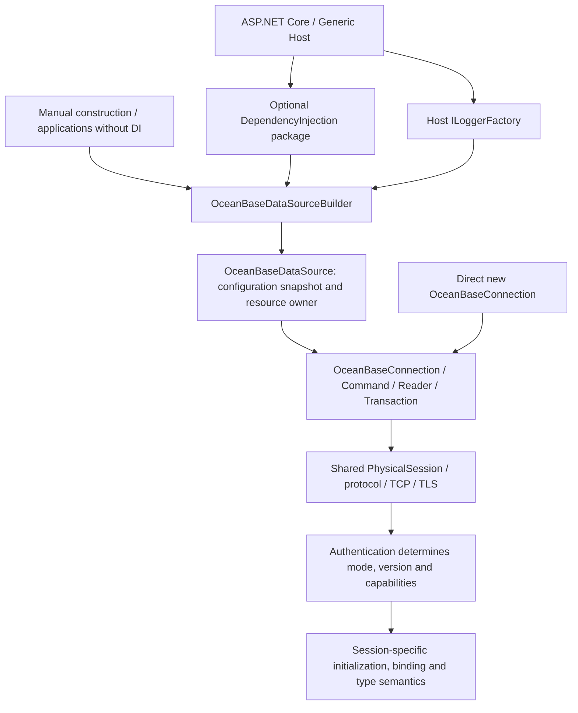
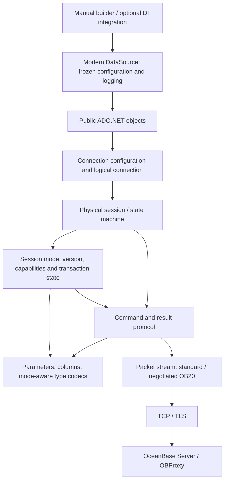

# OceanBase Connector for .NET Architecture Design

Status: design baseline. Phase A, B01–B09 and C02 have local implementation/review evidence. C03 numeric, nanosecond, TZ/LTZ and MySQL zero-date support, C04 sequential field streams and server cursors, and C05 database switching and the first four catalog collections have local implementations. A05 still lacks a trusted MySQL-mode determination; the product decisions in §9 and real compatibility remain open. Date: 2026-10-19. Implementation tasks are in the [development plan](obconnector-dotnet-development-plan.md); evidence is in the [progress ledger](obconnector-dotnet-progress.md). .NET integration is incorporated into §2.1–§2.7. Parameterization, reader field metadata, local transactions and cancellation/timeouts have local implementations; B09 completes scalar ProviderType and command log categories. Real catalog metadata acceptance remains open, and pooling is blocked by insufficient evidence of complete reset behavior.

## 1. Goals and Basis

Build a managed .NET database driver that connects directly to OceanBase Server or OBProxy and exposes a standard ADO.NET provider for both OceanBase MySQL and Oracle compatibility modes. The first stable release must safely support connections, parameterized execution, result reading, transactions and common type round trips. Later work adds extensions actually implemented in the Java driver, in dependency order. “Support” requires evidence from specified server versions and real database tests; the presence of a Java class does not establish support.

The basis is `obconnector-j` commit `6adc311ba5db8b2f19f98f3e6e4734667fdfdda1` (2.4.14), recorded in the [Java architecture outline](obconnector-j-architecture-outline.md). This review also checked that commit's handshake mode detection, capability negotiation, server-prepare prerequisites, type mapping and reconnect paths during transactions. References to Go `database/sql` or the Go design document in that outline are not .NET conclusions. The Java project uses LGPL-2.1. It can inform behavior and protocol analysis, but porting source requires a separate license and attribution review; this design does not authorize copying its implementation.

### Design Goals

- One provider and one shared connection/command protocol path, with compatibility mode stored on the session; no separate Oracle and MySQL transports.
- One NuGet package consumable by `netstandard2.0`, `netstandard2.1`, `net8.0`, `net9.0` and `net10.0`; consistent standard ADO.NET behavior across all five targets, with modern APIs exposed only on applicable targets.
- Truly asynchronous network I/O, cancellable operations and explicit resource ownership; no guessing whether SQL succeeded after network interruption, transaction interruption or cancellation.
- Credentials and connections protected by default, with explicit validation boundaries for protocols, server versions and feature availability.

### Non-goals

- Connecting to native Oracle or MySQL products, translating SQL dialects, or copying historical JDBC class names and Java SPI. An EF Core provider is a separate ecosystem layer outside the first driver release.
- Implementing every Java option, HA topology, XA, complex type or diagnostic plugin in the first usable milestone.
- Claiming compatibility with every OceanBase version or deployment mode. Releases maintain a matrix of combinations actually tested.

## 2. Runtime Targets and Public Contracts

Use one core provider project/package with `TargetFrameworks=netstandard2.0;netstandard2.1;net8.0;net9.0;net10.0`, plus an optional `OceanBaseConnector.DependencyInjection` integration package targeting `netstandard2.0;netstandard2.1;net8.0;net9.0;net10.0`. Do not split packages by compatibility mode. The core references standard logging abstractions; both Standard assets additionally expose diagnostic APIs through DiagnosticSource. It depends on neither a container implementation nor a logging backend. Repository-wide NuGet Central Package Management (CPM) pins all package versions in root `Directory.Packages.props` through `ManagePackageVersionsCentrally`, with transitive pinning enabled. No project may inline `Version` on its own `PackageReference`. Root `Directory.Build.props` supplies the `Version` for product packages and all future assemblies; csproj files must not declare individual versions. Core and integration packages release together at the same version, with their dependency verified. `netstandard2.0` is the minimum API baseline, not proof of integration testing on every older runtime implementing that standard. An installed SDK supporting net10.0 builds all five targets through `OceanBaseConnector.slnx`. All test and consumer hosts target `net10.0`; the repository does not pin an SDK version. Dedicated older-runtime consumption checks remain B09/R01 release acceptance work. Official runtime support follows Microsoft's lifecycle: a .NET 9 asset may still be supplied after official support ends, without promising fixes to that runtime itself. Share source and behavior where modern targets need no distinct API implementation; do not fork the protocol stack.

| Area | Proposed types / behavior |
| --- | --- |
| Standard entry points | `OceanBaseConnection : DbConnection`, `OceanBaseCommand : DbCommand`, `OceanBaseParameter : DbParameter`, `OceanBaseDataReader : DbDataReader`, `OceanBaseTransaction : DbTransaction`, `OceanBaseProviderFactory : DbProviderFactory` |
| Connection configuration | `OceanBaseConnectionStringBuilder : DbConnectionStringBuilder`; applications explicitly register with `DbProviderFactories.RegisterFactory` where available, or use the older runtime's provider registration mechanism. Assembly loading must not mutate global state |
| Modern targets | B01 supplies `OceanBaseDataSourceBuilder`, `OceanBaseDataSource : DbDataSource` and factory `CreateDataSource`, initially without pooling. C06 locally implements `OceanBaseBatch : DbBatch`, `OceanBaseBatchCommand` and its collection, with connection/factory `CanCreateBatch=true`. `netstandard2.0`/`netstandard2.1` expose neither these platform APIs nor invented substitutes with the same names; inherited capabilities remain unsupported |
| Host integration | B01's optional DI package registers unified data sources with or without a key. A container factory creates a Singleton data source and obtains the host `ILoggerFactory`. Applications create/dispose connections per operation; connections, commands and readers are not injected by default. The builder without DI and direct connection entry points remain available. See §2.4–§2.5 for lifetimes and registration conflicts |
| Async | `netstandard2.0`/`netstandard2.1` override token-aware `OpenAsync`, `ExecuteNonQueryAsync`, `ExecuteScalarAsync`, protected `ExecuteDbDataReaderAsync`, `ReadAsync` and `NextResultAsync`. `netstandard2.1` and modern targets also override APIs present in their reference assemblies: `PrepareAsync`, protected `BeginDbTransactionAsync` (called by public `BeginTransactionAsync`), `CommitAsync`, `RollbackAsync`, connection/command/reader/transaction `DisposeAsync`, and connection/reader `CloseAsync`. These entry points are absent from the `netstandard2.0` reference API. When close/dispose needs packet reads, rollback or pool reset, 2.1 and modern targets share truly async cleanup. Phase C `ChangeDatabaseAsync` likewise covers 2.1 and modern targets; `GetSchemaAsync` and `DbBatch.Execute*Async` are overridden only on modern targets offering those APIs. Network async methods use async reads/writes; synchronous entry points use synchronous I/O while sharing encoding, state machines and error mapping. Do not block on async tasks to simulate synchronous I/O or rely on base-class async implementations that call synchronous methods |
| Extensions | Add `OceanBaseDbType`, provider-specific values or explicit methods only for implemented OceanBase types/capabilities that ADO.NET cannot express. Extensions do not replace standard `DbType`, `ParameterDirection` or `GetSchemaTable` |

`OceanBaseConnector` is the working name and NuGet ID; check trademarks, package-name availability and authorization before release. Connection strings need not accept JDBC URLs. Minimum keys are `Server`, `Port`, `User ID`, `Password`, `Database`, `Connection Timeout`, `Command Timeout` and `TLS Mode`; keep aliases few and tested. Reject unknown or conflicting options. The builder must serialize passwords to create connections, so callers must protect its output. Public `ConnectionString` on an opened connection and modern `DbDataSource.ConnectionString` hide credentials by default; only explicit `Persist Security Info=true` permits retention. Exceptions and logs always hide credentials. Define Oracle-mode `Database`/schema semantics from actual server behavior; do not force the session mode through the connection string. An `ExpectedMode` option may validate the mode and fail opening if the server disagrees.

The proposed default `TLS Mode` is `VerifyFull`, validating the certificate chain and hostname. `Required` encrypts without verifying identity; `Disabled` uses plaintext. Both require explicit selection. All five targets use operating-system trust roots; a private CA must first be installed in the runtime environment's trusted roots. `netstandard2.0` lacks `X509ChainPolicy.CustomTrustStore`, so the first release does not expose a standalone PEM root-certificate option with inconsistent behavior. Design and verify consistent cross-target chain validation before adding it. By default the endpoint DNS name supplies both certificate validation and SNI. When connecting to OBProxy by IP with a DNS certificate, explicitly set `TLS Server Name` and still validate against that name. With multiple addresses, all targets must provide a certificate valid for that name; otherwise use a verifiable DNS name per address. TLS handshake failure must not fall back to plaintext, and certificate errors must not downgrade automatically to `Required`. Authentication is negotiated in the server handshake; the first milestone promises only plugins verified in real environments in both modes. Unknown plugins fail explicitly; cleartext authentication may send credentials only over a verified TLS channel. These defaults and certificate settings are .NET driver design decisions and may differ from Java defaults.

Additional local verification on 2026-10-19: with the server silent after receiving TLS ClientHello, five Windows loopback regressions confirmed that synchronous/asynchronous connection budgets, connection close and async caller cancellation interrupt the handshake and close the transport. Peer disconnection was confirmed before active test cleanup. Default tests do not modify the system trust store. Successful private-CA chains and hostname validation still require dedicated environment acceptance; the interactive trust-root installation/removal test attempt was withdrawn and cannot close A04 or real TLS gates.

### 2.1 References and Tradeoffs

| Reference | Verified facts | Boundary adopted here |
| --- | --- | --- |
| `obconnector-j`, commit `6adc311ba5db8b2f19f98f3e6e4734667fdfdda1` | `OceanBaseDataSource.getConnection()` and `OceanBaseConnection.newConnection()` share a connection path. `AbstractConnectProtocol` records `isOracleMode` after authentication OK and uses it for session initialization and protocol differences | Unified provider, connection, command, result and transaction types; mode, version and capabilities belong to the physical session. Java is the main protocol/mode reference; JDBC, XA and logging factories are not translated directly into .NET public APIs |
| Npgsql 10.0.0 | Builder provides `UseLoggerFactory`; DI extensions build data sources in a container factory and obtain host `ILoggerFactory`. Default data sources are Singleton, connections Transient, with keyed registration supported | Reference for .NET construction, host logging and resource ownership. The first release registers only data sources by default; operations explicitly create/dispose connections, without copying every injection/lifetime option |
| Local `oceanbase-dotnet`, commit `b9dd14f7c0ea26a29a244c113c5dbe059a07eb9c` | Separate DI project and builder `UseLoggerFactory`, but separate MySql/Oracle data sources/registration and `AddSingleton(builder.Build())` instance registration | Reference only for the separate integration package and builder logging entry point. Instance registration does not transfer disposal ownership to the built-in container, so do not adopt that ownership pattern, mode-separated structure or mutable global logging configuration |

Source locations: Java [`OceanBaseDataSource`](https://github.com/oceanbase/obconnector-j/blob/6adc311ba5db8b2f19f98f3e6e4734667fdfdda1/src/main/java/com/oceanbase/jdbc/OceanBaseDataSource.java#L271), [`OceanBaseConnection`](https://github.com/oceanbase/obconnector-j/blob/6adc311ba5db8b2f19f98f3e6e4734667fdfdda1/src/main/java/com/oceanbase/jdbc/OceanBaseConnection.java#L393), [`AbstractConnectProtocol`](https://github.com/oceanbase/obconnector-j/blob/6adc311ba5db8b2f19f98f3e6e4734667fdfdda1/src/main/java/com/oceanbase/jdbc/internal/protocol/AbstractConnectProtocol.java#L823); Npgsql [`DI factory and default lifetimes`](https://github.com/npgsql/npgsql/blob/v10.0.0/src/Npgsql.DependencyInjection/NpgsqlServiceCollectionExtensions.cs#L354), [`builder logging entry point`](https://github.com/npgsql/npgsql/blob/v10.0.0/src/Npgsql/NpgsqlDataSourceBuilder.cs#L99); local references `D:/dotnet-code/oceanbase-dotnet/src/OceanBase.DependencyInjection/OceanBaseServiceCollectionExtensions.cs` and `src/OceanBase/Logging/MySqlConnectorLoggingConfiguration.cs`. These establish reference-source behavior only, not implemented support in this project.

### 2.2 One Provider, Two Integration Layers



DI assembles application-level objects only. `PhysicalSession`, packet streams, authentication handlers, commands and readers are not container services. Lower layers neither receive `IServiceProvider` nor choose compatibility mode by registration name. Do not add `MySqlConnection`/`OracleConnection`, paired data sources/registration extensions or a custom `IOceanBaseConnection` abstraction. Keep differences in existing session state and the relevant protocol handling; extract internal shared logic only when repetition actually occurs in several places.

An application accessing tenants in both modes uses two independently configured data sources with the same public types and protocol implementation. A DI key identifies the data source's purpose in the application, not the server mode. Each physical connection still authenticates and validates `ExpectedMode` independently. A unified API promises neither automatic SQL dialect translation nor mode switching on one physical connection.

### 2.3 Packages, Target Frameworks and Release

| Package / project | Targets | Dependencies and responsibilities |
| --- | --- | --- |
| `OceanBaseConnector` | Retain `netstandard2.0;netstandard2.1;net8.0;net9.0;net10.0` | Sole provider and protocol implementation. References `Microsoft.Extensions.Logging.Abstractions`; both Standard assets also reference `System.Diagnostics.DiagnosticSource`, while modern assets use runtime diagnostic APIs. No container implementation, configuration system or logging backend dependency |
| `OceanBaseConnector.DependencyInjection` | `netstandard2.0;netstandard2.1;net8.0;net9.0;net10.0` | References core and `Microsoft.Extensions.DependencyInjection.Abstractions`; connection registration on all five targets, data-source registration on modern targets, and host `ILoggerFactory`. No full container implementation dependency |
| DI and consumer tests | `net10.0` | Tests may reference the full built-in DI container to verify scopes, disposal, keys, logging and package consumption. Obtain separate .NET 8/9 runtime evidence for release |

Replace the earlier “single product package/assembly” with “one core provider package plus optional host integration package.” These are not drivers for separate modes. Both take the same `Version` from `Directory.Build.props` and are built, verified and published together. Dependency versions remain exclusively in `Directory.Packages.props`; the solution remains slnx. The integration package depends on an exact NuGet range for the current root version (for example `[0.1.0-alpha]`, derived from root Version rather than copied as a project literal). Check the nuspec during packing; do not release divergent versions.

R01 local packaging retains these two existing package IDs. `src/Directory.Build.props` explicitly imports root shared properties and centralizes product repository, documentation and attribution metadata; packages include root `README.md` and `THIRD-PARTY-NOTICES.md`. One `dotnet pack OceanBaseConnector.slnx -c Release --no-build --no-restore -o TestResults/packages` generates both packages. `eng/Verify-Packages.ps1 -PackageDirectory TestResults/packages` checks actual nuspec/assets/dependencies, then restores real PackageReferences in empty projects using a fresh cache and a source restriction allowing product IDs only from the local package source. SHA512 hashes must match this run's nupkg files; older same-version cache entries or product ProjectReferences must not substitute for package consumption. Open-source licensing, trademark/package-name availability and source-origin review remain independent release gates. Do not inherit Java's LGPL automatically or invent an SPDX expression for missing authorization.

Dedicated release consumer samples live in `tests/PackageConsumer/Program.cs`; do not add routine test hosts for older targets. The verifier generates temporary five-target sample projects and CPM settings, compiling two Standard libraries and three modern executables. Standard assets are verified in isolated load contexts on .NET 10; modern samples run on actual .NET / ASP.NET Core 8, 9 and 10. The sample host's container verifies ordinary/keyed DI, factory, type identity, modern API boundaries, cancellation/credential hiding and logging/diagnostic assembly major versions, without adding ASP.NET Core dependencies to the product. This proves local package consumption only, not full older-runtime, real dual-mode or cross-platform compatibility acceptance. Routine test projects still target net10.

Central dependency management does not mean all targets reference the same major version. `Directory.Packages.props` selects Microsoft shared libraries conditionally by `TargetFramework`; core and DI use the same matrix. Transitive dependencies must not raise lower targets to higher major versions. Current versions follow; later patches are centrally updated within each corresponding major version.

| Product target | Logging.Abstractions | DependencyInjection.Abstractions | Full DependencyInjection (tests only) | DiagnosticSource |
| --- | --- | --- | --- | --- |
| `netstandard2.0` / `netstandard2.1` | 8.0.3 | 8.0.2 | 8.0.1 | 8.0.1 (explicit package) |
| `net8.0` | 8.0.3 | 8.0.2 | 8.0.1 | Runtime 8 |
| `net9.0` | 9.0.10 | 9.0.10 | 9.0.10 | Runtime 9 |
| `net10.0` | 10.0.0 | 10.0.0 | 10.0.0 | Runtime 10 |

All test hosts target `net10.0`, so the full container currently runs only in 10.0.0 tests; lower-target versions in the table do not introduce corresponding test hosts. A .NET 10 SDK/test host does not justify 10.x shared-library dependencies in older product assets. Verification must inspect each target's restore graph, assembly references and NuGet dependency groups; .NET 10 test-host assembly unification alone cannot establish older-runtime compatibility.

`OceanBaseDataSourceBuilder` and `OceanBaseDataSource : DbDataSource` appear only in modern core assets. `netstandard2.0`/`netstandard2.1` retain connection/factory entry points; do not invent `System.Data.Common.DbDataSource` or disguise a custom type as that platform type. All five assets provide the direct-connection constructor overload `(string connectionString, ILoggerFactory? loggerFactory)`, allowing instance-specific logging in older assets without a global factory or DI. Npgsql 10's dependency choices must not raise this project's older-asset Microsoft library baseline.

The additional `netstandard2.1` asset shares provider/protocol implementation, retains the Microsoft library baseline and introduces no modern ADO.NET data-source/batch types. Conditional compilation follows actual platform APIs: both Standard targets interrupt TCP connection cancellation by closing the socket; 2.1 can use the token-aware TLS handshake overload, while 2.0 interrupts by closing the transport. Override async connection/transaction begin, commit, rollback and connection/reader/transaction close/disposal APIs already available in 2.1, rather than restricting them incorrectly to net8+. Data-source/batch target boundaries remain unchanged. Both Standard assets use isolated load contexts to verify type boundaries, logging dependencies and public connection entry points; this .NET 10 host evidence does not accept every older runtime.

### 2.4 Data Source and Connection Ownership

- The builder is mutable and not guaranteed thread-safe. `Build()` only freezes configuration and creates logging context; it neither connects nor detects mode. Builder changes do not affect existing data sources; repeated builds produce independent sources.
- A data source is a long-lived, concurrently usable object holding frozen connection configuration and logging context, plus its own optional pool after C01. B01 works fully with `Pooling=false`, without waiting for pooling. Different sources never share an implicit global pool, even with identical connection strings, preventing cross-contamination of logs, credentials and trust material.
- `CreateConnection()` creates only a closed logical connection. `OpenConnection()`/`OpenConnectionAsync(ct)` create and open one, disposing it if opening fails. Sync and async paths retain real synchronous/asynchronous I/O.
- Connections created by a data source inherit its configuration/logging; replacing `ConnectionString` with other configuration must fail before sending packets. Direct `new OceanBaseConnection(connectionString)` remains available, permits configuration while closed according to ADO.NET, and defaults to no logging. Both paths share `PhysicalSession` and protocol implementation.
- Connections, commands, readers and transactions belong to a business operation and are disposed through `using`/`await using`. Each connection still permits only one active command/reader. Parallel operations obtain separate connections from the same source rather than sharing one request-level connection.
- Callers dispose manually built data sources. The container disposes sources created by its factories; application services do not dispose injected sources. An external `ILoggerFactory` always remains under its original owner's control and must not be disposed by the driver. Data-source disposal is idempotent, including duplicate disposal through DI aliases of the same instance.
- After disposal, reject connection creation and subsequent opening of source-created connections that have not yet opened. Already open connections remain with callers to finish and close; do not forcibly interrupt their transactions. C01 clears idle sessions and destroys borrowed sessions on return, without waiting indefinitely for borrowers. Races between an ongoing open and disposal require an explicit commit point so a new session cannot enter a disposed pool.

On modern assets, `OceanBaseProviderFactory.CreateDataSource` uses the same builder with no logging by default; the static factory never resolves a global container. C06 data-source batch reuses the platform `DbDataSource` wrapper and the same connection batch implementation. It retains B01 frozen configuration, logging, source-disposal checks and unpooled policy, with no separate protocol path.

### 2.5 DI Registration Contract

All five targets provide `services.AddOceanBaseConnection(connectionString)`: a Transient concrete connection and, if another provider has not claimed it, a Transient DbConnection factory forwarding resolution to the concrete type. Each resolution creates a separate closed connection tracked for disposal by the container/scope. Registration validates/normalizes the connection string and checks duplicate concrete connections before adding all descriptors together; a duplicate failure leaves no partial registration. First resolution obtains the optional host ILoggerFactory, otherwise using the core NullLoggerFactory. It neither builds a container nor opens the network nor creates a pool. Mutable configuration and credential visibility before opening follow the direct-connection contract. Use a scope for each business operation; never share a connection across parallel commands. Connection injection requires no platform DbDataSource, custom replacement platform type, lifetime options or keyed connection API.

The three modern targets additionally offer two data-source registrations, both with an optional `Action<IServiceProvider, OceanBaseDataSourceBuilder>` callback:

```csharp
services.AddOceanBaseDataSource(connectionString, (sp, builder) => { /* Optional configuration */ });
services.AddKeyedOceanBaseDataSource("reporting", reportingConnectionString);
```

Ordinary registration provides a Singleton `OceanBaseDataSource` and, if unclaimed by another provider, a `DbDataSource` alias to it; it never overrides another database's registration. Keyed registration supplies the concrete type and `DbDataSource` alias under the same non-null key, pointing to the same instance. Multiple OceanBase sources require distinct keys; duplicate ordinary registrations or duplicate keys fail during registration. If another provider already uses `DbDataSource` with that key, fail rather than overwrite it. Finish every conflict check before adding service descriptors so no partial registration remains. Generic database consumers must bind explicitly; business code should prefer injection of the concrete type.

Data-source registration only records factories and validates required arguments. On first resolution, the container factory creates the builder, obtains optional `ILoggerFactory`, calls `UseLoggerFactory`, applies the application callback, then calls `Build()`. The callback may explicitly override logging. Without host logging, use `NullLoggerFactory`; do not implicitly add logging providers. Never call `BuildServiceProvider()` to create a second container or open network connections during registration.

The data-source API does not register `OceanBaseConnection`/`DbConnection` by default, avoiding shared mutable connections. All five targets may explicitly use the separate connection API above. Neither entry point registers commands, readers or transactions. Add no connection lifetime parameters, automatic configuration reload, host background service, health checks or custom options pipeline. Applications read connection strings from `IConfiguration` and pass them in; the driver does not depend on configuration/Options packages. Singleton data-source callbacks must not capture Scoped services; tests enable scope validation.

Usage illustration (planned API; not yet runnable in the current code):

```csharp
// Without DI: the caller owns the data source; loggerFactory remains externally owned.
var builder = new OceanBaseDataSourceBuilder(connectionString);
builder.UseLoggerFactory(loggerFactory);
await using var dataSource = builder.Build();
await using var connection = await dataSource.OpenConnectionAsync(cancellationToken);

// With DI: register at startup; operations obtain connections from injected OceanBaseDataSource.
services.AddOceanBaseDataSource(connectionString);
// Two tenants can register the same data-source type under "orders" and "reporting".
// ExpectedMode validates after opening; it cannot override the authenticated mode.
```

### 2.6 Logging, Tracing and Metrics

Define these separately: `ILogger` supplies structured operational logs, `ActivitySource` local operation traces, and `Meter` aggregate metrics. B01 introduces logging; B02/B07 add command/transaction events with their implementations. C07 provides local tracing/metrics; C01 adds pool logs. Do not stack `DiagnosticListener`, `EventSource` and custom logging interfaces upfront; add bridges only for actual consumers.

`UseLoggerFactory(ILoggerFactory?)` belongs to the data-source builder; direct connections may use the same standard abstraction through the constructor overload in §2.3. Null means no logging in either case. Logging context flows data source → connection → session, or direct connection → session. No mutable process-wide LoggerFactory or connection-string-selected backend. Categories are `OceanBaseConnector.Connection`, `.Command`, `.Transaction` and `.Pool`, distinguished by event rather than duplicated for MySQL/Oracle. Authenticated mode can be a structured field; never label an unknown mode as MySQL.

Stable `EventId` values/fields initially cover connection start/completion/failure and execution completion/failure/cancellation/unknown outcome; C01 defines pool events. Defaults record elapsed time, command category, endpoint, confirmed mode and error code/SQLSTATE. Default logs, spans and metrics exclude SQL text, parameter values, passwords, full connection strings and authentication bytes. Server error text may echo sensitive data, so do not pass raw exception objects/Message directly to logging backends. All levels protect credentials; the first release provides no sensitive-parameter logging switch.

When logging is disabled, check the level before SQL rendering or per-packet string allocation. DI integration introduces no container dependency or repeated service resolution in TCP/packet streams. Log at session, command, transaction and pool state boundaries. Logging-provider exceptions must not skip socket cleanup, replace original database errors or turn successful writes into retryable failures; B01/B09 verify that isolation.

C07 uses `System.Diagnostics.DiagnosticSource` for Activity APIs in older assets; verify Meter API/package versions across all five targets. Metrics use bounded dimensions such as mode, operation category and outcome, never SQL, connection IDs or arbitrary DI keys as high-cardinality tags. Local tracing is independent of OB20; D01 handles negotiated server full-link tracing. Packet capture remains a separate explicit feature, disabled by default.

C07 local implementation contract: all five assets use ActivitySource and Meter named `OceanBaseConnector`, versioned by assembly version, without public diagnostic wrapper types or configuration switches. Listeners subscribe through standard APIs. Both Standard assets explicitly depend on DiagnosticSource 8.0.1; the three modern assets use their runtime APIs rather than raising older dependencies through the net10 test host. Spans are Client, named `oceanbase.` plus a fixed operation: `open`, `execute`, `prepare`, `change_database`, `transaction.begin`, `transaction.commit`, `transaction.rollback`. Catalog queries count as their underlying execute; batches count each execute/prepare. Internal timezone probes and automatic preparation belong to the current operation without double counting. Validation failure before acquiring an operation, pre-cancellation, connection close and network-free static catalog collections are not counted separately; initialization/validation failure after starting still belongs to that operation.

A span inherits the starting Activity.Current parent context but immediately restores the caller's Current; a reader's lifetime across calls does not occupy the application's ambient span. No server tracing information is sent. Commands cover preparation/execution after acquiring the execution lease and full result consumption; they end exactly once on terminal consumption, early close or failure. Connections cover all Open candidates/TLS/authentication; transactions cover local-state publication and autocommit restoration. Confirmed COMMIT/ROLLBACK remains confirmed even if restoration fails; cleanup failures use existing logs. Diagnostics start after exclusive operation state is published, outside internal locks, and end after resource/transaction-state cleanup. Listener exceptions must not change outcomes, skip cleanup or leak Activity.Current, including Activity.CurrentChanged exceptions during restoration. If a listener throws when first registering a source or publishing an instrument, that diagnostic channel may become unavailable within that assembly instance, without failing driver type initialization or blocking later connections. Restart after fixing the application listener to recover the channel.

The two metrics are `oceanbase.client.operations` (Counter<long>, unit `{operation}`) and `oceanbase.client.operation.duration` (Histogram<double>, unit `s`), each recorded once at operation end. Shared fixed tags are `db.operation.name`, `oceanbase.compatibility_mode` (`mysql`/`oracle`/`unknown`), `oceanbase.outcome` (`success`/`error`/`canceled`/`timeout`) and `oceanbase.execution_outcome_unknown` (bool). Cancellation/timeout reasons and unknown execution outcome can coexist; mode remains unknown until authentication confirms it. Spans use the same tags plus fixed `db.system.name=oceanbase`; success is Ok, all other outcomes Error, without error text/exception events. Metrics exclude endpoint, database name, SQL, parameters, credentials, connection IDs and arbitrary keys. With no listeners, allocate no per-operation diagnostic object, Activity, tag collection or Stopwatch. Windows local public-protocol/prepare/multi-result/large-value baselines record duration, allocation and disabled overhead; fixture numbers do not substitute for real database performance. C01 remains blocked, so the concurrent pool checkout/return baseline is deferred rather than represented by unpooled connections.

Applications create/dispose diagnostic listeners; the driver does not own the host's `MeterListener`. Actual .NET 8.0.31 regressions and the corresponding runtime source confirmed that `Dispose` may retain enabled instrument subscriptions when `MeasurementsCompleted` is unset. Hosts should supply a completion callback (a no-op is sufficient), or explicitly call `DisableMeasurementEvents` before disposal. Test fixtures follow this cleanup rule without weakening listener-exception isolation or no-listener allocation assertions. This describes only the verified patch version, not all .NET 8 patches.

Additional Windows regressions on 2026-10-19 ran full Unit 1206/DI 8 on actual .NET 8.0.31/9.0.20, all passing. Temporary MSBuild properties built older-runtime test hosts; project declarations remained net10.0, with core five targets/DI three targets and per-TFM 8/9/10 dependency majors unchanged. After restoring defaults, full Unit 1206/Consumer 152/DI 8 and actual five-asset package consumption passed on .NET 10.0.12. This adds local suite execution evidence for 8/9, without closing real-database, non-Windows, Framework 4.8 or full compatibility-matrix acceptance.

After D extensions and DI Standard corrections, the current suite was rerun on 2026-10-20: full Unit 2912/DI 14 passed on actual Windows .NET 8.0.31/9.0.20. Restored default core five/DI five targets built Release with zero warnings/errors; full Unit 2912/Consumer 1163/DI 14 passed on .NET 10.0.12, with zero failures/skips. Test projects still declare net10.0; temporary 8/9 hosts retained actual 8.x/9.x dependencies. The Oracle XA reverse-byte fixture explicitly uses LINQ for older-target compatibility. The error-dictionary-column fixture preserves first-row prefetch and waits for disconnection of the incomplete response, fixing a test-side write race. Failures and final evidence are in the ledger. This run did not repeat actual package or Framework checks and does not close the real matrix.

Windows package verification accepts explicit `-VerifyNetFramework`: on a machine with the 4.8 targeting pack, compile a temporary net48 host reusing the Standard 2.0 consumer library and restore this run's core package. Do not add repository test, product or DI targets. Check actual package hashes, Standard 2.0 asset selection and 8.x Microsoft.Extensions dependencies. The host uses generated binding redirects and reports desktop CLR description and registry Release. On 2026-10-19, local Framework 4.8.1 (Release 533509, runtime description 4.8.9337.0) passed basic factory/type-identity/modern-API-boundary/pre-cancellation/redaction checks. SQL/TLS and original 4.8 were not verified. The §9/G0 official support decision remains open; Standard 2.1 claims no Framework compatibility.

### 2.7 Impact on Current Code and Acceptance

Retain existing `ConnectResult.Mode`, the `PhysicalSession` exclusive state machine, frozen `OceanBaseConnectionOptions`, TCP/TLS and packet sequence handling. Current code has no duplicated mode-specific public objects and needs no rewrite to imitate the reference project. B01 adds immutable logging context alongside existing options and passes it to connections/sessions, without serializing `ILoggerFactory` into connection strings or adding host dependencies to low-level byte cursors/frame codecs.

| Area | Implementation and validation boundary |
| --- | --- |
| B01 | Core builder/data source, modern factory entry point and logging context; optional DI project, slnx entry and CPM dependency; retain connection paths without DI |
| B01/B09 | Network-free Build/parsing; configuration snapshots; concurrent data sources but exclusive connections; open-failure cleanup; close/dispose races; container construction/disposal; no disposal of external loggers; hosts without logging; configuration overrides; key isolation; duplicate registration and scope validation |
| B02/B07/B09 | Consistent sync/async logging; distinct failure/cancellation/unknown outcomes; no leaks from malicious server echoes; backend exceptions preserve execution and cleanup results |
| Consumption / packages | Compile five core assets; no modern types in older assets; isolated consumer tests resolve new logging dependencies; compile three modern DI assets; all test hosts .NET 10; consistent package versions/dependencies; no reverse core dependency on DI |
| C01 | Data-source-owned pool; reset and tenant/mode/TLS/credential isolation; destroy returned sessions after source closure; no cross-source physical-session sharing |
| C06/C07 | C06 adds batch/data-source batch entry points only; C07 handles tracing, metrics, disabled overhead and performance acceptance, without reimplementing data sources/basic logging |

B01 implements unified public connections/factory, modern unpooled data sources, optional DI and basic connection logs. B02 adds parameterless text commands, row-by-row readers, multiple results, update counts and command logs. B03/B04 add Oracle named binding, server prepare and basic binary parameters/results. B05 adds low-precision exact numerics, provider-specific access and mode-aware date/time. B06 adds both reader field schemas and snapshots across result switches. B07 adds explicit local transactions and sync/async close rollback. B08 adds a local cancellation/timeout fault matrix and budget-token/log attribution; real fault-timing acceptance remains outstanding. Phase A G0/G1, a trusted MySQL-mode version matrix and real tenant tests remain blockers. Successful DI registration is not evidence of dual-mode connections or SQL compatibility. At the user's request, real-database and non-Windows runtime tests remain deferred acceptance work.

## 3. Layers and State Ownership



Modern data sources own frozen configuration, logging context and, after C01, an independent optional pool. They create connections concurrently but are not shared execution connections. DI assembles data sources only, without registering internal protocol objects or passing `IServiceProvider` into sessions. The driver never disposes an external `ILoggerFactory`. Applications dispose manually created sources; containers dispose factory-created sources. See §2.4 for disposal races, active connections and configuration mutation contracts.

Physical sessions own sockets, packet sequences, connection IDs, server versions, server-confirmed mode, negotiated capabilities, current transactions and server statement IDs. Logical `DbConnection` owns borrowing/close semantics; `DbCommand` owns SQL, parameters and timeout; `DbDataReader` owns unconsumed responses and cursors. Each physical session allows one command or active reader at a time. Drain pending responses or invalidate the session; never pass unread packets to another command or pool borrower.

The handshake parses server capabilities/authentication challenges, constructs client capabilities and declares required bits such as `CLIENT_SUPPORT_ORACLE`, `CLIENT_SESSION_TRACK`, multi-results and prepared-statement multi-results. Decode responses only according to supported server capabilities. With TLS enabled, first require server `CLIENT_SSL`, send SSLRequest with `CLIENT_SSL`, then complete `SslStream` TLS and the selected mode's certificate validation before sending the authentication-bearing handshake response. Lack of TLS support or upgrade failure closes the connection without plaintext credentials or downgrade. `TLS Mode=Disabled` sends no SSLRequest. Authentication OK's `OB_SERVER_USE_ORACLE_MODE` determines mode. Generic greetings and MySQL mode require a read-only `select ob_version() from dual` confirmation before Open completes; only the verified 4.4.2.2 version is currently admitted on this path. Query EOF status may omit the Oracle bit and never changes the authenticated mode. The probe requires one ordinary string column, one row, a complete terminal boundary and no additional results; errors close the opening session within its original timeout/cancellation budget without endpoint failover. ExpectedMode remains a cross-check. Session state such as `ob_capability_flag` determines OB20, tracing and result-metadata capabilities. Negotiated OB20 is enabled before the identity probe. Missing optional capability reports disable those extensions without affecting the basic protocol in a confirmed mode. Options are requests: `EffectiveCapabilities = requested ∩ server-negotiated ∩ version/mode conditions`; extension commands use only effective capabilities. Never infer mode from port, SQL, username or `oracle:` text in a connection string. Java evidence: [client capability bits](https://github.com/oceanbase/obconnector-j/blob/6adc311ba5db8b2f19f98f3e6e4734667fdfdda1/src/main/java/com/oceanbase/jdbc/internal/protocol/AbstractConnectProtocol.java#L290), [SSLRequest and TLS upgrade](https://github.com/oceanbase/obconnector-j/blob/6adc311ba5db8b2f19f98f3e6e4734667fdfdda1/src/main/java/com/oceanbase/jdbc/internal/protocol/AbstractConnectProtocol.java#L673), [authentication OK and capabilities](https://github.com/oceanbase/obconnector-j/blob/6adc311ba5db8b2f19f98f3e6e4734667fdfdda1/src/main/java/com/oceanbase/jdbc/internal/protocol/AbstractConnectProtocol.java#L823), [extension command prerequisites](https://github.com/oceanbase/obconnector-j/blob/6adc311ba5db8b2f19f98f3e6e4734667fdfdda1/src/main/java/com/oceanbase/jdbc/internal/protocol/AbstractConnectProtocol.java#L1778).

The packet layer handles framing, lengths, sequences, limits and checksums. The command layer handles handshake, `COM_QUERY`, `COM_STMT_*`, OK/ERR, columns/rows, multi-results and state changes. Mode-aware codecs interpret shared type codes differently by mode. OB20 is a negotiated packet-stream wrapper/replacement, not another public driver. Validate every length, count, decompressed size and response-packet count before allocation. Reject server requests touching the client filesystem, such as LOCAL INFILE, by default; future support requires explicit authorization and path policy.

D01's internal packet layer is Ob20Packet/Ob20Checksum. Headers consist of a 7-byte outer header plus a 24-byte OB20 header. Outer length must equal body length plus 28; a single-frame body, including extra length prefix and extra, is at most 0xFFFFFF−28 bytes. Before body allocation, ParseHeader validates magic/version, connection ID, 24-bit request ID, OB20 sequence, length and caller limit. Preserve the outer compression sequence independently rather than assuming it equals the OB20 sequence. Reject nonzero uncompressed length without implicit decompression. Header CRC16/ARC covers the first 29 bytes; the trailer uses CRC32C initialized to 0 without final XOR. Each checksum's zero field disables it, but structural/identity validation still applies. Complete-frame parsing rejects truncation/trailing bytes. When extra is present, validate its 4-byte length before separating extra and inner MySQL bytes into ArraySegments borrowing the original frame; callers must not mutate the buffer until consumption ends. Single-frame parsing preserves flags/reserved; the stream layer constrains supported flags. Independent CRC execution against the pinned Java baseline supplies byte fixtures. Local encoding/boundary evidence is not real-database interoperability.

Use OB20/UseOb20 defaults to false. When requested, write `__proxy_capability_flag=256` only in a handshake response negotiating CLIENT_CONNECT_ATTRS; requesting Enable Full Link Trace as well uses 311552 (OB20, FULL_LINK_TRACE, NEW_EXTRA_INFO and SHOW_TRACE). Authentication/TLS upgrade still use standard frames. Only after authentication, confirmed mode and server ob_capability_flag containing OB_PROTOCOL_V2 does PhysicalSession wrap PacketChannel's current standard/TLS stream in Ob20Stream. Insufficient capabilities retain the standard stream without bypassing A05. Protocol choice is fixed for that physical connection; later state reports do not switch framing.

Ob20Stream has one owner, frames writes through a 64 KiB buffer and skips extra through an 8 KiB scratch buffer. Reads advance on upper-layer demand rather than prefetching whole frames. Each logical request has an independent wrapping 24-bit request ID. OB20 sequence starts at 0, continues into the response and wraps by byte; existing PacketChannel owns inner MySQL fragmentation, empty terminators and sequences. Validate trailer CRC before returning the final body segment. Every fetch page, prepare, internal probe and command completion requires a fully consumed outer response with last set. COM_STMT_CLOSE explicitly completes a no-response request. Cursor pages validate boundaries while retaining the SQL-sent marker; later failures still report unknown execution outcome. A complete trusted ERR permits ordinary-session reuse; cursor errors destroy sessions under existing policy.

The stream supports extra/last/new-extra flags. Without tracing, extra is length-checked, skipped in segments and included in CRC; session sync is not requested. Reroute/unknown flags, actual compression, identity/sequence/CRC errors, truncation, unterminated responses or trailing response bodies fail and close the session, without SQL replay. Limit each response to one million outer frames while retaining logical-packet-size and command-packet-count limits. Cancellation/timeouts/close reuse the CommandExchange total budget and unknown-outcome mapping. Underlying sync/async I/O remains separate; local loopback covers negotiation/fallback, preparation, cursors and fault boundaries. Added 2026-10-20: sync/async Required TLS consumption across five assets retains standard handshake/SSLRequest sequences, negotiates OB20 or standard frames inside TLS and covers text/prepare/execute/no-response close. Public SequentialAccess field streams read 128/1024 bytes before verifying CRC faults, cancellation, timeout and explicit close destroy incomplete responses. Reverse checks retaining correct CRC made all fault assertions reject the altered behavior; see the ledger. Local self-signed Required TLS proves neither VerifyFull trust chains nor real version/OBProxy/other-machine compatibility.

Enable Full Link Trace/EnableFullLinkTrace defaults to false and requires UseOb20. A server-confirmed FULL_LINK_TRACE enables one Ob20TraceContext per physical connection; absent capability retains ordinary OB20. NEW_EXTRA_INFO chooses nested TLV or legacy ObObj varchar key/value output; both formats are accepted. Per-frame tracing extra is limited to 64 KiB and parsed/published atomically only after trailer CRC passes. Validate nested lengths, bounded varints, terminators, duplicate known fields and scalar values; skip unknown TLVs. Legacy keys are case-insensitive and accept the reference implementation's bounded nonminimal length encodings. Interpret level as signed byte; negative levels do not enable ordinary sampling. SHOW can enable independently. Each request captures a policy snapshot; response policy applies to the next request.

CommandExchange reuses the existing Activity context, or ambient/internal W3C context when no local span exists. Prepare/probes/cursors share the trace; transaction control passes the outer Activity context. Each wire request has an independent 128-bit wire span; send trace IDs in canonical byte order. Only the first request frame carries extra. After completion retain just one bounded driver record; the next request carries driver/SHOW TLVs, without additional SQL or flushing the final record on close. Logs contain only fixed module oceanbase_dotnet, IDs and microsecond times, excluding SQL, parameters, credentials, endpoints and arbitrary Activity tags/baggage. Server query-time fields are validated but not exported as metrics. No AppInfo customization API was added. Required TLS local consumption added on 2026-10-20 covers five-asset modern/legacy correlation, redaction and fallback, plus current-target prepare/cursors/transaction control and malformed extra/limits/CRC/partial-response cancellation. Existing 70 plaintext and added 70 TLS focused cases passed; five assets were consumed in isolated net10 contexts. Self-signed Required does not prove VerifyFull chains; actual sampling/SHOW TRACE output still needs target-server acceptance.

D15 SHA-2 local implementation: create AuthenticationConversation and construct authentication responses only after TLS successfully returns. It stores current plugin, one switch, key-retrieval/final-result state and challenge, without I/O. `caching_sha2_password` uses a 20-byte challenge and SHA256 token (empty token for an empty password). After `01 03`, send nothing and await OK/ERR. Full authentication sends nonempty plaintext passwords only after VerifyFull; otherwise explicit RSA configuration is required. SHA-2 empty passwords use a no-password marker without RSA. Strict UTF8 rejects invalid Unicode; the connection-string base class rejects embedded NUL; native/clear retain existing encoding contracts. After the initial response, including initial sha256 key retrieval, allow one account-plugin switch and clear old key-retrieval state. Reject switches during caching full key retrieval. After a key, permit only final OK/ERR; reject OK before key retrieval completes and fail immediately on malformed/repeated messages. Sync/async share decisions, PacketChannel sequences, total connection budgets and safe error mapping. A05 mode gates remain unchanged.

`Server RSA Public Key` is caller-supplied SPKI PEM, with no file I/O. A pinned key takes precedence and invalid keys do not fall back. `Allow Public Key Retrieval` defaults to false. If explicitly enabled without a pinned key, sha256 requests 01 and caching full requests 02, then reads 01-prefixed PEM with at most one terminating NUL. Accept at most 16 KiB, 2048–8192-bit RSA and a positive odd exponent at least 3, at most 64 bits. BCL RSA.ImportParameters/Encrypt works across all five targets. Minimal internal DER parsing reuses ByteCursor, requiring RSA OID, canonical lengths/positive integers/full consumption and rejecting private keys or other algorithms. Append NUL to strict-UTF8 passwords, XOR cyclically with the 20-byte seed and use protocol-mandated OAEP-SHA1. Plaintext including NUL is limited to key bytes minus 42. SHA256 initial ciphertext over 255 bytes requires negotiated lenenc client authentication data; reject if absent. Default redacted connection strings exclude PEM/passwords; import/encryption failures omit inner exceptions that could echo key material.

Public-key retrieval is unauthenticated and vulnerable to key substitution, so users must explicitly enable it; handshake negotiation must not downgrade into it. RSA protects passwords only; business traffic remains plaintext with Disabled. Empty-password markers follow pinned Java empty-packet rules and MySQL 8 server `sql/auth/sql_authentication.cc` sha256 authentication entry points accepting empty packets/single NUL. Local source inspection is not OceanBase interoperability acceptance. TLS prerequisites for nonempty plaintext passwords are stricter than Java useSsl; Required does not authenticate identity. Other plugins and the real matrix remain D15 work. The VerifyFull full-password branch has state/encoding evidence only; Required/RSA loopbacks do not replace successful private-CA chains or real dual-mode acceptance.

D15 remaining Java-registered plugins: scope follows pinned commit `6adc311ba5db8b2f19f98f3e6e4734667fdfdda1`'s [META-INF/services registry](https://github.com/oceanbase/obconnector-j/blob/6adc311ba5db8b2f19f98f3e6e4734667fdfdda1/src/main/resources/META-INF/services/com.oceanbase.jdbc.authentication.AuthenticationPlugin): old password, dialog/PAM, Ed25519 and GSSAPI, without asking users to choose the scope again. mysql_old_password reuses AuthenticationConversation and existing TLS/total-budget/error-redaction behavior. Explicit initial/named switches use their challenge; a single-FE old switch uses the separately retained initial challenge. The one-switch limit remains; full SHA2 stages cannot switch. Check the 3.23 algorithm against Java OldPasswordPlugin without copying source. The first 8 challenge bytes must be ASCII, without zero padding; hash password UTF16 characters, ignore spaces/tabs, and preserve Java 64-bit overflow/low-31-bit semantics. Empty passwords return an empty packet; nonempty ones return 8 bytes plus NUL. Weak legacy hashes require VerifyFull; RSA cannot authorize them. Add no downgrade setting or pre41 handshake support. Record state/fixed-vector evidence separately from actual Required TLS rejection and five-asset Disabled rejection; neither claims trusted-TLS success chains or real database validation.

client_ed25519 follows the pinned Java baseline: require exactly 32 raw challenge bytes for initial/named switches, retaining trailing zero bytes and rejecting extra terminators. Use strict-UTF8 passwords (reject invalid Unicode/NUL), SHA512 expansion and BouncyCastle.Cryptography 2.7.0 public Ed25519.ExpandedKey.Sign to generate 64-byte signatures. Clear encoded passwords/expanded keys in finally; empty passwords give empty responses. Do not use the ordinary 32-byte seed signing API, which would hash again, port Java source or implement curve arithmetic. CPM pins the MIT dependency for all five core assets; package-consumer checks verify actual transitive loading. Retain one-switch/final-OK-or-ERR/mode/total-budget/TLS rules. Signatures do not replace TLS encryption of business traffic; trusted certificates and real dual-mode acceptance remain open.

dialog/PAM follows Java SendPamAuthPacket ordering: initial/named-switch responses use the primary password; subsequent non-OK/ERR/FE packets receive Password2, Password3, etc., plus NUL. Do not interpret prompts, reflect them in logs or invoke user callbacks. Every full-password round requires VerifyFull. StrictUtf8 rejects invalid Unicode; ADO.NET entry points reject NUL, with defensive encoder validation. Missing next-numbered passwords fail with redacted errors. Empty passwords include NUL; FE/final OK/ERR still follow shared handshake state and one-switch rules. Dynamic PasswordN keys require canonical indices 2..Int32.MaxValue without leading zeros; never allocate by maximum index. Support indexer/full-string round trips; ToSanitizedConnectionString(false) and option diagnostics remove extra passwords completely, while true and builder.ConnectionString intentionally retain secrets. Frozen options copy a read-only dictionary; ForEndpoint retains credentials; public Connection/DataSource follow existing PersistSecurityInfo policy. No new dependency. Record local trusted-TLS state/encoding, weak-TLS rejection and five-asset consumption separately; actual multi-round/dual-mode acceptance remains open.

auth_gssapi_client is checked against Java SendGssApiAuthPacket/StandardGssapiAuthentication for double-NUL challenges, current tickets, Kerberos mutual authentication and raw tokens, without copying source. GssapiChallenge strictly parses UTF8 SPN/mechanism within 16 KiB; extra bytes must all be zero. Empty mechanism means Kerberos; reject NTLM/Negotiate/unknown mechanisms. Service Principal Name may override SPN, at most 1024 characters without control characters/invalid Unicode; do not rewrite realm or perform reverse DNS. Freeze the option and retain it in ForEndpoint. Initially only the three modern assets call NegotiateAuthentication directly; both Standard assets explicitly reject it, with no dependency/reflection bridge. Create system context only after VerifyFull. Pass raw tokens to PacketChannel without 01 prefixes or NegotiateStream framing. Even after system Completed, IsAuthenticated, IsMutuallyAuthenticated and actual Kerberos are all confirmed, require final database OK; reject FE/other continuations after completion. AuthenticationConversation owns the context; both HandshakeFlow paths use using for success/error/cancellation/switch disposal. Deterministic test factories are session-local, without global hooks. Redact system errors. Synchronous native negotiation may wait for the KDC and cannot be forcibly interrupted by CancellationToken. Check budgets after it returns and during network stages; do not concurrently Dispose an executing context. Local substitutes/weak-TLS loopback prove neither real Kerberos, trusted TLS chains nor database interoperability. Other Java Windows-native mechanisms and Standard support remain open.

## 4. Execution, Transactions and Cancellation

D02 connects explicitly enabled public Oracle procedure/scalar-output execution. OraclePrepareExecutePacket encodes the extension request: 0xA1, 32-bit statement ID, noncursor flag, iteration=1, length-encoded UTF-8 SQL, 32-bit parameter count, existing PreparedParameters block and four 32-bit trailing fields (default executeMode=0, closeCount=0, raw CRC32C of original SQL, reserved=0). Reuse existing length-prefix encoding and Ob20Checksum raw CRC, without duplicate codecs/dependencies. Limit complete logical packets to 64 MiB before allocation, parameters to 65535, and check minimum encoded-block dimensions. SQL UTF-8 byte length, not character count, determines prefix and CRC.

The fixed 17-byte extension response header retains statement ID, column/parameter counts, warnings, uint extend flags and hasResultSet. Before allocating metadata arrays, reject bad marker/filler, truncation/trailing data, invalid booleans and more than 4096 columns. Preserve unknown flags for the execution layer to judge. This header OK is not an execution terminal state. Internal QueryResult's Oracle binary path consumes parameter definitions/optional EOF, then header-counted column definitions, binary rows and row terminators. Parameter/result metadata share a 4 MiB budget. With or without results, continue to an independent final OK/ERR; row termination does not release the lease. Final OK accumulates update counts/session reports; only its MoreResults determines ordinary-result continuation or exchange completion. Sync/async/SequentialAccess share terminal logic. Trusted ERR retains existing reuse semantics; cancellation/timeouts/malformed packets/early close with unread tails follow unresolved-response cleanup. Ordinary D02 permits only extend flags 0, 1, 3, 4: RETURNING 1/3 and PL OUT 4 are hidden scalar outputs; array binding 2 and unknown flags are explicitly rejected.

Real Oracle 4.4.2.2 can also mark PL outputs with `PS_OUT_PARAMETERS` in the column-definition EOF while leaving the extension flags zero. In that case validate the bound output count and column types after metadata, then consume the rowset through the same hidden-output path. An unmarked ordinary rowset is not inferred to be output merely because its column count matches. Header-based detection remains available when EOF is deprecated. Output publication still requires the complete execution tail and any following results.

Oracle DbType.Binary parameters use native RAW wire type 203 and retain length-prefixed raw bytes. MySQL binary parameters use type 252; Oracle streamed binary inputs use their separate type 254 path. This distinction is verified by real fixed-byte RAW probes and binary/temporary-BLOB acceptance; do not route Oracle RAW through VARCHAR or MySQL BLOB types.

Oracle routine catalogs explicitly cast OVERLOAD to VARCHAR2(40), preserving the documented string schema contract even when the server dictionary exposes NUMBER. Other numeric directory fields retain their declared types; shared row conversion remains strict.

Unconstrained scalar PL NUMBER outputs on this target report precision zero and scale -1. Only output capture treats that combination as unconstrained, preserving the exact runtime value while still checking syntax, unsignedness and Oracle NUMBER limits. Ordinary columns can legitimately use the same metadata for `NUMBER(*,-1)` and continue enforcing their declared scale; do not normalize this combination globally. Specified numeric outputs and array binding retain their existing decoding paths.

D02 public entry uses default-false `Use Oracle Prepare Execute` (builder UseOraclePrepareExecute), shared through frozen/multi-address options. Only authenticated Oracle StoredProcedure or Text with non-Input parameters uses it. First execution probes `select ob_version() from dual` in the same lease/budget, strictly parses a numeric dotted version and requires at least 2.2.76; do not trust the handshake's MySQL-compatible version. Cache successful probes on the physical session, not ERRs. Probe failure does not mark user SQL outcome unknown and never triggers fault fallback. Procedure names must be safe qualified identifiers, generating a BEGIN block; a single ReturnValue generates function assignment. Reuse the binding lexer and input snapshots. InputOutput sends its original value, pure Output/ReturnValue sends NULL, and repeated output placeholders fail before transmission.

Internal output-column counts must match binding targets; decode using server metadata, accept at most one row and map no row to DBNull. Multirow output belongs to D06; this path rejects standalone Prepare and FetchSize. Stage all outputs and publish once only after all result/OB20 boundaries pass, before lease release/log callbacks. Recheck cancellation/valid Busy state before publication, preventing publication if the session closed after final OK. Trailing ERR, later-result ERR, cancellation/timeouts and close before full consumption retain old values. Full consumption may publish before reader close. Transactions follow explicit binding rules. Extension statements are not reused and join the deferred-close queue after scalar execution; REF CURSOR retains them under D03 until every cursor releases, then later commands/idle command cleanup flush them. This is local protocol/public-consumer capability, not real compatibility. D03 below covers local REF CURSOR output; D04 LOB reading/binding; D05 named complex outputs.

1. Ordinary parameterless commands use text protocol. Parameterized commands prefer server prepare/execute with physical-session-local statement IDs; `Prepare()` forces preparation. The first release never silently falls back to client interpolation; unsupported statements fail explicitly. Java `useServerPrepStmts` defaults to `false`, but post-processing options such as cursors/Oracle extension execution can enable it. Thus .NET initially has an explicit gap for parameterized SQL executable with Java defaults but not preparable by the server. Phase B's Oracle lexer recognizes single/double quotes, comments, paired/unpaired `q'...'` delimiters and `:=`; only real `:name` binds map to positional server placeholders. Repeated names map to each position. Unrecognized literals/bind syntax or missing binds fail before sending. Oracle `ParameterName` accepts `name`/`:name`, matched case-insensitively after prefix removal. Reject multiple collection entries with the same normalized name before sending; repeated SQL `:name` uses the same parameter. B03's subset is ASCII `[A-Za-z_][A-Za-z0-9_$#]*`; numeric positional binds, quoted/Unicode names and `?` outside Oracle literals are unsupported and rejected without guessing. Ordinary quotes escape with doubled terminators, not backslashes. `q`/`nq` prefixes are case-insensitive; delimiters are one nonwhitespace/noncontrol/nonsurrogate BMP character, paired brackets ending at the matching right bracket. Line comments end at CR/LF/EOF; block comments do not nest and end at the first `*/`. Execution validates binds using authenticated mode before acquiring a command lease, detecting missing binds even with an empty collection. Closed connections cannot infer mode from `ExpectedMode`. B03 maps/validates; B04 executes valid basic parameters and forced server `Prepare`. Ordinary paths reject non-Input; explicit D02 follows the output contract below. MySQL SQL goes unchanged to server prepare; its returned count determines positional `?` binds. Do not guess string boundaries using potentially changing `SQL_MODE`. Values always travel through protocol parameters. D07 implements explicit limited client-prepare fallback below, disabled by default. Only an explicit unsupported-prepare first response permits downgrade; connection faults do not.
2. Oracle `COM_STMT_PREPARE_EXECUTE` requires all mode, option and version prerequisites. Java's current gate is `>=2.2.76`; .NET still needs actual server-matrix validation. Phase C `DbBatch` executes sequentially, retains each update count/failure position and identifies the executed prefix; phase D later adds bulk/array binding. A batch is not automatically atomic.
3. `DbDataReader` decodes row by row from phase B without buffering whole result sets and supports `NextResult`. Default `CLIENT_FOUND_ROWS` counts matched UPDATE rows rather than changed rows, matching Java defaults. `RecordsAffected`/`ExecuteNonQuery` derive from server OK counts, never client SQL guesses. Results without update counts yield `RecordsAffected=-1`; counts accumulate across multi-results. Verify text/prepared paths and both modes separately. Java `useAffectedRows` changes semantics; the first .NET release omits that option. If added, decide before handshake and include it in pool keys. Phase C streaming specifically means large-value `SequentialAccess` and server cursors. Readers/cursors retain physical sessions until closed/drained. `CommandBehavior.CloseConnection` closes logical connections; `ExecuteScalar`/`ExecuteNonQuery` must consume or safely terminate unused responses. `SequentialAccess` never implicitly buffers whole large values. Statement caches are physical-session-scoped and invalidated on disconnect.
4. `BeginTransaction` pins a physical session; `Commit`/`Rollback` affect only it. One logical connection permits one valid local transaction. With an active transaction, require `DbCommand.Transaction` to reference it before execution; without one, require null. Completed/disposed/foreign transactions fail before sending. Phase C `DbBatch.Transaction` follows the same rule; shared sessions alone cannot implicitly enlist unbound commands. Disposing unfinished transactions attempts rollback; destroy sessions if rollback cannot be confirmed. Map isolation by mode and explicitly reject unsupported levels. A disconnect causing unknown transaction outcome invalidates the connection and reports uncertainty, without replay. Already sent SQL is never retried outside transactions either; only pre-send connection establishment can traverse candidate addresses. Java also has an error path for transaction reconnect: [reconnect handling](https://github.com/oceanbase/obconnector-j/blob/6adc311ba5db8b2f19f98f3e6e4734667fdfdda1/src/main/java/com/oceanbase/jdbc/internal/failover/impl/MastersFailoverListener.java#L354).
5. Each execution combines caller `CancellationToken`, command timeout and connection close. Cancellation before sending returns `OperationCanceledException`, confirming no execution. Complete success/error responses take precedence, although server ERR does not imply rollback of earlier batch statements. Once sending starts without a trustworthy terminal response, including autocommit writes, `Commit` and `Rollback`, discard the session and throw `OceanBaseException : DbException` with `IsExecutionOutcomeUnknown=true`, preserving cancellation/timeout/network cause. Ordinary cancellation/timeout alone would wrongly suggest no write occurred. Retain sessions only after confirmed server cancellation and complete response consumption. Auxiliary-connection cancellation is optional and must target the original physical connection ID. On `netstandard2.0`, close transports to interrupt socket/TLS waits lacking direct cancellation. `DbCommand.Cancel()` follows this same state machine.
6. The first release supports explicit local `DbTransaction` only. `Open`/`OpenAsync` check `System.Transactions.Transaction.Current` before connecting. On open connections, all caller-initiated protocol operations recheck at public send entry points: execute/prepare, `BeginTransaction`, `Commit`, `Rollback`, `ChangeDatabase`, `GetSchema` and async equivalents. Ambient transactions cause `NotSupportedException` before transmission; `EnlistTransaction` always explicitly rejects. Internal close/rollback/session destruction must bypass this check; destroy sessions if cleanup fails. This prevents a connection opened before `TransactionScope` from silently autocommitting or mutating session state inside it. Change the contract only after testing enlistment, commit/rollback, cross-connection escalation and recovery. Explicit XA APIs are separate from `TransactionScope`.

C04's internal OpenPayload/OpenPayloadAsync reads only current logical-packet frame headers and requested body bytes, without buffering whole packets. Each continuation validates bidirectional sequences and the cumulative 64 MiB limit; exact full frames require consuming an empty terminator. Until full consumption, prohibit other reads/sends, BeginCommand and TLS stream replacement. Early disposal, truncation, corruption or body-read cancellation closes the transport; pre-cancellation before reading leaves idle transport untouched. Whole-packet ReadPacket shares this path but retains explicit full-array semantics. The channel remains single-owner, without concurrency. Default QueryResult still buffers the current row through whole-packet APIs; C04 connects SequentialAccess field reads and server cursor paging with shared command ownership. Java 2.4.14 StandardPacketInputStream.getPacketArray also assembles entire packets; this informs protocol behavior, not .NET large-value memory guarantees. Field reading/character decoding share the command lease/cancellation budget, also reused by server cursors.

Text/prepared-binary `CommandBehavior.SequentialAccess` prefetches only row prefixes/NULL bitmaps; `HasRows` need not read bodies. Field ordinals/offsets only advance; `IsDBNull` consumes only the field header. `GetBytes`/`GetStream` read raw binary columns directly; `GetChars`/`GetTextReader` incrementally decode strings with strict UTF-8, preserving BOM and UTF-16 surrogate boundaries. NULL stream access fails. Skipping columns, `Read` and `NextResult` drain unread bodies through a reused bounded buffer, without whole-row buffering. `GetBytes` accepts null buffer for byte length; sequential `GetChars` rejects null buffer to avoid consuming/buffering columns merely to count characters. Use `GetTextReader`; default-mode length-query semantics remain.

Explicit `GetValue`, typed/provider-specific getters and `GetFieldValueAsync<T>` may materialize the whole current field and repeat conversions, preserving C03 precision/zero-date contracts. This allocation is caller-requested whole-value access, not a fixed-memory stream. Do not mix whole-value, byte-stream and character-stream access within one field. Streams expire on column/row/result change or reader close. Early close with unread response destroys the session; `CloseConnection` also closes the logical connection. Cached characters/exhausted streams still check cancellation, timeout and connection close; async field tokens join the same budget. A complete received terminal EOF/ERR retains its known server outcome even if cancellation occurs before parsing; incomplete responses report unknown execution outcome and forbid replay. Async paths use async transport directly; concurrent reader/field operations are forbidden. COM_STMT_FETCH paging combines with sequential field streams. D04 locator LOB handles are read independently after draining the original reader.

C04 server cursors use `OceanBaseCommand.FetchSize`: default 0 streams ordinary results; positive values snapshot page rows for that execution and force server preparation; reject negatives. Reject prepared metadata without result columns before execute. Read-only COM_STMT_EXECUTE uses flag=1, followed by 9-byte COM_STMT_FETCH (statement ID/row count LE32). Paging never resends SQL, replaces the session or resets total command timeout. Readers retain the exclusive lease until `LastRowSent`. MySQL fetch returns binary rows directly. Oracle fetch repeats column metadata; compare each column's name, source, type, charset, flags, length, precision and scale, rejecting silent interpretation changes.

MySQL execute cursor confirmation must be old EOF or FE-OK beginning `0xFE`; binary-row `0x00` cannot substitute. Oracle old EOF confirms the cursor through metadata terminal status. With ClientDeprecateEof, Oracle execute/fetch omit metadata EOF; authenticated Oracle mode plus an explicit read-only cursor request permits first fetch, validated through repeated metadata/page status. Even empty results require fetch through `LastRowSent`. This mode distinction references pinned Java 2.4.14 [readResultSetColumnDef](https://github.com/oceanbase/obconnector-j/blob/6adc311ba5db8b2f19f98f3e6e4734667fdfdda1/src/main/java/com/oceanbase/jdbc/internal/protocol/AbstractQueryProtocol.java#L2185) and [readResultSet](https://github.com/oceanbase/obconnector-j/blob/6adc311ba5db8b2f19f98f3e6e4734667fdfdda1/src/main/java/com/oceanbase/jdbc/internal/protocol/AbstractQueryProtocol.java#L2487); local protocol fixtures are not target-version interoperability evidence.

Continuation pages require `CursorExists` and at least one row; page rows cannot exceed FetchSize. `LastRowSent` may end an empty final page. Multi-result/OUT markers, missing cursor confirmation, metadata changes or no progress fail and destroy the session, never reexecute as fallback. Default/SequentialAccess share paging; HasRows prefetches the first row (prefix only in sequential mode); NextResult drains every page. Early close/cancellation/timeouts/network faults destroy the original session. A complete ERR preserves the known server error but destroys the cursor session before lease release/log callbacks to prevent new commands entering an uncleared cursor. Each page terminator updates/invalidates session state rather than reusing old reports. After full consumption, the original statement can be reused for the same SQL/session; restoring FetchSize=0 uses its ordinary result stream. Scrollable cursors and actual version/mode/OBProxy acceptance remain unverified. D04 covers independent locator reads; D03 below covers local REF CURSOR output. A05's public MySQL handshake limitation remains.

M08 extended Fetch: command-level `UseCursorOffset` defaults to false on all five assets and requires positive FetchSize, authenticated Oracle mode and classic server prepare. First execution strictly probes ob_version() within the same exchange/timeout, requiring >=2.2.5. Physical-session version facts are shared with PrepareExecute, which still requires its explicit option and >=2.2.76. Explicit Prepare itself neither probes nor fetches; admit on execution, without silent fallback. The extended request is 19 bytes: append orientation LE16=2 (OCI_FETCH_NEXT), offset LE32=0 and final LE32=1 to the original 9 bytes. This adds no scrollable reader and changes no REF CURSOR behavior. While an offset-fetch tail is pending, MoreResultsExists on the row terminator identifies that separate tail rather than an exposed result set. Remove only that bit before the cursor state transition; the tail OK itself must still reject extra results/output flags and pass the original counters/boundary checks. Real legacy-EOF pages 0x0048/0x00C8 and tail OKs 0x4000/0x0080 are verified.

Each page's EOF/FE-OK requires a separate complete trailing OK before lease release, the next Fetch or reader completion. Retain metadata/page-count/progress checks. Trailing OK rejects multi-result/OUT flags and nonzero lastInsertId, and requires affectedRows to equal the cumulative forward row position; that position does not enter RecordsAffected. Apply its session reports normally. Missing/malformed/interrupted/canceled/timed-out tails destroy the original session without replay. A complete trailing ERR preserves known-error semantics and destroys the cursor session.

References are pinned Java AbstractConnectProtocol.java:1783, AbstractQueryProtocol.java:1423, Packet.java:117 and CursorResultSet.java:222. Java next() actually fetches ABSOLUTE; this implementation's NEXT/zero offset derives from protocol constants and non-scrollable cursor documentation, not a verified identical Java call chain. Java uses trailing affectedRows as position, but equality with cumulative rows is this implementation's strict consistency rule, without a real-server guarantee yet. Both deductions need real version/OBProxy validation. Local standard/OB20, both EOF forms, default/sequential and sync/async fixtures only establish consistency with this contract.

C05 local database-switch contract: `ChangeDatabase` sends COM_INIT_DB (command 2) only in authenticated MySQL mode. Encode the name unchanged with strict UTF-8; do not build USE SQL, escape, case-fold or trim it. Null/empty/NUL/invalid UTF-16/oversized logical packets fail before lease acquisition; the server decides name validity/permissions. Oracle mode explicitly rejects before sending, without treating schema switching as database switching. Reference Java [setCatalog](https://github.com/oceanbase/obconnector-j/blob/6adc311ba5db8b2f19f98f3e6e4734667fdfdda1/src/main/java/com/oceanbase/jdbc/internal/protocol/AbstractQueryProtocol.java#L1882) for command/mode boundaries. .NET additionally validates OK shape strictly and does not copy Java's server-error-text echo.

The physical session stores current Database, initially from frozen configuration. After one valid OK (zero counts, no multi-result/OUT/cursor flags), only a lease still owning that session may update the value before lease release/completion logs. Known ERR preserves Database/server error and session reuse; untrusted responses destroy the session and report unknown outcome without replay. Closing restores configured Database; reopen/new source connections use original configuration. Old responses cannot pollute reopened sessions, and switching changes neither ConnectionString nor source configuration. Prepared statements record their database; after execution lease acquisition, compare it again and reprepare if changed. Close old IDs through deferred cleanup so identical SQL cannot remain bound to an old database. Direct SQL changes such as `USE` are outside this API's local tracking guarantee; verify session reports/object resolution before release.

Switching permits an idle current explicit transaction, preserving its object/binding/commit state. Reject active readers/commands, closed/faulted connections and ambient transactions before sending. Use connection Command Timeout and the same CommandExchange total budget. Cancellation/partial sends/network failures follow unknown-outcome/no-replay rules. Sync uses synchronous I/O; Standard 2.1/modern targets override `ChangeDatabaseAsync` with real async network waits, not a sync wrapper. Standard 2.0 adds no async API absent from its reference assembly. Real permissions, transaction/object resolution and version-matrix acceptance remain open; this does not open A05's trusted public MySQL handshake. C05 catalog contracts are in §5.

B04 local implementation: automatic prepare/execute share one physical-session lease and timeout budget. Report SQL outcome unknown only after COM_QUERY/COM_STMT_EXECUTE is actually sent. Interrupted prepare destroys the session without claiming SQL executed; trusted terminal ERR never triggers fallback. Commands/physical sessions jointly own statement IDs, reusable only while rewritten SQL and session remain unchanged. SQL changes, reconnect or command disposal invalidate old IDs. Send no-response COM_STMT_CLOSE while idle; if another reader owns the session, queue closure before the next command. Cleanup cancellation affects only its lease. On prepare success with bind-count mismatch, close the new ID, retain the session and report a parameter error. Basic inputs support bool, signed/unsigned integers, floating point, ordinary UTF-8 strings, byte[] and NULL. B05 adds §5 numerics/date-time. Infer DbType from Value unless explicit; ResetDbType restores inference. Explicit types require matching CLR values; resend types each execution. National charset/LOB extensions remained later work at B04 delivery (D10 now locally implements national types). Execution rejects unsupported explicit types/value mismatches before prepare/execute packets. Explicit Prepare/PrepareAsync validates SQL/bind structure only, not Value encoding.

B07 local transactions follow Java session commands for [autocommit](https://github.com/oceanbase/obconnector-j/blob/6adc311ba5db8b2f19f98f3e6e4734667fdfdda1/src/main/java/com/oceanbase/jdbc/internal/protocol/AbstractQueryProtocol.java#L1949) and [isolation](https://github.com/oceanbase/obconnector-j/blob/6adc311ba5db8b2f19f98f3e6e4734667fdfdda1/src/main/java/com/oceanbase/jdbc/internal/protocol/AbstractQueryProtocol.java#L2080): `SET SESSION TRANSACTION ISOLATION LEVEL ...`, then `set autocommit = 0`; the first business statement starts the actual transaction implicitly. Unspecified means MySQL RepeatableRead / Oracle ReadCommitted. MySQL allows ReadUncommitted/ReadCommitted/RepeatableRead/Serializable; Oracle only ReadCommitted/Serializable, rejecting others before transmission. Java's allowance of Oracle RepeatableRead is not a substitute for testing, so it remains disabled. Every Begin sets isolation explicitly, without claiming restoration of state changed by raw SQL; complete pooling reset belongs to C01.

Commit/rollback and `set autocommit = 1` restoration share an exclusive lease. Control responses accept only one valid OK and reject multi-results, unfinished transactions or unexpected autocommit state. Complete ERR leaves the transaction active for caller rollback. Once terminal COMMIT/ROLLBACK is confirmed, restoration failure only destroys/logs the session while retaining that confirmed outcome; unknown outcome applies only before transaction-operation confirmation. Dispose/Close rollback bypasses ambient-transaction rejection. Never insert rollback packets into a busy reader/transaction operation; destroy the original session instead. `netstandard2.1`/modern reader CloseAsync/DisposeAsync with CloseConnection must await async rollback. Publish logical Closed before cleaning up the captured old session so reopening is unaffected. Transaction logs use a separate category and completion/failure events 1200/1201, with redacted structured fields only.

Public transaction consumption passed for all five assets on a .NET 10 host. Delayed responses verify async Begin/End on `netstandard2.1` and modern assets. 2.1/net10 additionally verify connection close/disposal, transaction disposal and reader close/disposal await async rollback/autocommit restoration. Pre-canceled Begin/Commit/Rollback retains the original token and sends no control SQL; Windows loopback also covers unknown outcomes, cleanup and state events. `netstandard2.0` implements only synchronous transaction APIs present in its reference assembly. .NET 10 consumption does not establish older-runtime compatibility. Real dual-mode isolation/commit semantics, OBProxy, non-Windows and older runtimes remain unverified; the public handshake safety gate for absent Oracle-mode bits is unchanged.

M05 savepoints: modern net8/net9/net10 override DbTransaction SupportsSavepoints, Save/SaveAsync, Rollback(name)/RollbackAsync(name) and Release/ReleaseAsync. Both Standard assets add no equivalent methods. Only the active local transaction's original session may execute them. Reject ambient transactions, finished transactions, old transactions after close/reopen and active readers before sending. Names contain 1–30 ASCII characters, starting with a letter, followed by letters/digits/underscore. Reject quotes, Unicode and leading underscore (including ORM default __EFSavePoint). MySQL follows Java with backtick names and SAVEPOINT/ROLLBACK TO SAVEPOINT/RELEASE SAVEPOINT. Oracle uses unquoted names and SAVEPOINT/ROLLBACK TO; Release is explicitly unsupported. Maintain no client name catalog and do not guess duplicate/missing server behavior. Existing public MySQL mode gates remain.

Savepoints reuse CommandExchange, original transaction timeout and sync/async network paths. Control OK must disable autocommit, have no multi-results and complete standard/OB20 boundaries; lazy transactions need not yet report InTransaction. Success neither ends the transaction nor restores autocommit. Successful rollback revalidates original transaction/session identity under the connection lock and increments the transaction-resource epoch, conservatively invalidating old LOB, REF CURSOR and complex-type contexts. After state publication, finish exchange/logging/diagnostics outside the lock. Activity name is fixed oceanbase.transaction.savepoint; omit name/SQL. Complete ERR retains local binding for callers to decide and does not claim a stateless ERR confirms server transaction state. Cancellation/timeouts/disconnect/bad boundaries destroy the session without replay. Evidence is local synthetic protocol only; actual data/locks/DDL/version/proxy semantics require database acceptance.

B08 local cancellation contract: before-send cancellation writes no packet, returns the lease and preserves caller token. After execute transmission, absent a trusted terminal response, destroy the owning session and report unknown outcome without replay. Interrupted prepare also destroys the session but does not claim SQL execution. Internal linked budget tokens only interrupt I/O and are not external cancellation causes. Caller cancellation preserves its token; Cancel maps to cancellation; pure budget expiry maps to TimeoutException. Command/transaction Canceled logs reflect attributed exceptions, never count timeout-driven internal interruption as caller cancellation.

A fully read OK/ERR retains its confirmed outcome even if cancellation precedes parsing and conservatively destroys transport. Intermediate multi-result OK does not confirm whole-command completion. After Close/reopen only the new session handles new requests; old command Cancel/Dispose cannot affect it. Sync/async fault injection covers partial header/payload I/O failure. Async writes send a fixed prefix then await Cancel/token/timeout through the real budget token. Other cases cover no terminal response, transaction interruption and public cancellation/timeout across five assets. Windows loopback does not prove server execution; real dual-mode/OBProxy timing, non-Windows and older-runtime acceptance remain open.

C06 local batch contract: the three modern assets expose `OceanBaseBatch : DbBatch`, `OceanBaseBatchCommand` and collection. Connection-created batches inherit Command Timeout; factories can create unbound batches/commands. At execute/prepare start, snapshot all SQL, CommandType, parameter metadata/values (copy byte[]) and reuse each item's server statement cache. An item belongs to one collection; removal/replacement/clear releases its prepared resources. Batch disposal likewise closes owned IDs without disposing caller connection/transaction. While active, prohibit batch configuration, item SQL/CommandType and collection changes. Later parameter-object changes do not affect the snapshot. A batch/reader does not support concurrent execution/reading/disposal.

Always send items sequentially: no SQL merging, automatic transaction or extra commit/rollback. Current server autocommit remains effective. Initial reader execution starts the first item; `NextResult` drains its remaining results before starting the next. Update counts are also FieldCount=0 results. Empty batches send nothing, have FieldCount=0 and no rows/further results. Sync/async reuse command protocol, preserving multi-results, strict typed/provider-specific getters, both schemas and SequentialAccess streams without buffering whole batches. ExecuteNonQuery drains all items. ExecuteScalar skips leading update counts, takes the first row/column from the first result with columns (null if that result has no rows), then drains all suffixes. Each item's RecordsAffected resets to -1, accumulates received OKs and stays -1 for result-only/uncompleted counts. Totals ignore -1, remain -1 if all unknown/absent, and equal 0 for empty batches. Readers hold independent per-execution count snapshots; batch reuse cannot overwrite them or let them write into new execution counts.

A batch reserves the original physical session from start until reader close, even after full consumption. Ordinary commands, catalogs, database switches, other batches and transaction controls cannot interleave between items. Failure stops suffixes/releases reservation; field-stream/materialization failures also terminate the batch. Early close cleans only the current item without starting suffixes; unread current responses still destroy the session. After close/reopen, the old batch cannot enter the new session. Ordinary/batch reader CloseConnection closes the logical connection only if it still owns the original physical session. Explicit batch.Transaction must exactly match the current transaction; reject ambient transactions. Known ERR does not imply rollback of completed prefixes.

Timeout is total seconds per item including prepare/execute/read, with 0 unlimited and a new budget between items; it is not a whole-batch wall-clock limit. Cancel interrupts the current request and blocks suffixes. Attribute initial async execution tokens, NextResult/field tokens and internal Cancel separately; prefer the original caller token if canceled. Late cancellation cannot override complete terminal outcomes. Partial sends/SQL without trusted terminals still report unknown outcome and destroy sessions, without replay. Server/protocol/unknown-outcome OceanBaseException uses inherited DbException.BatchCommand to reference the original item, preserving error code/SQLSTATE/cause. Local parameter/configuration validation retains its original exception type.

Data-source batch uses .NET DbDataSource wrappers: ExecuteNonQuery/Scalar opens automatically and closes in finally; readers receive CloseConnection; disposing a batch disposes its internal connection. Source frozen configuration/logging/redaction/disposal gates remain. Platform wrappers reject Connection/Transaction and Prepare; add items through factory.CreateBatchCommand, without relying on wrapper CreateBatchCommand. Pooling remains blocked by C01. D06 separately supplies explicit Oracle array binding; DbBatch itself promises no bulk, implicit atomicity or extra JDBC optimization. Windows isolated consumption and three actual-runtime samples do not replace real MySQL/Oracle tenants, OBProxy or cross-platform acceptance.

D03 local REF CURSOR contract: non-NULL binary Oracle type 163 outputs contain a fixed 4-byte LE cursor ID. Append OceanBaseDbType.RefCursor, map to DbType.Object, and permit only PrepareExecute Output/ReturnValue with zero Size/Precision/Scale; requests still send NULL. Server metadata confirms output types. Stage cursor objects with scalars and publish atomically; failures reclaim unpublished resources, never expose IDs as integers. Reject non-NULL cursor values in ordinary result columns/text protocol; NULL remains DBNull.

OceanBaseRefCursor.GetDataReader/GetDataReaderAsync returns existing OceanBaseDataReader, opened once per cursor. Default fetchSize is 128 and must be positive; Default/SequentialAccess/CloseConnection are accepted. Lease acquisition failure/pre-canceled token does not consume the opportunity. Objects pin original session, transaction reference and connection transaction generation, revalidated under the connection lock before reading. Transaction completion/later cycles/connection reopen cannot reuse old cursors. Only one reader per connection; multiple output cursors are read sequentially. Fetch uses 9-byte COM_STMT_FETCH and independent command sequences. First response obtains metadata then rows; subsequent pages reuse metadata consistency/progress/count/LastRowSent checks and streaming Sequential paths, without SQL reexecution or whole-result buffering. Each open independently uses the original command timeout. Result state follows existing session timezone/national encoding probes and per-page snapshots.

Per-execution OracleCursorOwner retains the parent statement until all output cursors release; command.Dispose only cleans releasable resources. Full consumption, failure or cursor Dispose atomically queues one deferred close; final cursor release queues the parent statement, and idle Dispose flushes the queue. Alias IDs share objects to prevent duplicate closes. Unread objects require Dispose; connection close releases server resources. Reexecution does not implicitly dispose old parameter values. Closing unread readers/cursors, fetch ERR and protocol/network faults destroy the original session. Later fetches do not execute business SQL; cancellation/timeouts/faults do not retroactively mark the completed procedure unknown, and retain actual codes/tokens. This is local implementation evidence; real target versions/OBProxy, TLS extension execution and other-machine acceptance remain open.

M07 long-parameter upload (locally connected 2026-10-20): binary Input Value in classic MySQL/Oracle prepare/execute may be Stream, inferred/explicit DbType.Binary. Execution rejects incompatible declarations, nonzero Size/Precision/Scale, unreadable sources, client-prepare fallback and array-binding stream combinations. One Stream reference can occupy only one bind position, including repeated Oracle names; reject before reading/sending rather than substituting an empty stream. Use standard ConditionalWeakTable reference identity, not user Equals. Prepare retains bind/count-only validation; execute validates values, without Prepare reading sources. After metadata/source-reference snapshots, read to EOF from current positions, never seek/read Length/dispose sources; callers manage position for reexecution. Ordinary byte[] remains unchanged; text streams are unimplemented.

Use a fixed 8 KiB buffer and 7-byte LONG_DATA header. Each chunk is an independent no-response command; empty streams still send an empty chunk. EXECUTE retains type headers but omits inline stream values. ResponseComplete(false) ends each standard/OB20 no-response boundary. All streams, inline encoding and the 10-byte EXECUTE header share 64 MiB. Async source/network reads use the original command budget token, without whole-stream buffering or extra tasks. Sources must cooperate with cancellation; the driver cannot interrupt blocking Read or token-ignoring ReadAsync, but still immediately destroys the original session after uploads begin. An independent contamination flag prevents reuse after upload cancellation/error/close, regardless of current response state. Pre-EXECUTE failure does not claim unknown SQL outcome; post-send follows existing rules. Pinned Java AbstractQueryProtocol.executePreparedQuery, StreamParameter.writeLongData and ComStmtExecute supply packet evidence; actual OceanBase/OBProxy acceptance/cleanup remain unverified.

Oracle instead uses 0xA2/statement LE32/index LE16/piece byte/reserved 0/encoded length LE64/uppercase hex, with EXECUTE type 254 and no inline stream value. 8192-byte chunks plus one-byte lookahead select FIRST=1/NEXT=2/LAST=3; single/empty chunks use LAST. Do not use Length/seek/Java available(). Each chunk requires one strict OK, session-variable application and complete standard/OB20 boundaries before continuing. ACK counts do not enter RecordsAffected or release the lease; reject result sets/extra results/cursor flags. The 64 MiB budget includes hex expansion. After validating a chunk ERR boundary, preserve its code and destroy the contaminated session rather than assuming cleanup. Trusted post-EXECUTE ERR follows the original contract. Pinned Java OBStreamParameter.writePieceData/Utils.encodeHexStr provide evidence. Add no unsupported server-version gate or confuse driver and server versions. Real acceptance/cleanup/version/OBProxy interoperability remain open; local implementation does not close all M07 scope.

Oracle PrepareExecute plus Stream Input retains Use Oracle Prepare Execute and 2.2.76 gates. Classic prepare obtains a fresh ID each time, validates counts, uploads PIECE_DATA, then sends 0xA1 with that ID. Reuse EnsurePrepared, but transfer temporary IDs to OracleCursorOwner rather than the command cache. Count mismatch explicitly Releases; extension-response ID changes defer-close the old ID, matching IDs do not double-close, and this execution's REF CURSOR retains the final parent ID. Reject InputOutput streams before direction normalization. Ignore old Stream values on Output/ReturnValue without reading them. Deduct the entire actual execute request (SQL/prefix/parameters/fixed extension header/trailers) from 64 MiB before counting hex chunks. Publish OUT only after full terminal/OB20 boundaries pass. No new option/type/service. Pinned Java AbstractQueryProtocol.executePreparedQuery and ComStmtPrepareExecute.send/read support this path; real server resource semantics remain unverified.

### D06 Array Batch Execution

All five assets expose OceanBaseCommand.ExecuteArray(rowCount)/ExecuteArrayAsync(rowCount, token), explicitly separate from modern DbBatch sequential execution. Require Oracle, Use Oracle Prepare Execute, existing version gates and explicit binding to current transaction. rowCount is 1–65535. Support INSERT/UPDATE/DELETE/MERGE, BEGIN/DECLARE/CALL and StoredProcedure. Freeze parameters in existing named-bind order. Input/InputOutput must be factory anonymous collections of the same positive row count; Output/ReturnValue declares a factory anonymous collection type and generates equally sized NULL placeholders. Reuse six scalar and preloaded named-complex element types; validate original session, transaction generation and cache identity. Reject read-only result descriptors and FetchSize, without extra connections.

Protocol evidence is pinned OceanBase `5e8a63d29dae9fde5e962b8fcc7b167d438fc343`: [obmp_stmt_prexecute.cpp](https://github.com/oceanbase/oceanbase/blob/5e8a63d29dae9fde5e962b8fcc7b167d438fc343/src/observer/mysql/obmp_stmt_prexecute.cpp#L1124) and [obmp_stmt_execute.cpp](https://github.com/oceanbase/oceanbase/blob/5e8a63d29dae9fde5e962b8fcc7b167d438fc343/src/observer/mysql/obmp_stmt_execute.cpp#L136). iteration-count=2 triggers array binding, even for one item; header flag=0 and exec_mode=0x80 retain DML row errors and disable aggregated batch optimization. Reuse anonymous-collection type headers/bit 0 bitmaps rather than copying Java mode 1 and inventing per-item counts.

Internal OracleArrayBindingPlan consumes sql_no, error_code,[outputs], error_message and checks names/types/counts/NULL/positions/order/per-item counts. For DML without RETURNING, first column means update count on success and position on failure. PL/RETURNING success also uses position; per-item counts remain null. DML without outputs requires item counts to match the final total; mismatch breaks the session. PL without outputs requires consecutive positions; outputs cannot skip positions. DML RETURNING permits zero/multiple rows grouped by position. Preserve codes, including negative internal RETURNING codes; strictly decode error messages without exposing/logging bind information. Limit total outputs to 65535 values and raw field bytes to existing 64 MiB packet limits; named complex elements still validate dictionary identity.

Public immutable OceanBaseArrayBindingResult supplies Items, IsComplete and nullable cumulative RecordsAffected; item states are Succeeded/Failed/Unknown. Publish ArrayBindingResult before original-command lease release/log callbacks. Trailing ERR/disconnect/cancellation/timeout preserves a provable received prefix, leaving unconfirmed suffixes Unknown; received OK alone does not establish an OB20 boundary. Publish parameters atomically only after complete response boundaries, cancellation and Busy checks pass. Each output Value is object[][]: first dimension input position, second returned rows at that position. Result OutputRows follow SQL output-bind order with independent RAW copies. PL lacks server save-exception support, so follow server stopping/trailing ERR. Exceptions never automatically rollback/replay; callers own transactions. Extension statements use existing deferred-close cleanup; ordinary D02/D05 behavior is unchanged. Local loopback/five-asset consumption cannot replace real database, OBProxy or other-machine integration.

### D07 Opt-in Client-side Prepare Fallback

Command property `AllowClientSidePrepareFallback` defaults to false. Only error 1295/HY000 in the first automatic COM_STMT_PREPARE response permits retaining the lease. After complete ERR parsing and standard/OB20 boundary checks, send one COM_QUERY on the same session, explicit transaction and cancellation/total-timeout budget. Metadata-stage, ordinary-execute and Oracle PrepareExecute errors never enter this branch; explicit Prepare/FetchSize never fall back. There is no statement ID to cache; retry prepare next execution, without reconnect replay. Fallback uses a text reader with existing multi-result/SequentialAccess/terminal/unknown-outcome rules.

Execution freezes SQL, switch and parameters (including RAW copies), reusing PreparedParameters declaration/precision/budget validation. Oracle uses original lexer bind positions, retaining q/nq, comments and repeated names. MySQL checks backslash-on/off and ANSI_QUOTES in three quote combinations; substitute only when every placeholder position agrees, rejecting executable comments. Parenthesize every value expression to isolate token boundaries. Oracle strings use CAST('doubled quotes' AS VARCHAR2(4000)) to avoid CHAR padding; reject NUL or escaped lengths above 4000 UTF8 bytes. RAW uses HEXTORAW, at most 2000 bytes. MySQL binary uses X'hex'; non-NULL strings remain rejected pending trustworthy session collation support, without hardcoded default collations. Ordinary NULL is encodable; special-type NULL remains rejected.

Support basic input integers, finite floating point, exact decimal, binary and the strings above. Oracle floats use F/D suffixes; MySQL uses exponent-form approximate expressions, with Single exactly promoted to Double first, avoiding type/precision changes from ordinary numeric literals. Reuse DecimalCodec constraints/plain decimal formatting. Date/time, national, JSON, LOB, complex values and outputs cannot yet be converted safely: explicitly require server preparation, never stringify them. Final UTF8 SQL plus command byte obeys the 64 MiB packet limit. Driver diagnostics omit SQL/parameters, but fallback sends values as SQL that may enter server SQL logs. Real OceanBase/OBProxy and public MySQL mode gates remain unverified; local fixtures prove client behavior only.

## 5. Value and Metadata Contracts

Prefer public `bool`, signed/unsigned integers, `decimal`, `double`, `string`, `byte[]`, `DateTime`, `DateTimeOffset`, `TimeSpan` and `DBNull.Value`. Encode parameters by `DbType`/`OceanBaseDbType` and actual value; decode by column definition, mode, charset, precision and signedness, not type code alone. Java code 3 means MySQL `INTEGER` but Oracle `NUMBER`: [ColumnType](https://github.com/oceanbase/obconnector-j/blob/6adc311ba5db8b2f19f98f3e6e4734667fdfdda1/src/main/java/com/oceanbase/jdbc/internal/ColumnType.java#L72). All provider-specific value types belong to the public `netstandard2.0` API, sharing type identity/round-trip semantics across five frameworks.

| Server column | `GetValue` / `GetFieldType` | Exact access and writeback |
| --- | --- | --- |
| MySQL `DECIMAL(p,s)` or Oracle `NUMBER(p,s)` with reliable metadata `1<=p<=28`, `0<=s<=p` | `decimal` / `typeof(decimal)` | From phase B, `GetProviderSpecificFieldType` is `typeof(OceanBaseDecimal)` and `GetProviderSpecificValue` returns `OceanBaseDecimal` (`BigInteger` coefficient + scale). `GetDecimal` must be exact; in-range `OceanBaseDecimal` parameters preserve scale |
| Other exact numerics: MySQL `DECIMAL(p,s)` with `p>28`, unreliable precision metadata, Oracle undeclared precision, negative scale or `p>28` `NUMBER` | `OceanBaseDecimal` / `typeof(OceanBaseDecimal)`, stable per column | `GetDecimal` converts only if the current value fits exactly, otherwise conversion/overflow failure. Parameters accept `OceanBaseDecimal` preserving scale; MySQL `DECIMAL(65,20)` never passes through `decimal`/`double` |
| Oracle `DATE` (may use protocol `DATETIME`) | `DateTime` / `typeof(DateTime)`, including time of day | `DateTime.Kind=Unspecified`; `GetDateTime`/`GetProviderSpecificValue` retain hours/minutes/seconds. Write explicitly with `OceanBaseDbType.OracleDate` in Oracle mode. `DbType.Date` bound to `DateTime` must not silently truncate nonzero time |
| Oracle timezone-free `TIMESTAMP(p)` | `DateTime` for `p<=7`, `OceanBaseTimestamp` for `p=8/9`; field type follows declared precision | Provider-specific type is OceanBaseTimestamp for all p. `DateTime.Kind=Unspecified`; `GetDateTime`/`GetFieldValue<DateTime>` succeed only for nanoseconds exactly representable as 100ns. Provider writeback preserves 0–9 fractional digits |
| Oracle `TIMESTAMP WITH TIME ZONE(p)` | `OceanBaseTimestampWithTimeZone` at every precision, preserving local fields, nanoseconds, offset and server-supplied zone name | Explicit `GetFieldValue<DateTimeOffset>` succeeds only if exact, retaining offset but losing zone name. Provider writeback carries name/abbreviation; the server resolves zone rules from them, so contradictory input offsets cannot be promised unchanged |
| Oracle `TIMESTAMP WITH LOCAL TIME ZONE` | `OceanBaseTimestampLocalTimeZone`, preserving returned local fields, nanoseconds and session-zone identifier | Explicit `DateTime` conversion uses `Kind=Unspecified` and requires exact precision. DST-overlap times do not identify a unique instant; original input offsets discarded by the server cannot be recovered |
| MySQL `DATE` / `DATETIME` / `TIMESTAMP` (may have zero components) | From phase C, normal standard values remain `DateTime`; zero-value `GetValue`/`GetDateTime` throws conversion errors; `GetFieldType` stays `typeof(DateTime)` | Provider-specific field type is fixed per column as `typeof(OceanBaseDate)` / `typeof(OceanBaseDateTime)`. Provider getters return that type for normal and zero values; never replace zeros with `DateTime.MinValue` |
| Oracle `NCHAR` / `NVARCHAR2` | D10 locally implements string / DbType.String, same standard/provider-specific type; explicit OceanBaseDbType.NChar/NVarchar2 | Codes 208/207. Both result protocols/parameters use length-encoded bytes and independent session national encoding, strict UTF8/UTF16BE. Preserve trailing spaces, BOM characters and supplementary characters without truncation. Schema ColumnSize is server character count, without precision/scale. Real round trips remain open |
| Oracle `INTERVAL YEAR TO MONTH` / `INTERVAL DAY TO SECOND` | D11 locally implements `OceanBaseIntervalYearToMonth` / `OceanBaseIntervalDayToSecond`, same standard/provider-specific types, DbType.Object | Codes 204/205; both row protocols use length-encoded 7/14-byte values, preserving sign, 0–9 leading precision and 0–9 fractional seconds. Value precision agrees with column scale (DS scale=leading precision*10+fractional precision). Exact parameters only: no implicit strings/TimeSpan. ToString gives invariant signed text; DS ToTimeSpan requires exact tick precision/range. Schema omits NumericPrecision/Scale. Real column/version/OBProxy round trips remain open |
| MySQL `YEAR` | D14 locally implements `ushort` / `DbType.UInt16`, same standard/provider-specific type | Four-digit YEAR only:0 or 1901–2155. No two-digit normalization/DateTime conversion. Code 13, four ASCII text digits or two LE binary bytes. Explicit `OceanBaseDbType.Year` binds SMALLINT with prevalidated range; ordinary UInt16 unchanged. Real round trips remain open; A05 still gates public MySQL connections |
| MySQL `BIT(1–64)` | D13 locally implements `ulong` / `DbType.UInt64`, including numeric BIT(1); never sign-extends negative | Code 16, Length=bit width, scale=0; both row protocols use length-encoded big-endian bytes of ceil(width/8), with unused high bits zero. Schema ColumnSize counts bits; NumericPrecision/Scale omit decimal precision. Explicit `OceanBaseDbType.Bit` binds unsigned BIGINT; Size=0 means 64 bits, 1–64 declares width, Precision/Scale=0. Reject overflow. Real round trips/A05 public MySQL gates remain open |
| MySQL `JSON` | D12 locally implements `string` / `DbType.String` from wire text; SQL NULL is DBNull, distinct from text `null` | Code 245; both row protocols use length-encoded strict UTF-8 text, including binary collation 63. MySQL only. Nonnumeric scale is not precision. Schema IsLong=true with no ColumnSize/NumericPrecision/Scale. Supports SequentialAccess characters/field streams. Explicit `OceanBaseDbType.Json` binds VAR_STRING with Precision/Scale=0. No syntax parsing/object serialization; servers validate syntax. Real round trips/A05 remain open |

`GetProviderSpecificFieldType`/`GetProviderSpecificValue` use matching provider types. `GetFieldValue<T>`, `GetValues`, `IsDBNull` and `GetSchemaTable` follow this table/column metadata; never vary `GetFieldType` per row. `DBNull.Value`/empty strings follow server mode semantics, with Oracle empty-string/NULL rules tested separately. Charset, NCHAR, unsigned overflow, `DateTime.Kind` and session timezone need bidirectional tests. Modern `DateOnly`/`TimeOnly` conveniences cannot be the sole cross-target representations; Oracle `DATE` with nonzero time must not implicitly become `DateOnly`. Java `TIMESTAMPTZ` reads additional zone names, so .NET defaults must retain more than offsets: [Java time decoding](https://github.com/oceanbase/obconnector-j/blob/6adc311ba5db8b2f19f98f3e6e4734667fdfdda1/src/main/java/com/oceanbase/jdbc/extend/datatype/DataTypeUtilities.java#L1030).

Before phase C, phase B already supported low-precision `OceanBaseDecimal` provider reads/in-range writes. C03 adds wide precision, nanoseconds, TZ/LTZ and MySQL zero dates. Phase B MySQL provider date access originally returned DateTime; from C03 DATE columns use OceanBaseDate, DATETIME/TIMESTAMP OceanBaseDateTime, including mixed normal/zero/NULL rows. Unimplemented types/encodings follow the same rule: identify actual mode/type/charset and reject unsupported reads; reject explicitly unsupported parameter types before sending. Never truncate, round or guess `string`/`byte[]` decoding. Ordinary untyped `string` parameters remain ordinary strings, without claiming real NCHAR/JSON target-column round trips. Oracle NCHAR needs independent server national-charset detection, not the ordinary charset; D10 boundaries follow below. Java's [`DECIMAL(65,20)` test](https://github.com/oceanbase/obconnector-j/blob/6adc311ba5db8b2f19f98f3e6e4734667fdfdda1/src/test/java/com/oceanbase/jdbc/DataTypeSignedTest.java#L77) supplies a wide-precision reference scenario.

D10 session national rules: before Oracle execution, reuse only complete reports containing NCHARACTER_SET_CONNECTION, CHARACTER_SET_RESULTS and CHARACTER_SET_CONNECTION. If unknown, query all three under the same lease/total budget without changing user state. Support UTF8/UTF8MB4 and strict BOM-free UTF16BE. NULL/binary national encoding falls back to connection for input/results for output; NULL/binary results uses source-column collation (UTF8 or UTF16). Ordinary strings still encode UTF8. Every SQL send/result start invalidates old facts; columns retain immutable encoding snapshots. Later non-NULL national results without new reports fail explicitly rather than guessing after session changes. Metadata/NULL require no byte decoding; NULL parameters retain type 6/NULL bitmaps. Explicit national parameters prevalidate type/Unicode/Size (CLR UTF16 code units)/Precision=Scale=0; after encoding is known, check byte budgets and encode before prepare. Internal queries also decode by column UTF8/UTF16 and require one row/three columns/one result. Conflicting reports clear facts and fail; a fully consumed empty result can retain the session, while unread responses/cancellation/timeouts retain destruction rules.

B05 local boundary: low-precision columns require reliable `1<=p<=28`, `0<=s<=p`. Oracle precision is a separate trailing column-definition byte and scale is signed; MySQL DECIMAL precision derives from display length minus sign/decimal point. Oracle code 3 is an optimized four-byte integer NUMBER layout; default p0/s0 permits p10 for that layout only, not code 246/other unknown-precision NUMBER. Binary codes 0/246 still contain length-encoded decimal text parsed exactly as coefficient/scale, never floating point or rounding conversion. Standard low-precision reads return decimal; provider-specific/`GetFieldValue<OceanBaseDecimal>` retain column scale; NULL is DBNull. Wide/unknown precision never narrows merely because the current value is 1 or NULL.

Parameter `OceanBaseDbType` optionally overrides inference; setting `DbType`/calling `ResetDbType` clears it. B05 supports Decimal, OracleDate and Timestamp; named deferred types reject even NULL. B05 originally limited scale to 0–28, CLR-decimal-exact values and explicit Precision<=28; C03 extends this to the mode ranges below. Precision alone infers value scale; explicit Scale=0 requires an exact integer. Rescaling must never round. Public OceanBaseDecimal allows arbitrary BigInteger coefficient/int scale; protocol entry validates bounds. ToDecimal is exact only and fails on overflow/rounding.

C03 numeric contract: reliable `1<=p<=28`, `0<=s<=p` remains decimal; all other exact numeric columns use OceanBaseDecimal. GetDecimal/GetFieldValue<decimal> succeed only for exactly representable current values. MySQL declaration maximum is p65/s30; Oracle p38/s[-84, 127], nonzero absolute NUMBER range [1e-130, 1e126), unknown precision at most 38 significant digits. Raw Oracle p255/s-85 normalizes under Java ColumnDefinition to unknown p0/s0, without fabricated schema precision; p0/s0 preserves payload coefficient/scale. Known scale requires exact rescaling. p0 with known nonzero scale validates against Oracle 38/MySQL 65, while schema precision remains unknown. Follow Java BigDecimalParameter with length-encoded plain decimal text, no CLR decimal/double/scientific notation. Negative scale expands to integers; returned scale comes from target columns. Explicit Scale alone does not invent Precision; validate mode bounds after rescaling, and enforce explicit Precision strictly. DbParameter.Scale retains byte API; negative scale uses OceanBaseDecimal.Scale. Limit input text to 512 characters, exponent[-256, 256], and bound internal scale/rescaling differences to prevent untrusted unbounded expansion. Local numeric/nanosecond/TZ/LTZ/zero-date evidence is in the ledger; C03 local implementation is complete, real interoperability is not.

DateTime parameters require `DateTimeKind.Unspecified`. MySQL DATE rejects nonzero time; DATETIME/TIMESTAMP/TIME preserve at most six fractional digits. TIME uses TimeSpan within ±838:59:59.999999; validate binary day counts before tick arithmetic. Oracle DATE code 12 preserves time but rejects fractional seconds; TIMESTAMP uses 202. Both result protocols encode 202 as length-prefixed 12 bytes (century, year within century, month/day/hour/minute/second, LE32 nanoseconds, scale). B05 accepts matching declared/payload scales <=7 and exact 100ns values only; other forms await real confirmation/C03. Oracle RAW 203 reads byte[]; binary inputs follow Java's Oracle VARSTRING 253 path. Layouts were checked against pinned Java ColumnDefinition, BinaryRowProtocol, RowProtocol, DataTypeUtilities and OBTIMESTAMPParameter. Synthetic packets/Windows loopback do not replace real dual-mode interoperability. B06 adds GetSchemaTable/GetColumnSchema.

C03 nanoseconds extend timezone-free Oracle TIMESTAMP to p0..9. OceanBaseTimestamp stores whole-second Kind=Unspecified WholeSeconds, Nanosecond and Scale. Its two-argument constructor requires whole seconds and scale-compatible nanoseconds; the DateTime constructor extracts 100ns nanoseconds (default scale 7). Years remain 1..9999; reject out-of-range/invalid dates/nanoseconds/lengths/scales without normalization. ToDateTime requires multiples of 100ns. Text/binary results share type 202 decoding; standard p<=7 remains DateTime, p8/9 never narrows even with no fraction/NULL. Provider types/both schemas always use OceanBaseTimestamp. Parameters infer DbType.DateTime2 or explicitly OceanBaseDbType.Timestamp; accept only Oracle TIMESTAMP, without guessing MySQL/DATE conversions. Preserve provider.Scale by default, DateTime scale 7, explicit 0..9 only with exact rescaling. Java OBTIMESTAMPParameter fixes scale 9; preserving explicit/value scale is an intentional difference needing real acceptance. Keep strict payload/column scale equality; that rule and actual non-7/9 parameter scale support remain unverified. LTZ/MySQL zero dates follow below; local evidence does not complete real C03 acceptance.

C03 local TZ contract: OceanBaseTimestampWithTimeZone stores OceanBaseTimestamp, whole-minute Offset in -14:00..+14:00, and optional TimeZoneName/TimeZoneAbbreviation. Each name is strict UTF-8, at most 255 bytes, rejecting control characters/invalid surrogates; empty names become null. Never query client timezone or recalculate offsets with client rules. Standard/provider-specific types and both schemas use this type for all p0..9, without NULL narrowing. GetFieldValue<DateTimeOffset>/ToDateTimeOffset require 100ns-exact nanoseconds and an in-range UTC instant; GetDateTime never silently drops zones. DateTimeOffset input extracts local fields/offset with default scale 7; provider input preserves scale. Explicit Scale requires exact rescaling. DbType.DateTimeOffset or appended OceanBaseDbType.TimestampWithTimeZone (27; prior values unchanged) binds Oracle 200. Reject MySQL including typed NULL, and explicit type/value mismatches, before transmission.

TZ type 200 text/binary results use length-encoded 14..530-byte payloads: first 12 bytes follow 202, then hour/minute and optional length-encoded names/abbreviations, each <=255 bytes. With nonzero hour, minute is a nonnegative magnitude; only zero hour permits signed minutes: (-3,+30) means-03:30, (0,-30) means-00:30. Reject invalid lengths/dates/UTF-8/offsets/scales. Parameter time/offset layout matches, but name and outer lengths are single bytes. Reject total payload above 255 bytes, including both name-length fields, before sending; never reuse result length encoding. Java OBTIMESTAMPTZParameter also uses single-byte lengths but does not check overflow and fixes scale 9; this driver checks limits/preserves explicit or value scale. Pinned server evidence: [single-byte parameter lengths and preserved scale](https://github.com/oceanbase/oceanbase/blob/5e8a63d29dae9fde5e962b8fcc7b167d438fc343/src/observer/mysql/obmp_stmt_execute.cpp#L3232), [parameter timezone interpretation/result offset encoding](https://github.com/oceanbase/oceanbase/blob/5e8a63d29dae9fde5e962b8fcc7b167d438fc343/deps/oblib/src/lib/timezone/ob_time_convert.cpp#L7593). Named zones use server zone tables/abbreviations to interpret local time, so arbitrary name/offset pairs cannot be guaranteed to retain offsets after real writeback. Unnamed DateTimeOffset uses explicit offset. Server [write_segment_str/store_length](https://github.com/oceanbase/oceanbase/blob/5e8a63d29dae9fde5e962b8fcc7b167d438fc343/deps/oblib/src/rpc/obmysql/ob_mysql_util.cpp#L543) confirms result name encoding:251..255-byte names need 3-byte lengths, yielding 530 bytes for two 255-byte names. Never decode result names by single-byte parameter rules. This is source/Windows-loopback evidence; target version/OBProxy/zone tables/real DST remain open. LTZ timezone sources/snapshots follow below, without Java client-default-zone, UTC or local-zone guesses.

LTZ session-report path: PhysicalSession separately stores invalidatable time_zone reports. ConnectResult.SessionVariables describes authentication only, not later command state. When business/transaction SQL starts sending, capture the current value and clear it under the same session lock. Pre-cancellation before sending, prepare and statement-close do not invalidate SQL state. Each QueryResult freezes its snapshot before reading its header, clearing the source for subsequent results. Only validated terminal OK/FEOK or transaction-control OK may report new values for later commands/results. Classic EOF/ERR without reports means unknown; do not refill from pre-execution/authentication snapshots. Thus a third result remains unknown when the first reported A and the second had no report. Prefetching empty-result terminals does not alter its already frozen snapshot.

Apply reports only with valid Busy state and the same lease identity; completed exchanges cannot pollute new commands. Close/Break clears reports; late complete OK cannot revive closed/broken sessions. time_zone is a raw server fact, not necessarily a parseable region, a continuous-tracking guarantee or the reliable query result needed for LTZ interpretation. Unknown/SYSTEM/invalid identifiers use the pre-execution query below. Reports do not change authenticated mode/negotiated capabilities. LTZ retains one provider without public configuration additions. Real C03 interoperability remains unaccepted.

C03 local LTZ contract: all five targets share readonly OceanBaseTimestampLocalTimeZone combining OceanBaseTimestamp and SessionTimeZone. Identifiers are strict UTF-8 <=255 bytes, without whitespace/control characters. SYSTEM is unresolved and cannot form a valid value. Numeric offsets require ±HH:MM within ±14:00. Region names are opaque server identifiers; never use TimeZoneInfo/client rules to infer instants. Preserve DST-overlap fields/identifiers without guessed DateTimeOffset conversion. ToDateTime/GetDateTime/GetFieldValue<DateTime> require exact 100ns and Kind=Unspecified, without truncating nanoseconds. Default values have no zone and fail writes before network operations.

Both Oracle 201 result protocols share the 12-byte time layout. Columns bind each result's zone snapshot; all p0..9 standard/provider-specific types/schemas are OceanBaseTimestampLocalTimeZone. Unknown zones still validate mode/scale and provide stable metadata/DBNull, but non-NULL decoding requires a valid snapshot. Never query during active readers or buffer entire results. Inputs infer DbType.DateTime2; explicit OceanBaseDbType.TimestampLocalTimeZone appends value 28. Ordinary Timestamp remains 202; LTZ values cannot override an explicit Timestamp identity. Encode a single-byte 12 length and original time fields, preserving value scale and permitting only exact explicit rescaling. Parameter SessionTimeZone must exactly match the current resolved identifier; never infer region/offset equivalence. MySQL, including typed NULL, rejects 201.

Before Oracle business execution, reuse valid time_zone reports; otherwise (missing/SYSTEM/invalid), issue SELECT SESSIONTIMEZONE FROM DUAL within the same CommandExchange lease/timeout/cancellation budget before user SQL. Prepare-only/internal transaction control does not probe. Require one supported UTF-8 string column, one non-NULL valid identifier, no extra rows/results, bad counts, invalid UTF-8 or oversized payloads. Publish only after draining successfully; retain the lease for user SQL. Scalar/terminal-report conflicts clear reports and fail; the next execution must query again, retaining neither conflicting source. Unconfirmed responses destroy sessions. Internal read-only probe failures/timeouts do not claim unknown user-SQL execution; sent business SQL retains normal rules. Ordinary bind errors fail before probing; LTZ identifier mismatch fails before prepare/execute, including cached statements. Without continuous reports, later executions may each add a query; later 201 multi-results without reports fail rather than reuse old snapshots.

Sources: [Java LTZ local fields/session timezone](https://github.com/oceanbase/obconnector-j/blob/6adc311ba5db8b2f19f98f3e6e4734667fdfdda1/src/main/java/com/oceanbase/jdbc/extend/datatype/DataTypeUtilities.java#L762), [server decode_otimestamp local fields/session context to UTC](https://github.com/oceanbase/oceanbase/blob/5e8a63d29dae9fde5e962b8fcc7b167d438fc343/deps/oblib/src/lib/timezone/ob_time_convert.cpp#L7518), [session-zone result encoding](https://github.com/oceanbase/oceanbase/blob/5e8a63d29dae9fde5e962b8fcc7b167d438fc343/deps/oblib/src/lib/timezone/ob_time_convert.cpp#L7623). [session_track_system_variables is MySQL-only](https://github.com/oceanbase/oceanbase/blob/5e8a63d29dae9fde5e962b8fcc7b167d438fc343/src/share/system_variable/ob_system_variable_init.cpp#L1302), so Oracle reports are not a continuous-tracking guarantee. Source/local fixtures cannot replace target version/OBProxy, SESSIONTIMEZONE permissions, real DST/zone-table validation. Semantics when a stored call changes timezone before returning 201 still need the real matrix; stored-procedure support is not claimed here.

`DbDataReader` implements `IDbColumnSchemaGenerator` for `GetColumnSchema()` and supplies `GetSchemaTable()`. Field types/names/lengths/precision/nullability derive from actual column definitions. `DbConnection.GetSchema()` provides database-object catalogs via MySQL `SHOW`/`INFORMATION_SCHEMA` or Oracle-compatible dictionaries. Verify field and catalog metadata separately rather than sharing SQL across modes. Connection/transaction-dependent LOB locator, REF CURSOR and complex-value objects must document invalidation points/Dispose obligations. The first milestone may support safe inline text/bytes first, but must not misdecode locators as ordinary `byte[]`.

D04 internal parsing: `LobLocator.Parse` returns only version, byte length and a borrowed inline-payload view or out-of-row marker. It opens no session, reads no server and copies no payload. V1 strictly validates `LOB!`/version 1, 40-byte fixed header, nonnegative snapshot, unsupported storage options and full rowid/payload lengths, including empty/pseudo locators. V2 follows pinned-server `ObLobCommon` plus memory version/type/flags to distinguish simple, extern and disk inline/out-of-row layouts. Extern extensions/rowkeys are bounds-checked/skipped without interpreting unknown internals. Reject freed/conflicting flags, invalid common/reserved fields, overlapping lengths/offsets, truncation and extra payload. Out-of-row length uses Int64 and may exceed 4 GiB without body allocation. TEMP_FULL parses; TEMP_DELTA explicitly rejects. Earlier V2 header layouts lack compatibility evidence and are not guessed. Public 210/211 columns, handshake, binding, D02 outputs and session-bound chunk streams are connected below; unknown layouts remain rejected, with actual resource semantics open.

D04 public reads/binds: default-off UseLobLocators requires UseOraclePrepareExecute in frozen options. Handshake requests ClientSupportLobLocator and V2 through separate `__ob_client_attribute_capability_flag=1`, outside `__proxy_capability_flag`, which retains only OB20/tracing bits. Decode 210/211 as OceanBaseLob only with explicit option, Oracle mode and effective locator capability. Metadata names BLOB/CLOB, IsLong=true, ColumnSize unknown. CLOB supports only the existing UTF8 whitelist. Malformed-locator getters fail through existing exchange cleanup, never leaving Busy sessions.

OceanBaseLob retains original connection/session/explicit transaction/epoch/command timeout. After draining the original reader, OpenRead/OpenTextReader permits one open. Failed reservation can retry; success grants the stream exclusive session ownership. Disposing handles cancels in-flight reads/releases reservation. Close/reopen, original transaction end or later transaction completion invalidates handles. Parameters bind only original locators, revalidating origin/epoch under the connection lock. DbType.Object may infer Blob/Clob inputs; InputOutput expected output type freezes when planning. Output/ReturnValue requires explicit type. Non-NULL output codes must match declarations; D02 atomically publishes outputs, NULL remains DBNull, and locator lengths never allocate bodies.

Inline streams borrow locator payload only after reservation, avoiding stale values from changes completed while waiting. Out-of-row streams read bounded `DBMS_LOB.READ` chunks on the same session, reusing D02 version/error cleanup. BLOB amount/offset count bytes, up to 32767 per chunk; CLOB counts Unicode scalars, up to 8191 scalars/32764 strict-UTF8 bytes, preserving BOM. Total bytes obey locator ByteLength. amount accepts exact integer NUMBER and rejects fractions/overflow/no progress/buffer mismatch. Caller cancellation/original timeout applies to network reads and breaks incomplete sessions. Internal READ never retroactively marks completed original SQL unknown or replays it. Async text entry points and stream/handle/internal-command disposal use async I/O. Standard 2.0 lacks public IAsyncDisposable but supports internal async cleanup. Dispose releases client resources only, never FREETEMPORARY; explicit ownership APIs follow. §6 records additional Required TLS local consumption; actual version/OBProxy/temporary-lifetime/trusted-TLS acceptance remains open.

D04 mutation: OceanBaseLob.WriteBytes/WriteText/Truncate and async counterparts execute DBMS_LOB.WRITE/TRIM on the original session. lob is INOUT; WRITE also binds amount/offset/buffer, TRIM length. Public offsets start at 0 and add 1 on wire, preserving Int64. BLOB counts bytes/CLOB Unicode scalars, retaining 32767-byte/8191-scalar chunks and surrogate pairs. Validate all UTF16, slices and offset+count before the first packet. Empty input sends no SQL but still validates context/reservation. One reservation spans chunks; active readers/streams/other commands/concurrent mutations/transaction completion cannot interleave. Each chunk uses original epoch/timeout. Adopt returned locators only after terminal/boundary success; later chunks/binds use new values. Failure invalidates the source handle; ByteLength retains only the latest successful snapshot. NULL locator after confirmed terminal state breaks the session with known failure; trusted ERR preserves usable sessions; malformed/unconfirmed responses use unknown-outcome destruction. Multichunk writes are non-atomic, without automatic commit/rollback of prefixes/replay. Dispose/DisposeAsync cancels in-flight writes; async command cleanup remains async.

D04 temporary objects: connection CreateTemporaryLob/Async accepts Blob/Clob only, requires existing Oracle PrepareExecute/locator options/negotiation, explicitly supplied active transaction and connection CommandTimeout. Fixed PL/SQL declares a BLOB/CLOB local, calls DBMS_LOB.CREATETEMPORARY(cache=FALSE, dur=DBMS_LOB.SESSION), then assigns OUT, avoiding NULL wire types failing to select overloads. After complete terminal state, validate cancellation/original session/epoch and deliver a handle with exclusive free ownership. Any failure after creation SQL starts sending, or inability to deliver a successfully created handle safely, destroys the original session to reclaim potentially ownerless SESSION resources. Pre-creation failures such as version-probe ERR/unsupported version retain usable sessions. Command completion retains original exchange HasSentSql, never counts probes as business SQL or changes trusted ERR's known-failure classification.

Only creator handles may FreeTemporary/Async; column/output handles borrow. Free holds the mutation reservation, assigns input locator to a typed local, calls FREETEMPORARY and returns a string completion marker, without parsing the now-invalid freed locator. Success/in-flight failure invalidates the source; failures retain mutation cancellation/timeout/unknown semantics. Independent borrowed handles are not promised simultaneous invalidation. Dispose/DisposeAsync only clears client resources/cancels work, never automatically frees database objects. Explicit Free is required before transaction end/Dispose. Abandoned/failed-to-free SESSION temporaries may remain until original-session end. No extra connection, commit, rollback, replay or background free. Interface evidence is pinned official [CREATETEMPORARY](https://github.com/oceanbase/oceanbase-doc/blob/2a5ae3a23a51729d065cec716508eb26cb064106/en-US/700.reference/600.pl-reference/300.pl-oracle/1400.pl-system-package-oracle/9300.dbms-lob-oracle/600.createtemporary-oracle.md), [FREETEMPORARY](https://github.com/oceanbase/oceanbase-doc/blob/2a5ae3a23a51729d065cec716508eb26cb064106/en-US/700.reference/600.pl-reference/300.pl-oracle/1400.pl-system-package-oracle/9300.dbms-lob-oracle/800.freetemporary-oracle.md), [ISTEMPORARY](https://github.com/oceanbase/oceanbase-doc/blob/2a5ae3a23a51729d065cec716508eb26cb064106/en-US/700.reference/600.pl-reference/300.pl-oracle/1400.pl-system-package-oracle/9300.dbms-lob-oracle/1150.istemporary-of-oracle-mode.md). Local fixtures cannot prove actual resource-reclamation semantics.

D05 internal nested codecs: immutable ComplexType snapshots distinguish fixed object members from collections of one element type. Scalar layouts allow only normalized internal NUMBER, VARCHAR2/CHAR, RAW, DATE and TIMESTAMP codes. Never guess unknown types/session-dependent LOB/cursor members. ComplexValueCodec parses with ByteCursor into independent nested object arrays. Exact NUMBER preserves OceanBaseDecimal, TIMESTAMP embedded scale/nanoseconds; DATE rejects fractional/timezone truncation. Parameters require exact matching types and strict UTF8 strings, never arbitrary ToString conversions. NULL objects differ from objects containing NULL members.

Complex values lack outer total lengths. Objects advance by member layout; collections first read a length-encoded element count. Result NULL bitmaps start at bit 2; parameter bitmaps at bit 0. Handle nested empty collections/objects and NULLs separately, preserving later fields. Each root is limited to 32 levels/65535 total members including NULL. Check body length/remaining bytes before allocations; DATE/TIMESTAMP validate fixed lengths first, NUMBER text is limited to 512 bytes. Whole bodies/encoding obey 64 MiB minus 10 bytes. Count 1/3/4/9-byte parameter prefixes exactly; check UTF8 byte counts before allocating strings. These are current internal-codec bounds, not server limits.

Protocol references: pinned Java [BinaryRowProtocol.getComplexArray/getComplexStruct](https://github.com/oceanbase/obconnector-j/blob/6adc311ba5db8b2f19f98f3e6e4734667fdfdda1/src/main/java/com/oceanbase/jdbc/internal/com/read/resultset/rowprotocol/BinaryRowProtocol.java#L2502) and [ComplexUtil.storeComplexStruct/storeComplexArray](https://github.com/oceanbase/obconnector-j/blob/6adc311ba5db8b2f19f98f3e6e4734667fdfdda1/src/main/java/com/oceanbase/jdbc/extend/datatype/ComplexUtil.java#L144), without source copying. Submodules below connect dictionaries, public construction, named results/parameters/outputs, anonymous scalar results/inputs/outputs. Full local requirements review passed. D05's agreed local scope is implemented, with formal validation still pending; real versions/modes/dictionary-resource semantics remain open.

D05 same-session dictionary/public values: GetComplexType/GetComplexTypeAsync(schemaName, typeName, transaction) caches by exact case-sensitive schema/name. Parameterized queries read ALL_TYPES OWNER/TYPE_NAME/TYPECODE/ATTRIBUTES, then ALL_TYPE_ATTRS or ALL_COLL_TYPES, joining ALL_TYPES on owner+name for nested identities. Sources follow pinned Java [complexAllTypeSql](https://github.com/oceanbase/obconnector-j/blob/6adc311ba5db8b2f19f98f3e6e4734667fdfdda1/src/main/java/com/oceanbase/jdbc/OceanBaseConnection.java#L236), without extra connections or uppercase-typeName-only caching. No synonym resolution/schema guessing. Validate result shape/root identity/attribute count/unique names/consecutive positions/single collection element/nested kind. Identifiers are <=512 UTF8 bytes and never interpolated. Support only scalar collections proven by the codec, not guessed LOB/cursor/national members.

Hold a PhysicalSession reservation throughout loading. Each command pins original session/epoch/explicit transaction; active readers/other reservations/ambient transactions reject before sending. Queries, row reads and statement-close use real async paths. Connection CommandTimeout limits each query, not the whole recursive load. Publish all new types/budgets atomically under the connection lock only after a complete valid graph/context. Failure publishes/charges no child cache. Layout depth is 32; current-session cache totals are 65535 members, 65535 named types and 4 MiB dictionary UTF8 text. Cached definitions remain charged; warming children cannot bypass quotas. On exhaustion, callers may ClearComplexTypeCache/reload; never silently evict descriptors still referenced by values.

OceanBaseComplexType/Members are immutable. CreateValue builds OceanBaseComplexValue, validating member counts/exact nested descriptor identities and existing scalar/byte budgets. Check RAW budget before copying. Input/GetValues arrays are independent; nested values share safely. Close/reopen, transaction changes and explicit cache clears invalidate old descriptors/values for construction/binding, while snapshots remain inspectable. External DDL is not detected automatically; clear/reload without active readers, never fabricate server type versions. Before StartCommand acquires a lease, validate parameter original connection/session/epoch/cache identity; standalone Prepare does not validate unassigned values.

D05 named result reads: after standard type 160 column headers, follow [ColumnDefinition](https://github.com/oceanbase/obconnector-j/blob/6adc311ba5db8b2f19f98f3e6e4734667fdfdda1/src/main/java/com/oceanbase/jdbc/internal/com/read/resultset/ColumnDefinition.java#L217) to read length-encoded schema/type/version. Empty type adds an element byte; anonymous scalar layouts follow below. Names are strict UTF8/no NUL/<=512 bytes; version is nonnegative Int64, not an invented zero requirement. StartCommand captures published dictionaries under the connection lock for the original session/transaction/epoch. Successful loads publish copies/whole replacements; active/completed readers retain snapshots without whole-cache copies per command or reader-side dictionary queries. Exact named schema/type must match preloaded descriptors. Missing/invalid dictionaries and text paths fail during result metadata; NULL cannot bypass checks.

Ordinary binary rows scan full layouts/copy exact field ranges before codec decoding. SequentialAccess recursively consumes only the current complex field and retains its body, without prefetching later fields. Both validate depth/total members/length/budget before result-bit 2 consumption. Empty collections differ from NULL; skipping must not mistake collection counts for byte lengths. GetValue/generic getters build OceanBaseComplexValue/nested public values bound to original descriptors, without calling idle-only CreateValue during active sessions. RAW stays independently copied. Append ProviderType Array/Struct without changing older enum values. DataTypeName is the named type; do not fabricate ColumnSize from unknown maxima. REF CURSOR/ordinary cursor pages compare extended schema/type/version and discard sessions on changes through unresolved-response cleanup. Real versions/external DDL consistency still require explicit refresh/database validation.

D05 named inputs/outputs: Parameter.ComplexType retains original-session descriptors and declares DbType.Object/Array/Struct. Infer from non-NULL Input/InputOutput; NULL/Output/ReturnValue retains explicit declarations. DbType, noncomplex provider type or ResetDbType clears declarations. Match descriptor/value identity/kind; Size/Precision/Scale=0. PreparedParameters writes all type headers before values. Complex NULL sets bitmaps but sends 160+length-encoded schema/type/version 0 without anonymous element headers. Pinned server [decode_type_info/named lookup](https://github.com/oceanbase/oceanbase/blob/5e8a63d29dae9fde5e962b8fcc7b167d438fc343/src/observer/mysql/obmp_stmt_execute.cpp#L1068) reads/discards version and resolves OBJECT/COLLECTION by schema/name. Do not copy Java anonymous array headers or invent dictionary versions. ComplexValueCodec writes directly into the existing writer; headers/ordinary/complex values share 64 MiB-10, without whole-payload copies. Each parameter bitmap starts at bit 0.

OracleCommandPlan snapshots output descriptors. Output/ReturnValue clears old execution values but retains type headers; InputOutput retains inferred descriptors. QueryResult compares each output type 160/descriptor during metadata, including NULL/no-row outputs; undeclared complex output remains rejected. CaptureOutput revalidates/builds public snapshots and reuses one atomic publication after complete response/OB20 success. Later-result/trailing ERR/cancellation/early close preserves old values. Parameter declaration changes during execution cannot alter the snapshot. Anonymous inputs/scalar outputs follow below; anonymous-complex outputs lacking full identities remain rejected. Real round trips/version/DDL-resource semantics remain deferred.

D05 anonymous scalar results: follow pinned Java [getAnonymousArrayComplexType](https://github.com/oceanbase/obconnector-j/blob/6adc311ba5db8b2f19f98f3e6e4734667fdfdda1/src/main/java/com/oceanbase/jdbc/OceanBaseConnection.java#L2016). Empty typeName creates a one-element collection layout from the element code alone, without dictionary queries. Normalize 0/3/246 to NUMBER; 253/254/203/12/202 to VARCHAR2/CHAR/RAW/DATE/TIMESTAMP. Reject other elements/160 without full identity, even NULL. Retain wire schema/empty TypeName, IsAnonymous=true, reader DataTypeName=ARRAY, without fabricated database/cache identity. Result-only anonymous descriptors have no dictionary session and reject CreateValue/parameter/output binding; values remain immutable snapshots. Ordinary/sequential/paging paths reuse named codecs/budgets/cleanup and compare element code/version across pages. Factory descriptors below are exempt from this read-only restriction. Local review is in the ledger; real acceptance remains open.

D05 anonymous inputs: CreateArrayType(string, transaction) accepts canonical NUMBER/VARCHAR2/CHAR/RAW/DATE/TIMESTAMP names case-insensitively, without queries. CreateArrayType(OceanBaseComplexType, transaction) wraps same-session loaded named objects/collections, rejecting anonymous elements/depth>32. Both reuse original connection/session/explicit transaction/epoch; Clear invalidates all descriptors. Named elements still check exact cache identity; anonymous roots invent no cache entry. Root schema/type are empty; members retain canonical scalar names or named identity. Values retain immutable snapshots/RAW copies/codec budgets. PreparedParameters writes 160+empty schema/type+version 0+element byte, with schema/type/version 0 for complex elements. Headers precede values and share 64 MiB-10. Pinned server obmp_stmt_execute.cpp empty-typeName branch/Java OBArrayParameter provide evidence, without copying source or using element-name length as version. Only valid factory descriptors bind, including typed NULL. Anonymous complex elements are Input-only; scalar outputs follow below. OracleCommandPlan checks before direction normalization; context-free result descriptors stay read-only.

D05 anonymous scalar outputs: Output/ReturnValue explicitly declares factory ComplexType; InputOutput may infer factory values. Validate original connection/session/transaction/cache generation. ResultColumn.BindComplexOutput compares anonymous scalar layouts during metadata, normalizing NUMBER 0/3/246 as before. Responses require empty typeName, but schema is not a named identity; retain original schema/element code/version metadata. On match, point column ComplexType at the execution snapshot and build through existing codecs without full-payload copies. Named output still requires exact dictionary descriptor identity. Reject undeclared/named-anonymous mismatches/unknown-wrong elements/identity-free anonymous-complex outputs, including NULL/no rows. CaptureOutput rechecks and publishes atomically only after complete response/all later results succeed. Error/cancellation/early close preserves all old values. Returned factory values can bind while original context remains valid; external DDL still needs explicit clear.

C05 first catalog collections (local implementation 2026-10-19; real dictionary versions/permissions remain open): all five targets provide three synchronous GetSchema overloads; three modern targets override three GetSchemaAsync overloads using async execute/row-result reads/disposal, without base sync fallback. Return independent InvariantCulture DataTables, preserving shape for empty results. Unsupported collections throw NotSupportedException, never silently empty tables.

| Collection | Fixed columns (in order) | Restriction order |
| --- | --- | --- |
| MetaDataCollections | CollectionName:string, NumberOfRestrictions:int, NumberOfIdentifierParts:int; four rows for the original four collections, restriction counts 0/0/4/4, identifier-part counts 0/0/3/4 | None |
| DataSourceInformation | Standard 17 ADO.NET columns, detailed below | None |
| Tables | TABLE_CATALOG/TABLE_SCHEMA/TABLE_NAME/TABLE_TYPE:string; TABLE/VIEW only | catalog, schema, table, type |
| Columns | TABLE_CATALOG/TABLE_SCHEMA/TABLE_NAME/COLUMN_NAME:string, ORDINAL_POSITION:int, COLUMN_DEFAULT/IS_NULLABLE/DATA_TYPE:string, CHARACTER_MAXIMUM_LENGTH:long, NUMERIC_PRECISION/NUMERIC_SCALE/DATETIME_PRECISION:int | catalog, schema, table, column |
| Procedures (M11) | ROUTINE_CATALOG/ROUTINE_SCHEMA/ROUTINE_NAME/PACKAGE_NAME/OVERLOAD:string, SUBPROGRAM_ID:int, ROUTINE_TYPE:string | catalog, schema, routine, type, package |
| ProcedureParameters (M11) | First seven columns as Procedures; PARAMETER_NAME:string, ORDINAL_POSITION:int, PARAMETER_MODE/DATA_TYPE:string, DATA_LENGTH:long, NUMERIC_PRECISION/NUMERIC_SCALE/DATETIME_PRECISION:int, TYPE_OWNER/TYPE_NAME/TYPE_SUBNAME:string | catalog, schema, routine, parameter, package |

DataSourceInformation columns: CompositeIdentifierSeparatorPattern, DataSourceProductName, DataSourceProductVersion, DataSourceProductVersionNormalized:string; GroupByBehavior:GroupByBehavior; IdentifierPattern:string, IdentifierCase:IdentifierCase, OrderByColumnsInSelect:bool, ParameterMarkerFormat/ParameterMarkerPattern:string, ParameterNameMaxLength:int, ParameterNamePattern/QuotedIdentifierPattern:string, QuotedIdentifierCase:IdentifierCase, StatementSeparatorPattern/StringLiteralPattern:string, SupportedJoinOperators:SupportedJoinOperators. Product name is OceanBase; retain raw authenticated version without guessing a normalized OceanBase version from MySQL-compatible prefixes. Parameter markers are `?`/`:{0}` by mode; Oracle name regex matches the driver's actual ASCII letter/underscore-start subset. Oracle unquoted identifiers are case-insensitive/quoted sensitive. Unknown MySQL case configuration yields IdentifierCase/QuotedIdentifierCase=Unknown. GroupByBehavior=Unknown. Other fields lacking reliable evidence, including normalized versions, name lengths, quote/literal regexes and grouping/join operators, stay DBNull rather than claim false capabilities.

All six collections require an open connection with no active command/reader and reject ambient transactions. The two static collections send nothing. Catalog commands snapshot restrictions, explicitly bind current local transactions and pin original sessions; close/reopen cannot run old-mode queries on new sessions. Reuse connection Command Timeout and command exclusivity/cancellation/error/unknown-outcome/no-replay contracts. Preserve permission error codes; never return empty results or retry another dialect. Excess restrictions throw ArgumentException. Null means no filter; empty strings, percent, underscore and quotes remain bound `=` values without unquoting/case changes. Comparison follows server identifier-column collation/rules. MySQL catalog maps TABLE_SCHEMA and schema is DBNull; Oracle catalog is DBNull and schema maps OWNER. Non-null restrictions on nonexistent identifier parts return empty tables. Unrestricted queries enumerate user-visible objects, without implicitly filtering current Database/user.

MySQL reads INFORMATION_SCHEMA.TABLES/COLUMNS and normalizes BASE TABLE to TABLE. Oracle uses ALL_OBJECTS (TABLE/VIEW, excluding __recyclebin)/ALL_TAB_COLUMNS. Preserve DATA_DEFAULT; normalize NULLABLE to YES/NO; retain COLUMN_ID; use CHAR_LENGTH only for character types and DATA_SCALE for TIMESTAMP fractions. Sort catalog/schema/table/column position. Missing metadata stays DBNull. Numeric conversions require exact integers and reject fractions/overflow. Parse textual decimals exactly, rejecting floating/unsupported numeric forms without rounding first or using current culture. Validate fixed column names/counts and terminal state/no extra result sets before returning tables.

Sources are pinned Java JDBC4DatabaseMetaData.getTables/getColumns, OceanBaseOracleDatabaseMetadata and util/DefaultSQLs. Reuse mode-specific dictionary sources, not interpolation, pattern matching, JDBC codes or ordinal adjustments. Compared with Java, the original first group omits synonyms, keys/indexes, procedures/parameters and full type/schema collections, leaving gaps to phase D. Real dictionary fields, ALL_TAB_COLUMNS DATA_DEFAULT LONG, ordinals, permissions and case configuration still need database checks; local protocol/five-asset consumption is not interoperability acceptance.

M11 now adds Procedures/ProcedureParameters. MySQL reads INFORMATION_SCHEMA.ROUTINES/PARAMETERS without joining by routine name, retains ROUTINE_TYPE to distinguish same-name functions/procedures and takes parameter routine names from SPECIFIC_NAME. Oracle ALL_PROCEDURES enumerates standalone PROCEDURE/FUNCTION and PACKAGE members with nonempty PROCEDURE_NAME, excluding package headers. Member routine/package names are PROCEDURE_NAME/OBJECT_NAME. Preserve OVERLOAD/SUBPROGRAM_ID; never merge overloads; unknown member type is DBNull. ALL_ARGUMENTS parameters use DATA_LEVEL=0/non-null DATA_TYPE, retaining POSITION/PACKAGE_NAME/OVERLOAD/SUBPROGRAM_ID/TYPE_OWNER/TYPE_NAME/TYPE_SUBNAME. Do not expand nested attributes or invent no-argument rows. Oracle parameter ROUTINE_TYPE stays DBNull; absence of return rows does not prove a procedure.

Parameter position 0 means RETURN in both modes; anonymous return names remain DBNull. Other Oracle modes normalize IN→IN, OUT→OUT, IN/OUT→INOUT; unknown is DBNull. DATA_LENGTH counts bytes from CHARACTER_OCTET_LENGTH/DATA_LENGTH. Oracle numeric precision/scale applies only to NUMBER/FLOAT; TIMESTAMP DATA_SCALE supplies DATETIME_PRECISION, never numeric precision. MySQL lacks package/overload/subprogram/Oracle identity, retaining DBNull; non-null package filters return empty tables. Both collections have five restrictions, identifier parts 4/5 and sort catalog/schema/package/routine/type/subprogram/overload/parameter position. Reuse exact numeric conversion, single-result terminal checks and cleanup.

Java field references: pinned JDBC4DatabaseMetaData.java:2775, 2898, 4842, 4991 and DefaultSQLs. Java Oracle routines use ALL_OBJECTS/ALL_ARGUMENTS and join ALL_PROCEDURES for parameter metadata; directly enumerating ALL_PROCEDURES here is a design choice to preserve no-argument/package/overload identities. No DeriveParameters, implicit parameter construction, CLR/DbType inference or complex-parameter reconstruction guarantee. Real fields/permissions/visibility/overloads/no-argument/package members/version/OBProxy still need database checks; current evidence is local protocol/consumption only.

B06 local contract: both schemas on five-target readers share ResultColumn/internal DbColumn mapping, reflect only current results, send no extra SQL and never buffer whole result sets. Return independent snapshots; GetColumnSchema is read-only, schema-table mutation cannot affect readers. Zero-row SELECT retains declared columns until NextResult returns false; columnless OK returns null schema table/empty column schema. Preserve aliases and source table/column names separately; GetName returns labels. Missing original names do not imply guessed provenance. MySQL database names map BaseCatalogName, Oracle BaseSchemaName; protocol catalog marker def is not a database.

C03 local MySQL zero-date contract: OceanBaseDate stores Year/Month/Day (0..9999/0..12/0..31). Nonzero month/day must form a valid calendar date; year 0 uses year 400 leap-day checks. Other ALLOW_INVALID_DATES calendars still reject. IsValidDate is true only with all three nonzero; ToDateTime throws InvalidCastException on zero components; default is all-zero. DateTime input requires Kind=Unspecified/zero time. OceanBaseDateTime combines Date, Hour/Minute/Second, Microsecond and Scale 0..6, requiring valid clocks, 0..999999 microseconds and exact scale. DateTime input requires Unspecified/no submicrosecond ticks, default scale 6. IsValidDateTime follows Date; ToDateTime preserves representable microseconds without timezone conversion. ToString emits fixed yyyy-MM-dd and optional time/declared fractional digits, without culture/zero normalization.

DATE 10, DATETIME 12/TIMESTAMP 7 standard FieldType remains DateTime in both protocols. Normal values return DateTime; any zero date component makes GetValue/GetDateTime/GetFieldValue<DateTime>/GetValues throw InvalidCastException. ProviderSpecificFieldType/both schemas stay OceanBaseDate/OceanBaseDateTime per column. GetProviderSpecificValue(s)/GetFieldValue<provider> preserve normal/zero values; SQL NULL remains DBNull and IsDBNull checks protocol NULL only. DATE scale must be 0, others 0..6. Text requires fixed separators/digit counts; fractions may be shorter, not longer, than declared scale. Pad zeros/preserve declared scale and validate exact representation. Binary DATE permits 0/4 bytes; others 0/4/7/11. Zero-length values still retain scale. Reject out-of-range components/lengths/dates/fractions. No zero-to-NULL/min-date/client-timezone option.

Provider parameters infer DbType.Date/DateTime, or use existing OceanBaseDbType.Date/DateTime. Only matching MySQL DATE 10/DATETIME 12 accepts them; reject Oracle, wrong explicit types and precision loss before sending. NULL retains metadata validation. All-zero dates/clocks/microseconds encode one zero-length byte; partial zeros/zero dates with nonzero times use normal 4/7/11 layouts without dropping components. Default preserves provider.Scale; explicit Scale only exactly rescales. MySQL TIMESTAMP 7 reads retain returned local fields, without reconstructing UTC instants. Writeback uses existing DATETIME 12 binding; target columns/server sessions determine storage semantics. References: [Java binary time/zero handling](https://github.com/oceanbase/obconnector-j/blob/6adc311ba5db8b2f19f98f3e6e4734667fdfdda1/src/main/java/com/oceanbase/jdbc/internal/com/read/resultset/rowprotocol/BinaryRowProtocol.java#L1433), [TimestampParameter DATETIME binding](https://github.com/oceanbase/obconnector-j/blob/6adc311ba5db8b2f19f98f3e6e4734667fdfdda1/src/main/java/com/oceanbase/jdbc/internal/com/send/parameters/TimestampParameter.java#L117). Do not port Java zero-to-NULL/round settings. SQL_MODE acceptance of zero/year 0, stored scale and TIMESTAMP timezone semantics still require real-version tests.

A05 still lacks trusted MySQL detection. Local MySQL reader/five-asset consumption uses explicit internal mode fixtures replacing post-authentication facts, without proving usable public MySQL connections or weakening handshake checks. Real dual-mode/OBProxy/cross-platform acceptance remains open.

ColumnSize converts MySQL text byte lengths by supported utf8/utf8mb4 maximum character width; binary counts bytes. Oracle ordinary character lengths follow Java server units, with actual byte/character semantics pending matrix validation. Noncharacter lengths retain wire units. Convert before saturating oversized lengths to int.MaxValue. Decimal precision/scale follows B05/C03; integer precision derives from width/signedness rather than display width. Floating precision/scale stays unknown without reliable decimal metadata. NOT_NULL/AUTO_INCREMENT supply AllowDBNull/IsAutoIncrement. Unreliably supplied IsKey/IsUnique/IsExpression/IsReadOnly/IsIdentity/server-name fields stay null (DBNull in schema tables); single-column flags cannot establish composite uniqueness/updateability. ProviderSpecificDataType matches actual getters. B09 supplies current scalar OceanBaseDbType identities, and ProviderType returns enum integer values, never raw wire codes disguised as enum members.

Readers exclusively own sessions until responses finish, then release leases. Early close destroys unread sessions. CloseConnection closes logical connections on drained/early paths alike. ExecuteScalar/ExecuteNonQuery use safe consumption; scalar conversion failure Dispose destroys unread sessions. Standard zero-date conversion throws C03 InvalidCastException; provider access retains zeros without DateTime.MinValue/NULL substitution. Windows synthetic/loopback/five-target isolated evidence exists; real databases, non-Windows and complete older-runtime acceptance remain absent. B09 basic Windows runtime consumption follows.

### B09 Public Type and Capability Review (2026-10-19)

`OceanBaseDbType` preserves Decimal..Year values 0..9 and appends SByte/Byte, Int16/UInt16, Int32/UInt32, Int64/UInt64, Single/Double, Boolean, String/Binary, Date/DateTime/Time and Null (10..26). It represents provider scalar families, not wire codes; both schemas return enum integers in ProviderType. MySQL MEDIUMINT maps by signedness to Int32/UInt32; optimized Oracle NUMBER to Decimal. Ordinary characters map String, binary/RAW Binary, while DataTypeName distinguishes CHAR/VARCHAR/TEXT/RAW. TIMESTAMP families map Timestamp, Oracle DATE OracleDate, MySQL DATE/DATETIME/TIME their corresponding identities.

Parameter identities reuse strict DbType codecs. Setting DbType/ResetDbType clears overrides. Null is DbType.Object and accepts only null/DBNull. Validate modes before NULL rewriting: Oracle TIME rejects NULL; OracleDate rejects MySQL. Timestamp encoding follows B05 mode rules. ProviderType is a bindable scalar identity, not a promise to reconstruct each original storage type. Boolean is an input convenience; never infer bool results from TINYINT widths/values. Results retain declared signed/unsigned integer types. Historical deferred B09 members were later extended by D11–D14 INTERVAL/Json/Bit/Year and D10 strict national encoding; see corresponding mode/metadata boundaries.

| Public entry | Current implementation and intentional Java gaps | Evidence / unaccepted boundaries |
| --- | --- | --- |
| Connection/factory/modern source/optional DI | Five assets in each core/DI package, one provider; Transient connections on five targets, no modern sources in Standard assets; instance configuration/logging | Five-target package consumption/dependency graphs, modern DI lifetimes and basic local Framework 4.8.1 DI passed. Complete older-runtime matrix remains open |
| Commands/parameters | Parameterless text/default server prepare; D07 opt-in limited fallback; ordinary Input/Text only; D02 explicit Oracle procedures/scalar outputs; names limited to B03 | B02-B05/B08 public loopback. No Java-default client-prepare path; procedures/scalar OUT require explicit D02 |
| Readers/metadata | Rowwise text/binary, multi-results, both schemas, stable CLR/provider types; strict typed getters, with C03 exact decimal/DateTime/DateTimeOffset conversions | B05/B06/B09. C04 local SequentialAccess/cursors and C05 first four catalogs/modern GetSchemaAsync implemented. Real large-value/cursor/dictionary acceptance remains open |
| Local transactions/cancellation | Session-bound, mode-specific isolation, unknown outcomes never replayed; D09 explicit XA pinned sessions/recovery; ambient transactions always rejected | B07/B08/D09 local protocol evidence. Oracle RepeatableRead rejected; real coordinators/dual-mode interoperability remain open |
| Diagnostics | Separate Connection 1000..1003, Command 1100/1101, Transaction 1200/1201 categories; safe logger creation/backend isolation | B09 fixes command events in Connection category; 4 filtering regressions failed then passed. C07 adds five-asset ActivitySource/Meter/fixed tags/disabled-overhead baselines; Windows unit/isolated/actual 8/9/10 samples pass. Real databases/pool performance/cross-platform remain open |
| Modern batch | C06 sequential execution/streamed results/item counts/failure attribution/explicit transactions, shared factory/connection/source paths; no Standard batch types | Windows protocol/isolated/actual .NET 8/9/10 consumption; real dual-mode batch acceptance remains open |
| Extensions/release | D04 temporary BLOB/CLOB creation/explicit free connected; adapter/command builder/pooling absent; modern GSSAPI relies on system authentication components | Factory capability tests/core five-DI five packaging/local LOB protocol tests. Real compatibility/licensing/NuGet publication need further gates |

Actual Windows runtime smoke source is `tests/OceanBaseConnector.ConsumerTests/RuntimeConsumerSample.cs`, excluded from xUnit compilation to keep routine hosts net10.0. SDK 10 csc compiles standalone executables against matching runtime reference packs/one product asset, with private DLLs from that asset's project.assets.json packages. runtimeconfig fixes Microsoft.NETCore.App major version with rollForward=LatestPatch. Samples assert actual Environment.Version/logging assembly major and exercise public pre-cancellation, authenticated Oracle loopback query, NUMBER(6, 2), both ProviderType schemas and CloseConnection.

Actual passes: Standard 2.0/2.1/net8 assets on .NET 8.0.31, net9 on 9.0.20, net10 on 10.0.12; logging majors 8/9/10 respectively. This adds one Windows core-asset loopback consumption run, not all APIs, older DI, Framework 4.8, real tenants or other OSes. Existing net10 five-asset isolated tests remain; neither replaces the other.

## 6. Pooling, HA, Diagnostics and Extensions

ADO.NET does not manage physical connections for providers. `Pooling=false` is default. Production offers optional pools only for server/OBProxy-version/mode combinations with real proof of complete reset; only those combinations may use `Pooling=true`. Other requests fail explicitly in Open. Pools group normalized options/authentication identity/TLS trust material/name, limiting size/wait timeout. Credential/trust rotation clears affected pools. Modern DbDataSource exposes configuration/lifetimes from B01; C01 adds independently owned pools without cross-source session sharing. Direct connections reuse protocol/reset rules; future pooling must not create another protocol stack.

Before return, close/drain readers, rollback unfinished transactions, perform verified full server reset and repeat required charset/timezone/schema/NLS initialization. All statement IDs/caches/cursors/locators invalidate. Validate raw application `SET`/`ALTER SESSION`, current database/schema, user variables, temporary objects, prepares and failed transactions, not just driver-tracked settings. Any failure, unprovably cleaned object or missing full reset destroys the session. Java `OceanBaseConnection.reset()` sends COM_RESET_CONNECTION only under certain conditions and otherwise mainly restores tracked state; it is not complete-reset proof: [Java reset](https://github.com/oceanbase/obconnector-j/blob/6adc311ba5db8b2f19f98f3e6e4734667fdfdda1/src/main/java/com/oceanbase/jdbc/OceanBaseConnection.java#L2463).

Multiple addresses default to sequential preconnection attempts. D08 adds application discovery/explicit rotation below; real OceanBase/OBProxy topology adapters remain unverified. New sessions after faults rehandshake/detect mode/initialize/reprepare; never transparently restore readers/transactions/locators. XA needs explicit APIs/pinned sessions/recovery/mode-specific commands; no System.Transactions integration before real server/coordinator tests.

C02 connection syntax: `Server=ob1:2881,ob2:2883,[::1]:2881;Port=2881`. Default candidates follow declaration order; omitted ports inherit Port. Bare IPv6 without ports is allowed; IPv6 with ports requires brackets. Ignore surrounding candidate whitespace; reject empty/bad host/port, JDBC URLs and candidate roles. Entire Open (all TCP/TLS/authentication/mode initialization) shares Connection Timeout; 0 is unlimited. Only TCP socket connection failures try another address. Once connected, TLS/authentication/protocol/mode failures return immediately, without hiding identity/configuration errors through switching. This is intentionally stricter than Java connectWithoutProxy's broader SQLException attempts. Each explicit Open normally creates a new session starting at the first candidate; D08 adds rotation. Business execution never changes candidates. TLS name/authentication _server_host uses actual candidate host, unless TLS Server Name overrides it. DataSource returns configured list; success/close/execute diagnostics use actual endpoint.

C02 implemented 2026-10-19 in shared PhysicalSession for connections/modern sources. Local evidence includes 60 new Windows unit tests, 10 sync/async five-asset consumers and five standalone 8/9/10 basic runs. TLS tests capture actual SNI/_server_host; VerifyFull rejects untrusted certificates without advancing. Private-CA success chains remain open. Total-budget regressions prove only Open's time bound; one CreateBudget/shared-token source review establishes no candidate reset, without relying on OS refusal timing. IPv6 parsing is verified, but real IPv6 networks/dual-mode direct-OBProxy/non-Windows remain open. C01 has no full-reset whitelist and continues rejecting pooling.

### D08 Address Sources and Rotation

Connection strings strictly parse named Load Balance values Sequential (default)/RoundRobin. EndpointSelector atomically rotates the first address per explicit Open and tries remaining candidates once in circular order. No health cache/background reconnect/business-SQL retry. Counters are per modern source or direct connection instance, reset on string/source replacement. Consume one selection after obtaining a valid snapshot, not based on success location. New sources have independent counters.

All five assets expose IOceanBaseAddressResolver.Resolve(token)/ResolveAsync(token), returning trusted same-tenant address lists in Server syntax. Direct Connection.AddressResolver is settable only while closed; modern builder UseAddressResolver freezes the reference at Build and source connections cannot override it. Every Open resolves afresh, without caching/silent seed fallback; omitted ports inherit Port. Limit external results to 65536 characters/256 addresses and fully validate before networking. Configured Server remains required for pre-discovery DataSource/logs; post-discovery logs use actual candidates. Applications own OCP/registry adapters, thread safety and resolver disposal. No built-in OCP/TNS/role routing.

Discovery shares PhysicalSession's single connection budget; subsequent TCP/TLS/authentication never resets it. Async waits interrupt on cancellation/close/timeout, ignore late success and observe late faults. Synchronous resolvers must cooperate with cancellation; async methods must return Tasks promptly. Callbacks run outside driver locks, and cancellation callbacks must return promptly without throwing. Close publishes terminal state/cleans transport before notifying cancellation outside locks; callback exceptions cannot skip cleanup. Driver logs omit resolver exception text; callers can inspect their own errors through existing InnerException.

Address sources grant no server identity: new sessions still perform TLS/authentication/mode/capability initialization. TLS/authentication/mode/protocol failures never switch; A05 MySQL confirmation remains. Discovery/rotation happen only before explicit Open, never migrate transactions/statements/readers/locators. Unknown sent SQL destroys sessions without replay. Real topology/version/OBProxy acceptance remains open.

### D09 XID Identity Foundation

Across five core targets, sealed immutable OceanBaseXid identifies an XA branch by signed Int32 FormatId, 1–64-byte globalTransactionId and 0–64-byte branchQualifier. Reject only reserved NULLXID -1; other negatives retain bit patterns. Neither byte array may be null. Constructor/GetGlobalTransactionId()/GetBranchQualifier() copy defensively. Equality includes format, individual lengths and all bytes; hash agrees. Default object strings omit identity bodies; no implicit string/Guid conversions. Coordinators may persist returned copies in their own formats.

Shape/limits follow pinned Java OceanBaseXid/OceanBaseXaResource and OceanBase `5e8a63d29dae9fde5e962b8fcc7b167d438fc343` ObXATransID, without Java's mutable-input retention. MySQL encodes FormatId as unsigned 32 bit patterns; Oracle sends signed values. Server Int64 is broader, so recovery never truncates/drops out-of-domain identities silently. Values alone send no packets/start no transactions. Modules below add pinned sessions/explicit phases/recovery. TransactionScope remains rejected; actual coordinator/dual-mode round trips remain open.

### D09 MySQL XA Phases and Recovery

Add public five-target `OceanBaseConnection.GetXaResource()`, returning sealed `OceanBaseXaResource` bound to the current physical session and reused within it. MySQL requires idle sessions without local transactions; Oracle conditions follow below. A05 public MySQL identity gates remain; local fixtures explicitly supply post-authentication MySQL facts, not real connection evidence.

Implementation choice: acquiring XA reserves the connection for XA until Close, without Dispose or implicit commit/rollback. Ordinary execute/prepare/batch is allowed only in Active, with null Transaction. Local BeginTransaction/ChangeDatabase always rejects. Close only destroys transport, sending no local ROLLBACK/XA phases. Reopen yields a new resource; every old-resource operation rejects rather than migrating. Successful phase changes increment transaction epochs and invalidate old LOB/complex contexts. Direct SQL bypassing phase APIs is unsupported; applications must use the resource.

Public sync/Task methods: `Start(xid, OceanBaseXaStartMode mode = New)`, `End(xid, OceanBaseXaEndMode mode = Success)`, `Prepare(xid)` returning `OceanBaseXaVote`, `Commit(xid, bool onePhase = false)`, `Rollback(xid)` and `Recover()` returning independent `OceanBaseXid[]`. Async methods add an optional trailing CancellationToken. StartMode=New/Join/Resume, EndMode=Success/Fail/Suspend, Vote=Prepared 0/ReadOnly 3 (MySQL success returns Prepared only). No coordinator timeout, no-op Forget, SameRM inference or ambient integration.

One resource tracks one branch. Idle permits New/Join; Ended same-XID Join; Suspended same-XID Resume; Active same-XID End; Ended Prepare/one-phase Commit; Prepared two-phase Commit; Ended/Prepared Rollback. Idle permits coordinator-persisted-XID two-phase Commit/Rollback without prior Recover. Prepare/one-phase Commit rejects rollback-only End(Fail); this flag survives Join/Resume until Rollback. Recover is Idle-only and returns the whole prepared-branch snapshot without implicit recovery cursors. Active/Suspended cannot commit/rollback until normal End. Errors do not advance phases. Complete trusted server refusal retains phase for retry/rollback; trusted XA_RBROLLBACK/RBTIMEOUT/RBDEADLOCK 1402/1613/1614 means rollback and conservatively destroys sessions in phase/business paths, preserving error without unknown marking. Codes follow pinned src/share/mysql_errno.h/ob_errno.def. Unknown outcomes also destroy/no replay. Each operation uses one CommandExchange budget plus existing cancellation/error/OB20 boundaries; publish phases under connection locks after original-session checks. Phase calls are exclusive and cannot interleave readers.

MySQL uses fixed XA keywords and `0x<gtrid>,0x<bqual>,0x<uint32 format bit pattern>`, never user text. Empty bqual uses X'', fixing Java's bare 0x issue; format IDs always have eight hex digits including 0x00000000, rather than Java's empty zero body. Pinned sql_parser_mysql_mode.l:730 requires digits after 0x but permits X''; yacc text_string/xa_xid and ulong_num confirm branch/format grammar. Source checks do not replace real acceptance. End(Fail) sends plain XA END with client rollback-only tracking, without claiming TMFAIL support. Recover parses raw four-column formatID/gtrid_length/bqual_length/data. Numbers require ASCII unsigned decimal; format 0..UInt32.MaxValue excluding reserved-1 bit pattern. Reject negative/wider IDs rather than fold distinct Int64s. Lengths are 1..64/0..64; data length must match exactly. NULL/extra columns/multi-results/bad metadata/identity fails without partial lists. Limit 65536 branches. OceanBaseException retains codes/SQLSTATE/unknown flags; never log SQL/identity bodies.

This module establishes locally verifiable MySQL contracts; Oracle types/codes/recovery follow. Real coordinators, dual-mode servers/OBProxy and other machines remain unaccepted.

### D09 Oracle DBMS_XA Phases and Recovery

Oracle retains GetXaResource/Start/End/Prepare/Commit/Rollback/Recover and original-session/single-branch rules, requiring explicit Use Oracle Prepare Execute=true. Reuse existing version checks/0xa1 execution, without SQL constructors, TABLE expressions or switches. All five C# targets use existing CommandExchange/QueryResult/OracleCommandPlan/complex codecs. Pinned Java `6adc311ba5db8b2f19f98f3e6e4734667fdfdda1` OceanBaseXaResource binds SYS.DBMS_XA_XID (NUMBER formatid, RAW gtrid/bqual), with fixed useLocalXID descriptors, and recovers through PL/SQL DBMS_XA_XID_ARRAY outputs. Adopt call contracts without copying Java or its negative-return-code-only check. Pinned ob_dbms_xa.h/Oracle DBMS_XA documentation establish signatures/codes; real interoperability remains open.

Implementation choice: private built-in SYS.DBMS_XA_XID/SYS.DBMS_XA_XID_ARRAY descriptors serve only the current XA exchange, never register in public dictionaries, return complex objects or bypass public-context validation. Existing structured encoding preserves signed Int32/RAW bytes/zero-length branches. Fixed functions select DBMS_XA.XA_START/END/PREPARE/COMMIT/ROLLBACK with parameters from dual. Start flags: TMNOFLAGS=0/TMJOIN=0x00200000/TMRESUME=0x08000000; End: TMSUCCESS=0x04000000/TMSUSPEND=0x02000000. Fail maps to TMSUCCESS per Java/docs and retains client rollback-only. Commit's second parameter is Boolean, never interpolated user SQL.

The resource's first Oracle operation checks PrepareExecute version and confirms set autocommit = 0 in the same exchange/budget. Initialization/final execute OK require zero affected rows/insert ID, no autocommit/extra results/cursor/OUT flags; initialization also requires no active transaction. XA keeps autocommit disabled throughout resource life; End never restores/implicitly commits. Close destroys transport only. Record initialization only after full success; later phases do not repeat it. Initialization/phase failures never transparently reconnect/replay. Successful phases/ReadOnly votes revalidate original sessions/update epochs under lock. ReadOnly clears the local branch to Idle; coordinators treat it as complete, without Commit. One-phase Commit then rejects; Idle two-phase Commit remains a persisted-identity recovery path without identity tombstones.

Require exactly one numeric column, one non-NULL integer return code, complete row terminator and final execute OK before publishing phases, never at first row/EOF. General success is 0; Prepare additionally accepts 3/ReadOnly. All other codes, including rollback 100–107, retry 4, heuristic 5–8, nonmigratable 9, negative XAER and unknown, throw OceanBaseException with nullable XaErrorCode retaining the actual value. ServerErrorCode remains ERR-only. Trusted returned-code errors are not unknown transport outcomes. Conservatively discard sessions after code errors to prevent business work with uncertain server phase; coordinators recover/handle persisted XIDs on fresh connections. Do not auto-retry XA_RETRY or treat heuristics as normal commit. Complete ERR follows existing server-error rules; incomplete/bad-boundary responses remain unknown and destroy sessions.

Idle-only Recover uses the fixed Java-observed `declare x DBMS_XA_XID_ARRAY := DBMS_XA_XID_ARRAY(); BEGIN x := DBMS_XA.XA_RECOVER(); :recovered := x; END;`. Existing named-bind plans create placeholders; read private arrays only after hidden-output/tail validation. Return independent OceanBaseXid[], never unverified SELECT TABLE/constructor replacements. Arrays must be non-NULL; each element has three attributes, signed Int32 format other than-1, 1–64-byte gtrid and 0–64-byte bqual. Oracle NULL RAW branch normalizes to empty; NULL global IDs fail. Out-of-domain formats/NULL elements/malformed-multirow outputs/extra results/interruption fail without partial results. Existing 65535-member limits charge one collection element plus three attributes per branch: Oracle maximum 16383, MySQL 65536. XA does not relax codec budgets. Queue every 0xa1-created statement for closure, without statement caches.

Five-target public sync/async lifecycles/XaErrorCode consumption and standard/OB20 fixtures cover phases/read-only/codes/recovery/bad boundaries while retaining MySQL regressions. Logs/diagnostics omit identities/SQL/parameters and use six xa.* operations only. Oracle Required TLS evidence follows. Added 2026-10-20: fixtures injecting MySQL facts after existing Oracle authentication cover five-asset sync/async standard/OB20 MySQL XA phases/recovery/trusted refusal/disconnect/error-boundary TLS consumption:80 added plus 80 plaintext cases passed. This proves local Required transport for post-auth XA paths, not real MySQL handshake/authentication, and does not open A05. Real coordinators/OceanBase/OBProxy/trusted TLS/other-machine/older-runtime acceptance remains open; TransactionScope/pooling gates remain.

### Local Oracle Extension Consumption over TLS (2026-10-20)

Seven existing public Consumer groups add 30/30/60/60/80/100/20 Required TLS cases for procedure OUT, REF CURSOR, out-of-row BLOB/CLOB reads, WRITE/TRIM, temporary create/write/explicit-free, Oracle XA phase/recovery/errors and complex dictionaries/binds/outputs. All 380 plaintext plus 380 TLS focused cases passed, covering five-asset sync/async standard/OB20 paths and existing ownership/trailing-body/output-publication assertions. Shared Handshake upgrades the same PacketChannel after SSLRequest, retaining sequences; later standard/OB20 traffic uses TLS. No product code/system roots changed. Five assets are isolated on net10; self-signed Required proves local encryption only, not VerifyFull, five runtimes, real resources/dictionaries/coordinators or every fault combination. Detailed evidence/boundaries are at the ledger's end.

### Errors and Diagnostics

Database/protocol errors use `OceanBaseException : DbException`, retaining server codes/SQLSTATE/`IsExecutionOutcomeUnknown`; modern inherited `BatchCommand` links batch items. Exceptions provide no mode/endpoint properties; correlate safe endpoint/mode through diagnostics/logs. Pre-send caller cancellation uses `OperationCanceledException`. B01 adds `Microsoft.Extensions.Logging.Abstractions` configured through source builder `UseLoggerFactory`, defaulting to no logging, without mutable global factories. B02/B07 add command/transaction logs. Logs/traces omit default SQL, values, credentials and raw server text; backend exceptions preserve execution/cleanup. C07 exposes local ActivitySource/Meter operations/aggregate metrics; five-target boundaries (explicit DiagnosticSource 8.0.1 for Standard, runtime APIs for modern assets) are locally verified without redundant event systems. Local tracing needs no OB20; negotiated full-link tracing belongs to D01. Packet capture is separate, explicitly enabled and strips authentication/parameters. See §2.6 for events/security/lifetimes.

## 7. Implementation Phases and Acceptance

| Phase | Minimum complete deliverable | Acceptance gates |
| --- | --- | --- |
| A. Protocol foundation | Five-target builds; connection strings, TCP/TLS, handshake/authentication, mode/capabilities, standard packets and errors | Fixed bytes validate boundaries/errors/mode bits/client Oracle-session-track declarations/negotiation/CLIENT_SSL-SSLRequest order. Required TLS with unsupported/failed upgrade sends no authentication. Unidentifiable mode after OK fails before decoding results. Real servers in both modes open/close/detect using confirmed plugins. Test private CAs/name mismatches/no TLS downgrade |
| B. ADO.NET core | Standard objects, modern sources/optional DI, standard logging, sync/async text/server parameters, rowwise/multi-results, explicit transactions, cancellation, basic types/field metadata | Five-target compilation, routine net10 hosts, separate .NET 8/9 and Standard 2.0/2.1 release-consumer evidence. Verify source/DI lifetimes/key isolation/redaction. Integration tests: dual-mode CRUD, Oracle names/repeats, low-precision OceanBaseDecimal provider access, Oracle DATE time read/write, unsupported-prepare errors, parameter round trips, unsupported read/bind errors, matched-unchanged UPDATE counts, missing/wrong/expired transaction binding, all protocol gates after entering TransactionScope with cleanup, pre-send cancellation/post-send unknown outcome. Modern prepare/transaction async APIs must not fall back to sync I/O |
| C. Production connections | Verified opt-in pooling, multi-address connection, server statement cache, large-value/cursor streams, basic GetSchema, MySQL ChangeDatabase, sequential DbBatch, wide/nanosecond values and diagnostics | Pool isolation covers raw session SQL/temporaries/transactions/prepares/reset failure. Unsupported resets reject Pooling=true. Verify batch transactions/item counts/failure prefixes/async execution, nonblocking GetSchemaAsync/ChangeDatabaseAsync, exact text/prepared wide numerics such as DECIMAL(65, 20), field/provider identities/writeback, OBProxy/fault paths |
| D. OceanBase extensions | OB20/checksums/tracing, Oracle OUT/RETURNING/cursors, LOB/complex types, bulk optimization, explicit XA, and needed client-prepare fallback/authentication plugins | Each feature needs target-server-version/mode round-trip/error/resource-lifetime tests. Unverified extensions explicitly reject; Java option names do not automatically become .NET configuration |

Matrix dimensions: TFM/runtime, OceanBase/OBProxy version, compatibility mode, TLS/authentication, standard/OB20, text/prepared, sync/async, pooled/direct and normal/fault paths. Fixtures validate malicious lengths/truncation/sequences/missing capabilities. Integration uses independent MySQL/Oracle tenants and controlled network faults. Without servers, report only static/fixture passes, never real OceanBase compatibility. Every phase records explicit supported server minima rather than inheriting Java README “all versions” claims.

## 8. Mapping Java Features to .NET

Phases below are .NET **plans**, not implemented/verified capabilities. M01–M16 correspond to [Java outline](obconnector-j-architecture-outline.md) §4; Java classes/tests do not establish .NET support. Validate basics separately in MySQL/Oracle modes. Java compatibility options do not automatically become .NET keys.

| Java module | .NET mapping / planned phase | Differences or deferrals |
| --- | --- | --- |
| M01 Entry/unified API | B: DbConnection/DbCommand/DbDataReader/DbTransaction/DbProviderFactory/modern DbDataSource/optional DI; C: DbBatch | Do not copy JDBC DataSource/XA entries. DbDataAdapter/DbCommandBuilder require actual demand/clear mode semantics; unsupported factory capabilities stay false |
| M02 URLs/options/addresses | A: .NET builder/single address; C: sequential multi-address | Defer JDBC URLs/TNS/OCP/large Java option sets; never infer mode from oracle: URLs |
| M03 Network/TLS/authentication | A: TCP/CLIENT_SSL/SSLRequest/SslStream/verified handshake plugins/standard packets; D: needed plugins | Required TLS sends authentication only after upgrade/selected validation. Explicit plaintext still forbids cleartext authentication. No first-release promise for Java SPI/Unix sockets/Windows pipes/shared memory/compressed packets. Private CA/names: §2 |
| M04 Handshake/mode/capabilities | A: CLIENT_SUPPORT_ORACLE/CLIENT_SESSION_TRACK declarations, auth OK mode bits, server versions/negotiation | D adds OB20/tracing. Keep requests/mode/version/server capabilities distinct; unknown is never MySQL |
| M05 Sessions/local transactions | B: lifecycle/autocommit/isolation/explicit command binding; C: verifiable reset/ChangeDatabase | B rejected ChangeDatabase/Async; C05 now implements local MySQL COM_INIT_DB/real async with session-owned database/prepare identity, pending real semantics. Oracle explicitly rejects; schema changes are not database changes. Validate savepoints by mode. Modern transaction async uses real I/O; expose DbTransaction.Save only after validation; older TFMs invent no platform APIs |
| M06 SQL/prepare | B: text/server prepare-execute; D: Oracle PrepareExecute/optional client prepare | Java defaults to client prepare, sometimes forced server-side. .NET never silently simulates it; D07 falls back only when explicitly enabled with safe scalars/exact error gates. `CommandType.StoredProcedure` requires explicit Oracle PrepareExecute/version gates |
| M07 Parameters/batches | B: mode-aware lexer/positional-named/common inputs; C: sequential DbBatch; D: bulk/array/long uploads | B Oracle names already need positional mapping; do not defer lexer until client prepare. Validate `ParameterDirection.Output`/InputOutput, Oracle PIECE_DATA and MySQL LONG_DATA separately; unsupported directions fail before execution |
| M08 Results/cursors | B: OK/ERR/multi-results/rowwise text-binary/default CLIENT_FOUND_ROWS; C: large-value/server-cursor streams; D: local REF CURSOR/explicit Oracle offset Fetch, real matrix pending | Bind readers/cursors to original-session lifetimes; no transparent migration. Java useAffectedRows alternative is outside first .NET release |
| M09 Types/charsets/time | B: scalars/low-precision provider numerics/Oracle DATE with time/mode mapping; C: wide numerics/Oracle TIMESTAMP-TZ-LTZ nanoseconds/MySQL zero dates | Oracle INTERVAL/NCHAR/NVARCHAR2 local implementation: D10/D11/§5. Use independent national encoding, never one-code-table/guessed decoding |
| M10 LOB/complex types | D: locators/LOB streams/ARRAY-STRUCT/dictionaries | B/C reads only proven-safe inline values, never treats locators/complex values as byte arrays |
| M11 Metadata | B: field/result metadata; C: basic GetSchema; D: local procedure/parameter catalogs/complex dictionaries | Mode-specific system views/dictionaries; actual fields/permissions/versions remain open. No automatic parameter derivation |
| M12 HA/discovery | C: sequential preconnection switching; D: topology-verified balancing/discovery | No Java AURORA/REPLICATION names or transparent replay of sent SQL |
| M13 Built-in pool | C: provider pools/full-reset gates | .NET supplies no general physical pool; Java tracked-state reset is insufficient isolation proof |
| M14 XA | D: pinned-session explicit APIs/mode-specific commands/recovery | Not equivalent to TransactionScope; first release explicitly rejects ambient transactions |
| M15 Diagnostics/OB20 | B: standard logs; C: ActivitySource/Meter; D: OB20/checksums/server full-link traces | Local traces independent of OB20; server traces require negotiation. Capture defaults off and strips secrets |
| M16 Build/ecosystem | A–D: NuGet/multitarget/fixtures/dual-mode integration matrix | No Java SPI/OSGi/JMX/JNA ports. .NET factory registration/optional integrations follow actual demand |

## 9. Product Decisions Required before Implementation

These are design defaults open to review, not public contracts to change silently in the first PR:

1. `netstandard2.0` is the cross-platform API baseline. Decide whether formal .NET Framework 4.8 runtime testing/support is required.
2. TLS defaults to VerifyFull. Decide whether existing non-TLS deployments may explicitly select Disabled and which plugins launch support includes. Private CAs initially use platform roots; TLS Server Name follows §2.
3. Specify minimum launch OceanBase/OBProxy versions and real environments for both modes; these determine public feature commitments.
4. Decide whether the first stable release must include verified pooling and Oracle wide/nanosecond provider values. This design makes them phase C delivery gates rather than protocol-prototype gates. Combinations without complete reset promise direct connections only.

This document defines the target architecture. As of 2026-10-19, local work includes phase A projects/transports/handshake prototype/sessions; B01 hosting; B02 parameterless text/rowwise/multi-results; B03/B04 named binding/server prepare/basic binary inputs-results; B05 low-precision/provider numerics/common date-time; B06 field metadata; B07 local transactions/close rollback; B08 local cancellation/timeout matrix; B09 scalar metadata/API review; C02 multi-address TCP; C03 numerics/nanoseconds/TZ-LTZ/zero dates; C04 sequential fields/cursors; C05 database switching/first catalogs; C06 sequential DbBatch; C07 local traces/metrics. R01 completed local dual-package/five-asset consumption, with licensing/origin/package-name review open. R02 added README troubleshooting/compatibility/delivery-rollback material with local checks/review. The final real matrix remains open and nothing is published. Pooling is absent; real catalog acceptance/interoperability remains unverified. See the progress ledger. No verified server-version matrix currently exists: authentication OK without the Oracle bit is always rejected, never overridden by ExpectedMode. Open MySQL combinations only after G0/G1 version evidence.
