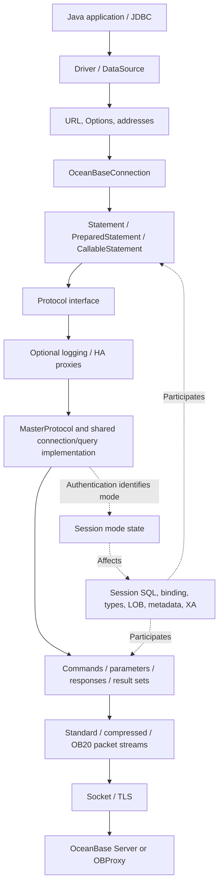

# OBConnector/J Source Structure and Feature Outline

This document analyzes the Java driver's actual structure, features and compatibility-mode branches as input to the original OceanBase Go driver design. Module numbers are logical reading/discussion groups, not claims that Java source is fully isolated along these boundaries. This historical analysis does not establish .NET implementation or support.

## 1. Analysis Baseline and Terminology

| Item | Baseline |
| --- | --- |
| Analysis date | 2026-10-16 |
| Java repository | [oceanbase/obconnector-j](https://github.com/oceanbase/obconnector-j) |
| Java branch | `master` |
| Java commit | `6adc311ba5db8b2f19f98f3e6e4734667fdfdda1`, message `push v2.4.14` |
| Maven coordinates | `com.oceanbase:oceanbase-client:2.4.14` |
| Public specification | JDBC 4.2, Java 8 compilation target |
| Source history | README describes MariaDB Connector/J origins with OceanBase protocol support/improvements |
| Original deliverable | Source-analysis document in the original Go repository's `docs` directory |
| Validation | Static inspection of source, resource registration, option definitions and representative tests; no Java build or database execution |

Terminology:

- The database product is **OceanBase**; Oracle/MySQL are its **compatibility modes**.
- Oracle compatibility mode means neither native Oracle connections nor delegation to Oracle JDBC.
- MySQL compatibility mode does not mean this project merely wraps another MySQL JDBC driver.
- No PostgreSQL/PG protocol or compatibility-mode implementation was found in this source. Scope is OceanBase Oracle/MySQL modes.
- “Implemented” below means a source path was found, not real-server verification or complete support for every JDBC overload.

Basis: [README][S01], [Maven build][S02].

## 2. Main Structural Conclusions

The driver combines **one JDBC API, shared connection/command protocol infrastructure, OceanBase extensions and distributed compatibility-mode handling**.



The diagram shows principal responsibility dependencies. HA/logging proxies are optional wrappers, not mandatory layers for every connection.

Five points:

1. **Unified entry:** primary entry points remain `com.oceanbase.jdbc.Driver`, `OceanBaseDataSource` and `OceanBaseConnection`.
2. **Shared network foundation:** handshake/commands/responses use MySQL-style packets with OceanBase capability bits, commands, types and OB20 extensions. Oracle mode shares this foundation.
3. **Session-derived mode:** authentication OK contains `OB_SERVER_USE_ORACLE_MODE`, used to set `isOracleMode`. A URL `oracle:` segment is neither an independent Oracle transport nor the final mode authority.
4. **Differences span layers:** checks occur in Connection, Statement, parameters, rows, columns, metadata, LOB and XA. No single dialect module owns every difference.
5. **Separate mode/capability checks:** OB20, full-link tracing and new result metadata require negotiation. PrepareExecute/offset Fetch also require options and OceanBase versions.

Evidence: [connection creation][S05], [protocol factory][S06], [post-auth mode detection][S08], [packet-stream switching][S09], [type mapping][S22].

## 3. Source Layout and Responsibilities

```text
obconnector-j/
├── pom.xml                         Single Maven jar project
├── README.md / LICENSE             Project, build and licensing
└── src/
    ├── main/
    │   ├── java/
    │   │   ├── com/oceanbase/jdbc/
    │   │   │   ├── top-level classes JDBC API, Connection, Statement, ResultSet, LOB, XA
    │   │   │   ├── authentication/   Authentication plugin interfaces/loading
    │   │   │   ├── credential/       Credential sources/plugins
    │   │   │   ├── tls/              TLS plugin interfaces/loading
    │   │   │   ├── extend/datatype/  Oracle-mode extended types
    │   │   │   ├── util/             Options, defaults, SQL, CRC, SocketFactory
    │   │   │   ├── jdbc2/optional/   XA adapters retaining older MySQL names
    │   │   │   └── internal/
    │   │   │       ├── protocol/     Connection/query/master-replica protocols/capabilities
    │   │   │       │   ├── flt/      OB20, extra information, full-link tracing
    │   │   │       │   └── tls/      Default TLS, certificate/hostname validation
    │   │   │       ├── com/          Commands, packet send/read, parameters/results/rows
    │   │   │       ├── io/           Packet streams, buffers, socket adapters
    │   │   │       ├── failover/     Proxies, listeners, selection, blacklist, recovery
    │   │   │       ├── logging/      Logging interfaces/protocol proxies
    │   │   │       ├── util/         SQL parsing, cache, errors, scheduling, pools
    │   │   │       └── osgi/         OSGi JDBC registration/factories
    │   │   └── com/alipay/oceanbase/  Historical Driver package entry
    │   └── resources/
    │       ├── META-INF/services/    JDBC/authentication/credential/TLS SPI registrations
    │       └── oceanbase.properties Build-filtered version information
    └── test/
        ├── java/com/oceanbase/jdbc/  Both-mode feature and failover tests
        └── resources/               Test connections, charset/timezone/SSL fixtures
```

`internal/com` means protocol command/communication code. `flt` contains OB20 structures and full-link tracing; directory names alone do not describe its entire responsibility.

## 4. Feature Modules

### M01. Driver Entry and Unified API

**Responsibility:** expose OceanBase through standard JDBC with a few OceanBase extensions.

- `Driver`: registration, URL acceptance, connection creation and driver-property information.
- `OceanBaseDataSource`: ordinary/XA source entry.
- `OceanBasePoolDataSource`: pooled connections.
- `OceanBaseConnection`, `OceanBaseStatement`, Prepared/CallableStatement classes: unified operation objects.
- `ObConnection`, `ObPrepareStatement`, `ObResultSet`, `ObArray`, `ObStruct`: extensions beyond standard JDBC.
- Historical `com.alipay.oceanbase...Driver`, `MysqlConnection` and `JDBC4*` reflect API evolution, not separate database products.

**Mode boundary:** unified entry points decide mode behavior internally. `ObPrepareStatement` exposes INTERVAL/TIMESTAMP WITH TIME ZONE bindings.

Evidence: [Driver][S03], [data source][S04], [extended PreparedStatement][S32].

### M02. URLs, Options and Addresses

**Responsibility:** convert connection strings/Properties into configuration, credential sources and candidates.

- `UrlParser`: `jdbc:oceanbase:`, database, parameters and HA mode.
- `HostAddress`: hosts/ports/address types, multihost and IPv6 parsing.
- `Options`: actual connection options.
- `DefaultOptions`: names/defaults/descriptions/parsing/post-processing.
- Sources include URL host lists, loadbalance extensions, TNS service names and OCP API.
- `ConfigParser`/`TnsDaemon`: extension parsing/cache/TNS file changes. OCP uses HTTP/cache intervals.

**Mode boundary:** URL `oracle:` receives special HA parsing compatibility treatment; runtime mode still comes from server responses. `compatibleOjdbcVersion=6/8`/`compatibleMysqlVersion=5/8` select JDBC client behavior compatibility, not server versions.

Evidence: [URL parser][S07], [Options][S33], [DefaultOptions][S34], [discovery][S29].

### M03. Network, TLS, Authentication and Credentials

**Responsibility:** establish channels/security/authentication and packet I/O infrastructure.

- `internal/io/socket`: TCP, Unix Domain Socket, Windows Named Pipe, Shared Memory and OBProxy VC Socket adapters.
- `PacketInputStream`/`PacketOutputStream`: standard, compressed/decompressed and OB20 implementations.
- `Buffer`/streams: basic protocol values, length encoding, packet boundaries/sequences.
- `AuthenticationPlugin`: negotiation/switching. SPI registers native password, SHA-256, caching SHA-2, clear/old password, Ed25519, GSSAPI and PAM.
- `CredentialPlugin`: sources beyond connection options, including environment/system properties.
- `TlsSocketPlugin`: TLS extensions; defaults support certificates/keys/hostname validation.

**Mode boundary:** both modes share transport/authentication. Plugin existence/registration does not establish support in all OceanBase deployments.

Evidence: [SPI resources][S35], [connection protocol][S08], [stream selection][S09], [OB20 read/checksum][S10].

### M04. Handshake, Mode Detection and Capability Negotiation

**Responsibility:** establish physical-session server information, mode and available capabilities.

- `ReadInitialHandShakePacket`: protocol/server versions, connection ID, charset, status, capabilities and authentication.
- `SendHandshakeResponsePacket`: client capabilities/authentication/database/attributes.
- `OceanBaseCapabilityFlag`: general/OceanBase capability bits.
- `AbstractConnectProtocol.authenticationHandler()`: switches/errors/OK/session-state processing.
- Authentication OK's `OB_SERVER_USE_ORACLE_MODE` sets protocol mode.
- `ob_capability_flag` negotiates OB20/full-link tracing/ExtraInfo; `__ob_client_capability_flag` negotiates new result metadata.
- After negotiation, select streams and run session initialization queries.

**Keep distinct:** mode, server version, negotiated capabilities and requested options. They reference each other but mean different things.

Evidence: [handshake parser][S11], [response][S12], [mode detection][S08], [capability/version gates][S13].

### M05. Connections, Sessions and Local Transactions

**Responsibility:** connection lifecycle, settings and transaction state.

- Creation/close/validity/Ping/network timeout/cancellation.
- autocommit, commit, rollback, savepoints, isolation and read-only state.
- Current database/catalog/schema/user/attributes/server variables/charset/timezone.
- OK-derived server/transaction/session-state tracking.
- `ConnectionState` identifies settings to restore; pool returns/failover require cleanup or synchronization.
- Query cancellation can create an auxiliary connection and issue `KILL QUERY <connectionId>`.

**Mode boundary:** catalog/schema semantics, initialization SQL, NCHAR charset, some read-only/isolation handling and savepoints branch by mode. Oracle `getCatalog()` returns null and `setCatalog()` does not run MySQL database-switching logic.

Evidence: [Connection mode branches][S14], [initialization][S15], [cancellation][S16].

### M06. SQL Execution and Prepared Statements

**Responsibility:** ordinary SQL, client preparation and server preparation.

- `OceanBaseStatement`: shared SQL/results/batch/timeout/cancellation behavior.
- `BasePrepareStatement`: shared parameter-setting foundation.
- `ClientSidePreparedStatement → JDBC4PreparedStatement → BasePrepareStatement`: client parsing and text-protocol sending.
- `ServerSidePreparedStatement → JDBC4ServerPreparedStatement → BasePrepareStatement`: server IDs/types/execution/cache/release.
- `ComQuery`, `ComStmtPrepare`, `ComStmtExecute`, `ComStmtFetch`: command packets.
- `ComStmtPrepareExecute`: OceanBase combined prepare/execute extension.

**Mode boundary:** Oracle allows anonymous blocks through server preparation; MySQL checks preparable SQL types. `emulateUnsupportedPstmts` controls client fallback after unsupported server preparation; connection errors are not swallowed as ordinary downgrade failures.

Source prerequisites for `COM_STMT_PREPARE_EXECUTE` include Oracle mode, `useOraclePrepareExecute` and OceanBase `>=2.2.76`. A command constant alone is insufficient.

Evidence: [prepare selection][S17], [query protocol][S18], [extension command][S19], [gates][S13].

### M07. Parameters, SQL Lexing and Batch Execution

**Responsibility:** parameter positions/types/encoding and repeated execution.

- `ParameterHolder`: text/binary writes, type/NULL/long-data contracts.
- `internal/com/send/parameters`: basic and `OB*Parameter` encoders.
- `ClientPrepareResult`: placeholders/strings/quotes/comments/backslashes/batch-rewritable SQL.
- `Utils.nativeSql()`: JDBC escapes and SQL-string handling.
- Oracle `:name` binding/index handling is more than string replacement.
- Batch paths include sequential execution, SQL rewriting, multiple packets, bulk and conditional Oracle array binding.
- Type headers, NULL bitmaps, statement checksums, counts and size limits are execution protocol concerns.

**Mode boundary:** quote/escape rules, names, time/character encoding and long uploads differ. MySQL uses LONG_DATA; Oracle has PIECE_DATA with option prerequisites.

**Scope boundary:** lexing serves binding/protocol needs, not arbitrary Oracle/MySQL business SQL translation. Array binding depends on autocommit/preparation/other batch options and is not universally available.

Evidence: [parameter contract][S20], [placeholder parser][S21], [query/long uploads][S18], [server statements/batches][S36].

### M08. Responses, Results and Cursors

**Responsibility:** organize rows/update counts/generated keys/multiple results.

- `AbstractQueryProtocol`: OK/ERR/LOCAL INFILE/result dispatch, multi-results and state.
- `Results`: execution/batch counts/generated keys/callable results.
- `ColumnDefinition`: server column types/attributes needed for decoding.
- `JDBC4ResultSet`/`SelectResultSet`: reads/access/cache/streaming.
- `TextRowProtocol`/`BinaryRowProtocol`: row decoding.
- `CursorResultSet`/`RefCursor`: server/procedure-returned cursors.
- `UpdatableResultSet`/`SensitiveCursorResultSet`: conditional updateable/sensitive paths.

**Mode boundary:** cursor eligibility/fetch/outputs/DML returning/type conversions differ. Offset Fetch requires Oracle, server preparation, options and version gates.

**Lifetime boundary:** streams/cursors depend on original sessions; unread results, next commands, result close and statement release must coordinate.

Evidence: [dispatch][S23], [Results][S24], [result implementation][S25], [cursors][S26].

### M09. Types, Charsets and Time

**Responsibility:** convert wire types/mode semantics/Java values.

- `ColumnType`: codes/JDBC types/return class names/mode mappings.
- `ColumnDefinition`: charset/length/precision/scale/signedness.
- Parameters encode; `TextRowProtocol`/`BinaryRowProtocol` decode.
- Basics: signed/unsigned integers, floating/exact numerics, strings, binary and dates/times.
- MySQL: YEAR/JSON/BIT/BLOB-TEXT/zero dates and conversion options.
- Oracle: NUMBER/NUMBER_FLOAT/BINARY_FLOAT-DOUBLE/RAW/ROWID/NCHAR-NVARCHAR2/INTERVAL/TIMESTAMP-TZ-LTZ/LOB/complex/CURSOR.
- `extend/datatype` supplies extended values/conversions; time also depends on session charset/timezone.

**Key evidence:** the same code can mean different types by mode; code 3 maps to INTEGER or NUMBER. A shared context-free code table cannot express driver behavior.

**Design input:** explicitly define exact-number, timezone/nanosecond, NULL/empty and character/byte-length round trips rather than merely listing supported type names.

Evidence: [mode type mappings][S22], [text rows][S37], [binary rows][S38], [extended types][S39].

### M10. LOB and Complex Types

**Responsibility:** large objects/collections/structures beyond ordinary scalars.

- `Lob`, `Blob`, `Clob`, `JDBC4NClob`: memory/stream reads/writes/free.
- `Lob.java`: Locator V1/V2 structures/parsers, possibly retaining original connections/server location.
- `BlobFromLocator`: location-based large-object reads.
- `ObArray`/`ArrayImpl`, `ObStruct`/`StructImpl`, `ComplexDataType`: collections/structures/metadata.
- `OceanBaseConnection` queries Oracle ALL_TYPES/ALL_COLL_TYPES/ALL_TYPE_ATTRS to build/cache descriptors.
- Parameters/rows transfer arrays/structures/LOBs; some access adds SQL/protocol round trips.

**Mode boundary:** Oracle locators/empty LOBs/character LOBs/complex types differ from ordinary MySQL binary/text; do not collapse everything into byte arrays.

**Lifetime boundary:** objects may continue using connections. Validity, transactions and close behavior are part of support.

Evidence: [LOB/locators][S27], [complex queries/construction][S28].

### M11. Database, Result and Parameter Metadata

**Responsibility:** database structure and result/parameter descriptions.

- Actual hierarchy: `OceanBaseDatabaseMetaData → JDBC4DatabaseMetaData → OceanBaseOracleDatabaseMetadata`.
- JDBC4 methods check mode and delegate Oracle behavior to the parent.
- Oracle queries its dictionaries; MySQL uses SHOW/INFORMATION_SCHEMA.
- `OceanBaseResultSetMetaData`: names/types/precision/length/nullability.
- `OceanBaseParameterMetaData`, `SimpleParameterMetaData`, callable metadata: types/directions.

**Mode boundary:** catalog/schema/identifier-case rules/type names/precision/length/table-column-key-procedure SQL differ.

**Reading caution:** JDBC4/Oracle Metadata class names do not establish product-specific scope; follow method branches.

Evidence: [metadata dispatch][S30], [Oracle metadata][S31].

### M12. Multiple Addresses, Balancing and Failover

**Responsibility:** target selection/fault detection/reconnection/execution state.

- `HaMode`: NONE, SEQUENTIAL, LOADBALANCE, REPLICATION, AURORA.
- `Utils.retrieveProxy()`: ordinary MasterProtocol or FailoverProxy+Listener by HA mode.
- `MastersFailoverListener`, `MastersSlavesListener`, `AuroraListener`: topology policies.
- `LoadBalanceDriver`, address groups/strategies: random/round-robin/server affinity/group selection.
- Blacklists: insertion/retry counts/windows/expiry.
- `FailoverLoop`/`ConnectionValidator`: recovery/checks.
- Address sources: explicit lists/extensions/TNS/OCP.
- Reconnect synchronizes settings/reprepares statements/decides permissible reexecution.

**Mode boundary:** HA is not compatibility mode. Retained AURORA/REPLICATION topologies were not validated for specific OceanBase deployments.

**Transaction boundary:** source tracks pre-fault transaction state and can throw `ReconnectDuringTransactionException`; not every failed operation transparently retries.

Evidence: [HA creation][S06], [faults/address selection][S40], [proxy dispatch][S41], [balancing][S42].

### M13. Built-in Pooling and Reuse

**Responsibility:** physical-connection limits/checkout-return/idle cleanup/validation/events.

- `OceanBasePoolDataSource`/`OceanBasePooledConnection`: Java pooling and connection/statement events.
- `Pools`/`Pool`: registry/acquisition/min-max size/idle/lifetime.
- `GlobalStateInfo`: reusable server-global initialization information.
- JMX/metrics/scheduler threads are Java operational infrastructure.
- Returns must reset/restore state, not merely put sockets into a collection.

**Original Go design mapping:** `database/sql` owns pooling; drivers reset/check/clean resources. The original Go design reference `go-driver-architecture-design.md` §12 is not included in this repository. Java's built-in pool does not justify a second Go pool.

Evidence: [pool implementation][S43], [pooled events][S44].

### M14. XA Distributed Transactions

**Responsibility:** Java XA interfaces and branch start/end/prepare/commit/rollback/recovery.

- `OceanBaseXaConnection`, `OceanBaseXaResource`, `OceanBaseXid`: XA object model.
- MySQL uses XA START/END/PREPARE/COMMIT/ROLLBACK/RECOVER.
- Oracle uses DBMS_XA, XID structures and procedure/function calls.
- Historical jdbc2/optional classes provide compatibility entries.

**Mode boundary:** XA public interfaces are unified, but commands/XID representations differ substantially and depend on complex types/procedure parameters.

**Original Go scope:** complete adaptation includes XA on pinned `sql.Conn` with explicit operations. Original `go-driver-architecture-design.md` §16.2 covers mode commands/flags/recovery/failure boundaries; that Go design reference is absent here. Dependency order does not reduce scope.

Evidence: [both XA modes][S45].

### M15. Logging, Diagnostics, Checksums and Full-link Tracing

**Responsibility:** execution observation/protocol diagnostics/OceanBase tracing.

- `Logger`/`LoggerFactory`/SLF4J/no-op implementations: internal logs.
- `ProtocolLoggingProxy`: SQL profiling/slow-query protocol records.
- `LruTraceCache`, packet debug, `TimeTrace`: protocol/time diagnostics.
- `ErrorPacket`/`ExceptionFactory`: codes/SQLState/exception types/connection context.
- `OceanBaseProtocolV20`/`FullLinkTrace`: extra information/trace-span/control data.
- OB20 input validates magic/version/request ID/sequence/length/checksums; output generates matching headers/checksum fields.

**Capability boundary:** full-link tracing requires OB20/negotiation. SQL logs, slow-query logs and packet debugging are separate facilities.

Evidence: [OB20 structures][S46], [input validation][S10], [exception mapping][S47].

### M16. Build, SPI, Tests and Java Integration

**Responsibility:** build/release/runtime discovery/behavior checks.

- Single-module Maven packaging, Java 8 target and resource version.
- `META-INF/services/java.sql.Driver` registers the main driver; authentication/credentials/TLS use separate SPI.
- JNA/Windows authentication/logging include optional/provided dependencies. POM `ojdbc8` is test-only, not runtime delegation for Oracle-mode connections.
- OSGi DataSourceFactory/JMX/legacy packages are Java integration features.
- JUnit covers modes/types/execution/faults, with performance-related test dependencies.
- Some methods explicitly reject capabilities, including certain ResultSet type mappings/REF/SQLXML. “JDBC 4.2 compatible” does not mean every JDBC API works.

Evidence: [POM][S02], [SPI][S35], [ResultSet limits][S48].

## 5. Four Main Call Chains

### 5.1 Connection and Mode Detection

```text
Driver.connect(url, properties) / DataSource.getConnection()
  → UrlParser.parse() → Options + credentials + address/discovery configuration
  → OceanBaseConnection.newConnection()
  → Optional Pool; otherwise Utils.retrieveProxy()
  → Ordinary protocol, or HA proxy/Listener address selection
  → Socket creation and initial handshake read
  → Optional TLS; handshake response and authentication
  → Mode detection from authentication OK status
  → OceanBase capabilities; standard/compressed/OB20 stream selection
  → Session/charset/timezone/server initialization
  → Unified OceanBaseConnection returned
```

Pooling reuses physical connections; application Connection acquisition is not synonymous with a new handshake.

### 5.2 Ordinary SQL and Client Preparation

```text
Statement or client PreparedStatement
  → JDBC escapes / parameter positions as needed
  → Client preparation: ParameterHolder writes mode-specific text values
  → Protocol.executeQuery() / COM_QUERY
  → Selected packet stream sends
  → OK / ERR / results / subsequent results parsed
  → Text rows and column types convert values
  → Rows, update counts or generated keys returned
```

Client preparation has no server statement ID. Its escapes/cache/long uploads must not be conflated with server preparation.

### 5.3 Server Preparation and Oracle Extension Execution

```text
Connection.prepareStatement()
  → Select server preparation by options/mode/SQL
  → Standard: COM_STMT_PREPARE → statement ID + parameter/column definitions
  → Bind: type headers + NULL bitmap + encoded values + required long data
  → COM_STMT_EXECUTE
  → Or eligible COM_STMT_PREPARE_EXECUTE extension
  → Result reading, binary conversions or cursor Fetch
  → Statement close/cache; failover may require repreparation
```

Statement IDs belong to physical sessions and cannot be reused directly on another connection.

### 5.4 Procedures, OUT Parameters and RETURNING

```text
Connection.prepareCall() / Oracle anonymous block
  → Function/procedure Statement
  → IN / OUT / INOUT and required metadata
  → Standard/extended execution
  → Ordinary results + callable OUT + optional REF CURSOR
  → Application reads outputs or continues Fetch
```

Oracle DML `RETURNING ... INTO ...` and named-column generated keys have dedicated SQL/parameter handling. Relevant server-prepared interfaces require `useOraclePrepareExecute=true`. Record these separately from ordinary query rows.

## 6. Compatibility-mode Differences

| Dimension | Shared | MySQL mode | Oracle mode |
| --- | --- | --- | --- |
| Entry | Driver/DataSource/Connection | Same entry | Same entry |
| Communication | Socket/TLS/streams/protocol | MySQL-style commands/types | Shared foundation plus OceanBase Oracle extensions |
| Mode state | Physical-session protocol state | Non-Oracle branch | Authentication OK bit |
| Initialization | Settings/charset/version/timezone | Variables/database | Oracle SQL/NCHAR/NLS |
| Namespace | Connection/Metadata | database/catalog | schema/user/dictionaries |
| Parameters | Positions/NULL/types/encoding | `?`/escape rules | `?`/named binds/different escapes |
| Server prepare | IDs/cache/close | Standard prepare-execute | Standard plus conditional PrepareExecute |
| Long data | Streams/chunks | LONG_DATA | Conditional PIECE_DATA |
| Batches | Counts/errors/boundaries | Rewrite/multisend/bulk | Rewrite/conditional arrays |
| Numerics | Types/precision/signedness | Integers/DECIMAL/FLOAT-DOUBLE | NUMBER/NUMBER_FLOAT/BINARY_FLOAT-DOUBLE |
| Dates/time | Session zone/conversion | DATE/TIME/DATETIME/TIMESTAMP/YEAR/zero options | DATE mapping/nanoseconds/TZ-LTZ/INTERVAL |
| Characters | Encoding/definitions/byte-character lengths | Charsets/collations | Additional NCHAR/NVARCHAR2 encoding |
| LOB | Blob/Clob/streams | Binary/text/related locators | Oracle/empty LOB/Locator V1-V2 |
| Complex | Extensions/descriptors | No Oracle-equivalent path found | STRUCT/ARRAY/collections/dictionaries |
| Cursors/procedures | Result/fetch/parameter interfaces | Procedure-function/cursor conditions | Blocks/OUT/REF CURSOR/extended fetch |
| Keys/returns | APIs/result organization | OK insert ID, etc. | Named columns/RETURNING |
| Catalog metadata | DatabaseMetaData | SHOW/INFORMATION_SCHEMA | Oracle dictionaries/parent methods |
| Local transactions | Connection API/state | Session commands/limits | Savepoint/read-only/isolation branches |
| XA | XAResource/XID operations | XA commands | DBMS_XA/complex XID |
| OB20/tracing | Negotiation/streams | Options/negotiation | Options/negotiation |

This indexes structural differences, not full SQL/server compatibility in either mode.

## 7. Configuration Groups

The original Go design's next step was to discuss public contracts by purpose before deciding whether names should match. These are representative Java options only.

| Group | Representative options |
| --- | --- |
| Connection/transport | `connectTimeout`, `socketTimeout`, `socketFactory`, `localSocket`, `tcpKeepAlive` |
| TLS/credentials | `useSsl`, certificate/key options, `tlsSocketType`, `credentialType`, authentication options |
| Session/encoding | `autocommit`, `sessionVariables`, `characterEncoding`, `nCharacterEncoding`, `serverTimezone` |
| Execution | `useServerPrepStmts`, `emulateUnsupportedPstmts`, `allowMultiQueries`, `useOraclePrepareExecute` |
| Cache/batches | `cachePrepStmts`, `prepStmtCacheSize`, `rewriteBatchedStatements`, `useBatchMultiSend`, `useBulkStmts`, `useArrayBinding` |
| Cursors/large objects | `useCursorFetch`, `defaultFetchSize`, `useCursorOffset`, `usePieceData`, `supportLobLocator`, `useLobLocatorV2` |
| API/conversions | `compatibleOjdbcVersion`, `compatibleMysqlVersion`, `mapDateToTimestamp`, `zeroDateTimeBehavior`, `tinyInt1isBit` |
| Protocol | `useOceanBaseProtocolV20`, `useObChecksum`, `enableOb20Checksum`, `useNewResultSetMetaData` |
| HA/discovery | `autoReconnect`, `loadBalanceStrategy`, `retriesAllDown`, `tnsnamesPath`, `ocpAccessInterval` |
| Pool/observation | `pool`, sizing/idle options, `profileSql`, `slowQueryThresholdNanos`, `enablePacketDebug`, `enableFullLinkTrace` |

Read Options fields, DefaultOptions declarations, post-processing and handshake feedback together; initial fields need not equal effective postconnection values.

## 8. Tests and Validation Limits

| Topic | Representative tests to inspect |
| --- | --- |
| Entry/connections | `DriverOracleTest`, `ConnectionTest`, `ConnectionOracleTest`, `UrlParserTest` |
| Preparation/lexing | `ClientPreparedStatementParsingTest`, `ClientPreparedStatementParsingOracleTest`, `ServerPrepareStatementTest` |
| Extensions/outputs | `OracleCmdPreparedExecuteTest`, `OracleReturningIntoTest`, `ExecuteReturnOracleTest` |
| Types/charset/timezone | `MysqlDataTypeTest`, `OracleDataTypeTest`, `OracleNcharNvarcharTest`, `INTERVALOracleTest`, `SetSessionTimeZoneOracleTest` |
| Results/cursors | `ResultSetOracleTest`, `CursorFetchTest`, `CursorFetchOracleTest`, `RefCursorOracleTest` |
| LOB/complex | `LobLocatorOracleTest`, `OceanBaseBlobOracleTest`, `ComplexOracleTest` |
| Metadata | `DatabaseMetadataTest`, `ResultSetMetaDataOracleTest`, `ParameterMetaDataOracleTest` |
| Protocol/tracing | `ObProtocolV20Test`, `ObProtocolV20OracleTest`, checksum tests |
| HA/pool/XA | `failover/*`, `OceanBasePoolDataSourceTest`, `OceanBaseXaResourceTest`, `OceanbaseOracleXATest` |
| TLS/cancel/timeouts | `SslTest`, `HostnameVerifierImplTest`, `CancelTest`, `TimeoutTest` |

Separate BaseTest/BaseOracleTest infrastructure exists; many tests need external databases/environments. Files indicate intended scenarios only. This review ran no tests and counted no effective assertions, ignored cases or pass rates.

This review checked project/layout, entry points, connection/protocol creation, authenticated mode detection, capability negotiation, main execution/response paths, mode-specific behavior and extension entry points. It did not perform method-by-method defect auditing, performance measurements or full byte-level protocol specification extraction.

## 9. Discussion Order for the Next Design Stage

These are design questions arising from source analysis, not settled Go implementation decisions.

1. **Unified public contract:** database/sql integration, necessary extensions, connection strings and mode representation.
2. **Connection/capability model:** mode/version/negotiation and requested versus effective configuration.
3. **Shared protocol/mode boundaries:** truly shared code versus mode-specific sessions/parameters/types/metadata.
4. **Execution model:** text/client-server preparation/placeholders/names/cancellation/errors.
5. **Round trips:** numeric precision/unsigned values/charsets/NULL-empty/date-time/extensions.
6. **Connection-bound resources:** Rows/cursors/statement IDs/locators/type descriptors/cache lifetimes.
7. **Advanced scope:** procedure/OUT/RETURNING/batch/LOB/OB20/tracing/XA priorities/dependencies.
8. **HA/standard-library boundary:** discovery/selection/reconnect/uncertain transactions and database/sql reuse responsibilities.
9. **Delivery/validation matrix:** target OceanBase/OBProxy versions/modes/execution paths/real-server/fault tests.

Preserve these facts: one driver targets OceanBase; compatibility mode supplies context for session semantics/protocol handling; availability also depends on server versions, negotiated capabilities and options.

## 10. Key Source Index

Links point to upstream source at §1's pinned commit and inspected line numbers. Recheck against a new commit after updates. Paths are relative to that repository's root.

- [S01: README, scope/specification/source history][S01]
- [S02: POM, versions/dependencies/build][S02]
- [S03: Driver.connect][S03]
- [S04: OceanBaseDataSource][S04]
- [S05: OceanBaseConnection.newConnection][S05]
- [S06: Utils.retrieveProxy, protocol/HA creation][S06]
- [S07: UrlParser.parseHaMode, including oracle segment][S07]
- [S08: Authentication OK, mode/capabilities][S08]
- [S09: Standard/compressed/OB20 stream selection][S09]
- [S10: OB20 input structure/checksums][S10]
- [S11: Initial handshake parsing][S11]
- [S12: Handshake response/attributes][S12]
- [S13: PrepareExecute/Fetch mode/version gates][S13]
- [S14: Connection read-only/catalog mode branches][S14]
- [S15: Postconnection initialization][S15]
- [S16: Auxiliary connection cancellation][S16]
- [S17: Client/server PreparedStatement selection][S17]
- [S18: Prepared queries/long parameters][S18]
- [S19: COM_STMT_PREPARE_EXECUTE encoding][S19]
- [S20: ParameterHolder contract][S20]
- [S21: ClientPrepareResult placeholders/lexer][S21]
- [S22: ColumnType mode mappings][S22]
- [S23: Response dispatch/result reads][S23]
- [S24: Results organization][S24]
- [S25: JDBC4ResultSet streaming/row protocol][S25]
- [S26: CursorResultSet prerequisites/Fetch][S26]
- [S27: Lob, Locator V1/V2][S27]
- [S28: Complex queries/construction][S28]
- [S29: TNS/extensions/OCP parsing][S29]
- [S30: JDBC4DatabaseMetaData mode dispatch][S30]
- [S31: Oracle database metadata][S31]
- [S32: ObPrepareStatement extensions][S32]
- [S33: Options fields][S33]
- [S34: DefaultOptions definitions/parsing][S34]
- [S35: SPI resource directory][S35]
- [S36: Server execution/batches/returns][S36]
- [S37: TextRowProtocol][S37]
- [S38: BinaryRowProtocol][S38]
- [S39: Extended types][S39]
- [S40: MastersFailoverListener faults/transactions][S40]
- [S41: FailoverProxy dispatch][S41]
- [S42: LoadBalanceDriver strategies][S42]
- [S43: Pool physical connections][S43]
- [S44: OceanBasePooledConnection events/lifetimes][S44]
- [S45: OceanBaseXaResource mode-specific XA][S45]
- [S46: OceanBaseProtocolV20 structures/extra information][S46]
- [S47: ExceptionFactory mapping][S47]
- [S48: Explicitly unsupported SQLXML ResultSet example][S48]

[S01]: https://github.com/oceanbase/obconnector-j/blob/6adc311ba5db8b2f19f98f3e6e4734667fdfdda1/README.md#L8
[S02]: https://github.com/oceanbase/obconnector-j/blob/6adc311ba5db8b2f19f98f3e6e4734667fdfdda1/pom.xml#L6
[S03]: https://github.com/oceanbase/obconnector-j/blob/6adc311ba5db8b2f19f98f3e6e4734667fdfdda1/src/main/java/com/oceanbase/jdbc/Driver.java#L83
[S04]: https://github.com/oceanbase/obconnector-j/blob/6adc311ba5db8b2f19f98f3e6e4734667fdfdda1/src/main/java/com/oceanbase/jdbc/OceanBaseDataSource.java#L67
[S05]: https://github.com/oceanbase/obconnector-j/blob/6adc311ba5db8b2f19f98f3e6e4734667fdfdda1/src/main/java/com/oceanbase/jdbc/OceanBaseConnection.java#L390
[S06]: https://github.com/oceanbase/obconnector-j/blob/6adc311ba5db8b2f19f98f3e6e4734667fdfdda1/src/main/java/com/oceanbase/jdbc/internal/util/Utils.java#L1426
[S07]: https://github.com/oceanbase/obconnector-j/blob/6adc311ba5db8b2f19f98f3e6e4734667fdfdda1/src/main/java/com/oceanbase/jdbc/UrlParser.java#L301
[S08]: https://github.com/oceanbase/obconnector-j/blob/6adc311ba5db8b2f19f98f3e6e4734667fdfdda1/src/main/java/com/oceanbase/jdbc/internal/protocol/AbstractConnectProtocol.java#L807
[S09]: https://github.com/oceanbase/obconnector-j/blob/6adc311ba5db8b2f19f98f3e6e4734667fdfdda1/src/main/java/com/oceanbase/jdbc/internal/protocol/AbstractConnectProtocol.java#L908
[S10]: https://github.com/oceanbase/obconnector-j/blob/6adc311ba5db8b2f19f98f3e6e4734667fdfdda1/src/main/java/com/oceanbase/jdbc/internal/io/input/Ob20PacketInputStream.java#L147
[S11]: https://github.com/oceanbase/obconnector-j/blob/6adc311ba5db8b2f19f98f3e6e4734667fdfdda1/src/main/java/com/oceanbase/jdbc/internal/com/read/ReadInitialHandShakePacket.java#L85
[S12]: https://github.com/oceanbase/obconnector-j/blob/6adc311ba5db8b2f19f98f3e6e4734667fdfdda1/src/main/java/com/oceanbase/jdbc/internal/com/send/SendHandshakeResponsePacket.java#L363
[S13]: https://github.com/oceanbase/obconnector-j/blob/6adc311ba5db8b2f19f98f3e6e4734667fdfdda1/src/main/java/com/oceanbase/jdbc/internal/protocol/AbstractConnectProtocol.java#L1778
[S14]: https://github.com/oceanbase/obconnector-j/blob/6adc311ba5db8b2f19f98f3e6e4734667fdfdda1/src/main/java/com/oceanbase/jdbc/OceanBaseConnection.java#L1208
[S15]: https://github.com/oceanbase/obconnector-j/blob/6adc311ba5db8b2f19f98f3e6e4734667fdfdda1/src/main/java/com/oceanbase/jdbc/internal/protocol/AbstractConnectProtocol.java#L978
[S16]: https://github.com/oceanbase/obconnector-j/blob/6adc311ba5db8b2f19f98f3e6e4734667fdfdda1/src/main/java/com/oceanbase/jdbc/internal/protocol/AbstractQueryProtocol.java#L1925
[S17]: https://github.com/oceanbase/obconnector-j/blob/6adc311ba5db8b2f19f98f3e6e4734667fdfdda1/src/main/java/com/oceanbase/jdbc/OceanBaseConnection.java#L761
[S18]: https://github.com/oceanbase/obconnector-j/blob/6adc311ba5db8b2f19f98f3e6e4734667fdfdda1/src/main/java/com/oceanbase/jdbc/internal/protocol/AbstractQueryProtocol.java#L470
[S19]: https://github.com/oceanbase/obconnector-j/blob/6adc311ba5db8b2f19f98f3e6e4734667fdfdda1/src/main/java/com/oceanbase/jdbc/internal/com/send/ComStmtPrepareExecute.java#L65
[S20]: https://github.com/oceanbase/obconnector-j/blob/6adc311ba5db8b2f19f98f3e6e4734667fdfdda1/src/main/java/com/oceanbase/jdbc/internal/com/send/parameters/ParameterHolder.java#L57
[S21]: https://github.com/oceanbase/obconnector-j/blob/6adc311ba5db8b2f19f98f3e6e4734667fdfdda1/src/main/java/com/oceanbase/jdbc/internal/util/dao/ClientPrepareResult.java#L94
[S22]: https://github.com/oceanbase/obconnector-j/blob/6adc311ba5db8b2f19f98f3e6e4734667fdfdda1/src/main/java/com/oceanbase/jdbc/internal/ColumnType.java#L67
[S23]: https://github.com/oceanbase/obconnector-j/blob/6adc311ba5db8b2f19f98f3e6e4734667fdfdda1/src/main/java/com/oceanbase/jdbc/internal/protocol/AbstractQueryProtocol.java#L2125
[S24]: https://github.com/oceanbase/obconnector-j/blob/6adc311ba5db8b2f19f98f3e6e4734667fdfdda1/src/main/java/com/oceanbase/jdbc/internal/com/read/dao/Results.java#L70
[S25]: https://github.com/oceanbase/obconnector-j/blob/6adc311ba5db8b2f19f98f3e6e4734667fdfdda1/src/main/java/com/oceanbase/jdbc/JDBC4ResultSet.java#L203
[S26]: https://github.com/oceanbase/obconnector-j/blob/6adc311ba5db8b2f19f98f3e6e4734667fdfdda1/src/main/java/com/oceanbase/jdbc/internal/com/read/resultset/CursorResultSet.java#L55
[S27]: https://github.com/oceanbase/obconnector-j/blob/6adc311ba5db8b2f19f98f3e6e4734667fdfdda1/src/main/java/com/oceanbase/jdbc/Lob.java#L176
[S28]: https://github.com/oceanbase/obconnector-j/blob/6adc311ba5db8b2f19f98f3e6e4734667fdfdda1/src/main/java/com/oceanbase/jdbc/OceanBaseConnection.java#L1954
[S29]: https://github.com/oceanbase/obconnector-j/blob/6adc311ba5db8b2f19f98f3e6e4734667fdfdda1/src/main/java/com/oceanbase/jdbc/internal/failover/utils/ConfigParser.java#L320
[S30]: https://github.com/oceanbase/obconnector-j/blob/6adc311ba5db8b2f19f98f3e6e4734667fdfdda1/src/main/java/com/oceanbase/jdbc/JDBC4DatabaseMetaData.java#L797
[S31]: https://github.com/oceanbase/obconnector-j/blob/6adc311ba5db8b2f19f98f3e6e4734667fdfdda1/src/main/java/com/oceanbase/jdbc/OceanBaseOracleDatabaseMetadata.java#L204
[S32]: https://github.com/oceanbase/obconnector-j/blob/6adc311ba5db8b2f19f98f3e6e4734667fdfdda1/src/main/java/com/oceanbase/jdbc/ObPrepareStatement.java#L54
[S33]: https://github.com/oceanbase/obconnector-j/blob/6adc311ba5db8b2f19f98f3e6e4734667fdfdda1/src/main/java/com/oceanbase/jdbc/util/Options.java#L61
[S34]: https://github.com/oceanbase/obconnector-j/blob/6adc311ba5db8b2f19f98f3e6e4734667fdfdda1/src/main/java/com/oceanbase/jdbc/util/DefaultOptions.java#L61
[S35]: https://github.com/oceanbase/obconnector-j/tree/6adc311ba5db8b2f19f98f3e6e4734667fdfdda1/src/main/resources/META-INF/services
[S36]: https://github.com/oceanbase/obconnector-j/blob/6adc311ba5db8b2f19f98f3e6e4734667fdfdda1/src/main/java/com/oceanbase/jdbc/JDBC4ServerPreparedStatement.java#L710
[S37]: https://github.com/oceanbase/obconnector-j/blob/6adc311ba5db8b2f19f98f3e6e4734667fdfdda1/src/main/java/com/oceanbase/jdbc/internal/com/read/resultset/rowprotocol/TextRowProtocol.java#L78
[S38]: https://github.com/oceanbase/obconnector-j/blob/6adc311ba5db8b2f19f98f3e6e4734667fdfdda1/src/main/java/com/oceanbase/jdbc/internal/com/read/resultset/rowprotocol/BinaryRowProtocol.java#L84
[S39]: https://github.com/oceanbase/obconnector-j/tree/6adc311ba5db8b2f19f98f3e6e4734667fdfdda1/src/main/java/com/oceanbase/jdbc/extend/datatype
[S40]: https://github.com/oceanbase/obconnector-j/blob/6adc311ba5db8b2f19f98f3e6e4734667fdfdda1/src/main/java/com/oceanbase/jdbc/internal/failover/impl/MastersFailoverListener.java#L156
[S41]: https://github.com/oceanbase/obconnector-j/blob/6adc311ba5db8b2f19f98f3e6e4734667fdfdda1/src/main/java/com/oceanbase/jdbc/internal/failover/FailoverProxy.java#L157
[S42]: https://github.com/oceanbase/obconnector-j/blob/6adc311ba5db8b2f19f98f3e6e4734667fdfdda1/src/main/java/com/oceanbase/jdbc/internal/failover/impl/LoadBalanceDriver.java#L100
[S43]: https://github.com/oceanbase/obconnector-j/blob/6adc311ba5db8b2f19f98f3e6e4734667fdfdda1/src/main/java/com/oceanbase/jdbc/internal/util/pool/Pool.java#L116
[S44]: https://github.com/oceanbase/obconnector-j/blob/6adc311ba5db8b2f19f98f3e6e4734667fdfdda1/src/main/java/com/oceanbase/jdbc/OceanBasePooledConnection.java#L75
[S45]: https://github.com/oceanbase/obconnector-j/blob/6adc311ba5db8b2f19f98f3e6e4734667fdfdda1/src/main/java/com/oceanbase/jdbc/OceanBaseXaResource.java#L162
[S46]: https://github.com/oceanbase/obconnector-j/blob/6adc311ba5db8b2f19f98f3e6e4734667fdfdda1/src/main/java/com/oceanbase/jdbc/internal/protocol/flt/OceanBaseProtocolV20.java#L89
[S47]: https://github.com/oceanbase/obconnector-j/blob/6adc311ba5db8b2f19f98f3e6e4734667fdfdda1/src/main/java/com/oceanbase/jdbc/internal/util/exceptions/ExceptionFactory.java#L85
[S48]: https://github.com/oceanbase/obconnector-j/blob/6adc311ba5db8b2f19f98f3e6e4734667fdfdda1/src/main/java/com/oceanbase/jdbc/JDBC4ResultSet.java#L2393
