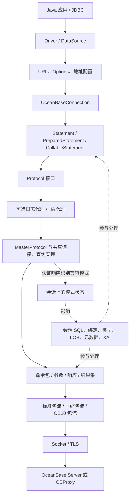

# OBConnector/J 源码结构与功能大纲

本文先梳理 Java 驱动的实际结构、功能和兼容模式分支，作为后续 OceanBase Go 驱动代码设计的输入。本文中的模块编号是阅读和讨论用的逻辑划分，不代表 Java 源码已经按这些模块完全隔离。

## 1. 分析基线与术语

| 项目 | 本次基线 |
| --- | --- |
| 分析日期 | 2026-10-16 |
| Java 源码仓库 | [oceanbase/obconnector-j](https://github.com/oceanbase/obconnector-j) |
| Java 分支 | `master` |
| Java 提交 | `6adc311ba5db8b2f19f98f3e6e4734667fdfdda1`，提交说明 `push v2.4.14` |
| Maven 坐标 | `com.oceanbase:oceanbase-client:2.4.14` |
| 对外规范 | JDBC 4.2，Java 8 编译目标 |
| 源码沿革 | README 说明源自 MariaDB Connector/J，并增加 OceanBase 协议支持与改进 |
| 本轮产物 | 当前 Go 仓库 `docs` 中的源码分析文档 |
| 验证范围 | 静态阅读源码、资源注册、配置定义及代表性测试；未编译 Java 驱动，未连接数据库运行测试 |

术语约定：

- 数据库产品是 **OceanBase**；Oracle、MySQL 是 OceanBase 的**兼容模式**。
- “Oracle 兼容模式”不表示该驱动连接原生 Oracle 数据库，也不表示内部调用 Oracle JDBC 驱动完成连接。
- “MySQL 兼容模式”不表示本项目只是对另一个 MySQL JDBC 驱动的封装。
- 本次源码中未发现 PostgreSQL/PG 协议或 PG 兼容模式实现；这份大纲以 OceanBase 的 Oracle、MySQL 两种兼容模式为范围。
- 后文“存在实现”仅表示找到了相应源码路径，不等于已通过真实服务端验证，更不等于该 JDBC 功能的所有重载均完整支持。

基线依据：[README][S01]、[Maven 构建定义][S02]。

## 2. 最重要的结构结论

该驱动采用 **统一 JDBC API + 共享连接与命令协议骨架 + OceanBase 扩展 + 分散的兼容模式处理**。



这张图表达主要职责依赖；HA 和日志代理是可选包装，不是所有连接都会经过的固定层。

需要明确的五点：

1. **统一入口**：主要入口始终是 `com.oceanbase.jdbc.Driver`、`OceanBaseDataSource` 和 `OceanBaseConnection`。
2. **共享网络骨架**：握手、命令与响应建立在 MySQL 风格的协议包结构上，同时处理 OceanBase 的能力位、命令、类型及 OB20 扩展。Oracle 兼容模式也沿用这套骨架。
3. **模式来自连接会话**：认证成功的 OK 响应包含 `OB_SERVER_USE_ORACLE_MODE` 状态位；驱动据此设置 `isOracleMode`。URL 中可出现的 `oracle:` 段不是独立 Oracle 网络协议实现，也不是最终模式识别的依据。
4. **差异跨越多层**：模式判断出现在 Connection、Statement、参数、行解码、列定义、元数据、LOB 和 XA 中，源码没有一个包揽全部差异的独立 dialect 模块。
5. **模式与能力分开判断**：OB20、完整链路追踪、新结果集元数据等依赖协商；PrepareExecute、带偏移量 Fetch 等还依赖连接选项和 OceanBase 版本。

核心依据：[连接创建][S05]、[协议工厂][S06]、[认证后的模式识别][S08]、[包流切换][S09]、[类型映射][S22]。

## 3. 源码目录与职责

```text
obconnector-j/
├── pom.xml                         单一 Maven jar 工程
├── README.md / LICENSE              项目、构建与许可证说明
└── src/
    ├── main/
    │   ├── java/
    │   │   ├── com/oceanbase/jdbc/
    │   │   │   ├── 顶层类             JDBC API、Connection、Statement、ResultSet、LOB、XA
    │   │   │   ├── authentication/   认证插件接口与加载
    │   │   │   ├── credential/       凭据来源及插件
    │   │   │   ├── tls/              TLS 插件接口与加载
    │   │   │   ├── extend/datatype/  Oracle 兼容模式扩展数据类型
    │   │   │   ├── util/             Options、默认选项、默认 SQL、CRC、SocketFactory
    │   │   │   ├── jdbc2/optional/   旧 MySQL 命名的 XA 适配类
    │   │   │   └── internal/
    │   │   │       ├── protocol/     连接、查询、主从协议与能力位
    │   │   │       │   ├── flt/      OB20、扩展信息、完整链路追踪
    │   │   │       │   └── tls/      TLS 默认实现、证书和主机名校验
    │   │   │       ├── com/          命令常量、发包、读包、参数、结果集与行协议
    │   │   │       ├── io/           包流、缓冲、Socket 适配
    │   │   │       ├── failover/     代理、监听器、选址、黑名单、故障恢复
    │   │   │       ├── logging/      日志接口和协议日志代理
    │   │   │       ├── util/         SQL 解析、缓存、异常、线程调度与连接池
    │   │   │       └── osgi/         OSGi JDBC 注册与工厂
    │   │   └── com/alipay/oceanbase/  历史 Driver 包名入口
    │   └── resources/
    │       ├── META-INF/services/    JDBC、认证、凭据和 TLS 的 SPI 注册
    │       └── oceanbase.properties  构建过滤写入的版本信息
    └── test/
        ├── java/com/oceanbase/jdbc/  两种兼容模式的功能测试及 failover 测试
        └── resources/               测试连接配置、字符集/时区/SSL 等资料
```

这里的 `internal/com` 指协议 command/communication 相关实现；`flt` 名称下同时存在 OB20 协议结构与完整链路追踪代码，不能只按目录名理解其职责。

## 4. 功能模块大纲

### M01. 驱动入口与统一 API

**职责**：让应用通过标准 JDBC 使用 OceanBase，并提供少量 OceanBase 扩展接口。

- `Driver`：驱动注册、URL 接受判断、创建连接、公布驱动参数信息。
- `OceanBaseDataSource`：普通数据源与 XA 数据源入口。
- `OceanBasePoolDataSource`：池化连接入口。
- `OceanBaseConnection`、`OceanBaseStatement` 及各类 Prepared/CallableStatement：统一操作对象。
- `ObConnection`、`ObPrepareStatement`、`ObResultSet`、`ObArray`、`ObStruct`：标准 JDBC 之外的类型或操作扩展。
- 历史 `com.alipay.oceanbase...Driver`、`MysqlConnection`、`JDBC4*` 类体现 Java API 沿革；这些命名不代表分别连接不同数据库产品。

**模式边界**：应用入口统一；接口方法内部再决定兼容模式行为。`ObPrepareStatement` 暴露 INTERVAL、TIMESTAMP WITH TIME ZONE 等绑定扩展。

依据：[Driver][S03]、[数据源][S04]、[扩展 PreparedStatement 接口][S32]。

### M02. URL、选项与地址配置

**职责**：将连接字符串和 Properties 转成连接配置、凭据来源及候选地址。

- `UrlParser`：解析 `jdbc:oceanbase:`、数据库名、参数以及 HA 方式。
- `HostAddress`：主机、端口、地址类型，多主机描述和 IPv6 等地址解析。
- `Options`：实际连接选项集合。
- `DefaultOptions`：选项名、默认值、描述、解析及后处理。
- 地址来源包括 URL 主机列表，以及 loadbalance 下的扩展描述、TNS 服务名和 OCP API。
- `ConfigParser`、`TnsDaemon` 负责扩展地址配置的解析、缓存与 TNS 文件变化检测；OCP 地址获取通过 HTTP 及缓存间隔控制完成。

**模式边界**：URL 的 `oracle:` 段在解析 HA 方式时有特殊兼容处理；运行时模式仍由连接响应识别。`compatibleOjdbcVersion=6/8`、`compatibleMysqlVersion=5/8` 表示对相应 JDBC 客户端行为的兼容选项，不是 OceanBase 服务端版本选择器。

依据：[URL 解析][S07]、[Options][S33]、[DefaultOptions][S34]、[地址发现][S29]。

### M03. 网络传输、TLS、认证与凭据

**职责**：建立底层通道、完成安全连接与认证，并提供包读写基础设施。

- `internal/io/socket`：TCP 及 Unix Domain Socket、Windows Named Pipe、Shared Memory、OBProxy VC Socket 等适配路径。
- `PacketInputStream` / `PacketOutputStream`：包流接口；实现包括标准包流、压缩/解压包流、OB20 包流。
- `Buffer` 与包流实现：协议基础值、长度编码值、包边界和序号等处理。
- `AuthenticationPlugin`：认证协商与切换；SPI 中注册 native password、SHA-256、caching SHA-2、clear password、old password、Ed25519、GSSAPI、PAM 等实现。
- `CredentialPlugin`：连接选项之外的凭据来源，内置环境变量和系统属性来源。
- `TlsSocketPlugin`：TLS Socket 扩展；默认实现配合证书、密钥及主机名校验。

**模式边界**：两种兼容模式复用传输和认证骨架。插件“存在并注册”不等于所有 OceanBase 部署都支持该认证方式。

依据：[SPI 资源][S35]、[连接协议实现][S08]、[包流选择][S09]、[OB20 读取与校验][S10]。

### M04. 握手、兼容模式识别与能力协商

**职责**：建立物理连接对应的服务端信息、兼容模式和可用能力。

- `ReadInitialHandShakePacket`：解析协议版本、服务端版本、连接 ID、字符集、状态、能力及认证信息。
- `SendHandshakeResponsePacket`：发送客户端能力、认证数据、数据库及连接属性。
- `OceanBaseCapabilityFlag`：通用能力位和 OceanBase 扩展能力位。
- `AbstractConnectProtocol.authenticationHandler()`：认证切换、错误处理、OK 响应与 session-state 信息处理。
- 认证 OK 响应中的 `OB_SERVER_USE_ORACLE_MODE` 设置协议对象的模式状态。
- `ob_capability_flag` 参与 OB20、完整链路追踪和 ExtraInfo 的协商；`__ob_client_capability_flag` 参与新结果集元数据能力协商。
- 协商完成后选择包流，并执行连接后的会话初始化查询。

**必须分开的状态**：兼容模式、服务端版本、协商能力、用户请求的选项。源码中这几类状态有交叉引用，但含义不同。

依据：[握手包解析][S11]、[握手响应][S12]、[模式识别][S08]、[能力及版本条件][S13]。

### M05. 连接、会话和本地事务

**职责**：维护连接生命周期、会话设置及事务状态。

- 连接的创建、关闭、有效性检查、Ping、网络超时与取消。
- `autocommit`、commit、rollback、savepoint、事务隔离级别、只读状态。
- 当前 database/catalog/schema、用户、连接属性、服务端变量、字符集与时区。
- 从 OK 响应跟踪服务端状态、事务状态及 session-state 变化。
- 用 `ConnectionState` 标记需要恢复的设置；连接池归还与故障切换都涉及会话清理或同步。
- 取消查询有建立辅助连接并执行 `KILL QUERY <connectionId>` 的实现路径。

**模式边界**：catalog/schema 语义、初始化 SQL、NCHAR 字符集、部分只读与隔离级别处理、保存点行为等均有分支。例如 Oracle 兼容模式下 `getCatalog()` 返回 null，`setCatalog()` 不执行 MySQL 兼容模式的数据库切换路径。

依据：[Connection 的模式分支][S14]、[连接初始化][S15]、[取消查询][S16]。

### M06. SQL 执行与预处理语句

**职责**：提供普通 SQL、客户端预处理和服务端预处理执行路径。

- `OceanBaseStatement`：普通 SQL、执行结果、批量、超时和取消等公共行为。
- `BasePrepareStatement`：参数设置等共享基础。
- `ClientSidePreparedStatement → JDBC4PreparedStatement → BasePrepareStatement`：客户端解析参数并按文本协议发送。
- `ServerSidePreparedStatement → JDBC4ServerPreparedStatement → BasePrepareStatement`：服务端 statement ID、参数类型、执行、缓存与释放。
- `ComQuery`、`ComStmtPrepare`、`ComStmtExecute`、`ComStmtFetch` 等承载对应命令。
- `ComStmtPrepareExecute` 对应 OceanBase 的合并 prepare/execute 扩展命令。

**模式边界**：Oracle 兼容模式允许匿名块等 SQL 进入服务端预处理路径；MySQL 兼容模式有 SQL 可预处理类型判断。服务端预处理失败后是否退回客户端路径受 `emulateUnsupportedPstmts` 控制，连接异常不会被当作普通可降级错误吞掉。

`COM_STMT_PREPARE_EXECUTE` 在源码中的功能条件包括 Oracle 兼容模式、`useOraclePrepareExecute` 和 OceanBase 版本不低于 `2.2.76`；不能只检查命令常量是否存在。

依据：[预处理路径选择][S17]、[查询协议][S18]、[扩展命令][S19]、[能力条件][S13]。

### M07. 参数、SQL 词法处理与批量执行

**职责**：确定参数位置、类型、编码及多次执行方式。

- `ParameterHolder`：提供文本写入、二进制写入、类型、NULL、长数据等共同契约。
- `internal/com/send/parameters`：基础类型参数及 `OB*Parameter` 扩展编码。
- `ClientPrepareResult`：识别占位符、字符串、引号、注释、反斜杠及可批量改写 SQL。
- `Utils.nativeSql()` 等：JDBC escape 和部分 SQL 字符串处理。
- Oracle 兼容模式存在 `:name` 名称绑定及对应索引处理；不是简单对 SQL 做字符串替换。
- 批量路径包括逐项执行、SQL 改写、多发包、bulk 以及特定条件下的 Oracle array binding。
- 参数类型头、NULL bitmap、statement checksum、参数数量与包大小限制属于协议执行的一部分。

**模式边界**：引号/转义规则、名称绑定、时间与字符类型编码、长参数发送方式不同。MySQL 兼容模式长参数走 LONG_DATA 路径；Oracle 兼容模式存在 PIECE_DATA 扩展及选项条件。

**范围边界**：驱动处理绑定和协议需要的 SQL 解析，不是通用的 Oracle/MySQL 业务 SQL 互译器。Array binding 的条件涉及 autocommit、预处理方式和其他批量选项，不能表述为任意批量请求均可启用。

依据：[参数契约][S20]、[占位符解析][S21]、[查询和长参数发送][S18]、[服务端语句及批量执行][S36]。

### M08. 响应、结果集与游标

**职责**：将协议响应整理成查询行、更新计数、生成键及多个结果。

- `AbstractQueryProtocol`：分派 OK、ERR、LOCAL INFILE 和结果集响应，处理多结果与状态变化。
- `Results`：组织执行结果、批量统计、更新计数、生成键及 callable 结果。
- `ColumnDefinition`：解析服务端列描述并保留后续解码需要的类型和属性。
- `JDBC4ResultSet` / `SelectResultSet`：结果读取、数据访问、缓存和流式读取。
- `TextRowProtocol` / `BinaryRowProtocol`：文本行与二进制行解码。
- `CursorResultSet`、`RefCursor`：服务端游标和过程返回游标。
- `UpdatableResultSet`、`SensitiveCursorResultSet` 等：特定条件下的可更新或敏感结果集路径。

**模式边界**：游标启用条件、fetch 命令、返回参数结果、DML returning 以及行类型转换存在差异。带 offset 的 Fetch 在源码中受 Oracle 兼容模式、服务端预处理、选项和版本条件约束。

**生命周期边界**：流式结果和游标依赖原物理连接；未读结果、下一条命令、结果关闭和 statement 释放需要共同协调。

依据：[响应分派][S23]、[Results][S24]、[ResultSet 实现][S25]、[游标][S26]。

### M09. 数据类型、字符集与时间

**职责**：在协议类型、兼容模式语义和 Java 值之间转换。

- `ColumnType`：维护类型码、JDBC 类型、返回类名以及两种兼容模式的映射。
- `ColumnDefinition`：补充字符集、长度、精度、小数位、符号等列属性。
- 参数类完成写入方向；`TextRowProtocol` / `BinaryRowProtocol` 完成读取方向。
- 基础类型包括整数、无符号数、浮点数、精确数值、字符串、二进制、日期时间等。
- MySQL 兼容模式包含 YEAR、JSON、BIT、各类 BLOB/TEXT、零日期及相关转换选项。
- Oracle 兼容模式包含 NUMBER、NUMBER_FLOAT、BINARY_FLOAT/DOUBLE、RAW、ROWID、NCHAR/NVARCHAR2、INTERVAL、TIMESTAMP/TZ/LTZ、LOB、复杂类型和 CURSOR 等。
- `extend/datatype` 提供这些扩展值的表示和转换，时间处理还依赖连接的时区及字符集状态。

**关键证据**：相同协议类型码可因兼容模式而有不同解释，例如类型码 3 在映射中分别出现 `INTEGER` 与 `NUMBER`。因此只共享一个没有模式上下文的类型码表不足以表达该 Java 驱动的行为。

**设计输入**：精确数值、时区/纳秒精度、NULL/空值、字符长度与字节长度都需要单独定义往返语义；不能仅列出“支持某类型”的名称。

依据：[类型枚举及模式映射][S22]、[文本行解码][S37]、[二进制行解码][S38]、[扩展类型目录][S39]。

### M10. LOB 与复杂类型

**职责**：处理不能简单视为普通标量的大对象、集合及结构类型。

- `Lob`、`Blob`、`Clob`、`JDBC4NClob`：内存数据、流式访问、读写和释放。
- `Lob.java` 中包含 Locator V1/V2 结构及解析路径；locator 可能保留原连接和服务端定位信息。
- `BlobFromLocator` 等路径处理按定位信息读取的大对象。
- `ObArray` / `ArrayImpl`、`ObStruct` / `StructImpl`、`ComplexDataType` 等处理集合、结构及其元数据。
- `OceanBaseConnection` 查询 Oracle 兼容模式的 `ALL_TYPES`、`ALL_COLL_TYPES`、`ALL_TYPE_ATTRS` 等信息，建立复杂类型描述并缓存。
- 参数及行协议配合传输数组、结构和 LOB 信息；部分大对象访问涉及额外 SQL 或协议往返。

**模式边界**：Oracle 兼容模式中的 locator、空 LOB、字符 LOB、复杂类型与 MySQL 兼容模式的普通二进制/文本值不能混为一个字节数组处理。

**生命周期边界**：这些对象可能继续使用连接；其有效期、事务关系和关闭行为是功能的一部分。

依据：[LOB 与 locator][S27]、[复杂类型查询与构造][S28]。

### M11. 数据库、结果集与参数元数据

**职责**：提供数据库结构信息及查询结果/参数的描述。

- `OceanBaseDatabaseMetaData` 的实际继承链是 `OceanBaseDatabaseMetaData → JDBC4DatabaseMetaData → OceanBaseOracleDatabaseMetadata`。
- `JDBC4DatabaseMetaData` 中多个方法判断模式；Oracle 兼容模式转给父类中的相应实现。
- Oracle 兼容模式路径查询对应的数据字典视图；MySQL 兼容模式路径使用对应的 SHOW / INFORMATION_SCHEMA 等查询。
- `OceanBaseResultSetMetaData`：列名、类型、精度、长度、可空性等。
- `OceanBaseParameterMetaData`、`SimpleParameterMetaData`、callable 参数元数据：参数类型、输入输出等。

**模式边界**：catalog/schema、标识符规则、大小写、类型名称、精度与长度、表/列/键/过程查询 SQL 均可能不同。

**阅读注意**：不能因为类名是 `JDBC4DatabaseMetaData` 或 Oracle Metadata，就认定该类只对应某一种数据库产品；必须跟到方法内分支。

依据：[数据库元数据分派][S30]、[Oracle 兼容模式元数据][S31]。

### M12. 多地址、负载均衡和故障切换

**职责**：选择连接目标、检测失败、恢复连接，并协调执行状态。

- `HaMode` 包含 NONE、SEQUENTIAL、LOADBALANCE、REPLICATION、AURORA。
- `Utils.retrieveProxy()` 按 HA 方式创建普通 `MasterProtocol` 或 `FailoverProxy + Listener`。
- `MastersFailoverListener`、`MastersSlavesListener`、`AuroraListener` 分别承载相应拓扑策略。
- `LoadBalanceDriver`、地址组和策略类提供随机、轮转、服务器亲和及组选择。
- 黑名单包含加入、重试计数/时间窗口和超时恢复等策略。
- `FailoverLoop`、`ConnectionValidator` 参与恢复和连接检查。
- 地址既可来自显式主机列表，也可来自扩展描述、TNS 或 OCP API。
- 重连涉及会话设置同步、statement 重新 prepare，以及是否允许重新执行某个操作的判断。

**模式边界**：HA 类型不是数据库兼容模式。AURORA、REPLICATION 等是源码中保留的拓扑能力；本次未验证其在 OceanBase 具体部署中的适用性。

**事务边界**：源码会记录故障前是否处于事务中；存在事务中重连抛出 `ReconnectDuringTransactionException` 的路径，并非任意失败操作都透明重试。

依据：[HA 创建][S06]、[故障处理和地址选择][S40]、[代理分派][S41]、[负载均衡策略][S42]。

### M13. 内置连接池与连接复用

**职责**：管理物理连接数量、借还、空闲回收、校验和事件。

- `OceanBasePoolDataSource`、`OceanBasePooledConnection`：Java 池化接口及连接/statement 事件。
- `Pools` / `Pool`：池注册、连接申请、最小/最大连接数、空闲和生命周期管理。
- `GlobalStateInfo`：可复用的服务端全局信息，供新连接初始化使用。
- JMX、池指标与调度线程属于该 Java 实现的运维设施。
- 连接归还后需要重置或恢复会话状态，不能只把 Socket 放回集合。

**Go 设计落点**：连接池交给 `database/sql`，驱动负责 reset、失效检查与资源清理；具体约束见 [Go 架构设计](go-driver-architecture-design.md) §12。Java 内置池的存在不意味着 Go 驱动需要另一套池。

依据：[池实现][S43]、[池化连接事件][S44]。

### M14. XA 分布式事务

**职责**：实现 Java XA 接口以及事务分支的开始、结束、预提交、提交、回滚和恢复。

- `OceanBaseXaConnection`、`OceanBaseXaResource`、`OceanBaseXid` 提供 XA 对象模型。
- MySQL 兼容模式使用 `XA START/END/PREPARE/COMMIT/ROLLBACK/RECOVER` 等命令。
- Oracle 兼容模式使用 `DBMS_XA`、XID 结构及相关过程/函数调用。
- `jdbc2/optional` 下的旧类名提供相应 Java 兼容入口。

**模式边界**：XA 在公共接口层统一，底层命令与 XID 表示差异明显；它也依赖复杂类型和过程参数能力。

**Go 设计范围**：XA 已纳入完整功能适配目标，以固定 `sql.Conn` 和显式 XA 操作承载；两种模式的命令、flags、恢复及失败边界见 [Go 架构设计](go-driver-architecture-design.md) §16.2。实施依赖顺序不缩减此范围。

依据：[XA 的两种模式实现][S45]。

### M15. 日志、诊断、校验和完整链路追踪

**职责**：提供执行观察、协议诊断以及 OceanBase 扩展追踪。

- `Logger`、`LoggerFactory`、SLF4J/无日志实现：内部日志。
- `ProtocolLoggingProxy`：SQL profiling、慢查询等协议调用记录。
- `LruTraceCache`、包调试、`TimeTrace`：协议和时间诊断。
- `ErrorPacket`、`ExceptionFactory`：错误码、SQLState、异常类型和连接上下文。
- `OceanBaseProtocolV20`、`FullLinkTrace`：OB20 扩展信息、trace/span 及相关控制信息。
- OB20 输入流校验 magic、版本、请求 ID、序号、长度和校验和；输出流生成对应包头及校验字段。

**能力边界**：完整链路追踪依赖 OB20 及协商结果；SQL 日志、慢查询日志和包调试是不同设施。

依据：[OB20 协议结构][S46]、[OB20 输入校验][S10]、[异常映射][S47]。

### M16. 构建、SPI、测试及 Java 生态适配

**职责**：构建发布、运行时发现以及行为验证。

- Maven 单模块打包；Java 8 目标，版本写入资源文件。
- `META-INF/services/java.sql.Driver` 注册主要 Driver；认证、凭据及 TLS 使用各自 SPI。
- JNA、Windows 认证和日志等存在可选或 provided 依赖；Oracle `ojdbc8` 在此 POM 中是 test 依赖，不是主驱动连接 Oracle 兼容模式时的运行时转发依赖。
- OSGi DataSourceFactory、JMX、旧包名适配属于 Java 生态能力。
- JUnit 测试按两种兼容模式、数据类型、执行路径和故障场景组织，并包含性能基准相关测试依赖。
- 方法中仍有显式不支持的能力，例如部分 ResultSet 类型映射、REF 和 SQLXML 访问；不能由“JDBC 4.2 compatible”推导所有 JDBC API 均可用。

依据：[POM][S02]、[SPI][S35]、[ResultSet 支持边界][S48]。

## 5. 四条主调用链

### 5.1 建立连接与识别模式

```text
Driver.connect(url, properties) / DataSource.getConnection()
  → UrlParser.parse() → Options + 凭据来源 + 地址/地址发现配置
  → OceanBaseConnection.newConnection()
  → 可选 Pool；否则 Utils.retrieveProxy()
  → 普通协议，或 HA 代理及对应 Listener 选址
  → 建立 Socket，读取初始握手
  → 可选 TLS，发送握手响应并完成认证
  → 从认证 OK 的状态位识别兼容模式
  → 解析 OceanBase 能力信息，选择标准/压缩/OB20 包流
  → 初始化会话、字符集、时区及服务端信息
  → 返回统一的 OceanBaseConnection
```

池化路径会复用已有物理连接，不能把“每次应用获取 Connection”与“每次重新握手”视为同一件事。

### 5.2 普通 SQL 与客户端预处理

```text
Statement，或客户端 PreparedStatement
  → 必要的 JDBC escape / 参数位置解析
  → 客户端预处理时：ParameterHolder 按模式写入文本值
  → Protocol.executeQuery() / COM_QUERY
  → 当前选定的包流发送
  → 解析 OK / ERR / 结果集 / 后续结果
  → 文本行协议与列类型共同完成转换
  → 返回行、更新计数或生成键
```

客户端预处理没有服务端 statement ID；它和服务端预处理的转义、缓存及长参数路径不能混写成一个实现。

### 5.3 服务端预处理与 Oracle 扩展执行

```text
Connection.prepareStatement()
  → 按选项、模式及 SQL 条件选择服务端预处理
  → 标准路径：COM_STMT_PREPARE → statement ID + 参数/列描述
  → 参数绑定：类型头 + NULL bitmap + 编码值 + 必要的长数据
  → COM_STMT_EXECUTE
  → 或满足条件时走 COM_STMT_PREPARE_EXECUTE 扩展
  → 结果读取、二进制行转换或游标 Fetch
  → 关闭 / 缓存 statement；故障切换时可能需要重新 prepare
```

服务端 statement ID 属于物理会话，不能跨物理连接直接复用。

### 5.4 存储过程、OUT 参数与 RETURNING

```text
Connection.prepareCall() / Oracle 兼容模式的匿名块
  → 函数或过程对应 Statement
  → IN / OUT / INOUT 参数及必要元数据
  → 标准或扩展执行路径
  → 普通结果 + callable OUT 结果 + 可选 REF CURSOR
  → 应用读取输出参数或继续 Fetch
```

Oracle 兼容模式的 DML `RETURNING ... INTO ...` 及指定列生成键还有相应 SQL/参数处理；源码中的相关服务端预处理接口要求 `useOraclePrepareExecute=true`。这些能力应与普通查询返回行分别记录。

## 6. 兼容模式差异清单

| 维度 | 共享部分 | MySQL 兼容模式路径 | Oracle 兼容模式路径 |
| --- | --- | --- | --- |
| 驱动入口 | Driver、DataSource、Connection | 同一入口 | 同一入口 |
| 基础通信 | Socket、TLS、包流和协议接口 | MySQL 风格命令/类型语义 | 同一骨架加 OceanBase 的 Oracle 兼容扩展 |
| 模式状态 | 物理连接上的协议状态 | 非 Oracle 分支 | 认证 OK 状态位设置 |
| 初始化 | 会话参数、字符集、版本、时区 | 对应变量及 database 处理 | Oracle 兼容 SQL、NCHAR/NLS 相关处理 |
| 命名空间 | Connection 和 Metadata API | database/catalog 路径 | schema/用户语义及相应字典 |
| SQL 参数 | 位置、NULL、类型与编码 | `?`、对应转义规则 | `?` 及名称绑定处理、不同转义规则 |
| 服务端预处理 | statement ID、缓存、关闭 | 标准 prepare/execute 路径 | 标准路径及有条件的 PrepareExecute 扩展 |
| 长参数 | 流对象与分块发送基础 | LONG_DATA | 有条件的 PIECE_DATA |
| 批量执行 | 批次、计数、异常和边界 | 对应改写、多发包或 bulk 路径 | 对应改写及有条件的 array binding |
| 数值类型 | 类型、精度、符号转换 | 整数、DECIMAL、FLOAT/DOUBLE 等 | NUMBER、NUMBER_FLOAT、BINARY_FLOAT/DOUBLE 等 |
| 日期时间 | 会话时区及时间转换 | DATE/TIME/DATETIME/TIMESTAMP/YEAR、零日期选项 | DATE 映射、纳秒 TIMESTAMP、TZ/LTZ、INTERVAL |
| 字符类型 | 编码、列定义、字符与字节长度 | 对应字符集及 collation | 另含 NCHAR/NVARCHAR2 字符集处理 |
| LOB | Blob/Clob API 与流操作 | 普通二进制/文本及相关 locator 路径 | Oracle LOB、空 LOB、Locator V1/V2 |
| 复杂类型 | 扩展接口和类型描述基础 | 本轮未发现与 Oracle 路径等价的实现 | STRUCT、ARRAY/集合及字典元数据 |
| 游标与过程 | 结果容器、fetch、参数接口 | 对应过程/函数和游标条件 | 匿名块、OUT 参数、REF CURSOR、扩展 fetch |
| 生成键/返回值 | 生成键 API 与结果组织 | OK 响应 insert ID 等 | 指定列及 RETURNING 的专门处理 |
| 数据库元数据 | DatabaseMetaData 接口 | SHOW / INFORMATION_SCHEMA 等 | Oracle 兼容数据字典及父类实现 |
| 本地事务 | Connection 事务入口及状态维护 | 对应会话命令与限制 | 部分保存点、只读/隔离行为分支 |
| XA | XAResource、XID 的公共操作 | XA 命令 | DBMS_XA 及复杂 XID |
| OB20/追踪 | 能力协商与包流设施 | 按协商与选项启用 | 按协商与选项启用 |

该表是结构差异索引，不是两种模式的完整 SQL 或服务端功能兼容性声明。

## 7. 配置能力分组

下一阶段应先按用途讨论公开契约，再决定 Go 是否需要同名配置。以下只列 Java 源码中的代表项。

| 分组 | 代表选项 |
| --- | --- |
| 连接与传输 | `connectTimeout`、`socketTimeout`、`socketFactory`、`localSocket`、`tcpKeepAlive` |
| TLS 与凭据 | `useSsl`、证书/密钥选项、`tlsSocketType`、`credentialType`、认证相关选项 |
| 会话与编码 | `autocommit`、`sessionVariables`、`characterEncoding`、`nCharacterEncoding`、`serverTimezone` |
| 执行方式 | `useServerPrepStmts`、`emulateUnsupportedPstmts`、`allowMultiQueries`、`useOraclePrepareExecute` |
| 缓存与批量 | `cachePrepStmts`、`prepStmtCacheSize`、`rewriteBatchedStatements`、`useBatchMultiSend`、`useBulkStmts`、`useArrayBinding` |
| 游标与大对象 | `useCursorFetch`、`defaultFetchSize`、`useCursorOffset`、`usePieceData`、`supportLobLocator`、`useLobLocatorV2` |
| API 兼容与转换 | `compatibleOjdbcVersion`、`compatibleMysqlVersion`、`mapDateToTimestamp`、`zeroDateTimeBehavior`、`tinyInt1isBit` |
| 协议能力 | `useOceanBaseProtocolV20`、`useObChecksum`、`enableOb20Checksum`、`useNewResultSetMetaData` |
| HA 与地址发现 | `autoReconnect`、`loadBalanceStrategy`、`retriesAllDown`、`tnsnamesPath`、`ocpAccessInterval` |
| 池与观察 | `pool`、池大小/空闲选项、`profileSql`、`slowQueryThresholdNanos`、`enablePacketDebug`、`enableFullLinkTrace` |

源码中的 Options 字段、DefaultOptions 声明、后处理和握手反馈需要联合阅读；某个字段的初始值不一定就是连接建立后的最终生效值。

## 8. 测试结构与本轮验证边界

| 测试主题 | 可继续追踪的代表性测试 |
| --- | --- |
| 入口与连接 | `DriverOracleTest`、`ConnectionTest`、`ConnectionOracleTest`、`UrlParserTest` |
| 预处理与 SQL 解析 | `ClientPreparedStatementParsingTest`、`ClientPreparedStatementParsingOracleTest`、`ServerPrepareStatementTest` |
| 扩展执行与返回参数 | `OracleCmdPreparedExecuteTest`、`OracleReturningIntoTest`、`ExecuteReturnOracleTest` |
| 类型、字符集与时区 | `MysqlDataTypeTest`、`OracleDataTypeTest`、`OracleNcharNvarcharTest`、`INTERVALOracleTest`、`SetSessionTimeZoneOracleTest` |
| 结果集与游标 | `ResultSetOracleTest`、`CursorFetchTest`、`CursorFetchOracleTest`、`RefCursorOracleTest` |
| LOB 与复杂类型 | `LobLocatorOracleTest`、`OceanBaseBlobOracleTest`、`ComplexOracleTest` |
| 元数据 | `DatabaseMetadataTest`、`ResultSetMetaDataOracleTest`、`ParameterMetaDataOracleTest` |
| 协议与追踪 | `ObProtocolV20Test`、`ObProtocolV20OracleTest`、校验相关测试 |
| HA、池、XA | `failover/*`、`OceanBasePoolDataSourceTest`、`OceanBaseXaResourceTest`、`OceanbaseOracleXATest` |
| TLS、取消和超时 | `SslTest`、`HostnameVerifierImplTest`、`CancelTest`、`TimeoutTest` |

测试中可见独立的 `BaseTest`、`BaseOracleTest` 基础设施，且大量功能测试需要外部数据库或其他环境。测试文件存在只表明设计了相应场景；本轮未运行这些测试，也未统计其有效断言、忽略项或通过率。

本轮已核对的范围是：工程与目录结构、驱动入口、连接和协议创建、认证模式识别、能力协商、执行/响应主链、模式差异落点，以及主要扩展模块的实现入口。未进行逐方法缺陷审计、性能测量或完整协议字节规范提取。

## 9. 下一阶段代码设计的讨论顺序

以下是由源码大纲产生的待设计事项，不是已经确定的 Go 代码方案。

1. **统一公开契约**：`database/sql` 接入、扩展 API 的必要范围、连接串与模式呈现方式。
2. **连接和能力模型**：模式识别、版本信息、协商能力、请求配置与生效配置的关系。
3. **共享协议与模式差异边界**：哪些代码真正共享，哪些会话、参数、类型及元数据行为需要模式实现。
4. **执行模型**：文本执行、客户端/服务端预处理、占位符与名称绑定、取消及错误语义。
5. **值的往返契约**：数值精度、无符号数、字符集、NULL/空值、日期时间和扩展类型。
6. **连接相关资源**：Rows、游标、statement ID、LOB locator、复杂类型描述及缓存的生命周期。
7. **高级能力范围**：过程、OUT 参数、RETURNING、批量、LOB、OB20、追踪、XA 的优先级及依赖。
8. **HA 与标准库边界**：地址发现、选址、重连、事务结果不确定性，以及与 `database/sql` 连接复用的职责划分。
9. **交付和验证矩阵**：目标 OceanBase/OBProxy 版本、两种兼容模式、基础执行路径、真实服务端与故障测试。

设计时需要保留的主要事实：同一驱动面向 OceanBase；兼容模式是会话语义和协议处理的上下文；功能可用性还取决于服务端版本、协商能力与连接选项。

## 10. 关键源码索引

以下链接指向第 1 节固定提交的上游源码及核对时的行号；源码更新后需要按新提交重新核对。源码目录均相对于该仓库根目录。

- [S01：README，定位、规范和源码沿革][S01]
- [S02：POM，版本、依赖与构建][S02]
- [S03：Driver.connect][S03]
- [S04：OceanBaseDataSource][S04]
- [S05：OceanBaseConnection.newConnection][S05]
- [S06：Utils.retrieveProxy，协议及 HA 创建][S06]
- [S07：UrlParser.parseHaMode，含 oracle 段处理][S07]
- [S08：认证 OK 与兼容模式/能力识别][S08]
- [S09：标准、压缩与 OB20 包流选择][S09]
- [S10：OB20 输入包结构与校验][S10]
- [S11：初始握手解析][S11]
- [S12：握手响应与连接属性][S12]
- [S13：PrepareExecute、Fetch 的模式/版本条件][S13]
- [S14：Connection 的只读、catalog 等模式分支][S14]
- [S15：连接后的初始化查询][S15]
- [S16：辅助连接取消查询][S16]
- [S17：客户端/服务端 PreparedStatement 选择][S17]
- [S18：预处理查询和长参数处理][S18]
- [S19：COM_STMT_PREPARE_EXECUTE 编码][S19]
- [S20：ParameterHolder 契约][S20]
- [S21：ClientPrepareResult 占位符与词法解析][S21]
- [S22：ColumnType 两种模式的类型映射][S22]
- [S23：响应分派与结果读取][S23]
- [S24：Results 结果组织][S24]
- [S25：JDBC4ResultSet 流式读取与行协议选择][S25]
- [S26：CursorResultSet 的能力条件及 Fetch][S26]
- [S27：Lob、Locator V1/V2][S27]
- [S28：复杂类型查询与构造][S28]
- [S29：TNS、扩展描述与 OCP 配置解析][S29]
- [S30：JDBC4DatabaseMetaData 按模式分派][S30]
- [S31：Oracle 兼容模式数据库元数据][S31]
- [S32：ObPrepareStatement 扩展接口][S32]
- [S33：Options 实际选项][S33]
- [S34：DefaultOptions 定义及解析][S34]
- [S35：SPI 注册资源目录][S35]
- [S36：服务端预处理执行、批量和返回值][S36]
- [S37：TextRowProtocol][S37]
- [S38：BinaryRowProtocol][S38]
- [S39：扩展数据类型目录][S39]
- [S40：MastersFailoverListener 故障和事务处理][S40]
- [S41：FailoverProxy 的方法分派][S41]
- [S42：LoadBalanceDriver 策略构造][S42]
- [S43：Pool 物理连接管理][S43]
- [S44：OceanBasePooledConnection 事件和生命周期][S44]
- [S45：OceanBaseXaResource 两种模式的 XA 路径][S45]
- [S46：OceanBaseProtocolV20 结构与扩展信息][S46]
- [S47：ExceptionFactory 异常映射][S47]
- [S48：ResultSet 中显式不支持的 SQLXML 接口示例][S48]

[S01]: https://github.com/oceanbase/obconnector-j/blob/6adc311ba5db8b2f19f98f3e6e4734667fdfdda1/README.md#L8
[S02]: https://github.com/oceanbase/obconnector-j/blob/6adc311ba5db8b2f19f98f3e6e4734667fdfdda1/pom.xml#L6
[S03]: https://github.com/oceanbase/obconnector-j/blob/6adc311ba5db8b2f19f98f3e6e4734667fdfdda1/src/main/java/com/oceanbase/jdbc/Driver.java#L83
[S04]: https://github.com/oceanbase/obconnector-j/blob/6adc311ba5db8b2f19f98f3e6e4734667fdfdda1/src/main/java/com/oceanbase/jdbc/OceanBaseDataSource.java#L67
[S05]: https://github.com/oceanbase/obconnector-j/blob/6adc311ba5db8b2f19f98f3e6e4734667fdfdda1/src/main/java/com/oceanbase/jdbc/OceanBaseConnection.java#L390
[S06]: https://github.com/oceanbase/obconnector-j/blob/6adc311ba5db8b2f19f98f3e6e4734667fdfdda1/src/main/java/com/oceanbase/jdbc/internal/util/Utils.java#L1426
[S07]: https://github.com/oceanbase/obconnector-j/blob/6adc311ba5db8b2f19f98f3e6e4734667fdfdda1/src/main/java/com/oceanbase/jdbc/UrlParser.java#L301
[S08]: https://github.com/oceanbase/obconnector-j/blob/6adc311ba5db8b2f19f98f3e6e4734667fdfdda1/src/main/java/com/oceanbase/jdbc/internal/protocol/AbstractConnectProtocol.java#L807
[S09]: https://github.com/oceanbase/obconnector-j/blob/6adc311ba5db8b2f19f98f3e6e4734667fdfdda1/src/main/java/com/oceanbase/jdbc/internal/protocol/AbstractConnectProtocol.java#L908
[S10]: https://github.com/oceanbase/obconnector-j/blob/6adc311ba5db8b2f19f98f3e6e4734667fdfdda1/src/main/java/com/oceanbase/jdbc/internal/io/input/Ob20PacketInputStream.java#L147
[S11]: https://github.com/oceanbase/obconnector-j/blob/6adc311ba5db8b2f19f98f3e6e4734667fdfdda1/src/main/java/com/oceanbase/jdbc/internal/com/read/ReadInitialHandShakePacket.java#L85
[S12]: https://github.com/oceanbase/obconnector-j/blob/6adc311ba5db8b2f19f98f3e6e4734667fdfdda1/src/main/java/com/oceanbase/jdbc/internal/com/send/SendHandshakeResponsePacket.java#L363
[S13]: https://github.com/oceanbase/obconnector-j/blob/6adc311ba5db8b2f19f98f3e6e4734667fdfdda1/src/main/java/com/oceanbase/jdbc/internal/protocol/AbstractConnectProtocol.java#L1778
[S14]: https://github.com/oceanbase/obconnector-j/blob/6adc311ba5db8b2f19f98f3e6e4734667fdfdda1/src/main/java/com/oceanbase/jdbc/OceanBaseConnection.java#L1208
[S15]: https://github.com/oceanbase/obconnector-j/blob/6adc311ba5db8b2f19f98f3e6e4734667fdfdda1/src/main/java/com/oceanbase/jdbc/internal/protocol/AbstractConnectProtocol.java#L978
[S16]: https://github.com/oceanbase/obconnector-j/blob/6adc311ba5db8b2f19f98f3e6e4734667fdfdda1/src/main/java/com/oceanbase/jdbc/internal/protocol/AbstractQueryProtocol.java#L1925
[S17]: https://github.com/oceanbase/obconnector-j/blob/6adc311ba5db8b2f19f98f3e6e4734667fdfdda1/src/main/java/com/oceanbase/jdbc/OceanBaseConnection.java#L761
[S18]: https://github.com/oceanbase/obconnector-j/blob/6adc311ba5db8b2f19f98f3e6e4734667fdfdda1/src/main/java/com/oceanbase/jdbc/internal/protocol/AbstractQueryProtocol.java#L470
[S19]: https://github.com/oceanbase/obconnector-j/blob/6adc311ba5db8b2f19f98f3e6e4734667fdfdda1/src/main/java/com/oceanbase/jdbc/internal/com/send/ComStmtPrepareExecute.java#L65
[S20]: https://github.com/oceanbase/obconnector-j/blob/6adc311ba5db8b2f19f98f3e6e4734667fdfdda1/src/main/java/com/oceanbase/jdbc/internal/com/send/parameters/ParameterHolder.java#L57
[S21]: https://github.com/oceanbase/obconnector-j/blob/6adc311ba5db8b2f19f98f3e6e4734667fdfdda1/src/main/java/com/oceanbase/jdbc/internal/util/dao/ClientPrepareResult.java#L94
[S22]: https://github.com/oceanbase/obconnector-j/blob/6adc311ba5db8b2f19f98f3e6e4734667fdfdda1/src/main/java/com/oceanbase/jdbc/internal/ColumnType.java#L67
[S23]: https://github.com/oceanbase/obconnector-j/blob/6adc311ba5db8b2f19f98f3e6e4734667fdfdda1/src/main/java/com/oceanbase/jdbc/internal/protocol/AbstractQueryProtocol.java#L2125
[S24]: https://github.com/oceanbase/obconnector-j/blob/6adc311ba5db8b2f19f98f3e6e4734667fdfdda1/src/main/java/com/oceanbase/jdbc/internal/com/read/dao/Results.java#L70
[S25]: https://github.com/oceanbase/obconnector-j/blob/6adc311ba5db8b2f19f98f3e6e4734667fdfdda1/src/main/java/com/oceanbase/jdbc/JDBC4ResultSet.java#L203
[S26]: https://github.com/oceanbase/obconnector-j/blob/6adc311ba5db8b2f19f98f3e6e4734667fdfdda1/src/main/java/com/oceanbase/jdbc/internal/com/read/resultset/CursorResultSet.java#L55
[S27]: https://github.com/oceanbase/obconnector-j/blob/6adc311ba5db8b2f19f98f3e6e4734667fdfdda1/src/main/java/com/oceanbase/jdbc/Lob.java#L176
[S28]: https://github.com/oceanbase/obconnector-j/blob/6adc311ba5db8b2f19f98f3e6e4734667fdfdda1/src/main/java/com/oceanbase/jdbc/OceanBaseConnection.java#L1954
[S29]: https://github.com/oceanbase/obconnector-j/blob/6adc311ba5db8b2f19f98f3e6e4734667fdfdda1/src/main/java/com/oceanbase/jdbc/internal/failover/utils/ConfigParser.java#L320
[S30]: https://github.com/oceanbase/obconnector-j/blob/6adc311ba5db8b2f19f98f3e6e4734667fdfdda1/src/main/java/com/oceanbase/jdbc/JDBC4DatabaseMetaData.java#L797
[S31]: https://github.com/oceanbase/obconnector-j/blob/6adc311ba5db8b2f19f98f3e6e4734667fdfdda1/src/main/java/com/oceanbase/jdbc/OceanBaseOracleDatabaseMetadata.java#L204
[S32]: https://github.com/oceanbase/obconnector-j/blob/6adc311ba5db8b2f19f98f3e6e4734667fdfdda1/src/main/java/com/oceanbase/jdbc/ObPrepareStatement.java#L54
[S33]: https://github.com/oceanbase/obconnector-j/blob/6adc311ba5db8b2f19f98f3e6e4734667fdfdda1/src/main/java/com/oceanbase/jdbc/util/Options.java#L61
[S34]: https://github.com/oceanbase/obconnector-j/blob/6adc311ba5db8b2f19f98f3e6e4734667fdfdda1/src/main/java/com/oceanbase/jdbc/util/DefaultOptions.java#L61
[S35]: https://github.com/oceanbase/obconnector-j/tree/6adc311ba5db8b2f19f98f3e6e4734667fdfdda1/src/main/resources/META-INF/services
[S36]: https://github.com/oceanbase/obconnector-j/blob/6adc311ba5db8b2f19f98f3e6e4734667fdfdda1/src/main/java/com/oceanbase/jdbc/JDBC4ServerPreparedStatement.java#L710
[S37]: https://github.com/oceanbase/obconnector-j/blob/6adc311ba5db8b2f19f98f3e6e4734667fdfdda1/src/main/java/com/oceanbase/jdbc/internal/com/read/resultset/rowprotocol/TextRowProtocol.java#L78
[S38]: https://github.com/oceanbase/obconnector-j/blob/6adc311ba5db8b2f19f98f3e6e4734667fdfdda1/src/main/java/com/oceanbase/jdbc/internal/com/read/resultset/rowprotocol/BinaryRowProtocol.java#L84
[S39]: https://github.com/oceanbase/obconnector-j/tree/6adc311ba5db8b2f19f98f3e6e4734667fdfdda1/src/main/java/com/oceanbase/jdbc/extend/datatype
[S40]: https://github.com/oceanbase/obconnector-j/blob/6adc311ba5db8b2f19f98f3e6e4734667fdfdda1/src/main/java/com/oceanbase/jdbc/internal/failover/impl/MastersFailoverListener.java#L156
[S41]: https://github.com/oceanbase/obconnector-j/blob/6adc311ba5db8b2f19f98f3e6e4734667fdfdda1/src/main/java/com/oceanbase/jdbc/internal/failover/FailoverProxy.java#L157
[S42]: https://github.com/oceanbase/obconnector-j/blob/6adc311ba5db8b2f19f98f3e6e4734667fdfdda1/src/main/java/com/oceanbase/jdbc/internal/failover/impl/LoadBalanceDriver.java#L100
[S43]: https://github.com/oceanbase/obconnector-j/blob/6adc311ba5db8b2f19f98f3e6e4734667fdfdda1/src/main/java/com/oceanbase/jdbc/internal/util/pool/Pool.java#L116
[S44]: https://github.com/oceanbase/obconnector-j/blob/6adc311ba5db8b2f19f98f3e6e4734667fdfdda1/src/main/java/com/oceanbase/jdbc/OceanBasePooledConnection.java#L75
[S45]: https://github.com/oceanbase/obconnector-j/blob/6adc311ba5db8b2f19f98f3e6e4734667fdfdda1/src/main/java/com/oceanbase/jdbc/OceanBaseXaResource.java#L162
[S46]: https://github.com/oceanbase/obconnector-j/blob/6adc311ba5db8b2f19f98f3e6e4734667fdfdda1/src/main/java/com/oceanbase/jdbc/internal/protocol/flt/OceanBaseProtocolV20.java#L89
[S47]: https://github.com/oceanbase/obconnector-j/blob/6adc311ba5db8b2f19f98f3e6e4734667fdfdda1/src/main/java/com/oceanbase/jdbc/internal/util/exceptions/ExceptionFactory.java#L85
[S48]: https://github.com/oceanbase/obconnector-j/blob/6adc311ba5db8b2f19f98f3e6e4734667fdfdda1/src/main/java/com/oceanbase/jdbc/JDBC4ResultSet.java#L2393
